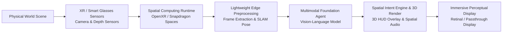

# XR Creator Con (XRCC / Immersive Insiders) — Junction 2026 Partner In-Depth Research Report

## 1. Company & Organization Overview

- **Organization Name**: XR Creator Con (XRCC, founded and organized by the global spatial computing education and developer ecosystem platform **immersive insiders**)
- **Global Headquarters**: Berlin, Germany (Physical summits and global grand finales hosted at CityCube Berlin, backed by an active online developer network spanning 100+ countries).
- **Founding Background**:
  - Founded by internationally renowned extended reality (XR) pioneer, educator, and keynote speaker **Dinesh Punni** (Founder & CEO of Immersive Insiders) and his core team.
  - **Founding Rationale & Industry Chasm**: Immersive Insiders stands as a gold-standard benchmark in spatial computing education and developer upskilling. Collaborating closely with technology giants including Meta, Qualcomm, and Snap, the team recognized a critical industry bottleneck: tech titans were launching revolutionary spatial computing headsets (Meta Quest 3, Apple Vision Pro, Snap Spectacles 5, PICO 4 Ultra), heralding the post-mobile spatial era; yet the developer ecosystem faced an acute shortage of **"builders who combine low-level 3D graphics and physics interactions with environmental perception (Spatial Anchors, Scene Reconstruction) and multimodal generative AI integration."** Most industry conferences were dominated by high-level marketing keynotes without functional software prototypes.
  - To bridge this gap, Dinesh and his team launched **XR Creator Con (XRCC)**, positioned as **"The World's Largest AI and XR / Smart Glasses Hackathon and Creator Summit,"** treating functional interactive software as the sole source of truth and creating a direct bridge between builders, platform leaders, and real-world spatial problems.
- **Industry Standing & Global Footprint**:
  - Globally recognized as the largest, most technically intensive, and most respected vertical hackathon and conference for XR, spatial computing, and wearable AI engineers.
  - **Platform Endorsements & Strategic Partnerships**: Ecosystem partners and sponsors include global spatial computing and silicon leaders such as **Meta (Meta Horizon)**, **Snap Inc. (Spectacles / Lens Studio)**, **Google**, **PICO (ByteDance)**, **Qualcomm (Snapdragon Spaces)**, and **1SP**.
  - Has educated, connected, and empowered thousands of senior spatial computing architects, Unity/Unreal developers, WebGL/WebXR specialists, and 3D interaction designers, serving as the premier talent pipeline for Silicon Valley and European spatial computing engineering teams.

---

## 2. Core Products & Ecosystem Architecture

XRCC is not a mere conference; it is a full-spectrum developer ecosystem combining an elite competitive hackathon, a technology summit, hardware developer sandboxes, and an immersive talent network.

### 2.1 Core Pillars & Ecosystem Matrix

1. **XRCC Global Hackathon Engine**:
   - **Dual-Track Intensive Sprint**: Combines an intensive Online Global Builder Sprint with an invite-only In-Person Grand Finale hosted at CityCube Berlin.
   - **On-Site Hardware Sandbox**: Provides participants with access to millions of euros worth of pre-release and cutting-edge hardware (Snap AR Spectacles, Meta Quest 3/Pro, PICO 4 Ultra Enterprise, Qualcomm Snapdragon XR2 Gen 2 Developer Kits), removing hardware access barriers for indie developers.
   - **Direct Platform Mentorship**: Core engineering architects from Meta, Snap, and Qualcomm provide on-site, hands-on SDK debugging, graphics pipeline profiling, and algorithmic guidance.

2. **XRCC Creator Conference & Technology Expo**:
   - Brings together spatial computing, spatial audio, computer vision, and embodied AI leaders for technical keynotes and panel discussions.
   - Features dedicated Showcase & Indie Arcade spaces where hackathon-born prototypes pitch directly to venture capital funds, angel syndicates, and enterprise innovation executives, turning hackathon prototypes into funded startups.

3. **Immersive Insiders Developer Platform (Education & Talent Engine)**:
   - As XRCC’s founding organization, Immersive Insiders provides an industry-leading practical curriculum:
     - **Unity & Unreal Engine for XR**: Universal Render Pipeline (URP) optimization, OpenXR cross-platform standards.
     - **VisionOS & Spatial Interaction Systems**: Gaze-and-pinch input paradigms, micro-gesture recognition, and spatial ergonomics.
     - **Smart Glasses & Wearables**: Micro-optical engines, ambient sensing, and ultra-low-power edge computing.
     - **Spatial AI Integration**: Coupling lightweight on-device vision-language models (VLMs) with SLAM spatial point clouds.

---

## 3. Vision and Mission

### 3.1 Official Statements

- **Mission**:
  > *"To build and empower the global XR & spatial computing creator community by connecting builders who can actually code and design directly with platform giants and enterprise leaders solving real-world spatial problems."*

- **Vision**:
  > *"To accelerate the global mainstream adoption of spatial computing, smart glasses, and ambient spatial intelligence, shifting the world from flat screens to immersive computing through hands-on builder empowerment."*

### 3.2 Core Philosophy
- **Builders First, Real Prototypes Only**: Rejecting theoretical slide decks; only high-fidelity interactive prototypes running natively on headsets or smart glasses prove the validity of a concept.
- **XR + AI Symbiosis**: Spatial computing provides the ultimate physical and visual canvas for artificial intelligence, while generative AI supplies the real-time reasoning and semantic understanding required to bring immersive 3D worlds to life.
- **Open Standards & Interoperability**: Championing OpenXR and WebXR open standards to dismantle walled gardens and ensure cross-platform longevity.

---

## 4. Category & Classification

- **Primary Category**: Spatial Computing & Extended Reality (XR + AI) Creator Ecosystem
- **Secondary Categories**:
  - Smart Glasses & Wearable Computing Developer Community
  - Global Developer Hackathons & Tech Conferences
  - Immersive Tech Education & Talent Accelerator
  - 3D Spatial UI/UX, WebXR & OpenXR Standards
  - Spatial AI & Contextual Perception Infrastructure

---

## 5. Role at Junction 2026 & Challenge Tracks Prediction

### 5.1 Hackathon Partner Positioning
XRCC acts as the **Spatial Computing & Next-Gen Interface Vanguard** at Junction 2026.
For software engineers traditionally focused on web interfaces, mobile screens, or backend microservices, XRCC prompts a dimensional paradigm shift: expanding their canvas from flat 2D glass to three-dimensional physical space, exploring the intersection of **"AI + Spatial Hardware + Physical World Perception."**

### 5.2 Challenge Tracks Prediction & Potential Prompts

#### Track Concept 1: AI Smart Glasses & Real-World Contextual Co-Pilots
- **Challenge Scope**: Modern smartphones demand heads-down attention, fracturing human engagement with the immediate environment. Participants design an always-on ambient copilot for camera-equipped smart glasses or passthrough MR headsets: contextualizing physical objects, faces, gauges, and signs in the user's field of view to deliver heads-up audio-visual guidance.
- **Use Cases**:
  - Industrial Maintenance: The glasses detect complex machinery or circuitry, overlaying 3D animated maintenance guides and diagnostic readouts directly over physical components.
  - Multilingual Live Accessibility: Real-time translation floating dynamically next to speakers in natural conversational space.
- **Recommended Stack**: Snap Lens Studio / Meta Horizon SDK + WebRTC video ingestion + Gemini 1.5 Flash / GPT-4o multimodal streaming APIs.

#### Track Concept 2: 3D Generative Gaussian Splatting & Digital Twin Reconstruction
- **Challenge Scope**: Traditional 3D scene creation requires months of manual polygon modeling. Teams harness 3D Gaussian Splatting (3DGS) or neural radiance fields (NeRF) to allow users to capture brief smartphone video sweeps of physical spaces and compile them in minutes into navigable, photorealistic digital twins within WebXR or VR headsets.
- **Recommended Stack**: WebXR API / Three.js / Babylon.js + 3DGS real-time WebGL rendering pipelines + spatial anchor alignment.

#### Track Concept 3: Spatial Collaborative Canvas & Ambient AI Workspace
- **Challenge Scope**: Reimagining virtual meetings and brainstorming beyond Zoom grids and Slack channels. Using hand tracking and spatial audio, teams construct an ambient multi-user workspace where documents, architectural models, and AI-generated 3D assets can be anchored in physical conference rooms and synced seamlessly across remote participants.
- **Recommended Stack**: OpenXR standard + Unity URP + Photon Fusion / Normcore real-time state synchronization.

### 5.3 Spatial AI Pipeline Architecture

---

## 6. Official Links & Key Resources

- **XR Creator Con Official Website**: [https://xrcc.events](https://xrcc.events)
- **Immersive Insiders Platform**: [https://immersive-insiders.com](https://immersive-insiders.com)
- **Founder Dinesh Punni Personal Site**: [https://dineshpunni.com](https://dineshpunni.com)
- **XRCC Official LinkedIn**: [https://www.linkedin.com/company/immersive-insiders/](https://www.linkedin.com/company/immersive-insiders/)
- **Immersive Insiders YouTube Channel**: [https://www.youtube.com/@immersiveinsiders](https://www.youtube.com/@immersiveinsiders)
- **Past XRCC Hackathon Devpost Showcase**: [https://devpost.com](https://devpost.com)
- **Dinesh Punni Official X/Twitter**: [https://x.com/dineshpunni](https://x.com/dineshpunni)
