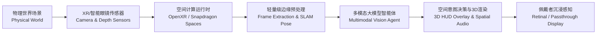

# XR Creator Con (XRCC / Immersive Insiders) — Junction 2026 合作方深度调研报告

## 1. 公司/机构基本概况

- **机构全称**: XR Creator Con (简称 **XRCC**，由全球知名的空间计算教育与开发者生态孵化平台 **immersive insiders** 发起并主办运营)
- **机构总部**: 德国柏林 (Berlin, Germany)（实体峰会与线下全球总决赛常设于柏林 CityCube，同时覆盖全球 100+ 国家和地区的常态化线上开发者网络）
- **创立背景**:
  - XRCC 由国际著名扩展现实（XR）先驱、技术教育家、行业演说家 **Dinesh Punni**（Founder & CEO of Immersive Insiders）及其核心团队联合创立。
  - **初心与产业痛点**: Dinesh Punni 创立的 Immersive Insiders 是全球空间计算与沉浸式技术教育领域的标杆机构。团队在长期与 Meta、Qualcomm、Snap 等平台打交道时深刻洞察到行业的核心断层：各大科技巨头纷纷推出划时代的硬件设备（如 Meta Quest 3、Apple Vision Pro、Snap Spectacles 5、PICO 4 Ultra 等），并宣称空间计算是下一个计算时代；然而在产业落地端，严重匮乏**“既懂得编写复杂 3D 图形与物理交互逻辑，又深刻理解环境感知（Spatial Anchors, Scene Understanding），并能将多模态生成式 AI 深度植入沉浸式硬件的实战型开发者”**。绝大多数行业峰会充斥着浮躁的概念宣讲，缺乏真正能够落地的工业级与消费级原型。
  - 为此，Dinesh 带领团队打造了 **XR Creator Con (XRCC)**，将其定位为**“全球最大、最具实战价值的 XR + AI 与智能眼镜创作者黑客松与峰会（The World's Largest AI and XR / Smart Glasses Hackathon）”**，以“可交互原型（Working Software）”为唯一真理，彻底打通开发者、平台巨头与真实行业痛点之间的直连通道。
- **行业地位与全球影响**:
  - 全球公认规模最大、技术浓度最高、最受一线工程师与技术美术敬重的 XR + 空间计算垂直黑客松与创作者峰会。
  - **顶级科技平台深度背书与赋能**: 官方深度合作伙伴与赞助生态涵盖 **Meta (Meta Horizon 生态)**、**Snap Inc. (Spectacles / Lens Studio)**、**Google**、**PICO (ByteDance)**、**Qualcomm (Snapdragon Spaces)**、**1SP** 等全球芯片与空间操作系统霸主。
  - 累计连接与培养了全球数千名顶尖的空间计算架构师、Unity/Unreal 资深开发者、WebGL/WebXR 极客与 3D 交互设计师，成为硅谷与欧洲科技巨头招募前沿空间计算核心人才的“首要蓄水池”。

---

## 2. 核心产品与业务体系

XRCC 并非单一的会展活动，而是一个集“高规格黑客松竞赛、前沿技术峰会、硬件开发者沙盒与沉浸式技术人才网络”于一体的综合性生态中枢。

### 2.1 主打核心支柱与生态矩阵

1. **XRCC Global Hackathon Engine (全球空间计算极限黑客松赛事体系)**:
   - **双轨高强度赛制**: 采用“全球线上极限构建冲刺（Online Global Builder Sprint） + 柏林 CityCube 线下闭门顶级总决赛（In-Person Grand Finale）”的高规格模式。
   - **硬件真机沙盒 (On-Site Hardware Sandbox)**: 在赛事期间为参赛者提供价值数百万欧元的顶尖未公开发售或最新款硬件设备（如 Snap AR Spectacles、Meta Quest 3/Pro、PICO 4 Ultra 企服版、高通骁龙 XR2 Gen 2 开发者套件等），彻底解决开发者缺少物理测试机型的痛点。
   - **平台架构师直通支持 (Direct Platform Mentorship)**: Meta、Snap、高通等官方资深工程师常驻赛事现场，提供手把手底层 SDK 调试、图形管线调优与算法答疑。

2. **XRCC Creator Conference & Technology Expo (创作者技术峰会与展览)**:
   - 汇聚全球空间计算、空间音频、计算机视觉与具身智能领袖的深度演讲与圆桌论坛。
   - 设有专属的“创作者展位（Showcase & Indie Arcade）”，让黑客松涌现出的优秀项目直接面对全球风险投资机构（VC）、天使投资人与企业级采购高管，助力原型项目直接转化为初创企业。

3. **Immersive Insiders 开发者赋能底座 (Education & Talent Engine)**:
   - 作为 XRCC 的母体，Immersive Insiders 提供了行业最顶尖的系统化实战课程库：
     - **Unity & Unreal Engine for XR**: 深度掌握 Universal Render Pipeline (URP)、OpenXR 标准接口规范。
     - **VisionOS & Spatial Design System**: 空间视线追踪（Eye-tracking）、微手势识别（Micro-gesture）人机交互规范。
     - **Smart Glasses & Wearables**: 专注于微型光学模组、低功耗轻量级计算下的即时感知交互。
     - **Spatial AI Integration**: 将本地轻量级 VLM（视觉多模态大模型）与 SLAM 空间定位数据深度串联。

---

## 3. Vision（愿景）与 Mission（使命）

### 3.1 官方声明

- **Mission (使命)**:
  > *"To build and empower the global XR & spatial computing creator community by connecting builders who can actually code and design directly with platform giants and enterprise leaders solving real-world spatial problems."*
  > （凝聚并全方位赋能全球 XR 与空间计算创作者社区，将真正具备代码编写与前沿 3D 设计实操能力的极客构建者，与正在解决真实物理空间问题的科技平台巨头和行业领军企业直接无缝连接。）

- **Vision (愿景)**:
  > *"To accelerate the global mainstream adoption of spatial computing, smart glasses, and ambient spatial intelligence, shifting the world from flat screens to immersive computing through hands-on builder empowerment."*
  > （加速空间计算、智能眼镜与环境空间智能的全球普及化进程；通过一线极客构建者的亲手创造与实战探索，推动全人类的人机交互从二维扁平玻璃屏幕彻底跃迁至沉浸式三维空间计算新纪元。）

### 3.2 核心价值观与创作者哲学
- **构建者至上，代码说话 (Builders First, Real Prototypes Only)**: 拒绝华而不实的 PPT 叙事，唯有可以在头显或智能眼镜中流畅运行、具备物理真实感的交互原型才能证明未来的存在。
- **空间计算与人工智能的双螺旋演进 (XR + AI Symbiosis)**: 空间计算是人工智能在三维物理世界中最直观的视觉与空间具身载体，而生成式 AI 是让沉浸式三维世界拥有生命、语义与自适应交互的灵魂中枢。
- **生态开放与跨平台互通 (Open Standards & Interoperability)**: 坚持拥抱 OpenXR 与 WebXR 开源开放标准，致力于打破单一硬件围墙花园。

---

## 4. 所属 Category（业务与技术分类）

- **Primary Category**: Spatial Computing & Extended Reality (XR + AI) Creator Ecosystem (空间计算与扩展现实创作者生态)
- **Secondary Categories**:
  - Smart Glasses & Wearable Computing Developer Community (智能眼镜与可穿戴计算开发者社区)
  - Global Developer Hackathons & Tech Conferences (全球开发者黑客松与顶级技术峰会)
  - Immersive Tech Education & Talent Accelerator (沉浸式技术教育与人才加速器)
  - 3D Spatial UI/UX, WebXR & OpenXR Standards (三维空间交互界面与跨平台标准)
  - Spatial AI & Contextual Perception Infrastructure (空间具身智能与情境感知基建)

---

## 5. 在 Junction 黑客松中的角色与赛道挑战预测

### 5.1 黑客松角色定位
XRCC 在 Junction 2026 中扮演了**“下一代人机交互与空间计算先锋（Spatial Computing & Next-Gen Interface Vanguard）”**的关键角色。
对于长期习惯于开发 Web 网页端、移动 App 端或后台 API 的 Junction 开发者而言，XRCC 的加入带来了一场颠覆性的认知升级：引导黑客松选手将视角从冰冷的二维屏幕拓展至 360 度立体的物理现实空间中，探索**“AI + 空间硬件 + 物理世界感知”**的前沿交叉领域。

### 5.2 赛道挑战预测与题目方向

#### 赛道预测 1: AI Smart Glasses & Real-World Contextual Co-Pilots (AI 智能眼镜与现实世界情境伴侣)
- **挑战概述**: 传统的智能手机需要用户低头打字，破坏了用户与现实世界的连接。参赛团队需要针对搭载摄像头与环境传感器的下一代 AR 智能眼镜（或透视 MR 头显 Pass-through 模式），构建一个始终在线的情境智能助手：实时解析佩戴者眼前的物理物体、人脸、指示牌或设备仪器，并通过低延迟轻量级语音与精简的 HUD 虚实融合图层给出即时辅助。
- **典型场景**:
  - 工业设备维修：眼镜识别复杂的电路板或管道阀门，直接在实物上方覆盖 3D 拆装箭头与动态排障步骤。
  - 社交与多语种无障碍：实时识别眼前对话者的外语，并在视野侧边以空间浮动文字呈现同声传译字幕。
- **技术栈建议**: Snap Lens Studio / Meta Horizon SDK + WebRTC 视频流 + Gemini 1.5 Flash / GPT-4o 实时视觉多模态 API。

#### 赛道预测 2: 3D Generative Gaussian Splatting & Digital Twin Reconstruction (XR 中的生成式 3D 高斯泼溅与神经实景重建)
- **挑战概述**: 以往在 XR 中搭建逼真的三维场景需要 3D 建模师耗费数月精细拓扑。参赛团队需要结合最新的 3D Gaussian Splatting (3DGS) 或 NeRF 算法，允许用户只需手持手机环绕真实物体或空间拍摄一段数秒的视频，即可在数分钟内转化为可以在 WebXR 或 VR 头显中自由走动、光影逼真的沉浸式数字孪生空间。
- **技术栈建议**: WebXR API / Three.js / Babylon.js + 3DGS 实时 WebGL 渲染管线 + 空间锚点定位。

#### 赛道预测 3: Spatial Collaborative Canvas & Ambient AI Workspace (空间三维协作画布与自适应智能办公空间)
- **挑战概述**: 彻底颠覆传统的 Zoom 视频会议或 Slack 文字聊天。参赛团队利用自然手势追踪（Hand Tracking）与空间音频（Spatial Audio），构建一个虚实融合的多人空间头脑风暴白板：团队成员可以将 3D 概念模型、PDF 文档、甚至由 AI 即时生成的 3D 物体随意“摆放”在真实会议室的空气中或桌面上，并支持多端空间数据同步。
- **技术栈建议**: OpenXR 标准 + Unity URP + Photon Fusion / Normcore (空间网络同步引擎)。

### 5.3 参赛者架构参考 (Spatial AI Pipeline Architecture)

---

## 6. 官网与关键资源链接

- **XR Creator Con 官方主页**: [https://xrcc.events](https://xrcc.events)
- **Immersive Insiders 官方平台**: [https://immersive-insiders.com](https://immersive-insiders.com)
- **创始人 Dinesh Punni 个人主页与技术分享**: [https://dineshpunni.com](https://dineshpunni.com)
- **XRCC 官方 LinkedIn**: [https://www.linkedin.com/company/immersive-insiders/](https://www.linkedin.com/company/immersive-insiders/)
- **XRCC 官方 YouTube 频道与赛事回顾**: [Immersive Insiders YouTube Channel](https://www.youtube.com/@immersiveinsiders)
- **往届 XRCC Hackathon Devpost 成果库**: [XR Creator Con on Devpost](https://devpost.com)
- **Dinesh Punni 官方 Twitter/X**: [@dineshpunni](https://x.com/dineshpunni)
