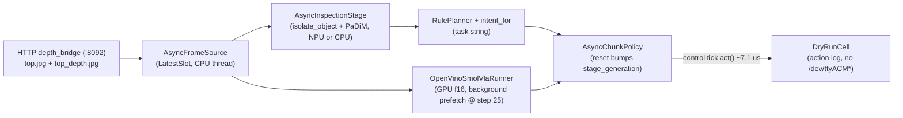

# Async Closed-Loop Inference Pipeline Benchmark (Camera-to-Policy, Hardware-Safe)

Date: 2026-11-15  
Host: Intel Core Ultra X9 388H workstation (`dev2@100.76.18.70`), OpenVINO `2026.4.1` (`CPU`, `GPU`, `NPU`)  
Environment: `~/work/physical-ai-studio/library/.venv/bin/python` (remote profiling); unit suite in local `uv` environment (`tests/test_async_pipeline.py`)  
Precision constraint: Maximum weight quantization reduced by half (**FP32 → FP16** via `compress_to_fp16=True` / `INFERENCE_PRECISION_HINT=f16`; no INT8/INT4)  
Hardware safety boundary: Zero `/dev/ttyACM*` arm connection or motion (`DryRunCell` only); zero exclusive USB `/dev/video*` takeover (reads live `depth_bridge` HTTP streams on `:8092`).

## 1. Objective

Validate an end-to-end **Camera → Crop/Isolate → Anomalib Inspection → RulePlanner/Intent → SmolVLA OpenVINO Action Chunk → `DryRunCell`** pipeline without actuating the physical SO-101 arm, eliminate chunk-boundary stalls via an asynchronous overlapped runtime, verify FP16 vs CPU FP32 numerical parity on real `sort-depth-v2` observations, and measure real multi-device contention (Arc GPU + NPU + CPU) on the target Intel workstation.

## 2. Architecture Implemented

Implementation lives in [`src/defect_sorter/async_pipeline.py`](../../src/defect_sorter/async_pipeline.py) with deterministic offline tests in [`tests/test_async_pipeline.py`](../../tests/test_async_pipeline.py) and the remote profiling harness in [`scripts/hardware_profiling/bench_async_pipeline.py`](../../scripts/hardware_profiling/bench_async_pipeline.py):

- **`LatestSlot[T]`**: Single-slot overwrite mailbox with monotonic `version` counter and `wait_newer(last_version, timeout_s)`. Slow consumers always read the latest frame or inspection decision without backlog buildup.
- **`AsyncFrameSource` + `AsyncInspectionStage`**: Background capture thread polling `depth_bridge` HTTP JPEGs (`fetch_http_jpeg`) into `LatestSlot`, paired with a worker thread waiting on new frames, running `isolate_object` (RGB → BGR → crop → RGB conversion when `crop_fn=None`), `ThresholdInspector`, `RulePlanner`, and `intent_for`.
- **`OpenVinoSmolVlaRunner`**: Loads an OpenVINO IR exported from `sort-depth-v2-10k-candidate`, matches the `manifest.json` contract (`512×512` aspect-preserving padded resize via `resize_with_pad_smolvla`, camera ordering `top_rgb_v2:0, wrist:1, front:2, top_depth_v2:3`, `mean_std` state normalization and `(50, 6)` action chunk denormalization, task newline normalization across pre-tokenized `prompt_tokens.json`).
- **`AsyncChunkPolicy`**: Implements the [`closed_loop.Policy`](../../src/defect_sorter/closed_loop.py) protocol (`reset`, `act`, `done`). Runs synchronous chunk inference on step 0 after `reset`, schedules non-blocking background prefetch at `prefetch_step` (step 25 of 50), swaps atomically at chunk boundaries, and increments a monotonic `stage_generation` counter inside `reset(task)` while draining any in-flight prefetch so old-task actions never leak across a skill transition (`INSPECT_THEN_SORT_PLAN.md`).
- **`DryRunCell`**: Implements the [`closed_loop.Cell`](../../src/defect_sorter/closed_loop.py) protocol (`mode = "dry_run"`) with zero servo access; records applied action vectors and timestamps while leaving `outcome()` unset (`bowl=None, settled=False`).

## 3. Stage A — Graph Fix & FP16 Model Compression

Script: `scripts/hardware_profiling/bench_async_pipeline.py` (results saved locally in ignored `artifacts/async_pipeline_benchmark.json`, total run duration `657.77 s`).

- Folded `2` `Bucketize` ops in the exported `sort-depth-v2-10k-candidate` SmolVLA IR into constant token type IDs (`tile(arange(32))`) so the OpenVINO GPU plugin compiles the graph cleanly.
- Applied `compress_to_fp16=True` (`compress_ir_to_fp16`) to SmolVLA, PaDiM, and PatchCore IRs:

| Model | Variant | `.xml` (bytes) | `.bin` (bytes) | Total (bytes) | `.bin` compression ratio |
| --- | --- | ---: | ---: | ---: | ---: |
| SmolVLA (`sort-depth-v2-10k`) | `smolvla_fp32` | 17,838,951 | 793,591,194 | 811,430,145 | — |
| SmolVLA (`sort-depth-v2-10k`) | `smolvla_fp16` | 18,997,561 | 787,041,810 | 806,039,371 | 1.0083× |
| Anomalib PaDiM (fold 0) | `padim_fp32` | 76,694 | 168,212,282 | 168,288,976 | — |
| Anomalib PaDiM (fold 0) | `padim_fp16` | 93,861 | 84,106,666 | 84,200,527 | 2.0000× |
| Anomalib PatchCore (fold 0) | `patchcore_fp32` | 191,480 | 267,462,096 | 267,653,576 | — |
| Anomalib PatchCore (fold 0) | `patchcore_fp16` | 245,422 | 133,785,918 | 134,031,340 | 1.9992× |

PaDiM and PatchCore `.bin` weights compressed by ~2× (`2.0×` and `1.9992×`). SmolVLA `.bin` weights decreased slightly (`1.0083×`).

## 4. Stage B — Live Camera Fetch, Anomaly & SmolVLA Latency + Parity

### 4.1 Live D415 HTTP Capture (`http://100.76.18.70:8092`)

Fetching both `/top.jpg` and `/top_depth.jpg` sequentially over 30 samples:

| Metric | min | median | p90 | p95 | max | mean |
| --- | ---: | ---: | ---: | ---: | ---: | ---: |
| HTTP capture pair (ms) | 3.585 | 3.974 | 9.194 | 9.324 | 10.258 | 4.869 |

### 4.2 Anomalib PaDiM & PatchCore on Real Held-Brick Crops

Evaluated over 100 timed runs plus 8 real held-brick wrist crops (`4` normal, `4` defective) from `sort-depth-v2` against fold-0 thresholds (`0.52385038` for PaDiM, `0.40224744` for PatchCore):

| Model & IR | Device / Hint | Compile (s) | Median (ms) | p95 (ms) | 8-crop Acc | Parity vs CPU FP32 |
| --- | --- | ---: | ---: | ---: | ---: | --- |
| `padim_fp32` | `CPU_f32` | 0.0714 | 10.344 | 12.930 | 1.0 | ref |
| `padim_fp32` | `GPU_f32` | 0.3004 | 36.312 | 59.086 | 1.0 | — |
| `padim_fp32` | `GPU_f16` | 0.2350 | 1.776 | 4.586 | 1.0 | corr `0.999996`, max diff `0.003487` |
| `padim_fp32` | `NPU_f16` | 0.0654 | 10.923 | 11.652 | 1.0 | corr `1.0`, max diff `0.000494` |
| `padim_fp16` | `CPU_f32` | 0.0700 | 9.786 | 12.967 | — | — |
| `padim_fp16` | `GPU_f32` | 0.1396 | 30.334 | 50.496 | — | — |
| `padim_fp16` | `GPU_f16` | 0.0787 | 1.889 | 4.599 | — | — |
| `padim_fp16` | `NPU_f16` | 0.0565 | 10.816 | 12.110 | — | — |
| `patchcore_fp32` | `CPU_f32` | 1.3569 | 872.832 | 955.090 | 1.0 | ref |
| `patchcore_fp32` | `GPU_f32` | 1.6922 | 216.079 | 240.475 | 1.0 | corr `1.0`, max diff `3e-06` |
| `patchcore_fp32` | `GPU_f16` | 0.5193 | 124.220 | 153.592 | 1.0 | corr `0.999988`, max diff `0.00398` |
| `patchcore_fp32` | `NPU_f16` | 3.5832 | failed | failed | — | `ZE_RESULT_ERROR_INVALID_ARGUMENT` (`2013265924`) |
| `patchcore_fp16` | `CPU_f32` | 0.5430 | 580.010 | 654.222 | 1.0 | `mean_normal=0.0`, `mean_defective=0.7009` |
| `patchcore_fp16` | `GPU_f32` | 0.4153 | 222.004 | 254.698 | 1.0 | `mean_normal=0.0`, `mean_defective=0.7009` |
| `patchcore_fp16` | `GPU_f16` | 2.7876 | 119.116 | 132.882 | 1.0 | `mean_normal=0.0`, `mean_defective=0.7001` |
| `patchcore_fp16` | `NPU_f16` | 2.9473 | failed | failed | — | `ZE_RESULT_ERROR_INVALID_ARGUMENT` (`2013265924`) |

Two key hardware observations on real crops vs the earlier synthetic benchmark in [`HARDWARE_PROFILING.md`](./HARDWARE_PROFILING.md):

1. **Real-crop PaDiM on `GPU_f16` did not collapse here**: `padim_fp32` on `GPU_f16` achieved `0.999996` correlation (`max_abs_diff = 0.003487`) and `8/8` (`1.0`) crop classification accuracy at `1.776 ms` median, vs the synthetic noise collapse (`corr = 0.09`, score saturation) reported in PR #10. Sample size here is small (`8` real crops), so full held-out dataset parity should still be checked before relying on PaDiM GPU FP16 in production.
2. **NPU handles PaDiM cleanly (`~10.8–10.9 ms`, `1.0` corr), while PatchCore fails NPU compilation** (`ZE_RESULT_ERROR_INVALID_ARGUMENT`).

### 4.3 SmolVLA `sort-depth-v2-10k` Inference & Numerical Parity

20 timed runs after 3 warmups on a real recorded `sort-depth-v2` observation (`4` camera inputs + `6-DoF` joint state + task prompt):

| IR | Device / Hint | Compile (s) | Prep med (ms) | Infer med (ms) | Infer p95 (ms) | Cos sim vs CPU FP32 | Max \|raw err\| | Max \|joint err\| |
| --- | --- | ---: | ---: | ---: | ---: | ---: | ---: | ---: |
| `smolvla_fp32` | `CPU_f32` | 8.5051 | 8.84 | 3889.83 | 4324.90 | 1.000000 | 0.000000 | 0.000000 |
| `smolvla_fp32` | `GPU_f16` | 16.3086 | 12.50 | 149.43 | 164.43 | 0.999915 | 0.019224 | 0.619083 |
| `smolvla_fp32` | `GPU_f32` | 18.0736 | 12.99 | 595.93 | 772.49 | 0.999942 | 0.010332 | 0.555592 |
| `smolvla_fp16` | `CPU_f32` | 11.3488 | 9.81 | 4888.60 | 5320.62 | 0.999996 | 0.002752 | 0.169166 |
| `smolvla_fp16` | `GPU_f16` | 18.3902 | 12.73 | 153.86 | 156.54 | 0.999914 | 0.019071 | 0.639595 |
| `smolvla_fp16` | `GPU_f32` | 19.6695 | 12.78 | 626.07 | 752.25 | 0.999952 | 0.008922 | 0.514648 |

- **`GPU_f16` achieves ~26× speedup over `CPU_f32`** (`149.43–153.86 ms` median vs `3889.83 ms`), bringing SmolVLA action chunk generation comfortably below a 50-step chunk execution budget (~`1.67 s` at 30 Hz) while retaining `cosine_similarity >= 0.99991` and max denormalized joint error `0.62–0.64` (Studio normalized joint scale).
- **Prompt conditioning is preserved**: For `smolvla_fp16` on `GPU_f16`, step-0 actions differ clearly between green and pink tasks (`green_step0 = [4.6328, -4.7807, -9.672, 41.6512, 5.7522, 10.2813]` vs `pink_step0 = [4.5536, -5.0579, -8.7409, 40.7256, 6.2024, 10.1247]`), matching the divergence pattern on `CPU_f32` (`[4.495, -4.7401, -9.5956, 41.4344, 5.8676, 10.4774]` vs `[4.4288, -4.974, -8.764, 40.6136, 6.5338, 10.3629]`).
- **Tail stability**: On `GPU_f16`, `smolvla_fp16` kept tight tail latency (`p95 = 156.54 ms`, `max = 159.43 ms` over 20 runs).

## 5. Stage C — Multi-Device Contention & End-to-End Pipeline

### 5.1 Concurrent Multi-Device Contention (20 cycles)

Running HTTP `:8092` capture, `padim_fp16` anomaly scoring, and `smolvla_fp16` (`GPU_f16`) in parallel vs solo:

| Setup | Component | Solo med / p95 (ms) | Concurrent med / p95 (ms) | Median overhead ratio |
| --- | --- | ---: | ---: | ---: |
| **Config 1** (`SmolVLA` GPU f16 + `PaDiM` NPU + capture CPU) | Camera | 6.50 / 12.48 | 7.96 / 19.36 | 1.225× |
| **Config 1** | PaDiM (`NPU`) | 16.94 / 18.96 | 17.35 / 24.40 | **1.0243×** |
| **Config 1** | SmolVLA (`GPU_f16`) | 183.78 / 225.53 | 190.33 / 231.03 | **1.0357×** |
| **Config 1** | Wall cycle | — | 191.35 / 236.16 | — |
| **Config 2** (`SmolVLA` GPU f16 + `PaDiM` CPU_f32 + capture CPU) | Camera | 8.26 / 14.40 | 7.36 / 18.28 | 0.891× |
| **Config 2** | PaDiM (`CPU_f32`) | 11.87 / 13.22 | 14.22 / 16.00 | **1.1981×** |
| **Config 2** | SmolVLA (`GPU_f16`) | 177.15 / 188.87 | 179.91 / 194.12 | **1.0155×** |
| **Config 2** | Wall cycle | — | 180.80 / 194.96 | — |

Putting PaDiM on the NPU incurs only **+2.4% inspect overhead** and **+3.6% VLA overhead** under simultaneous execution across CPU/GPU/NPU; running PaDiM on CPU adds **+19.8%** inspection contention against capture/preprocessing threads while GPU VLA stays essentially flat (**+1.6%**).

### 5.2 Synchronous Serial Loop vs Asynchronous Overlapped Pipeline

| Mode | Scope | Timing Breakdown / Latency | Effective Rate / Boundary Behavior |
| --- | --- | --- | --- |
| **Synchronous serial loop** (20 cycles, PaDiM `CPU_f32` + SmolVLA `GPU_f16`) | Capture → Isolate → PaDiM → RulePlanner → SmolVLA | Capture `5.85 ms`, Crop `14.50 ms`, Inspect `10.85 ms`, Plan `0.015 ms`, SmolVLA `158.98 ms`; **Total median `193.78 ms`**, p95 `199.86 ms`, max `200.41 ms` | **5.16 Hz** max serial chunk rate; blocks control loop for ~194 ms at every chunk |
| **Asynchronous overlapped pipeline** (`DryRunCell`, 200 ticks, `chunk_size=50`, `prefetch_step=25`, reset at step 100) | Background `AsyncFrameSource` + `AsyncInspectionStage` + background `AsyncChunkPolicy` prefetch | Foreground `policy.act()` (199 calls): **median `0.0071 ms` (`7.1 µs`)**, p90 `0.0152 ms`, **p95 `0.0309 ms`**, mean `2.62 ms`, max `175.11 ms` (cold step-0 sync); Reset at step 100 (`stage_generation=2`): `first_chunk_after_reset_ms = 413.17 ms` | Background capture+inspect completes off the critical path (`33.95 ms` sample: `17.91 ms` capture + `16.04 ms` inspect); steady-state ticks and normal chunk swaps complete in microseconds with zero >190 ms chunk-boundary stalls |

*Notes on async boundary timings:* `max_ms = 175.11 ms` occurs on initial cold step 0 immediately after `policy.reset(task)` before any chunk exists. At step 100, calling `policy.reset("Place the held brick in the pink bowl.\n")` drains the in-flight prefetch started at step 75 and runs one synchronous `GPU_f16` inference with the new prompt before emitting the first post-switch action (`413.17 ms` end-to-end stage switch latency under aggressive `1 ms` tick pacing).

## 6. Verification & Scope Limits

- Verified offline tests on Windows repo root (`uv run pytest tests/test_async_pipeline.py -q`) and style checks (`uv run ruff check`, `uv run ruff format --check`).
- Hardware profiling executed on `dev2@100.76.18.70` using Studio's OpenVINO `2026.4.1` environment against live `:8092` D415 streams and exported `sort-depth-v2` models/observations.
- **What remains before real physical closed-loop sorting**:
  1. Connect `AsyncChunkPolicy` + motion/safety clamp layer to the physical SO-101 follower bus (`Cell` adapter) only under explicit on-site operator authorization.
  2. Integrate live wrist camera and front camera frames alongside `/top.jpg` and `/top_depth.jpg` (this benchmark pulled `/top.jpg` and `/top_depth.jpg` live while pairing recorded `wrist`/`front` tensors and a recorded wrist crop for end-to-end SmolVLA input completeness).
  3. Validate held-brick outcome verification (`cell.outcome()`), brick isolation under live lighting (`crop_fn` vs `isolate_object`), and full-validation-set PaDiM GPU FP16 vs NPU threshold parity.
