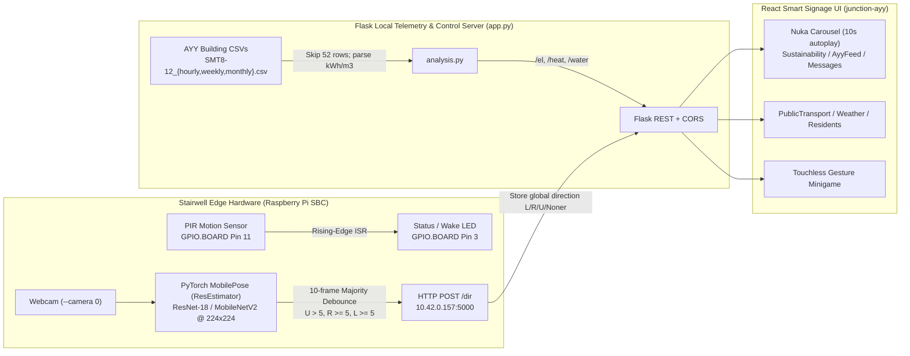

# [2019 Winner Case Study] Aalto University (AYY) — AyyHello! (`Smart Signage - For Students by Students`)

## 1. Metadata & Verification Ledger

- **Challenge File**: [`2019_Aalto_University_Smart_Signage.md`](file:///c:/Users/Jiang/.gemini/antigravity/scratch/hackjunction/docs/past/silver/en/Hardware/2019_Aalto_University_Smart_Signage.md)
- **Event & Dates**: Junction 2019 (November 15–17, 2019, Väre & School of Business, Otaniemi, Espoo)
- **Original Junction Track**: `IoT & Hardware` (mapped to Hardware Track in Silver archive)
- **Partner**: **Aalto University & AYY (Aalto University Student Union)** (~2,600 student apartments, ~3,500 residents)
- **Challenge Name**: `Smart Signage - For Students by Students`
- **Winning Project & Team**: **AyyHello!** (repo also stylized `ayyHello`) — **1st Place Winner** `[L1]`
- **Runners-up**: `[Not publicly documented]` (Official Medium post snippet confirmed `Winner: AyyHello!`; no 1st/2nd runner-up entries appeared for this challenge)
- **Team Members** (`L1` GitHub commit authors on `mariporko/junction2019`):
  - **Jesse Tolvanen** (`JZNT`)
  - **Satria Sutisna** (`satriasutisna`)
  - **Harri Rahikainen** (`HRahikainen`)
  - **Mari Porko** (`mariporko`)
  - **`smirq`** (GitHub handle)
- **Evidence Sources**:
  - `[L1]` Official Winners Announcement: Junction Medium, *"The winners of Junction 2019"* (`https://medium.com/hack-junction/the-winners-of-junction-2019-de539036dc3f`)
  - `[L1]` Primary Source Repository: [`mariporko/junction2019`](https://github.com/mariporko/junction2019) (created `2019-11-15T21:15:54Z`; fork at [`HRahikainen/junction2019`](https://github.com/HRahikainen/junction2019))
  - `[L2]` Challenge Context: Aalto University News, *"Student Union looks for creative ideas for their information channels from Junction"* (`https://www.aalto.fi/en/news/student-union-looks-for-creative-ideas-for-their-information-channels-from-junction`)

---

## 2. Problem Context & Design Goal

AYY planned to install digital information screens ("smart signage") across stairwells and hallways in its ~2,600 student apartments (~3,500 student tenants) to strengthen community engagement and sustainability awareness using real building energy/water/heating telemetry `[L2]`.

Passive lobby noticeboards suffer from display blindness: students walk past static slides without interacting or remembering building alerts or utility benchmarks. **AyyHello!** solved this by transforming a Raspberry Pi stairwell kiosk into a **touchless, presence-aware, gesture-controlled communal hub** that wakes on motion, surfaces personalized building utility telemetry alongside local transit/weather/AYY feeds, and embeds a gesture-controlled minigame `[L1]`.

---

## 3. Hardware, Sensor Stack & Embedded Architecture

Directly verified from `mariporko/junction2019` `[L1]`:

| Layer | Component / Spec | Exact Code Evidence (`[L1]`) | Role |
| :--- | :--- | :--- | :--- |
| **Compute Node** | Raspberry Pi SBC (Linux) | `README.md`, `ayy-lmao/pir.py` (`RPi.GPIO`) | Local display controller, sensor interrupt handler, Flask server host |
| **Presence Sensor** | Passive Infrared (PIR) sensor + status LED | `ayy-lmao/pir.py`: `GPIO.setmode(GPIO.BOARD)`, `PIR_PIN = 11`, `LED_PIN = 3` | Hardware rising-edge wake interrupt (`GPIO.add_event_detect(PIR_PIN, GPIO.RISING, callback=pir_isr_cb)`) |
| **Vision Input** | Standard USB/integrated webcam | `alg-ayy-rhythms/startDemo.sh`: `--camera 0` | Live video capture for upper-body pose/gesture estimation |
| **CV Inference** | Modified `MobilePose-PyTorch` (`PyTorch 1.0.0`, `OpenCV 3.4.2.17`) | `alg-ayy-rhythms/estimator.py` (`ResEstimator`), `run_webcam.py` (`--model resnet18 --inp_dim 224`) | Real-time keypoint regression (`resnet18` default, `mobilenetv2` selectable) mapped to `L` / `R` / `U` gestures |
| **Backend API** | Python Flask + `flask_cors` | `ayy-lmao/app.py` (`http://10.42.0.157:5000`) | Serves `/el`, `/heat`, `/water` weekly analytics and receives `/dir` gesture `POST`s |
| **Data Pipeline** | AYY Building Telemetry CSVs | `ayy-lmao/analysis.py` reading `SMT8-12_hourly.csv`, `SMT8-12_weekly.csv`, `SMT8-12_monthly.csv` | Skips 52 header metadata rows (`delimiter=';'`), parses electricity, heating, and water metrics |
| **Kiosk Frontend** | React `16.12.0` + Material-UI `4.6.1` | `junction-ayy/src/App.js`, `package.json` (`nuka-carousel`, `victory`, `react-google-charts`) | Auto-rotating info cards + `PublicTransport`, `Weather`, `Residents`, `Sustainability`, `Game` |

### System Architecture Diagram

---

## 4. Key Technical Details & Engineering Trade-Offs

1. **Temporal Debouncing Before Network Dispatch (`run_webcam.py`) `[L1]`**:
   - Raw frame-level pose classification jitters rapidly. Instead of spamming Flask on every frame, `submitData(data)` buffers `datalen_max = 10` predictions in `datacache` and fires `postDirection()` only after collecting 10 samples:
     - `Ucount > 5` -> sends `"U"`
     - `Rcount >= 5` -> sends `"R"`
     - `Lcount >= 5` -> sends `"L"`
     - Otherwise -> fallback `"D"`
   - **Trade-off**: Eliminates gesture flicker without a heavy temporal neural network (LSTM/3D-CNN), at the cost of a small latency window (10 frames) and a hardcoded local hotspot IP (`http://10.42.0.157:5000/dir`). Notice `app.py` checks `L`, `R`, `U` and logs `Something else came through -> "Noner"` for `"D"`.

2. **Lightweight Backbone Choice for Edge Latency `[L1]`**:
   - Built upon SJTU's `MobilePose-PyTorch` (`estimator.py`: `ResEstimator`), letting the team toggle `--model resnet18` (used in `startDemo.sh` at `--inp_dim 224`) vs `mobilenetv2` depending on whether inference ran on a Raspberry Pi CPU or a tethered demo laptop feeding `10.42.0.157:5000`.

3. **Interrupt-Driven Low-Power Wake vs Continuous Polling `[L1]`**:
   - `pir.py` uses `GPIO.add_event_detect(PIR_PIN, GPIO.RISING, callback=pir_isr_cb)` with `time.sleep(100)` in the main loop rather than tight-loop polling (`GPIO.input`), demonstrating good embedded hygiene—though the hackathon prototype left `pir.py` as a standalone script not yet merged directly into `app.py`'s process.

4. **Real Building Telemetry Wrangling (`analysis.py`) `[L1]`**:
   - Real Finnish building sub-metering exports (`SMT8-12_*.csv`) contained 52 metadata header rows, semicolon delimiters, space thousand-separators, and comma decimals (`"123,4".replace(",",".").replace(" ","")`). Handling dirty real-world utility CSVs cleanly enabled genuine ISO-week comparisons (`date.today().isocalendar()[1]`) on the dashboard.

---

## 5. Transferable Lessons for Hardware Hackathons

- **Multi-Modal Decoupling via Local HTTP (`POST /dir`)**: Splitting Raspberry Pi GPIO, PyTorch webcam CV, and React signage into independent processes talking over local HTTP allowed parallel debugging on separate laptops over a local network (`10.42.0.157`) before final integration.
- **Pair Utility Data with Behavioral Hooks**: Judges from housing unions do not want another Grafana chart—combining sustainability metrics (`/el`, `/heat`, `/water`), practical commuter value (`PublicTransport`), and a touchless webcam game directly addressed student engagement and display blindness.
- **Keep Physical Prototypes Hygienic & Touchless**: Even pre-COVID (Nov 2019), camera-based gesture control avoided fragile capacitive touchscreens in apartment stairwells while remaining easy to demo live to roaming judges.
