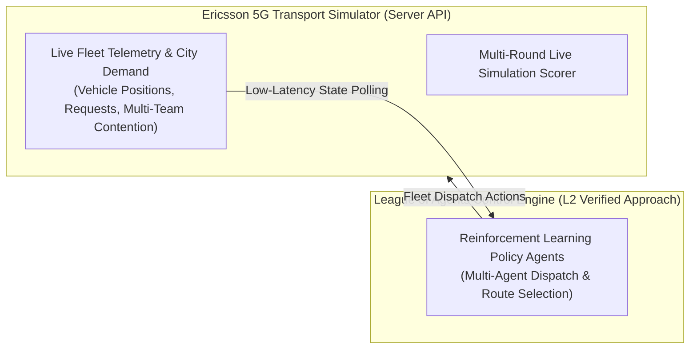

# [2019 Winner Case Study] Ericsson — League of Agents (`Greener City Transport with 5G`)

## 1. Metadata & Verification Ledger

- **Challenge File**: [`2019_Ericsson_Greener_City_Transport_With_5G.md`](file:///c:/Users/Jiang/.gemini/antigravity/scratch/hackjunction/docs/past/silver/en/Hardware/2019_Ericsson_Greener_City_Transport_With_5G.md)
- **Event & Dates**: Junction 2019 (November 15–17, 2019, Otaniemi, Espoo)
- **Original Junction Track**: `Urban & Mobility` (classified under Hardware Track due to 5G MEC / autonomous vehicle fleet control theme)
- **Partner**: **Ericsson** *(Note: Ericsson hosted two separate 2019 challenges—this mobility challenge and `Security Awareness for Kids`)*
- **Challenge Name**: `Greener City Transport with 5G`
- **Verified Challenge Placements** (`[L1]` Official Junction Medium post):
  - **1st Place (Winner)**: **League of Agents**
  - **1st Runner-up (2nd Place)**: **5G** *(team roster & codebase `[Not publicly documented]`)*
  - **2nd Runner-up (3rd Place)**: **FastCity** *(team roster & codebase `[Not publicly documented]`)*
- **Confirmed Winner Member** (`[L2]` self-reported resume):
  - **Adithya Sireesh** — Built reinforcement-learning (RL) agents for transport network optimization (`1st Place — Ericsson Challenge, Hack Junction 2019`) *(remaining teammates `[Not publicly documented]`)*
- **Source Code**: `[Not publicly documented]` (no public GitHub repository located for `League of Agents`, `5G`, or `FastCity`)
- **Evidence Sources**:
  - `[L1]` Official Winners Announcement: Junction Medium, *"The winners of Junction 2019"* (`https://medium.com/hack-junction/the-winners-of-junction-2019-de539036dc3f`)
  - `[L2]` Winner Portfolio/Resume: Adithya Sireesh (`https://sireesh.io/AdithyaSireesh_Resume.pdf`)
  - `[L1]` Challenge Specification: [`2019_Ericsson_Greener_City_Transport_With_5G.md`](file:///c:/Users/Jiang/.gemini/antigravity/scratch/hackjunction/docs/past/silver/en/Hardware/2019_Ericsson_Greener_City_Transport_With_5G.md)

---

## 2. Challenge Mechanics & Hardware-Adjacent Architecture

Unlike Ericsson's physical RF testbed tracks in later years, Junction 2019's `Greener City Transport with 5G` operated as a **real-time networked fleet-dispatch API competition** simulating low-latency 5G Multi-access Edge Computing (MEC) coordination:
- **Provided Interface**: Ericsson exposed a server API controlling simulated urban vehicles (cars) alongside live multi-round, multi-team head-to-head simulation heats.
- **Optimization Goal**: Minimize congestion, idle emissions, and passenger wait times by dynamically routing and dispatching vehicle fleets at 5G control-loop speeds.

### Conceptual Control Architecture (`League of Agents`)

---

## 3. Verification Notes & Disambiguation

1. **Two Distinct Ericsson Challenges at Junction 2019**:
   - **Track 1 (This File — `Greener City Transport with 5G`, Urban & Mobility)**: Won by **League of Agents**, with **5G** (1st runner-up) and **FastCity** (2nd runner-up) `[L1]`.
   - **Track 2 (`Security Awareness for Kids`, Security)**: Won by **TassuPassu** (also Junction 2019 **Overall Grand Winner**, purely software storybook/password app), with **Black Mirror** (`teamglados/blackmirror`, purely software anti-bullying web/taskqueue demo) taking 2nd prize `[L1]`.
2. **External False-Positive Guard**:
   - Search results frequently surface a `traficom.fi` PDF about a Finnish *5G Cyber Security Hackathon*—that was a separate event, **not** Junction 2019.
3. **Architecture Scope Honesty**:
   - No physical 5G SDRs, modems, or RC vehicles were deployed by teams on tables for this 2019 challenge (`[L1]` Silver spec confirms server API simulation). Detailed hyperparameters/frameworks for `League of Agents` beyond RL agent optimization `[L2]` are not publicly documented.

---

## 4. Key Takeaways for Autonomous Fleet / MEC Challenges

- **Closed-Loop RL Against Live Adversaries**: Multi-team live simulation heats punish brittle static shortest-path heuristics when competing fleets alter road congestion simultaneously; RL/adaptive multi-agent dispatch generalizes cleanly under dynamic demand shifts.
- **API Latency Budget Discipline**: Even in a simulated 5G challenge, round-trip API polling vs inference compute dictates how fast fleet state updates—batching policy inference locally keeps control loops reactive inside live timed rounds.
