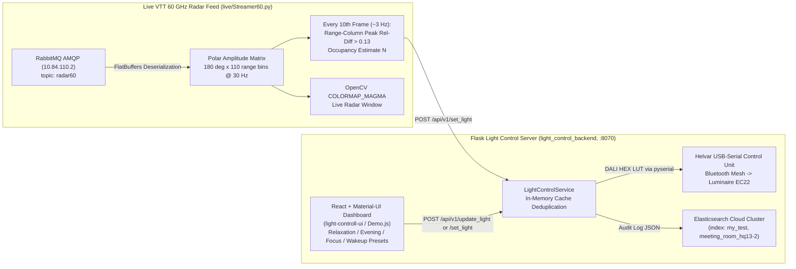

# [2019 Winner Case Study] Helvar & VTT — LumenLoop (`Making Spaces Brighter with Radar Technology`)

## 1. Metadata & Verification Ledger

- **Challenge File**: [`2019_Helvar_VTT_Making_Spaces_Brighter_With_Radar.md`](file:///c:/Users/Jiang/.gemini/antigravity/scratch/hackjunction/docs/past/silver/en/Hardware/2019_Helvar_VTT_Making_Spaces_Brighter_With_Radar.md)
- **Event & Dates**: Junction 2019 (November 15–17, 2019, Otaniemi, Espoo)
- **Original Junction Track**: `AI & Data` (co-classified under Hardware Track due to live VTT 24/60 GHz radars & Helvar DALI luminaires)
- **Partners**: **Helvar** (intelligent DALI lighting control) & **VTT Technical Research Centre of Finland** (compact mmWave radar)
- **Challenge Name**: `Making Spaces Brighter with Radar Technology`
- **Verified Challenge Placements** (`[L1]` Official Junction Medium post):
  - **1st Place (Winner)**: **LumenLoop**
  - **1st Runner-up (2nd Place)**: **Brighten your way** *(team details & codebase `[Not publicly documented]`)*
  - **2nd Runner-up (3rd Place)**: **figvam** *(4 HSE CS students coached by Maxim Dyakov `[L2]`)*
- **LumenLoop Core Team** (2-person team confirmed `[L1]` repo + `[L2]` author blog):
  - **Denys Kovalenko** — Backend / signal processing / DALI hardware control (`deniskovalenko`, repo user `"denisk"`)
  - **Elizaveta Lebedeva** — Data Science / UI control integration (`elizavetalebedeva.com`, repo `Demo.js` user `"elizaveta"`)
  - *(Note: The duo later returned with Carlos Bentes at Junction 2021 with **Lumen Loop 3.0**, confirming their 2019 team was the original **LumenLoop** `[L2]`.)*
- **Figvam Team** (2nd Runner-up / 3rd Place, `[L2]` HSE & Russian Hackers Channel):
  - **Timofey Smirnov**, **Igor Zverev**, **Ainur Nuriev**, **Aldar Danilov** (Higher School of Economics CS students), coached/accompanied by **Maxim Dyakov**.
- **Evidence Sources**:
  - `[L1]` Official Winners Announcement: Junction Medium, *"The winners of Junction 2019"* (`https://medium.com/hack-junction/the-winners-of-junction-2019-de539036dc3f`)
  - `[L1]` LumenLoop 2019 Primary Repo + Official Challenge `README.pdf`: [`deniskovalenko/junction2019`](https://github.com/deniskovalenko/junction2019) (commits Nov 16–23, 2019)
  - `[L2]` LumenLoop Author Confirmation: Elizaveta Lebedeva Blog (`https://elizavetalebedeva.com/` & `https://elizavetalebedeva.com/tag/junction/`) — confirms *"Junction 2019: our 2-person team won the challenge by Helvar"*
  - `[L2]` Partner Hardware Background: VTT Research Blogs (01.11.2019 & 08.11.2019, `vttresearch.com`)
  - `[L2]` 2nd Runner-up Report: HSE News (09.12.2019, `https://www.hse.ru/en/news/323373069.html`) & `@RussianHackers_Channel`
  - `[L2]` Competitor Benchmark Context: STACC Hackathon Post (`https://stacc.ee/junction/`, 02.12.2019)

---

## 2. Official VTT Radar & Helvar Hardware Specs (`README.pdf`, `[L1]`/`[L2]`)

Recovered directly from the official 11-page Helvar & VTT starter kit `README.pdf` archived in `deniskovalenko/junction2019` `[L1]` and VTT press releases `[L2]`:

| Subsystem | Hardware / Interface | Exact Measured Specs |
| :--- | :--- | :--- |
| **VTT 60 GHz 2D Imaging Radar** | 60 GHz FMCW compact IC radar (~5x5 mm chip era `[L2]`) | Horizontal beamwidth `160 deg`, elevation `25 deg`, **range resolution `5 cm`**, **angular resolution `3.5 deg`**, micromotion `< 700 nm`. Polar frames `180 x 110` (`0.5–6 m` @ `100 Hz` meeting room) & `180 x 990` (`0.5–50 m` @ `50 Hz` parking garage) `[L1]` |
| **VTT 24 GHz Vital-Sign Radar** | Single-channel 24 GHz FMCW radar | Horizontal beamwidth `80 deg`, elevation `25 deg`, **range resolution `60 cm`**, micromotion **`1–5 um`** (`workplace.csv`: 497 raw channels `r_0..r_496` + HR, respiration, 3D pose, `good_posture`, `moving`) `[L1]` |
| **Live Sensor Bus** | Ethernet -> RabbitMQ AMQP (`10.84.110.2`) + FlatBuffers | Topics `radar60` (`Vtt60Processed.Sample`: `AmplitudeAsNumpy()`, `AngleAsNumpy()`) & `radar24` (`RadarRawInt.Sample`) `[L1]` |
| **Helvar Luminaire Hardware** | Real physical demo luminaire (`ID: "EC22"`) + Bluetooth Mesh USB-Serial gateway | Controlled via `pyserial==3.4`; DALI 31-step brightness HEX LUT (`00`..`FE` for `0–100%`) + 39-step Kelvin color temperature HEX LUT (`1964`..`0A8C` for `6500K–2700K`); `LUMIAIRE_MODE = "00"` bypasses built-in PIR `[L1]` |

> **Why Radar Beats Cameras (`[L2]` VTT)**: At 60 GHz, radar sees through smoke, fog, darkness, clothing, plastics, and dry wood while remaining **privacy-preserving** (no facial biometrics or optical PII), and FMCW maintains constant range resolution regardless of target distance.

---

## 3. LumenLoop Architecture (`deniskovalenko/junction2019`, `[L1]`)

LumenLoop built a **closed-loop live 60 GHz radar-to-luminaire lighting controller** combining real-time polar amplitude denoising, lightweight people-counting, physical Helvar Bluetooth-Mesh/DALI actuation, cloud telemetry logging, and a manual React override dashboard:

### Verified Occupancy-to-Lighting Mapping (`live/Streamer60.py` & `junction/viz_denoised.py`) `[L1]`

Every 10 incoming live radar frames, `Streamer60.py` counts significant radial peak changes across the transposed polar frame (`sum(pd.DataFrame(frame).max().diff() / pd.DataFrame(frame).max() > 0.13)`), decrements `number > 0` by 1, and posts DALI commands to `http://10.100.15.151:8070/api/v1/set_light`:

| Estimated Occupancy | Target Brightness | Target Color Temp | Physical Behavior |
| :--- | :--- | :--- | :--- |
| `0` people | `5%` | `6500K` (coolest) | Deep energy-saving standby |
| `1` person | `20%` | `5750K` | Focused single-user ambient light |
| `2` people | `30%` | `4850K` | Balanced neutral meeting illumination |
| `3+` people | `60%` | `3450K` (live) / `3450K @ 40%` (offline) | Warmer, brighter collaborative illumination |

Additionally, the React control UI (`light-controll-ui/src/Demo.js`, `roundy` rotary sliders) added four ergonomic presets (`Relaxation 20%/6000K`, `Evening 30%/5000K`, `Focus 70%/3900K`, `Wakeup 40%/3400K`) backed by `/api/v1/update_light` (live tuning without DB spam) vs `/api/v1/set_light` (stateful Elasticsearch audit log) `[L1]`.

---

## 4. Runner-up Context: `figvam` (3rd Place / 2nd Runner-up) `[L2]`

From Higher School of Economics (HSE) News (Dec 9, 2019) & `@RussianHackers_Channel` `[L2]`:
- **Concept**: Smart indoor positioning & circadian/safety lighting system combining VTT radar concepts with WiFi FingerPrinting localization and a coordinator simulator server.
- **Smart Modes**: Automatically tuned room light intensity/temperature by detected state, including waking up drowsy users via blinking sequences and turning off lights upon sleep detection.
- **Outcome**: Won 3rd place on the Helvar & VTT track; Helvar reportedly extended job offers to team members (which the students declined to finish their studies in Moscow).

*(Note: 1st runner-up **Brighten your way** is verified in the official Junction 2019 Medium winners post `[L1]`, with no public team roster or repository archived.)*

---

## 5. Key Technical Trade-Offs & Hackathon Lessons

1. **Closing the Loop on Physical Hardware Beats Offline Accuracy**:
   - Helvar's starter kit had notorious pitfalls (`README.pdf`: `timestamps.log` marked *"Quite useless"*, 6-second / 600-frame offset between 100 Hz radar and 15 fps RGB in Meeting Room data, and noisy transmitter-to-receiver leakage sidelobes).
   - Instead of getting stuck training a heavy RetinaNet-supervised deep radar detector on mis-aligned offline files, LumenLoop's 2-person team wrote a **1-line robust peak-jump heuristic** (`diff / max > 0.13`), bridged RabbitMQ FlatBuffers directly to Helvar's **physical Bluetooth Mesh luminaire (`EC22`)** over serial DALI, cached redundant commands so the serial bus wouldn't flood, and built a sleek React UI + Elasticsearch telemetry backend.
2. **Separate Fast Tuning (`/update_light`) from Logged Transitions (`/set_light`)**:
   - Rotary sliders firing Elasticsearch writes on every drag event would freeze or throttle the demo; separating telemetry-free interactive sliders from committed state changes is an ideal hardware-demo pattern.
3. **Avoid Multipath / Human-Body Sidelobe Traps**:
   - As Helvar's FAQ warned `[L1]`, humans at 60 GHz act as extended multi-scatterer clouds whose breathing and limb micro-motions cause amplitude flickering—temporal averaging (`rolling=5` or checking every 10 frames) prevents strobe-like luminaire oscillation.
