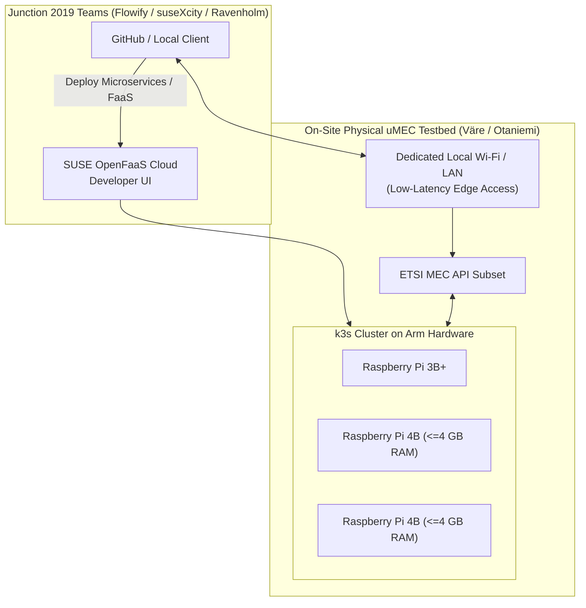

# [2019 Winner Case Study] SUSE — Flowify, suseXcity & Ravenholm (`Open Open City`)

## 1. Metadata & Verification Ledger

- **Challenge File**: [`2019_SUSE_Open_Open_City.md`](file:///c:/Users/Jiang/.gemini/antigravity/scratch/hackjunction/docs/past/silver/en/Hardware/2019_SUSE_Open_Open_City.md)
- **Event & Dates**: Junction 2019 (November 15–17, 2019, Otaniemi, Espoo)
- **Original Junction Track**: `Urban & Mobility` (mapped to Hardware Track due to on-table Raspberry Pi 3B+/4B+ uMEC edge cluster infrastructure)
- **Partner**: **SUSE** (with hardware/architecture collaboration later documented under LF Edge Akraino alongside Nokia & Arm)
- **Challenge Name**: `Open Open City`
- **Verified Challenge Placements** (`[L1]` Official Junction Medium post):
  - **1st Place (Winner)**: **Flowify**
  - **1st Runner-up (2nd Place)**: **suseXcity**
  - **2nd Runner-up (3rd Place)**: **Ravenholm**
- **Team Members & Codebases**: `[Not publicly documented]` *(No public team rosters or GitHub repositories were recovered for Flowify, suseXcity, or Ravenholm)*
- **Evidence Sources**:
  - `[L1]` Official Winners Announcement: Junction Medium, *"The winners of Junction 2019"* (`https://medium.com/hack-junction/the-winners-of-junction-2019-de539036dc3f`)
  - `[L2]` Partner Infrastructure Post-Mortem: LF Edge Blog (Aug 13, 2020, by Tapio Tallgren / Nokia, Ferenc Szekely / SUSE, Tina Tsou / Arm), *"MicroMEC now available with the Akraino R3 release"* (`https://www.lfedge.org/2020/08/13/micromec-now-available-with-the-akraino-r3-release/`)

---

## 2. Deployed Edge Hardware & MEC Architecture (`[L2]` LF Edge / SUSE)

Even though team-level repositories for **Flowify**, **suseXcity**, and **Ravenholm** remain private/unarchived, the **exact bare-metal edge hardware testbed** built and deployed by SUSE at Junction 2019 is unusually well documented in LF Edge's post-mortem on the Akraino MicroMEC (uMEC) blueprint `[L2]` and the challenge spec:

| Hardware / Software Layer | Exact Junction 2019 Specification (`[L2]` + Challenge Spec) |
| :--- | :--- |
| **Compute Nodes (`uMEC`)** | Clusters of **Raspberry Pi 3B+ and Raspberry Pi 4B** Arm single-board computers (`max 4 GB RAM`) interconnected on gigabit LAN + dedicated local Wi-Fi |
| **Container Orchestration** | Lightweight **k3s** (Rancher/SUSE Kubernetes distribution) across Pi edge nodes |
| **Serverless Runtime** | **OpenFaaS Cloud (OFC)** + custom **Developer Web UI** allowing hackathon teams to push GitHub functions directly onto the local Arm edge cluster |
| **MEC APIs Exposed** | Subset of **ETSI MEC APIs** (with SUSE later adding MEC-11 service discovery in Akraino R3) plus optional **SUSE Cloud Application Platform (CAP)** |
| **Storage / Boot Evolution** | Junction 2019 experience directly drove SUSE/Nokia/Arm to eliminate fragile SD cards for production Akraino R3 by introducing **PXE network boot + iSCSI shared storage** and adding Wi-Fi/5G interface hooks |

---

## 3. Verification Gap Statement (Strict Epistemic Accounting)

- **Verified (`[L1]`)**: Exact top-3 placements for `Open Open City` at Junction 2019 — **1st: Flowify**, **2nd: suseXcity**, **3rd: Ravenholm**.
- **Verified (`[L2]`)**: Exact physical edge cluster stack (`Raspberry Pi 3B+` / `4B`, `k3s`, `OpenFaaS Cloud`, `ETSI MEC APIs`, `SUSE CAP`) provided to those teams at Junction 2019.
- **Unverified / Not Publicly Documented**: Individual project descriptions, team member names, and GitHub repositories for `Flowify`, `suseXcity`, and `Ravenholm` did not surface in public search indices, GitHub, or Devpost. No project-specific features are inferred beyond the verified challenge/testbed specification.

---

## 4. Hardware & Edge Computing Lessons Learned

1. **Never Trust SD Cards in Shared Cluster Demos (`[L2]`)**:
   - Running stateful multi-team `k3s` / `OpenFaaS` workloads on Pi clusters at Junction 2019 highlighted SD-card I/O bottlenecks and corruption risk—motivating SUSE/Nokia/Arm to shift to **PXE boot + iSCSI** over gigabit Ethernet in the very next release.
2. **Arm Architecture Cross-Compilation Discipline**:
   - Building on `Raspberry Pi 3B+`/`4B` requires `arm64`/`armhf` multi-arch container images; teams pushing x86-only Docker containers stall during hackathon deployment unless pre-tested with `buildx` or OpenFaaS Cloud templates.
3. **Hardware-on-Table MEC Enables True Local Breakout**:
   - Putting the `k3s` Pi cluster physically on the hackathon floor over dedicated local Wi-Fi let teams experience genuine sub-10ms local edge routing decoupled from venue internet congestion.
