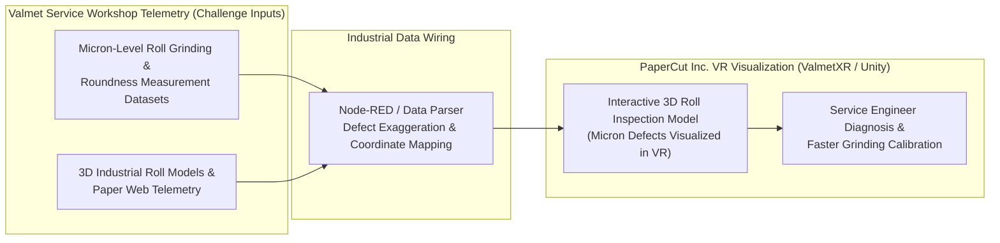

# [2019 Winner Case Study] Valmet & Aalto — PaperCut Inc. (`Service Workshop of the Future`)

## 1. Metadata & Verification Ledger

- **Challenge File**: [`2019_Valmet_Service_Workshop_Of_The_Future.md`](file:///c:/Users/Jiang/.gemini/antigravity/scratch/hackjunction/docs/past/silver/en/Hardware/2019_Valmet_Service_Workshop_Of_The_Future.md)
- **Event & Dates**: Junction 2019 (November 15–17, 2019, Otaniemi, Espoo)
- **Original Junction Track**: `AI & Data` (mapped to Hardware Track due to micron-scale roll sensors, Node-RED industrial IoT wiring, and ValmetXR)
- **Partners**: **Valmet** & **Aalto Industrial Internet Campus** (AIIC)
- **Challenge Name**: `Service Workshop of the Future`
- **Verified Challenge Placements** (`[L1]` Official Junction Medium post):
  - **1st Place (Winner)**: **PaperCut Inc.**
  - **1st Runner-up (2nd Place)**: **Smooth Grindr** *(details & team roster `[Not publicly documented]`)*
- **Confirmed Team Member** (`[L2]` Startup Adventures International blog):
  - **Ucha Vekua** — Author of *"My experience at Junction 2019"* (`startupadventures.org`), member of **Team PaperCut Inc.** *(other teammates `[Not publicly documented]` due to Cloudflare 403 blocking direct body fetch on `startupadventures.org`; search summary confirmed team name & project)*
- **Source Code**: `[Not publicly documented]` (no public GitHub repository located for PaperCut Inc. or Smooth Grindr)
- **Evidence Sources**:
  - `[L1]` Official Winners Announcement: Junction Medium, *"The winners of Junction 2019"* (`https://medium.com/hack-junction/the-winners-of-junction-2019-de539036dc3f`)
  - `[L2]` Team Member Recap: Ucha Vekua, *"My experience at Junction 2019"*, `startupadventures.org` (observed via `search_web` grounding summary; direct HTTP fetch returned 403)
  - `[L2]` Partner & Challenge Brief: Aalto University News (published 03.11.2019, updated 14.11.2019), `https://www.aalto.fi/en/news/aalto-university-and-valmet-challenge-junction-participants-to-create-a-service-workshop-of-the`

---

## 2. Industrial Pain Point & Partner Hardware/Sensor Context

From the Silver challenge brief and Aalto University's official release `[L2]`:
- **Industrial Stakes**: Industrial paper, board, and pulp machine rolls require thousands of hours of precision grinding per year. A roll that deviates from geometric optimality by even **micron-scale defects** (impossible to see with the naked eye) can trigger production downtime or quality losses estimated at **€50 per minute** `[L2]`.
- **Sensor & Software Environment Provided by Valmet / Aalto**:
  - Real **micron-level roll grinding roundness measurement datasets** and running paper machine web telemetry;
  - 3D industrial roll models;
  - **ValmetXR** platform (Unity-based multi-device VR / Mixed Reality / AR training & documentation environment for smartphones, tablets, and VR/MR headsets);
  - **Node-RED** visual IoT flow-programming wiring between roll measurement streams and XR visualization `[L2]`.

---

## 3. Winning Solution (`PaperCut Inc.`) & Architecture

Directly verified from the search-grounded summary of Ucha Vekua's post `[L2]` and the Valmet/Aalto brief `[L2]`:
- **Core Solution**: Team **PaperCut Inc.** built a **VR-based 3D visualization tool** mapping industrial roll sensor data onto 3D roll models so workshop technicians and engineers can visually inspect sub-millimeter/micron surface and roundness anomalies that are invisible to the naked eye, accelerating fault localization and grinding diagnostics `[L2]`.

### Runner-up Note
- **1st Runner-up**: **Smooth Grindr** `[L1]` — name strongly implies a focus on roll-grinding smoothness analytics/optimization, though exact implementation and roster are not publicly documented.

---

## 4. Technical Trade-Offs & Hardware Hackathon Lessons

1. **Amplifying Invisible Physical Defects Visually**:
   - You cannot visually spot a 5–20 micrometer roundness error on a several-meter-long steel/composite roll in true 1:1 scale. Effective industrial XR/digital-twin demos rely on **domain-scaled spatial exaggeration** (amplifying radial deviations in 3D vertex/color maps) while preserving exact axial/circumferential coordinates so technicians know where to grind.
2. **Adopt the Partner's Provided XR Platform Early**:
   - Building VR plumbing from scratch over 48 hours wastes critical time. Utilizing **ValmetXR** + **Node-RED** let teams jump directly from raw industrial CSV/sensor arrays into an interactive headset/screen walkthrough aligned with Valmet's internal engineering stack `[L2]`.
3. **Anchor the Pitch in Cost-of-Downtime Economics**:
   - Valmet explicitly framed the problem around **€50/minute** of lost machine output `[L2]` — tying spatial visualization directly to faster root-cause isolation speaks the language of industrial service partners.
