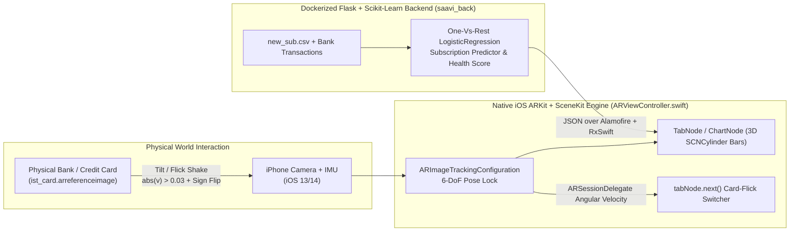

# [2020 Overall Winner Case Study] OP / Finance — Saavi – Healthy Finance (`ARKit Physical Card Interface + ML`)

## 1. Metadata & Verification Ledger

- **Event & Dates**: **Junction 2020 Connected** (November 6–8, 2020 — COVID-19 hybrid/virtual edition; partners listed on Wikipedia: `Genelec, HKScan, Paulig, OP, Supercell, Aito, Brella`)
- **Award**: **Junction 2020 Connected Overall Main Prize Winner (Grand Winner 🏆)** — won out of the Finance / OP challenge track `[L1]`/`[L2]`
- **Project**: **Saavi – Healthy Finance** (backup repo titled `MoneyMustBeFunnyAkaJunction2020Backup`)
- **Verified Core Team** (`[L2]` Wikipedia + `andreykr.com` + `[L1]` GitHub):
  - **Alexander Zimin** (`azimin` — iOS / Swift / ARKit client author)
  - **Anton Lebedev** (`antoleb` — Python Flask / `scikit-learn` ML backend author)
  - **Andrey Krylov** (`andreykr.com` — Experience / UI-UX Designer)
  - **Andrey Volodin**
  - **Egor Petrov**
- **Evidence Sources**:
  - `[L1]` iOS ARKit Client Repo: [`azimin/MoneyMustBeFunnyAkaJunction2020Backup`](https://github.com/azimin/MoneyMustBeFunnyAkaJunction2020Backup) (`ar_demo.gif`, YouTube demo `https://www.youtube.com/watch?v=Zc7ce9MxTNg`)
  - `[L1]` ML & Backend Repo: [`antoleb/saavi_back`](https://github.com/antoleb/saavi_back)
  - `[L2]` Public Encylopedia & Author Portfolio: [Wikipedia: Junction (hackathon)](https://en.wikipedia.org/wiki/Junction_(hackathon)), [`andreykr.com/media`](https://www.andreykr.com/media), [`andreykr.webflow.io`](https://andreykr.webflow.io/)

---

## 2. Why Saavi Belongs in the 2020 Hardware / Spatial Computing Archive

During COVID-19 (Nov 2020), Junction 2020 Connected ran remotely, dramatically reducing traditional soldered-electronics submissions. Yet the **2020 Overall Grand Winner** won in part by bridging the **physical-digital boundary**: instead of another flat 2D banking dashboard, Saavi turned the user's **physical bank/credit card** into a tangible 3D Spatial Computing controller using native **Apple ARKit** `[L1]`/`[L2]`.

---

## 3. Spatial Computing & ML Technical Architecture (`[L1]` Code Verified)

### 3.1 Physical-Card ARKit & Gesture Pipeline (`MoneyHealth` iOS Swift App)

Directly inspected in `PresentationLayer/Flows/AR/ARViewController.swift`, `PresentationLayer/Nodes/ChartNode.swift`, and `Assets.xcassets/AR Resources.arresourcegroup/ist_card.arreferenceimage` `[L1]`:

1. **Physical Card Image Tracking (`ARImageTrackingConfiguration`)**:
   - `resetTracking()` loads reference marker `ist_card.arreferenceimage` from `"AR Resources"` into `ARImageTrackingConfiguration().trackingImages` and launches `session.run(..., options: [.resetTracking, .removeExistingAnchors])`.
   - When the iPhone camera (`iOS 13/14`, built in `Xcode 12.1`) detects the physical card, `renderer(_:didAdd:for:)` spawns an initial animated highlight `SCNPlane` (`imageHighlightAction`) followed by a floating 3D SceneKit `TabNode` container (`tabPresentationAction` scale/tilt pop-up).
2. **3D Volumetric Spending Charts (`ChartNode.swift`)**:
   - Renders 6 translucent `SCNCylinder` bars (`heights` mapped to category spends `spend1`..`spend6`) anchored in the physical card's local coordinate plane, animating `scale.y` sequentially upward (`onTransitionIn`).
3. **Physical Card Tilt / Shake Gesture Switching (`ARSessionDelegate`)**:
   - On every `ARFrame` update, `session(_:didUpdate:)` tracks changes in the physical card anchor's Z-axis orientation (`velocity = node.rotation.z - lastRotation`), buffering the last 5 angular velocities in `self.velocities`.
   - When `velocities.count > 3`, if the last two frames reverse rotational sign (`sign(v[-1]) != sign(v[-2])`) AND mean absolute rotational speed exceeds `0.03` (while `!isTransitionInProgress`), it logs `"shake!!!"`, resets velocities, and flips `tabNode.next()` with a `.rotateTo(x: .pi / 3)` spring animation!
   - *(Code inspection also reveals commented-out `Vision` `VNDetectHumanHandPoseRequest` thumb-tip overlay code in `ARViewController.swift`, showing the team prototyped hand-keypoint interaction before locking in physical card flicks for demo reliability `[L1]`.)*

### 3.2 Subscription Prediction & Financial Health Backend (`antoleb/saavi_back`)

Directly inspected in `run_app.py`, `data_analisys/data_analyser.py`, and `data_analisys/subscription_analyser.py` `[L1]`:

| Component | Stack / Implementation (`[L1]`) | Endpoints / Functionality |
| :--- | :--- | :--- |
| **API Server** | Dockerized Python `Flask` + `markupsafe` (`run.sh` -> `run_app.py` on `0.0.0.0`) | `/user/<user_id>`, `/user/insides/...`, `/user/popular_categories/...`, `/user/subscription_prediction/<user_id>/`, `/user/active_subscriptions/<user_id>/`, `/user/next_two_subscriptions/<user_id>/`, `/user/stories/<user_id>` |
| **Subscription ML** | `scikit-learn` (`OneHotEncoder` + per-service `LogisticRegression(max_iter=1e7, class_weight='balanced', C=1e-2)`) | Trained across `new_sub.csv` (`service_name`, `service_category`, `number_of_payments` per `user_id`) to rank top-`n` predicted next recurring subscriptions (`predict_user`) |
| **Client Stack** | Swift CocoaPods: `Alamofire`, `SnapKit`, `Nuke`, `RxSwift`, `RxCocoa`, `AnimatedGradientView`, `FittedSheets` | Consumes Flask JSON telemetry for reactive UI sheets alongside native ARKit camera view |

---

## 4. Technical Trade-Offs & Hackathon Lessons

1. **Physical-Object Tangibility via Sensor Fusion Beats Commented Vision Complexity**:
   - In `ARViewController.swift`, the team initially wrote Apple Vision `VNDetectHumanHandPoseRequest` thumb tracking—which suffers from occlusion and lighting jitter when holding a phone one-handed—then commented it out and shipped **card-anchor IMU/pose velocity zero-crossing detection** (`|v| > 0.03`). Tying interaction directly to tilting the physical card in the other hand produced an ultra-reliable, zero-latency AR gesture!
2. **Native Zero-Bloat AR vs Heavy Cross-Platform Engines**:
   - Skipping Unity/Unreal bloat in favor of pure Apple `ARKit` + `SceneKit` (`ChartNode`) + reactive Swift (`RxSwift`/`FittedSheets`) delivered crisp 60 fps mobile banking polish inside 48 hours `[L1]`.
3. **Simple Calibrated ML Models Ship Faster**:
   - One-vs-rest `LogisticRegression(C=1e-2, class_weight='balanced')` on weighted one-hot subscription counts trains in milliseconds inside a single Docker container (`saavi_back`) without GPU infrastructure or fragile deep-learning checkpoints `[L1]`.
