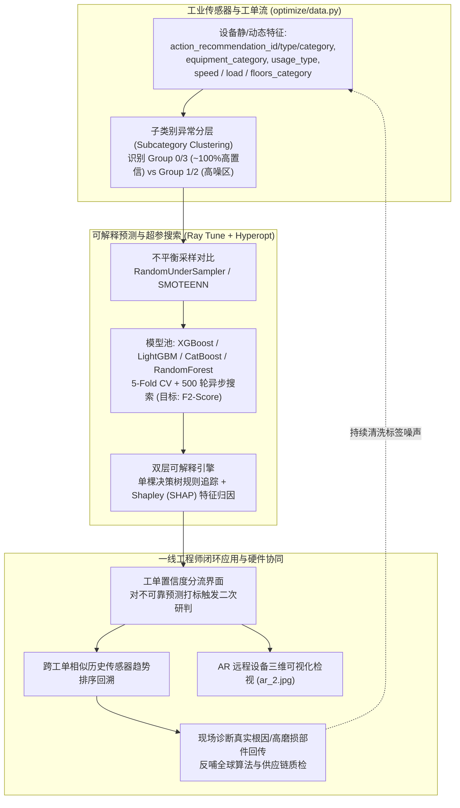

# [2021 Winner Case Study] CGI x KONE — ElevAI (Team Glados) & S.H.I.E.L.D (`Sky(scraper)-is-the-limit`)

## 1. 元数据与验证台账 (Metadata & Verification Ledger)

- **归档缺失说明**: 该赛题未录入 `challenges_full.json` 及 `docs/past/silver/en/Hardware/` 目录，本文基于 **CGI Finland 官方赛后博客 (`L2`)** 与 **冠军开源仓库 (`L1`)** 补充重构为完整 Bronze 档案。
- **赛事届次与时间**: Junction 2021（2021年11月19日–21日，混合赛制，Otaniemi Aalto Hub 线下展位 + 全球线上/分赛区）
- **出题企业**: **CGI** 与 **KONE（通力电梯）**（KONE 导师：**Jaakko Uusitalo** `[L2]`）
- **赛题名称**: `Sky(scraper)-is-the-limit`
- **赛题规模** (`[L2]` CGI 官方统计): CGI 在 2021 年联合 KONE 与 Turku 市共运营两个挑战赛道，总计吸引 **约 30 支队伍**参赛。
- **官方双赛道奖项与获奖团队** (`[L2]` CGI Finland 官方博客):
  1. **"Best Performing and Most Explainable Model" 类别第一名 + 全场 Top-10 总决赛入围**: **Team Glados — `ElevAI`**
     - **确认核心开发者** (`[L1]` `teamglados/elevai` Git 提交历史):
       - **Ville Toiviainen** (`Villux` — 算法调优、提交推理、AR 概念交互演示；Junction 2017 & 2018 两届全场总冠军 Team Glados 核心成员 `[L2]`)
       - **Andreas Urbanski** (`nardeas` — 数据探索、特征工程、模型架构与文档；Junction 2017 & 2018 两届全场总冠军 Team Glados 核心成员 `[L2]`)
     - **开源代码仓库 (`[L1]`)**: [`teamglados/elevai`](https://github.com/teamglados/elevai)（关联分支说明提及 `nardeas/elevai`）
     - **演示视频 (`[L1]`)**: Vimeo — [`https://vimeo.com/648187179`](https://vimeo.com/648187179) (*ElevAI | Junction 2021*)
  2. **"Out-of-the-Box Thinking" 奖项第一名**: **S.H.I.E.L.D — Safety Helmet with Intelligent Embedded Lighting Device**
     - **核心硬件概念** (`[L2]` CGI 官方博客): 面向电梯维保现场的智能安全帽穿戴设备，集成 **嵌入式智能照明（Intelligent Embedded Lighting）**、**AR 摄像头推流（AR camera）**、**语音转文本通信（Speech-to-text）** 与 **手势识别（Gesture recognition）**。
     - **队伍名单与仓库**: `[Not publicly documented]`（CGI 官方博客确认项目全称、硬件融合形态与获奖奖项，未公开队员姓名或开源仓库）。
- **核心证据来源 (`Evidence Level`)**:
  - `[L2]` CGI Finland 官方赛后报告 (03.12.2021): [`https://www.cgi.com/fi/fi/blogi/junction-2021-hackathon-highlights`](https://www.cgi.com/fi/fi/blogi/junction-2021-hackathon-highlights)
  - `[L1]` 冠军队伍代码仓库 (`README.md`, `submission.md`, `optimize/model.py`, `optimize/data.py`, `optimize/models/xgboost.py`, `notebooks/`): [`https://github.com/teamglados/elevai`](https://github.com/teamglados/elevai)
  - `[L2]` Wikipedia Junction 条目（佐证 Team Glados / Ville Toiviainen / Andreas Urbanski 历史履历）: [`https://en.wikipedia.org/wiki/Junction_(hackathon)`](https://en.wikipedia.org/wiki/Junction_(hackathon))

---

## 2. 工业背景与双奖评判维度 (`Sky(scraper)-is-the-limit`)

根据 KONE 与 CGI 在赛题中披露的工程现实 (`[L1]`/`[L2]`):
- **每日 10 亿+ 人次的电梯客流**：任何计划外停机都会导致居民无法归家或商业楼宇瘫痪；但另一端，KONE 大型基底预测系统自动派发给一线维保工程师的 **Service Action Recommendations（服务动作建议 / 工单）** 中存在相当比例的误报。
- **无效上门的沉没成本**：在历史数据中，**87%** 的派单对应真实维保需求（`class 1`），**13%** 属于无需现场出勤的无效维保（`class 0`）。每一次无效上门都会直接吞噬高技能电梯工程师的现场工时，并挤占真正高风险设备的抢修窗口。
- **双轨评审机制 (`[L2]` CGI)**：KONE 与 CGI 罕见地将本赛题拆为两个独立奖励类别——既要求 **Best Performing and Most Explainable Model（最高预测性能与最强可解释性模型）**，又专门设立 **Out-of-the-Box Thinking（跳出框架的颠覆性构想奖）** 以奖励穿戴式硬件与人机协同现场流程重构。

---

## 3. `ElevAI` 技术架构与算法实证 (`teamglados/elevai`, `[L1]`)

Team Glados 在深入审计 KONE 数据集后敏锐发现：**由于不同设备类别/传感器组合在原始数据集中占比严重倾斜且噪声分布截然不同，全局模型若盲目追求表面准确率极易靠“全预测 1”刷分；而在部分噪声子类别（如特征不足的组合）上，任何模型提升空间均有理论上限。** 因此，团队确立了 **“高精度轻量级可解释 GBT 模型 + 工程师置信度分级 + AR 远程协同 + 全球一线零件磨损闭环反馈”** 的双轮系统：

### 3.1 源码与基准测试数据核验 (`[L1]`)
1. **多框架对比与异步超参搜优** (`optimize/model.py`, `optimize/models/xgboost.py`, `submission.md`):
   - 运行命令：`python -m optimize --num_samples=500 --model=xgboost --kfold_n=5 --max_concurrent=10`
   - 使用 `ray.tune` + `HyperOptSearch` + `AsyncHyperBandScheduler`，对比 `XGBoost`（`binary:logistic`）、`LightGBM`、`CatBoost` 与 `RandomForest`，目标优化指标锁定兼顾召回（防止漏修造成安全隐患）的 **`f2_score`**。
   - 在 Hyperopt 搜索日志 (`submission.md`) 中观察到的高分试次（如 `_train_97b2ffea`、`_train_8fe31ea8`）在 5-fold 下最高达到 **`f2_score ≈ 0.9722`**（对应 `fb125_score ≈ 0.9472`，`f1_score ≈ 0.9333`）。
2. **特定高频误报子群实测提升** (`README.md`):
   - 以关键细分设备群 **`arc02 / tp007 / ut011`（2,679 条事件）** 为例，对比全预测 Naive Baseline：
     - **Naive Baseline**: `F2 = 0.92299`, `Accuracy = 0.70586`
     - **ElevAI Model**: **`F2 = 0.926601`**, **`Accuracy = 0.737212`**（精准过滤无效工单，准确率提升超 3.1 个百分点且未牺牲 F2 召回指标）。
3. **维度降维证伪与“流程反向重构”** (`README.md`):
   - 团队使用 **PCA** 与 **t-SNE** 证明原始静态类别特征存在信息天花板后，果断从“硬卷特征”转向“系统工程闭环”——用 **SHAP** 与 **单决策树可视化** 向 KONE 工程师证明预测为何触发，并在移动端/AR 端让工程师在抵达现场前即可远程 AR 检查设备并向后台标注真正故障的零部件，使原本“无效的上门”转化为高价值的数据标注资产。

---

## 4. `S.H.I.E.L.D` 智能维保头盔亮点 (`[L2]` CGI Blog)

作为同场另一支获得 **Out-of-the-Box Thinking** 大奖的硬核概念队，`S.H.I.E.L.D`（*Safety Helmet with Intelligent Embedded Lighting Device*）直接瞄准了电梯井道/机房极端暗光、狭窄、双手持工具无法操作平板的真实作业痛点：
- **嵌入式智能照明（Embedded Lighting）**：解决井道暗环境作业自照明；
- **AR 摄像头（AR Camera）**：第一视角实时回传后台专家并叠加操作指导；
- **语音转文本（Speech-to-Text）+ 手势识别（Gesture Recognition）**：实现 **100% 免手部触控（Hands-Free）** 的工单查询、维修步骤翻页与检修日志记录，避免戴绝缘手套摘脱操作智能终端的危险与繁琐。

CGI 评价该团队为维保领域提出了“**全新的产品范式与极富前景的多技术融合概念**”。

---

## 5. 评审契合度与硬件/工业 IoT 参赛启示 (Lessons for Industrial & Hardware Builders)

1. **当工业 IoT 数据集存在“特征噪声天花板”时，用降维证伪+闭环产品胜出**：
   - Team Glados 没有在报告里强行吹嘘虚高的准确率，而是诚实展示 `PCA` / `t-SNE` / 分组误差分析（Group 0–3）证明数据瓶颈所在，并顺理成章用 **“低置信度预警 + AR 远程复核 + 工程师反馈回流”** 把算法弱点转化为商业护城河——这种高级工程诚实度极受工业评委（如 KONE、Valmet）青睐。
2. **工业 B2B 的 AI 必须选择业务对齐的指标（`F2` 而非盲目追求 `Accuracy`）**：
   - 电梯漏修一次的安全性与违约风险远大于多跑一趟误报。以 `F2-Score` 优先保障极高召回率，再从最差的特定设备子类别里“抠”出精准的假阳性剔除，是预测性维护赛题的标准满分策略。
3. **现场运维硬件的核心命题是“Hands-Free（解放双手）”**：
   - 无论是 `ElevAI` 的移动端 AR 预检，还是 `S.H.I.E.L.D` 集成 AR 相机+手势+语音识别+照明的头盔，两者能双双在 CGI x KONE 赛题获奖，充分说明工业穿戴设备与远程视觉诊断在电梯/高空/井道场景具备极高评委共鸣。

---

## 6. 关联参考资料 (References)

- **L2 CGI Finland 2021 官方赛后报告**: [`cgi.com/fi/fi/blogi/junction-2021-hackathon-highlights`](https://www.cgi.com/fi/fi/blogi/junction-2021-hackathon-highlights)
- **L1 ElevAI 开源代码库**: [`github.com/teamglados/elevai`](https://github.com/teamglados/elevai)
- **L1 ElevAI 演示视频**: [`vimeo.com/648187179`](https://vimeo.com/648187179)
- **L2 Wikipedia Junction 历史表**: [`en.wikipedia.org/wiki/Junction_(hackathon)`](https://en.wikipedia.org/wiki/Junction_(hackathon))
