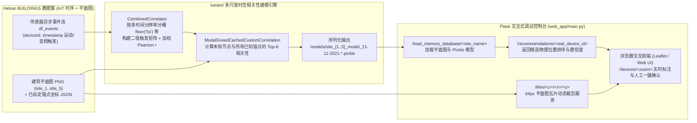

# [2021 Winner Case Study] Helvar — Lumen Loop 3.0 & FloorMagic (`Brighter Spaces: Intelligent Lighting`)

## 1. 元数据与验证台账 (Metadata & Verification Ledger)

- **关联赛题档案**: [`2021_Helvar_Brighter_Spaces_Intelligent_Lighting.md`](file:///c:/Users/Jiang/.gemini/antigravity/scratch/hackjunction/docs/past/silver/en/Hardware/2021_Helvar_Brighter_Spaces_Intelligent_Lighting.md)
- **赛事届次与时间**: Junction 2021（2021年11月19日–21日，混合赛制：全球多个线下 Hub + Otaniemi Aalto Hub + Gather 虚拟平台；48小时编程冲刺）
- **原赛题归属赛道**: `IoT & Hardware`（`hackjunction.com` 官方归类为 `IoT & Hardware`，Silver 归档同步收录于 `Data` 与 `Hardware`）
- **出题企业**: **Helvar**（智能照明控制与建筑环境感知系统厂商）
- **赛题规模** (`[L2]` Junction 官方 Medium 赛后复盘): 第一天结束时共 **14 支队伍**锁定 Helvar 赛题（约 **45+ 名参与者**），最终提交 **11 份完整方案与 4 份草稿**。
- **已验证获奖情况**:
  - **Helvar 赛题获胜者 + 全场 Top-10 总决赛入围（200+ 个参赛项目中脱颖而出）** `[L1]`/`[L2]`: **Lumen Loop 3.0**
    - **团队成员** (`[L1]` GitHub 仓库贡献者 + 作者博客 + YouTube 演示):
      - **Elizaveta Lebedeva** (`LizaLebedeva` — 数据科学 / 控制模型 / 2019 Helvar 冠军成员)
      - **Denys Kovalenko** (`deniskovalenko` — 后端与信号建模 / 2019 Helvar 冠军成员)
      - **Carlos Bentes** (`cbentes` — 空间地图瓦片后端、Web 可视化架构与全栈工程)
    - **代码仓库 (`[L1]`)**: [`LizaLebedeva/junction-2021`](https://github.com/LizaLebedeva/junction-2021)（Commits: 2021年11月20日–21日，`master` 分支）
    - **演示视频 (`[L1]`)**: YouTube — [*Lumen Loop 3.0 | Junction 2021*](https://www.youtube.com/watch?v=dX27x6s6wl4)
    - **作者/团队证实 (`[L1]`)**: [Elizaveta Lebedeva Blog — Junction 标签页](https://elizavetalebedeva.com/tag/junction/)
  - **Helvar 赛题获奖团队（多子赛题/获奖记录）** `[L1]`/`[L2]`: **FloorMagic (Healthy Mind Tech)**
    - **团队成员** (`[L1]` 团队官网 + `[L2]` Medium 引用): **Paula Petcu** (CEO)、**Troels Nielsen** (CTO & CFO)、**Martin Basterrechea** (VP Marketing/Analytics)、**Kim Ng** (VP Personnel Dev/HR & Sales)（Healthy Mind Tech ApS，丹麦哥本哈根，CVR 42155292）
    - **事实标注**: 团队官网明确列出 **`Junction 2021 - Helvar Challenge Winner`** 荣誉及 IoT/AI 项目 **FloorMagic**；官方 Medium 复盘文章 `junction-2021-intelligent-lighting-as-the-engine-for-brighter-spaces-2ee963c6c0e8` 亦提及 Martin Basterrechea 与 Kim Ng。开源代码仓库 `[Not publicly documented]`。
- **核心证据来源 (`Evidence Level`)**:
  - `[L1]` 冠军开源代码库: [`https://github.com/LizaLebedeva/junction-2021`](https://github.com/LizaLebedeva/junction-2021)（完整读取 `lumen/` 核心算法模块、`models/`、`web_app/main.py` 及 `starter_kit/requirements.txt`）
  - `[L1]` 团队成员第一手履历与录像: [`https://elizavetalebedeva.com/tag/junction/`](https://elizavetalebedeva.com/tag/junction/) 与 [`https://www.youtube.com/watch?v=dX27x6s6wl4`](https://www.youtube.com/watch?v=dX27x6s6wl4)
  - `[L1]`/`[L2]` Healthy Mind Tech 官方履历页: [`https://healthymindtech.com/`](https://healthymindtech.com/)
  - `[L2]` Junction 官方 Helvar 赛题复盘（Medium）: [`https://hackjunction.medium.com/junction-2021-intelligent-lighting-as-the-engine-for-brighter-spaces-1926e69eed6b`](https://hackjunction.medium.com/junction-2021-intelligent-lighting-as-the-engine-for-brighter-spaces-1926e69eed6b) 与 [`https://hackjunction.medium.com/junction-2021-intelligent-lighting-as-the-engine-for-brighter-spaces-2ee963c6c0e8`](https://hackjunction.medium.com/junction-2021-intelligent-lighting-as-the-engine-for-brighter-spaces-2ee963c6c0e8)

---

## 2. 获胜者背景与赛题工业痛点 (Team Background & Challenge Context)

### 2.1 连续夺冠的硬件数据科学班底
**Lumen Loop 3.0** 的核心成员 **Elizaveta Lebedeva** 与 **Denys Kovalenko** 曾在 **Junction 2019** 中以双人团队 `LumenLoop` 击败全场拿下 **Helvar & VTT 雷达照明赛题冠军**（详见 [`2019_Helvar_VTT_Radar_LumenLoop.md`](file:///c:/Users/Jiang/.gemini/antigravity/scratch/hackjunction/docs/past/bronze/winner_mateirals/2019_Helvar_VTT_Radar_LumenLoop.md)）。2021 年，两人联合全栈工程师 **Carlos Bentes** 再次出战 Helvar 赛道，从 2019 年的“实时 60 GHz 雷达单房间控光”升级为“大规模多楼宇未标定传感器自动拓扑定位平台”。

### 2.2 Helvar 三大子赛题与真实楼宇部署痛点 (`[L1]` Silver Spec)
Helvar 在 2021 年开放了两个大型真实智能照明物联网数据集（`BUILDINGS` 办公楼群传感器事件 + 建筑平面图，以及 `GARAGE` 停车库 PIR 运动传感器事件），并设置了三大子任务：
1. **Challenge 1 — "Where are all the devices?"（设备都在哪？）**：商业楼宇在施工安装数百上千个支持运动/音频感知的智能灯具与传感器节点时，现场电工往往未能将**物理传感器 MAC/Device ID** 与**建筑 CAD/PNG 平面图上的二维坐标 $(x, y)$** 一一对应，导致人工核对（Commissioning）成本极高。如果已知部分锚点设备（Anchor Devices）坐标，如何利用纯时序事件流自动反推未知设备在平面图上的物理位置？
2. **Challenge 2 — "Where is everyone going?"（人流往哪走？）**：基于照明运动传感器序列追踪大楼与车库内人员动线。
3. **Challenge 3 — "Mystery Garage"（神秘车库）**：不直接提供地图，从纯 PIR 时序事件重建地下车库的拓扑关系与车道结构。

Lumen Loop 3.0 将核心产品定位为 **"AirTag meets intelligent lighting"**（智能照明领域的 AirTag）`[L1]`，宣称通过自动化传感器空间配准可将智能照明的现场调试与安装成本**降低超过 50%**。

---

## 3. 核心技术架构与算法/全栈实现 (`LizaLebedeva/junction-2021`, `[L1]`)

通过直接审计 `LizaLebedeva/junction-2021` 源码可知，**Lumen Loop 3.0** 并非停留在 Jupyter Notebook 的离线分析脚本，而是一套包含**多时间尺度相关性引擎（`lumen/`）**、**5 个预训练楼宇序列化模型（`models/site_{1..5}_model_21-11-2021-*.pickle`）**以及**基于地图瓦片切片的交互式 Flask Web 应用（`web_app/`）**的完整端到端工程系统：

### 3.1 关键源码模块拆解 (`[L1]`)
| 模块路径 | 核心类 / 函数 | 真实实现细节（已源码核验） |
| :--- | :--- | :--- |
| `lumen/model_greed_cached_custom_corr.py` | `CombinedCorrelator` & `ModelGreedCachedCustomCorrelation` | 将离散异步传感器时间戳按 `time_buckets_config`（如 `{'5s': 2}`）通过 `df.timestamp.dt.floor(time_resolution)` 对齐到等间隔 `pd.date_range` 二值激活矩阵；针对每对设备调用 `scipy.stats.stats.pearsonr` 计算共现相关性并按权重叠加；提供 `offload_tmp_data()` 清理中间大矩阵以实现轻量级 `.pickle` 持久化。 |
| `lumen/model_greed.py` & `model_greed_cached.py` | 贪心空间推断模型家族 | 基线版与缓存版贪心匹配算法，利用人/车流连续触发的空间局部性原则：同一人在数秒内先后经过相邻灯具，故**事件序列时间相关性最高的一组已知锚点，其空间质心或邻近点即为未知设备的物理坐标**。 |
| `lumen/util.py` | `extract_device_events`, `plot_devices` | 提取每个 `deviceid` 的时间戳序列；支持用 PIL (`ImageDraw`) 直接在平面图上渲染训练锚点（绿色 `#50ff50`）与预测目标 ID（红色标注）。 |
| `web_app/core/configuration.py` | `SITE_MODEL_MAP`, `TILE_SIZE = 64` | 映射 `site_1` 至 `site_5` 各自的 2021年11月21日凌晨预训练模型文件（`site_1_model_21-11-2021-00:47:23.pickle` 等）。 |
| `web_app/main.py` | Flask Web API | 提供 `/load_memory_database/<site_name>`、`/recommendations/<real_device_id>`、`/tiles/<z>/<x>/<y>` 与 `/devices/<zoom>` 路由，支撑类似 Google Maps / Leaflet 的高分辨率建筑平面图缩放与“点击推荐点位完成设备配对”的工作流。 |
| 依赖环境 (`Pipfile` & `requirements.txt`) | Python 科学计算与 Web 栈 | `pandas`, `numpy`, `scipy`, `Pillow`, `Flask` 等轻量可控依赖。 |

### 3.2 同期获奖方案对比：`FloorMagic` (Healthy Mind Tech, `[L1]`/`[L2]`)
- 根据 Healthy Mind Tech 官方项目介绍：`FloorMagic` 同样切入 **“运动传感器不仅用于控光，还蕴含建筑内人流运动轨迹”** 这一洞察，利用传感器采集到的移动数据（movement data）预测未标注传感器的物理位置，实现敏捷智能楼宇（agile intelligent buildings）的自组织配置。
- 两支获奖队伍高度一致地选择了 Helvar **Challenge 1 (`Where are all the devices?`)** 作为主攻突破口，证明该痛点在智能照明 B2B 工程落地中的高商业优先级。

---

## 4. 演示亮点与赛题评审契合度 (Demo Highlights & Judging Alignment)

1. **从“离线算法精度”直接闭环为“现场施工交互工作流”**：
   - 大多数 Data Science 参赛队只交出一张预测散点图和 RMSE 指标；而 Lumen Loop 3.0 预判到**工业现场不可能完全取消人工核验**，因此打造了“算法给出 Top-K 最可能安装点位 + 平面图瓦片地图一键高亮推荐”的 **Human-in-the-Loop（人机协同）** Web 界面，完美契合“减少 50%+ 安装人工成本”的商业叙事。
2. **极佳的抗异步/抗稀疏时序对齐设计**：
   - 智能照明 PIR/音频传感器只在触发时上报，属于极度稀疏的非均匀事件流。`CombinedCorrelator` 通过可配置的多时间窗口（如 5s 桶离散化）将异步事件流转为规整稠密向量做 Pearson 相关，既避免了对长尾微扰动过拟合，又保留了毫秒–秒级人流走廊连续穿越信号。
3. **跨届次演进能力**：
   - 从 2019 年的硬件侧直接控制（60GHz 雷达 + pyserial + DALI 调光）到 2021 年的大规模楼宇数字孪生（5 个完整站点模型 + Tile 瓦片地图前端），连续两届赢得 Helvar 认可并闯入 2021 全场 Top-10。

---

## 5. 对硬件与 IoT 参赛者的启示 (Lessons for Hardware Builders)

1. **IoT 规模化落地的最大成本往往不在芯片，而在 Commissioning（现场配准调试）**：当硬件赛题提供建筑/工厂的传感器历史日志和平面图时，“设备自发现、拓扑自动成图、零配置上线”往往比单纯做一个炫酷 Dashboard 更能直击商业客户（如 Helvar、KONE）的核心利润率痛点。
2. **把不确定预测封装成“可交互推荐系统”而非黑盒**：在存在对称房间、盲区或多路径的复杂物理空间中，单点回归坐标很容易因跨走廊误匹配产生大误差；输出带置信度排名的候选点并在建筑平面图上以瓦片地图（Tiles）形式呈现，能在 Demo 演示时展现极高的工程成熟度。
3. **赛前模型预训练 + `.pickle` 轻量化服务分离**：在 48 小时内不要让 Web Demo 现场实时重跑全楼宇全量相关性计算。像 `Lumen Loop 3.0` 一样将特征/相关性矩阵计算离线化并卸载临时张量（`offload_tmp_data()`），让演示后端毫秒级响应，是现场 Demo 零翻车的关键。

---

## 6. 关联参考资料 (References)

- **L1 冠军开源代码库**: [github.com/LizaLebedeva/junction-2021](https://github.com/LizaLebedeva/junction-2021)
- **L1 团队成员博客**: [elizavetalebedeva.com/tag/junction/](https://elizavetalebedeva.com/tag/junction/)
- **L1 团队演示视频**: [youtube.com/watch?v=dX27x6s6wl4](https://www.youtube.com/watch?v=dX27x6s6wl4)
- **L1/L2 Healthy Mind Tech 官网**: [healthymindtech.com](https://healthymindtech.com/)
- **L2 Junction 2021 Helvar 官方报道**: [hackjunction.medium.com (1926e69eed6b)](https://hackjunction.medium.com/junction-2021-intelligent-lighting-as-the-engine-for-brighter-spaces-1926e69eed6b) / [hackjunction.medium.com (2ee963c6c0e8)](https://hackjunction.medium.com/junction-2021-intelligent-lighting-as-the-engine-for-brighter-spaces-2ee963c6c0e8)
