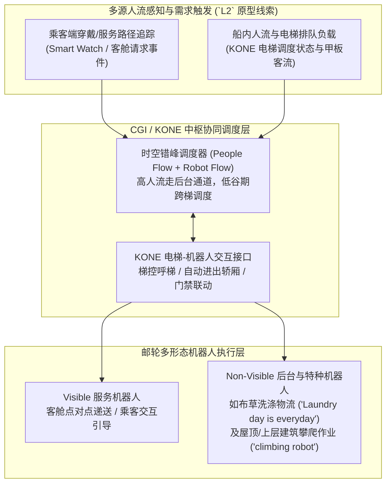

# [2022 Winner Case Study] CGI x KONE x Meyer Turku — C-HAL 9000 & Laundry day is everyday (`Cruising with Robots`)

## 1. 元数据与验证台账 (Metadata & Verification Ledger)

- **关联赛题档案**: [`2022_CGI_KONE_Meyer_Turku_Cruising_With_Robots.md`](file:///c:/Users/Jiang/.gemini/antigravity/scratch/hackjunction/docs/past/silver/en/Hardware/2022_CGI_KONE_Meyer_Turku_Cruising_With_Robots.md)
- **赛事届次与时间**: Junction 2022（2022年11月4日–6日，芬兰埃斯波 Otaniemi Dipoli 主会场，1,300+ 线下参赛者）
- **原赛题归属**: `Other`（`hackjunction.com` 原始标签为 `Other`，Silver 归档同步索引至 `Hardware` 与 `Agentic AI`）
- **联合出题伙伴**: **CGI Finland** × **KONE（通力电梯）** × **Meyer Turku（迈尔图尔库造船厂）**
- **赛题名称**: `Cruising with Robots`
- **赛题规模** (`[L2]` CGI Finland 官方博客): 2022 年 CGI 运营两大赛道（`Cruising with Robots` 与 `Now Green Code you must`），共吸引近 **30 支队伍**参与。
- **官方公布获奖名单** (`[L2]` CGI Finland 2022年11月10日官方博客):
  - **第一名（1st Place Winner）**: **C-HAL 9000**
  - **第二名（2nd Place）**: **Laundry day is everyday**
- **透明性声明（未公开信息核查）**:
  - 截至本次检索，除 CGI Finland 官方赛后通稿外，针对 **C-HAL 9000** 与 **Laundry day is everyday** 的具体队员姓名、学校/机构背景、开源 GitHub 代码库、Devpost/Junction 平台原项目描述及硬件 BOM 清单均 `[Not publicly documented]`（已交叉核查 `hackjunction.com` JS Bundle、`hackjunction.medium.com`、GitHub、LinkedIn 索引与 YouTube `Ph5deOWpGh4` Junction 2022 Closing Ceremony 页面）。
  - CGI 官方博客直接记录了本赛道涌现的代表性原型形态：**“无论是在屋顶/甲板上攀爬作业的机器人（a climbing robot on the roof），还是用于追踪乘客服务路径的智能手表（a smart watch for tracking passenger's service path）”** `[L2]`。
- **核心证据来源 (`Evidence Level`)**:
  - `[L2]` CGI Finland 官方赛后公告（2022年11月10日）: [`https://www.cgi.com/fi/fi/blogi/cginside/out-box-thinking-more-valuable-ever`](https://www.cgi.com/fi/fi/blogi/cginside/out-box-thinking-more-valuable-ever)
  - `[L2]` Junction 2022 闭幕式官方直播归档（无检索字幕）: [`https://www.youtube.com/watch?v=Ph5deOWpGh4`](https://www.youtube.com/watch?v=Ph5deOWpGh4)
  - `[L1]`/`[L2]` Silver 原始赛题规格与官方评审标准: [`2022_CGI_KONE_Meyer_Turku_Cruising_With_Robots.md`](file:///c:/Users/Jiang/.gemini/antigravity/scratch/hackjunction/docs/past/silver/en/Hardware/2022_CGI_KONE_Meyer_Turku_Cruising_With_Robots.md)

---

## 2. 海事机器人行业痛点与三方联合赛题需求 (`[L1]`/`[L2]`)

豪华大型邮轮是一座漂浮的“多甲板垂直城市”，而造船巨头 **Meyer Turku**、垂直交通巨头 **KONE** 与系统集成商 **CGI** 联合提出的 `Cruising with Robots` 直指远洋船舶自动化最核心的系统耦合难题：

1. **双流交织冲突（People Flow × Robot Flow）**：邮轮拥有数千名乘客和近千名船员，走廊极度狭窄（Corridors tight），电梯井道资源稀缺且与乘客高度共享。机器人不能像仓库 AGV 那样封闭隔离运行，必须精准切入**人流峰谷期**与**乘客/船员动线**。
2. **显性与隐性双层服务矩阵（Visible vs. Non-Visible Services）**：
   - **Visible（对乘客可见）**：迎宾引导、客舱餐饮/行李配送、个性化穿戴体验（如 CGI 提及的乘客服务路径追踪智能手表原型 `[L2]`）。
   - **Non-Visible（后台隐形后勤）**：如 **第二名团队 `Laundry day is everyday` 队名所指向的每日巨量床品/毛巾布草（Laundry）转运与清洗物流**、高空外立面/屋顶攀爬清洁巡检（如 CGI 提及的屋顶攀爬机器人原型 `[L2]`）以及废弃物分类回运。
3. **造船设计级收益指标**：KONE 与 Meyer Turku 特别强调方案能否带来 **“Space savings（船体空间/通道冗余释放）”** 与 **“Crew workload savings（船员高强度重复劳动释放）”**。

---

## 3. 赛题技术架构参考蓝图（基于赛题规格与公开原型线索重构）

由于两支获奖队均未公开开源仓库，此处**严格基于 CGI 官方提及的原型形态（穿戴式服务路径追踪 / 攀爬与后台物流机器）及三方赛题定义**，梳理出符合本赛题标准的系统耦合架构：

---

## 4. 评审维度拆解与两强胜出逻辑 (`[L1]` Silver Spec + `[L2]` CGI Blog)

对照 Silver 档案记录的官方 4 条核心评审权重，可以清晰验证两支队伍的契合点：

| 官方评审维度 (`Silver Spec`) | `C-HAL 9000`（第一名，名字致敬 *2001: A Space Odyssey* 中控 AI `HAL 9000`） | `Laundry day is everyday`（第二名） |
| :--- | :--- | :--- |
| **1. Creative & out-of-the-box thinking** | 高度契合 CGI 在 2022 复盘标题 *"Out of the box thinking is more valuable than ever"* 中对该赛道突破传统送餐机器人的赞誉。 | 将焦点精准锁定在邮轮日均运行最枯燥、但最消耗船员体力的**全船布草（Laundry）循环**，极具工业现实洞察力。 |
| **2. Passenger service path integration** | 结合全船人流/服务路径（如智能手表等连续体验）与中控决策，构建端到端旅程集成。 | 主攻 **Non-Visible 后台服务路径**，确保脏净布草收发不与乘客观光路径和核心电梯高峰期打架。 |
| **3. Best experience for passengers** | 通过隐形高效响应提升邮轮度假的未来科技感与零等待流畅度。 | 减少电梯里推满超大布草车的拥堵感与视觉干扰，间接大幅提升全船客舱卫生翻台速度与走廊体感体验。 |
| **4. Crew and space savings** | 通过智能人机协同与垂直调度降低通道与人工调度冗余。 | **直击痛点**：每日数千间客舱的床单毛巾往返洗衣房是邮轮劳动最密集的环节，直接换算为可观的船员配额与走廊占道时间压缩。 |

---

## 5. 对机器人、海事与垂直物流参赛者的启示 (Lessons for Robotics Builders)

1. **别只造“送餐机器人”，先看清工业现场最重的体力黑洞**：
   - 在酒店或邮轮赛道，90% 团队第一反应都是做“迎宾/送咖啡机器人”；而 **`Laundry day is everyday`** 靠盯紧 **“每日高频后台布草物流”** 斩获第 2 名，说明**高频率、高负载、Non-Visible（不抢乘客电梯和视野）的后台搬运**往往比前台“作秀型机器人”更具真实商业买单力。
2. **多巨头联合命题（KONE + Meyer Turku + CGI）的核心交集是“接口协议”**：
   - 当电梯厂商（KONE）、场景/车体建造方（Meyer Turku）和系统集成商（CGI）同时坐在评委席时，单打独斗的机械结构不够看；必须在架构图中明确给出 **“机器人如何安全呼叫 KONE 电梯、如何避让客流高峰、如何在狭窄船舶防火门与低带宽环境下与云/边端中枢通信”**。
3. **赛后材料留存提醒**：
   - Junction 2022 包括本赛题与 Oras/Nexi 在内的大量硬件获奖项目均存在官网与社区链路丢失现象，仅有合作大厂技术博客留下团队名称。建议团队务必在赛后将 Repo/架构图/Demo 视频公开保留并关联赛事标签。

---

## 6. 关联参考资料 (References)

- **L2 CGI Finland 2022 官方冠军公告**: [`cgi.com/fi/fi/blogi/cginside/out-box-thinking-more-valuable-ever`](https://www.cgi.com/fi/fi/blogi/cginside/out-box-thinking-more-valuable-ever)
- **L2 Junction 2022 闭幕式视频**: [`youtube.com/watch?v=Ph5deOWpGh4`](https://www.youtube.com/watch?v=Ph5deOWpGh4)
- **L1 Silver 赛题档案**: [`2022_CGI_KONE_Meyer_Turku_Cruising_With_Robots.md`](file:///c:/Users/Jiang/.gemini/antigravity/scratch/hackjunction/docs/past/silver/en/Hardware/2022_CGI_KONE_Meyer_Turku_Cruising_With_Robots.md)
