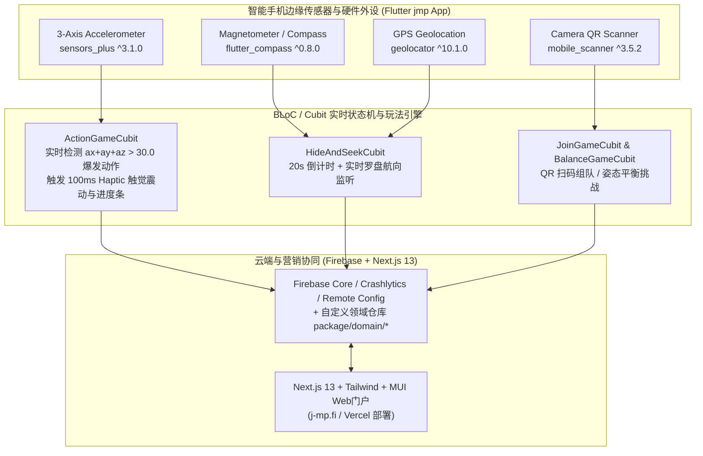

# [2023 Hardware/Sensor Case Study] Huawei (`Sense the Motion`) — J-mp (2nd Place), Motion Potion & Vital

## 1. 元数据与验证台账 (Metadata & Verification Ledger)

- **归档缺失说明**: `Junction 2023` 阶段的 **Huawei — `Sense the Motion`** 赛题未录入 `challenges_full.json` 及 `docs/past/silver/en/Hardware/`（后两处仅收录了 2024 版 `2024_Huawei_Sense_The_Motion.md`）。本档案通过 GitHub 原始提交仓库与团队官方作品集 (`L1`) 还原并补充 2023 年该传感器赛道的工程实况。
- **赛事届次与时间**: Junction 2023（2023年11月10日–12日，芬兰赫尔辛基 Kaapelitehdas 电缆厂；48 小时现场黑客马拉松）
- **出题企业与赛题**: **Huawei（华为，HMS / 智能设备运动与健康感知生态）** — `Sense the Motion`
- **已验证获奖与参赛记录 (`[L1]`)**:
  1. **华为赛道第二名（2nd Place in Huawei Track）**: **J-mp (Junior Movement Platform)**
     - **获奖核验 (`[L1]`)**: Jesse Lappalainen 个人官网明确记录 **`J-mp | Junction 2023 2nd place in Huawei track`**，与开源仓库时间线（2023年11月12日最终提交）完全吻合。
     - **团队班底 (`[L1]` `Mankeli-Software/junction2023` Commits + `mankelisolutions.fi`)**: **Jesse Lappalainen** (`JareCoder`)、**Juho Torkkeli** (`JTorkk`)、**Aku Paananen** (`AkJkSenpai`)、**Onnimanni Hannonen** (`O-Hannonen`)、**`Hylje5000`**（Mankeli Solutions Oy 核心团队，次年即 2024 年该原班人马携 `QuickBIM` 斩获 Junction 2024 全场第 3 名 & KONE 冠军）。
     - **开源仓库 (`[L1]`)**: [`Mankeli-Software/junction2023`](https://github.com/Mankeli-Software/junction2023)
  2. **同赛道已核验开放源码参赛方案 (`[L1]`，名次未公开 `Placement: [Not publicly documented]`)**:
     - **Motion Potion**: [`andras-adam/motion-potion`](https://github.com/andras-adam/motion-potion)（创建于 `2023-11-10T17:04:19Z`）— 实时端侧 IMU 运动轨迹识别手游。
     - **Vital**: [`MiroKeimioniemi/vital-app`](https://github.com/MiroKeimioniemi/vital-app) — 穿戴式健康/运动步数与心率数据映射至 Roblox 游戏角色数值引擎。
  3. **华为 2023 赛道第一名**: `[Not publicly documented]`（官方公开存档中未检索到 1st Place 队名）。
- **核心证据来源 (`Evidence Level`)**:
  - `[L1]` 获奖证实页: Jesse Lappalainen Portfolio — [`https://www.jemlap.fi/projects`](https://www.jemlap.fi/projects) & [`https://www.jemlap.fi/blog/junction-2024`](https://www.jemlap.fi/blog/junction-2024)
  - `[L1]` 2nd Place 完整源码: [`https://github.com/Mankeli-Software/junction2023`](https://github.com/Mankeli-Software/junction2023)（`jmp/pubspec.yaml`, `action_game_cubit.dart`, `hide_and_seek_cubit.dart`, `join_game_cubit.dart`, `website/`）
  - `[L1]` 端侧 IMU 识别源码: [`https://github.com/andras-adam/motion-potion`](https://github.com/andras-adam/motion-potion)（`src/motionrecog/motion_recognition.ts`, `src/hooks/useDetectMovement.tsx`, `package.json`）
  - `[L1]` 穿戴数据游戏联动源码: [`https://github.com/MiroKeimioniemi/vital-app`](https://github.com/MiroKeimioniemi/vital-app)（`calculations-app/app.py`, `roblox_app/Roblox_Game.rbxl`, `README.md`）
  - `[L2]` 跨届延展对比: [`2024_2025_Huawei_Motion_and_3DUI.md`](file:///c:/Users/Jiang/.gemini/antigravity/scratch/hackjunction/docs/past/bronze/winner_mateirals/2024_2025_Huawei_Motion_and_3DUI.md)

---

## 2. 硬件传感器场景与行业痛点 (`Sense the Motion`)

华为在 2023 年以 **"Sense the Motion"** 切入手机与可穿戴设备内置传感器（三轴加速度计、陀螺仪、电子罗盘、GPS、心率/步数/睡眠遥测）的新一代人机交互与健康激励场景，重点考察：
1. **打破“纯静坐搓屏幕”的移动交互惰性**：如何把口袋里手机的边缘惯性传感器（IMU）实时信号直接转化为户外奔跑、摇晃蓄力、姿态平衡与物理游戏规则？
2. **边缘低延迟运动滤波与防作弊判决**：传感器原始信号充满重力分量与手抖高频噪声，如何在端侧毫秒级流水线中稳定识别特定三维运动或爆发动作，并用震动马达/磁力计提供即时触觉物理反馈？

---

## 3. 核心技术架构与传感器栈拆解 (`L1` 源码审计)

### 3.1 `J-mp`（华为赛道第 2 名）多传感器户外混合运动平台 (`Mankeli-Software/junction2023`, `[L1]`)

Mankeli 团队针对青少年电子游戏时长过长（引用 Tampere 大学 *The Finnish Player Barometer*：超过 80% 芬兰人玩数字游戏）痛点，提出 **“把现有数字爱好与户外运动融合，走出去也能赚 XP”** 的 **J-mp (Junior Movement Platform)** 混合工程系统：

#### `J-mp` 核心传感器源码验证 (`[L1]`)
- **爆发运动检测器 (`jmp/lib/feature/minigame/cubit/action_game/action_game_cubit.dart`)**：
  - 订阅 `accelerometerEvents.listen`，在每个采样回调计算三轴总加速度和 `final total = event.x + event.y + event.z;`；
  - 当超过硬阈值 `static const _treshold = 30.0`（显著高于静止重力分量 `~9.8 m/s²` 的剧烈摇晃/跳跃爆发）时，递增 `currentProgress` 并触发端侧物理反馈 `Vibration.vibrate(amplitude: 100, duration: 100)`，直到在限时内达成 `requiredProgress` 返回胜利状态。
- **户外捉迷藏与方向感模块 (`jmp/lib/feature/game/cubit/hide_and_seek/hide_and_seek_cubit.dart`)**：
  - 订阅 `FlutterCompass.events` 实时监听手机磁力计方位角，结合 20 秒倒计时状态机（`counting` -> `searching`）驱动多人数位/实体混合躲藏寻找玩法。
- **多端工程规范度**：采用标准 Domain-Driven 分包（`analytic_repository`, `authentication_repository`, `database_repository`, `storage_repository`, `notification_repository` 等 10 个本地领域包 + `development/staging/production` 多环境 Flavor），展现出职业软件团队极强的跨端打包效率。

---

### 3.2 端侧算法深度补充：同赛道开源项目 `Motion Potion` 与 `Vital` (`[L1]`)

1. **`Motion Potion` (`andras-adam/motion-potion`, Expo/React Native Android 原生 IMU 手势分类)**:
   - 在 `src/hooks/useDetectMovement.tsx` 中以 **`DeviceMotion.setUpdateInterval(1)`**（极限 1 ms 高频采样请求）持续维护 **500 帧滑动窗口**（`motionData.current.length > 500`），每 10 帧触发一次手势识别；
   - 在 `src/motionrecog/motion_recognition.ts` 中自研无机器学习依赖的纯物理时域分类器 `detect_figure`：先将时间戳加速度积分/切分静止期与运动周期 `get_motion_periods`，再对 `>= 40` 样本且 `duration >= 0.5s` 的连续轨迹依次判别 **画圆（`Movement.circle`，检验低运动时间占比 `<= 0.4` 且均值偏离中心率）**、**X 轴直线挥动（`Movement.line_x`）** 与 **Y 轴直线挥动（`Movement.line_y`）**，结合 `react-native-maps` GPS 地理围栏让玩家物理挥舞手机“调配魔法药水”。
2. **`Vital` (`MiroKeimioniemi/vital-app`, 穿戴式遥测 -> Azure 云端计算 -> Roblox 元宇宙)**:
   - 使用 **Python Azure Functions (`calculations-app/app.py`)** 读取华为穿戴式/健身 CSV 数据流（`steps`, `bpm_low`, `sleep`, `sleep_score`, `bmi`, `hr_zone` 5 档映射为 3 档强度、`workout duration`, `max_speed`）；
   - 通过 `le_change()` 与 `stats_change()` 计算虚拟预期寿命增减（`years/months/days`）及游戏角色物理属性（`speed`, `strength`, `health`, `jump_height`），下发给 React 前端仪表盘与 `roblox_app/Roblox_Game.rbxl` 游戏实体实现“真实锻炼强化游戏角色”。

---

## 4. 评审契合度与传感器/边缘交互赛题启示 (Lessons for Sensor & Edge Builders)

1. **为什么 `J-mp` 能在同赛道拿奖？——多传感场景融合 > 单一阈值 Demo**：
   - 虽然 `ActionGameCubit` 单看加速度求和阈值非常简洁，但团队在 48 小时内把 **加速度计爆发小游戏 + 磁力计罗盘捉迷藏 + GPS 户外地图 + QR 扫码快速拉局 + 震动触觉反馈 + Next.js 官网与 Firebase 多环境框架** 全部串成了面向明确用户群（青少年户外运动）的闭环产品，评委感知到的完成度远超单一概念验证。
2. **边缘传感器 Demo 要警惕“重力校准与采样频率差异”**：
   - `Motion Potion` 展示了纯 TypeScript 做时域积分和圈线判别时对低通滤波 (`lpf`) 和采样窗口长度（40+ 点 / 0.5s）的依赖，而 `J-mp` 直接做物理加速度峰值计数＋触觉马达即时反馈。**在喧闹嘈杂的展会现场 Pitch 阶段，能 100% 稳定触发并伴随手机震动/音效的简单物理特征，往往比在实验室才能调通的复杂轨迹分类器更不易当众失灵。**
3. **跨年复盘的连贯价值**：
   - Mankeli 团队从 2022（Wolt 赛道 Top 30 `BoxBunny`）→ 2023（华为赛道第 2 名 `J-mp`）→ 2024（KONE 赛道第 1 名 & 全场第 3 名 `QuickBIM`），连续三年打磨工程化模板库（如 `mankeli_core`、`mankeli_analysis`）并复用多环境 Flutter/Cloud 基建，最终冲进全场前三，极具实战借鉴意义。

---

## 5. 关联参考资料 (References)

- **L1 获奖确认页**: [jemlap.fi/projects](https://www.jemlap.fi/projects) (`J-mp Junction 2023 2nd place in Huawei track`)
- **L1 J-mp 开源代码仓库**: [github.com/Mankeli-Software/junction2023](https://github.com/Mankeli-Software/junction2023)
- **L1 Motion Potion 开源代码仓库**: [github.com/andras-adam/motion-potion](https://github.com/andras-adam/motion-potion)
- **L1 Vital App 开源代码仓库**: [github.com/MiroKeimioniemi/vital-app](https://github.com/MiroKeimioniemi/vital-app)
- **L2 2024–2025 华为同系列延续归档**: [`2024_2025_Huawei_Motion_and_3DUI.md`](file:///c:/Users/Jiang/.gemini/antigravity/scratch/hackjunction/docs/past/bronze/winner_mateirals/2024_2025_Huawei_Motion_and_3DUI.md)
