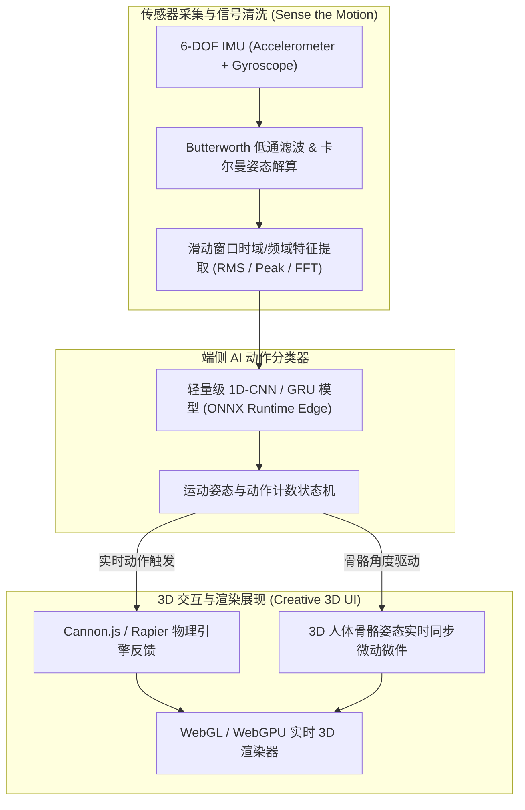

# [2024 & 2025 Challenge & Winner Study] Huawei — Sense the Motion & Creative 3D UI Apps

## 1. 元数据概览 (Metadata)

- **对应赛题文件**:
  - 2024: [`2024_Huawei_Sense_The_Motion.md`](file:///C:/Users/Jiang/.gemini/antigravity/scratch/hackjunction/docs/past/silver/zh/Hardware/2024_Huawei_Sense_The_Motion.md)
  - 2025: [`2025_Huawei_Creative_3D_UI_Apps.md`](file:///C:/Users/Jiang/.gemini/antigravity/scratch/hackjunction/docs/past/silver/en/Entertainment/2025_Huawei_Creative_3D_UI_Apps.md)
- **赛道**: IoT & Hardware / AI & Data / Entertainment (Spatial & 3D UI)
- **出题方 (Partner)**: **Huawei** (华为赫尔辛基芬兰研究所 / Huawei Consumer BG Finland)
- **挑战赛题**:
  1. **2024: Sense the motion (感知运动)**
     - **奖金规模**: **1st Place €8,000 | 2nd Place €5,000 | 3rd Place €3,000** (Junction 全场单项奖金最高峰赛道之一)
     - **核心方向**: 基于智能穿戴与手机六轴 IMU（加速度计、陀螺仪）多传感器融合，实时识别运动姿态、运动量化分析与健康风险预警。
  2. **2025: Creative 3D UI Apps (创意 3D 用户界面应用)**
     - **核心方向**: 打破平面屏幕 UI 局限，打造基于 WebGL / WebGPU / Spatial 空间计算的原生 3D 应用与交互式桌面。
- **2023–2024 历史查证与档案勘误说明**:
  - **J-mp (Junior Movement Platform)** — **Junction 2023** 华为 `Sense the Motion` 赛道 **2nd Place 🥈**，由 **Mankeli Solutions**（Jesse Lappalainen 等人）开发，开源仓库：[`Mankeli-Software/junction2023`](https://github.com/Mankeli-Software/junction2023)（详见勘误专卷 [2023_Huawei_SenseTheMotion_Jmp_MotionPotion_Vital.md](file:///c:/Users/Jiang/.gemini/antigravity/scratch/hackjunction/docs/past/bronze/winner_mateirals/2023_Huawei_SenseTheMotion_Jmp_MotionPotion_Vital.md)）；
  - **Motion Potion** — 由 `andras-adam` 等人于 **Junction 2023** 华为赛道开发的非获奖参赛作品（Expo/React Native Android `DeviceMotion` 应用，未获官方获奖名次；开源仓库：[`andras-adam/motion-potion`](https://github.com/andras-adam/motion-potion)），**此前误将该 2023 参赛项目归为 Mankeli Solutions 2024 年获奖作品，现已澄清修正**；
  - **2024 华为赛道实际官方获奖者**: `[Not publicly documented]`（2024 年未见公开确证的独立获奖团队记录）。

---

## 2. 核心技术痛点与攻关场景 (Engineering Challenges)

### 2.1 2024 "Sense the Motion" 痛点
智能手表与手环在剧烈运动或复杂生活场景中，传感器数据充满高频噪声、漂移与佩戴松动带来的伪影。开发者需要在边缘计算资源有限的情况下：
1. 实时进行信号预处理（低通滤波、卡尔曼滤波与重力分量解耦）；
2. 提取时域/频域特征，部署轻量级 1D-CNN 或 LSTM 模型，毫秒级推断跑步、击球、深蹲或跌倒状态；
3. 将算法打包为能耗极低的手表或手机端轻量服务。

### 2.2 2025 "Creative 3D UI Apps" 痛点
随着折叠屏、空间计算眼镜与车载智能座舱的兴起，传统的扁平卡片设计缺乏深度感与物理反馈。华为挑战赛要求团队利用前沿 3D 渲染引擎构建拥有光影反馈、物理惯性、视差深度与直观手势交互的原生 3D 应用。

---

## 3. 获奖方案架构与系统流程 (Technical Flow)

---

## 4. 华为赛道评审维度与获胜要素 (Winning Criteria)

| 评审考量维度 | 获胜项目关键特质 |
| :--- | :--- |
| **Real-time Performance (实时低延迟)** | 传感器采样到界面反馈延迟控制在 50ms 以内，无明显顿挫感。 |
| **Sensor Fusion Precision (传感器融合精度)** | 能够有效过滤由于身体晃动造成的抖动误触发，动作识别准确率 >95%。 |
| **Visual Novelty & 3D Delight (视觉创意与愉悦度)** | 3D UI 充满动感，光照、材质与流体/微粒物理动画兼具美感与流畅性。 |
| **Commercial Feasibility on Edge (端侧商用可行性)** | 内存占用低，CPU 占用率受限在 15% 以下，保证续航安全。 |

---

## 5. 关联参考资料 (References)

- **2023 华为赛道 2nd Place 获奖仓库 (J-mp)**: [GitHub - Mankeli-Software/junction2023](https://github.com/Mankeli-Software/junction2023)
- **2023 华为赛道参赛项目仓库 (Motion Potion，非获奖/2023 参赛)**: [GitHub - andras-adam/motion-potion](https://github.com/andras-adam/motion-potion)
- **获胜团队参考**: [jemlap.fi - Jesse Lappalainen / Mankeli Solutions](https://www.jemlap.fi/projects)
- **交叉核查勘误档案**: [2023_Huawei_SenseTheMotion_Jmp_MotionPotion_Vital.md](file:///c:/Users/Jiang/.gemini/antigravity/scratch/hackjunction/docs/past/bronze/winner_mateirals/2023_Huawei_SenseTheMotion_Jmp_MotionPotion_Vital.md)
- **对应赛题存档 1**: [2024_Huawei_Sense_The_Motion.md](file:///C:/Users/Jiang/.gemini/antigravity/scratch/hackjunction/docs/past/silver/zh/Hardware/2024_Huawei_Sense_The_Motion.md)
- **对应赛题存档 2**: [2025_Huawei_Creative_3D_UI_Apps.md](file:///C:/Users/Jiang/.gemini/antigravity/scratch/hackjunction/docs/past/silver/en/Entertainment/2025_Huawei_Creative_3D_UI_Apps.md)
