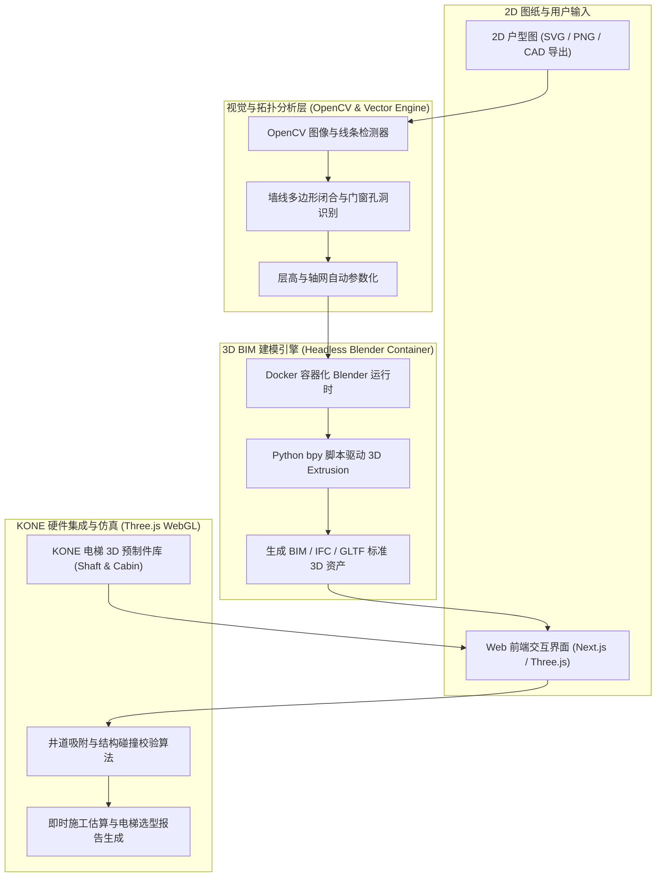

# [2024 Winner Case Study] KONE — QuickBIM by Mankeli Solutions (Jesse Lappalainen & Team)

## 1. 元数据概览 (Metadata)

- **对应赛题文件**: [`2024_KONE_BIM_For_Any_Building.md`](file:///C:/Users/Jiang/.gemini/antigravity/scratch/hackjunction/docs/past/silver/zh/Hardware/2024_KONE_BIM_For_Any_Building.md)
- **赛道**: IoT & Hardware / Construction Tech (Agentic 3D & Digital Twin)
- **出题方 (Partner)**: **KONE** (通力电梯与自动扶梯全球工程巨头)
- **赛题名称**: BIM for any building, by anyone (任何人、任何建筑的建筑信息模型)
- **获奖项目**: **QuickBIM**
- **获奖荣誉**: **Junction 2024 全场总季军 (Overall 3rd Place) 🥉 & KONE 赛道最高荣誉入围主舞台演讲 (Top 10 Finalist)**
- **开发团队**: **Mankeli Solutions** (芬兰图尔库高新技术软件工作室)
- **核心成员**:
  - **Jesse Lappalainen**: 首席执行官 & 全栈工程师 (CEO & Co-Founder at Mankeli Solutions)
  - **Juho Torkkeli**: 联合创始人 & 软件架构师 (Co-Founder & Developer)
  - **Aku Paananen**: 联合创始人 & 前端/视觉工程师 (Co-Founder & Developer)
  - **Onnimanni Hannonen**: 联合创始人 & 后端/算法工程师 (Co-Founder & Developer)
- **官方博客专访与回顾**: [jemlap.fi/blog/junction-2024](https://jemlap.fi/blog/junction-2024)
- **GitHub 开源仓库**: [github.com/Mankeli-Software/quickbim](https://github.com/Mankeli-Software/quickbim)

---

## 2. 获胜者背景与领英资料 (LinkedIn Profile & Background)

- **核心主创**: Jesse Lappalainen
- **领英主页 (LinkedIn)**: [Jesse Lappalainen on LinkedIn](https://www.linkedin.com/in/jesse-lappalainen/)
- **个人作品集官网**: [jemlap.fi](https://jemlap.fi)
- **工作室官网**: [mankelisolutions.fi](https://mankelisolutions.fi)
- **工程背景**:
  - 图尔库大学 (University of Turku) 计算机科学与软件工程背景，活跃于芬兰本地开发者社群 Digit ry；
  - 创立 Mankeli Solutions Oy，承接移动端、高精 Web 3D 渲染与云原生微服务开发；
  - **Junction 连胜老手**: 曾在 Junction 2023 斩获 Huawei 赛道全球第二名 (2nd Place)，并在 Junction 2024 带领 Mankeli 团队以 QuickBIM 杀入全球总决赛前三名。

---

## 3. 项目背景与痛点破解 (Project Concept & Solution)

### 3.1 KONE 出题痛点
在传统电梯加装、楼宇现代化翻新与设施管理中，全球超过 80% 的既有建筑仅留存泛黄的 2D 平面图纸或扫描版 SVG/PDF，完全缺乏现代建筑信息化模型 (BIM - Building Information Modeling)。为老旧建筑量身定制电梯方案通常需要资深勘测师与建筑师耗费数周进行 3D 手工建模，成本高昂且周期冗长。

### 3.2 QuickBIM 破局创新
QuickBIM 提出“从 2D 图纸到沉浸式 3D 电梯配置只需 30 秒”：
1. **即时图纸矢量解析**: 用户上传任意 2D 户型图或 SVG 图纸；
2. **AI 与几何算法提取**: 结合训练过的 OpenCV 计算机视觉模型与矢量几何计算，精准识别墙体闭合回路、承重墙位置、门窗洞口与走廊走线；
3. **自动化 3D 挤出生成**: 后台驱动无头 Docker 化 Blender 脚本，将 2D 拓扑结构毫秒级拉伸为符合 IFC/BIM 标准的三维建筑空间；
4. **交互式 KONE 电梯热插拔**: 用户在三维网页视图中自由拖拽 KONE 标准电梯井道模型，实时检测碰撞、层高对齐与逃生通道合规性。

---

## 4. 获奖项目核心技术架构深潜 (Technical Architecture)

### 关键技术点：
1. **Blender in Docker (自动化无头渲染管道)**:
   - 克服了传统 CAD 软件笨重不可调用的缺陷，将 Blender 打包进轻量 Linux 容器，通过 Python API (`bpy`) 接收拓扑坐标并进行布尔运算切削，秒级产出 GLTF 并在前端 Three.js Canvas 中呈现。
2. **智能墙体与门窗语义识别**:
   - 算法并非简单像素描边，而是将墙体分为外承重墙与内隔墙，自动避开承重柱计算电梯井道的合理开挖区域。
3. **现场演示压倒性表现**:
   - 在决赛主舞台路演中，团队仅用现场随手涂鸦的一张简易平面图，几秒内即时生成了逼真的多层 3D 建筑并平稳滑入一部 KONE 电梯轿厢，引爆全场评审。

---

## 5. 赛题契合度与评审映射 (Judging Matrix)

| 赛题评审维度 | QuickBIM 的实现方案与亮点 |
| :--- | :--- |
| **BIM by Anyone (零门槛大众化)** | 摆脱 Revit/Tekla 复杂学习曲线，普通楼宇业主或物业管理员拖拽图纸即可一键生成 BIM。 |
| **BIM for Any Building (跨时代通用性)** | 不挑图纸格式，无论是老旧手绘扫描图还是现代矢量 SVG，均能稳定抽取空间几何结构。 |
| **Commercial Value for KONE (商业变现)** | 极大地缩短 KONE 现代化升级 (Modernization) 销售团队的出图与报价周期，把咨询周期从 2 周压进 2 分钟。 |

---

## 6. 关联参考资料 (References)

- **获胜者领英**: [Jesse Lappalainen on LinkedIn](https://www.linkedin.com/in/jesse-lappalainen/)
- **团队技术博客复盘**: [jemlap.fi/blog/junction-2024](https://jemlap.fi/blog/junction-2024)
- **开源代码仓库**: [GitHub - Mankeli-Software/quickbim](https://github.com/Mankeli-Software/quickbim)
- **Mankeli 官网**: [https://mankelisolutions.fi](https://mankelisolutions.fi)
- **对应赛题存档**: [2024_KONE_BIM_For_Any_Building.md](file:///C:/Users/Jiang/.gemini/antigravity/scratch/hackjunction/docs/past/silver/zh/Hardware/2024_KONE_BIM_For_Any_Building.md)
