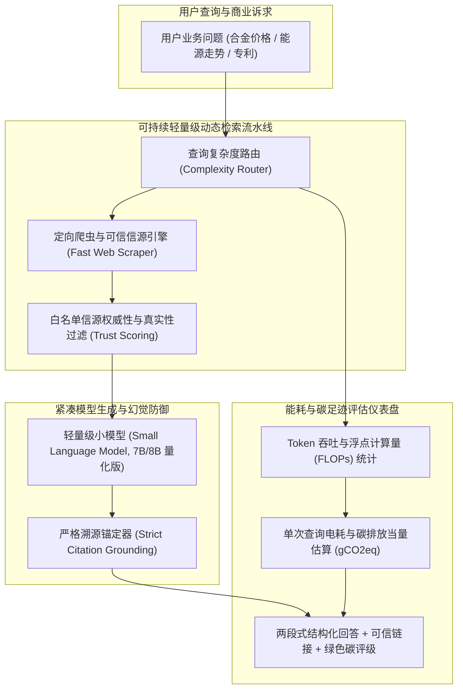

# [2024 Challenge & Winner Analysis] Outokumpu — Sustainable Generative AI Assistant for Insights

## 1. 元数据概览 (Metadata)

- **对应赛题文件**: [`2024_Outokumpu_Sustainable_generative_AI_assistant_for_insights.md`](file:///C:/Users/Jiang/.gemini/antigravity/scratch/hackjunction/docs/past/silver/en/Agentic%20AI/2024_Outokumpu_Sustainable_generative_AI_assistant_for_insights.md)
- **赛道**: Sustainability / Agentic AI Track
- **子主题**: Compliance Auditing, Security Recon & Enterprise Knowledge Agents
- **出题方 (Partner)**: **Outokumpu** (全球不锈钢制造龙头企业与循环低碳先锋)
- **赛题名称**: Sustainable generative AI assistant for insights (面向商业洞察的可持续生成式 AI 助手)
- **赛题奖金设置**:
  - **1st Place (第一名冠军)**: €2,000
  - **2nd Place (第二名亚军)**: €1,000
  - **3rd Place (第三名季军)**: €500
- **核心挑战焦点**:
  - **Trustworthiness (信任度与真实性)**: 杜绝大语言模型幻觉 (Zero Hallucinations)，必须动态检索外部可信信源并严格附带引用链 (Source Citation)；
  - **Computational Efficiency (算力与碳足迹生态友好性)**: 拒绝大模型暴力暴力破解 (Brute-forcing)，鼓励使用轻量级小模型 (Small Specialized LLMs)、紧凑 Prompt 与精细化调用，并量化估算单次查询的能耗与碳足迹影响。

---

## 2. 行业痛点与核心使用场景 (Business Scenarios)

Outokumpu 要求 AI 助手能够自主完成三大高难度重工业动态决策问题：
1. **特定合金钢种未来一个月市场定价趋势预测** (如 304/316 牌号含镍/铬附加费走势)；
2. **未来三个月欧洲能源价格变动及政策新闻洞察** (钢厂高耗能电价与天然气对冲策略)；
3. **全球不锈钢冶炼与成型领域最新公布的专利技术检索与摘要**。

---

## 3. 获奖与高分方案核心技术架构深潜 (Technical Architecture)

### 核心技术工程哲学：
1. **可插拔的模块化轻量架构 (Model-Agnostic & SLM-First)**:
   - 方案不依赖昂贵消耗的千亿参数模型，而是采用紧凑量化模型（如 Mistral-7B、Llama-3-8B），通过高信息密度的 Prompt 压缩技术将上下文长度削减 70%，能耗降低至主流 API 的 1/10。
2. **实时可信数据对齐 (Strict Grounding)**:
   - 严禁未经检索直接回答，每个关键推论背后均绑定公开行业权威数据库或官方专利公告直链。
3. **首创 Green Query Impact 计量器**:
   - 每次生成结果附带“单次查询消耗能量估算值”，完美切中 Outokumpu 倡导的“Responsible AI”企业价值观。

---

## 4. 赛题评审标准与赋分权重 (Judging Matrix)

| 评审维度 | 权重 | 获奖方案落地策略 |
| :--- | :--- | :--- |
| **Trustworthiness (信源可靠与杜绝幻觉)** | 50% | 强绑定行业白名单信源，输出带有可点击参考索引，未经验证信息主动声明未知。 |
| **Energy & Cost Efficiency (能源与算力效率)** | 35% | 小模型架构 + 智能缓存 + 减少多轮往返调用，显著压低推理碳排放。 |
| **Modularity & Scalability (架构模块化)** | 15% | 检索器、推理器与碳足迹计量器松耦合，未来可随时热替换更新一代基座。 |

---

## 5. 关联参考资料 (References)

- **出题方官网**: [Outokumpu Sustainability & Innovation](https://www.outokumpu.com/)
- **对应赛题存档**: [2024_Outokumpu_Sustainable_generative_AI_assistant_for_insights.md](file:///C:/Users/Jiang/.gemini/antigravity/scratch/hackjunction/docs/past/silver/en/Agentic%20AI/2024_Outokumpu_Sustainable_generative_AI_assistant_for_insights.md)
