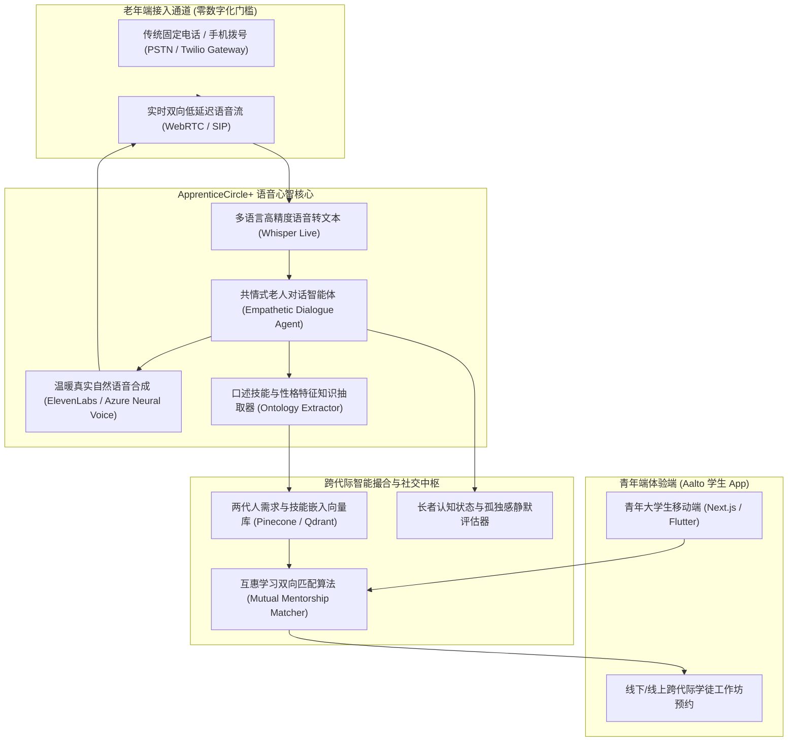

# [2025 Winner Case Study] Aalto University — ApprenticeCircle+ by Tommin Teekkarit

## 1. 元数据概览 (Metadata)

- **对应赛题文件**: [`2025_Aalto_University_Aging_with_AI.md`](file:///C:/Users/Jiang/.gemini/antigravity/scratch/hackjunction/docs/past/silver/en/Agentic%20AI/2025_Aalto_University_Aging_with_AI.md)
- **赛道**: Health & Society / Agentic AI Track (Human-Centered Voice AI)
- **出题方 (Partner)**: **Aalto University** (阿尔托大学科研转化团队 AR4U / Research-to-Business Team)
- **赛题名称**: Aging with AI (AI 助老：以人为本的老龄化社会关怀与智能生活)
- **获奖项目**: **ApprenticeCircle+**
- **获奖荣誉**: **Aalto University 挑战赛道总冠军 (Track Winner 🥇)**
- **参赛战队**: **Tommin Teekkarit** (阿尔托理工精英战队)
- **核心成员**:
  - **Alex Kozorenko**: 战略与组织设计硕士 (Aalto University MSc Strategy & Organisational Design)
  - **Risto Hartikainen**: 计算机科学硕士 (Aalto University MSc Computer Science)
  - **Juuso Syrjälä**: 计算机科学硕士 (Aalto University MSc Computer Science)
- **官方报道与表彰发布**: [Aalto.fi 官方深度报道](https://aalto.fi)

---

## 2. 老龄化社会痛点与人文关怀背景 (Aging Society Challenges)

芬兰是全欧洲人口老龄化速度最快的国家之一，65 岁以上老年人口占比持续攀升。
传统的助老科技往往陷入两大误区：
1. **“数字鸿沟 (Digital Divide)”壁垒高企**: 现有的移动 App 充斥着繁琐的注册流程、复杂的验证码和密集的菜单，许多高龄长者甚至连触控屏幕都难以熟练操作，被阻绝在数字社会之外；
2. **“病理化 (Medicalization)”视角过重**: 绝大多数老年科技产品仅把老人视为“需要服药和防止跌倒的病人”，忽视了老年人最根本的精神心理诉求——**社会归属感、价值被认可感以及对抗孤独的渴望**；
3. **跨代际割裂**: 年轻人缺乏传统工艺、生活经验与口述历史的传承窗口，而老人空有数十年的专业技能与生活智慧却无人倾听。

---

## 3. ApprenticeCircle+ 项目解决方案 (Innovative Concept)

Tommin Teekkarit 战队打造了名为 **ApprenticeCircle+** 的“语音优先 (Voice-First) 跨代际技能传承与社交纽带平台”：
1. **零触控摩擦的 10 分钟电话建档 (Frictionless Phone Onboarding)**:
   - 老年人完全不需要下载任何 App，只需拨打一个本地固定电话号码。后台的 AI 语音 Agent 以温和耐心的语气与老人像老朋友一样聊天 10 分钟（“您年轻时最自豪的手艺是什么？平时喜欢侍弄花草还是木工？”），自动提取技能图谱与性格偏好；
2. **跨代际学徒圈 (Generational Pairing Engine)**:
   - 将拥有丰富技能的老年人（如传统木工、手工编织、经典烹饪、园艺技巧）与渴望学习生活技能、寻求职业人生建议的年轻大学生进行精准智能撮合；
3. **安全守护与情感伴聊双闭环**:
   - 在连接社交生活的同时，Agent 在后台自然监测长者的认知功能、语言流畅度与心理状态，当检测到情绪严重低落或异常失联时，柔性通知社区看护人员。

---

## 4. 获奖项目核心技术架构深潜 (Technical Architecture)

---

## 5. 阿尔托大学赛道评审契合度分析 (Judging Criteria)

| 评审指标 | ApprenticeCircle+ 的卓越解法 |
| :--- | :--- |
| **Radical Accessibility (极致易用性)** | 彻底抛弃移动屏幕，以一通最普通的电话作为交互入口，真正消除了高龄老人的数字鸿沟。 |
| **Human Dignity & Empowerment (赋予长者尊严与价值)** | 扭转了传统看护将老人置于“被施舍、被照顾”的被动地位，让他们成为受尊重的“导师与工匠”。 |
| **Ethical AI & Privacy (伦理与隐私考量)** | 契合 Aalto AR4U 的医学伦理要求，语音分析严格遵循本地医疗数据脱敏规范。 |

---

## 6. 关联参考资料 (References)

- **阿尔托大学官方深度专访**: [aalto.fi/en/news](https://www.aalto.fi)
- **对应赛题存档**: [2025_Aalto_University_Aging_with_AI.md](file:///C:/Users/Jiang/.gemini/antigravity/scratch/hackjunction/docs/past/silver/en/Agentic%20AI/2025_Aalto_University_Aging_with_AI.md)
