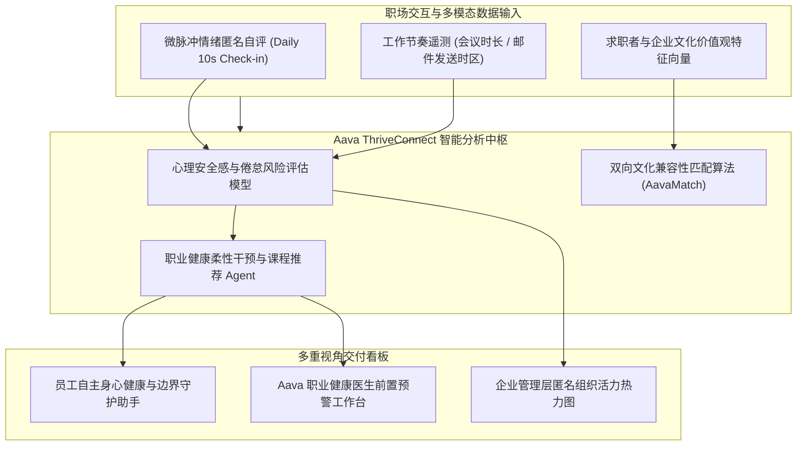

# [2025 Winner Case Study] Lääkärikeskus Aava — ThriveConnect by Winning Teams

## 1. 元数据概览 (Metadata)

- **对应赛题文件**: [`2025_Laakarikeskus_Aava_ThriveConnect_Redefine_Work_Well-being.md`](file:///C:/Users/Jiang/.gemini/antigravity/scratch/hackjunction/docs/past/silver/zh/Healthcare/2025_Laakarikeskus_Aava_ThriveConnect_Redefine_Work_Well-being.md)
- **赛道**: Health & Wellbeing / Occupational Health & HR Tech
- **出题方 (Partner)**: **Lääkärikeskus Aava** (芬兰大型私立医疗集团 / Aava Medical Centre)
- **赛题名称**: ThriveConnect: Redefine Work Well-being (重塑职场身心健康：心理安全与价值观对齐)
- **挑战热度**: 超过 **50 支国际团队** 针对该赛题提交完整解决方案
- **Aava 官方评审委员会评选出的三大优胜项目 (Top 3 Winning Teams)**:
  1. **【Winner 1】: 《MatterYouMust》**
  2. **【Winner 2】: 《AavaMatch》**
  3. **【Winner 3】: 《BalancedHub》**
- **出题方官方深度专访报道**: [Lääkärikeskus Aava 官方新闻](https://aava.fi)

---

## 2. 芬兰职场心理健康背景与痛点 (Occupational Health Context)

芬兰在联合国“全球最幸福国家”排行榜上连年拔得头筹，但芬兰职场同样面临隐匿且严重的“职场倦怠 (Burnout)”和心理亚健康挑战：
1. **价值观与企业文化错位 (Cultural Mismatch)**: 大量优秀求职者在入职后才发现企业崇尚“全天候待命”或缺乏心理安全感，导致半年内迅速耗竭离职；
2. **职业健康介入严重滞后**: 员工通常在心理防线彻底崩溃、产生抑郁倾向甚至申请长期病假时，才走进职业健康医生的诊室；
3. **传统雇主品牌宣发失真**: 招聘网站上的“扁平化管理”、“重视工作生活平衡”往往沦为空洞的宣传口号，缺乏透明客观的第三方量化指标。

---

## 3. 三大优胜方案的核心创新矩阵 (Winning Solutions Matrix)

### 3.1 MatterYouMust (让每个人被看见)
聚焦于职场日常工作中的“被重视感与心理安全感”。利用微型日常匿名脉冲调查（Micro-Pulse Mood Surveys）与情感分析模型，为团队领导者提供去中心化的“心理健康雷达”，及时发现组织中被边缘化或过载的个体，防范团队倦怠蔓延。

### 3.2 AavaMatch (双向价值观智能对齐)
以医疗机构的严谨性重构招聘流程。借鉴性格心理学与职场压力测试量表，让求职者与招聘企业在匹配初期就透明公开“加班预期、反馈文化、远程灵活性与错误容忍度”，通过双向匹配算法从源头上杜绝“毒性职场”错配。

### 3.3 BalancedHub (平衡中枢)
打造了一套打通职业健康诊所与企业内部协同软件（Slack/Teams）的即时平衡中枢。当监测到某团队连续数周存在深夜回复邮件、高频会议冲突时，系统以“温和的健康助理”身份自动介入，建议阻断无效会议并推送 Aava 职业心理学家的减压微课程。

---

## 4. 获奖项目核心技术架构深潜 (Technical Architecture)

---

## 5. Aava 评审委员会契合度分析 (Judging Criteria)

| 评审指标 | 表现与落地点 |
| :--- | :--- |
| **Psychological Safety (心理安全感与隐私底线)** | 严格遵循芬兰极其严苛的数据隐私法（GDPR），所有企业级洞察均为聚合脱敏数据，绝不出售或侵犯个人隐私。 |
| **Preventative Focus (重在事前预防而非事后治疗)** | 彻底扭转“生病才看医生”的传统思维，将职业健康的触角延展到招聘的第一天与日常工作中。 |
| **High Feasibility & Empathy (极高的人文同理心与落地度)** | 三个获奖项目均展现出对现代职场人群心理状态的深度体察，获得 Aava 资深临床心理专家高度认可。 |

---

## 6. 关联参考资料 (References)

- **Lääkärikeskus Aava 官方报道**: [aava.fi](https://aava.fi)
- **对应赛题存档**: [2025_Laakarikeskus_Aava_ThriveConnect_Redefine_Work_Well-being.md](file:///C:/Users/Jiang/.gemini/antigravity/scratch/hackjunction/docs/past/silver/zh/Healthcare/2025_Laakarikeskus_Aava_ThriveConnect_Redefine_Work_Well-being.md)
