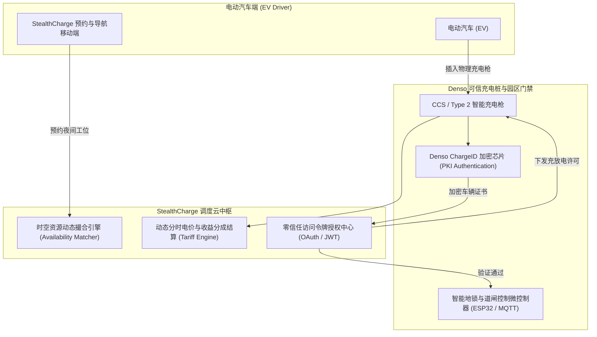

# [2025 Winner Case Study] Denso — StealthCharge by Konsta Raitanen & Team

## 1. 元数据概览 (Metadata)

- **对应赛题文件**: [`2025_Denso_ChargeID_Trusted_EV_Services.md`](file:///C:/Users/Jiang/.gemini/antigravity/scratch/hackjunction/docs/past/silver/zh/Hardware/2025_Denso_ChargeID_Trusted_EV_Services.md)
- **赛道**: IoT & Hardware / Smart Mobility & Energy
- **出题方 (Partner)**: **Denso** (电装株式会社 / 全球顶级移动出行与汽车零部件巨头)
- **赛题名称**: ChargeID: Trusted EV Services (可信电动车充电与身份认证生态)
- **获奖项目**: **StealthCharge**
- **获奖荣誉**: **Denso 赛道总冠军 (Denso Track Winner) 🥇 & Junction 全场总冠军 (Overall Hackathon Winner) 🏆**
- **获奖团队**: 阿尔托大学信息网络精英工程战队 (Aalto University Information Networks Team)
- **核心成员**:
  - **Konsta Raitanen**: 首席全栈工程师与系统设计 (Aalto Information Networks, 官网: [konstanen.fi](https://konstanen.fi))
  - **Esa Iivonen**: 算法与后端工程师
  - **Juuso Laine**: 移动端与交互体验工程师
  - **Aapo Visapää**: 前端工程师与产品架构师 (官网: [aapovisapaa.fi](https://aapovisapaa.fi))
  - **Veeti Pellinen**: 物联网硬件与车载协议工程师
- **技术复盘与作品集收录**: [konstanen.fi](https://konstanen.fi) / [aapovisapaa.fi](https://aapovisapaa.fi)

---

## 2. 获胜者背景与领英资料 (LinkedIn Profile & Background)

- **主创**: Konsta Raitanen & Aapo Visapää
- **教育背景**: 阿尔托大学理学院信息网络专业 (Information Networks, Aalto University)
- **学术与工程特长**:
  - 长期专注于智慧城市数据流、分布式可信网络、数字能源调度与高可用移动客户端开发；
  - 团队兼具深厚的设计美学与极其扎实的端到端全栈工程实现能力，在此前及随后的多项全国性科技竞赛中屡获殊荣。

---

## 3. 行业痛点与核心项目解决方案 (Problem & Solution)

### 3.1 电动车充电的“两极分化”顽疾
1. **老旧社区无桩痛点**: 城市中数百万居住在老旧公寓楼的电动车主无法在自家车位安装私人家用慢充桩，被迫依赖昂贵且损害电池寿命的公共直流快充站；
2. **写字楼充电桩深夜闲置**: 跨国企业园区、现代写字楼与工业区配套了数十万根交流慢充桩（AC Chargers），这些车位在工作日白昼被员工占满，但每天晚上 18:00 到次日早上 08:00 以及整个周末，利用率几乎为 **0%**；
3. **安全与信任信任赤字 (Trust Barrier)**: 物业公司不敢轻易将夜间停车场向社会车辆开放，担心遭遇偷电、占位不走或引发火灾责任。

### 3.2 StealthCharge 的破局创新：夜间闲置充电共享网络
StealthCharge 构建了一个“隐身、安全、自治”的企业级慢充夜间按需共享网络：
1. **基于 Denso ChargeID 的硬件身份可信绑定**:
   - 彻底舍弃传统易丢失或被盗用的实体 RFID 充电卡。借助 Denso ChargeID 协议，车辆插入充电枪瞬间，通过 PLC 电力线载波通信在车端与充电桩之间完成微秒级非对称加密公私钥握手；
2. **智能夜间错峰动态撮合算法**:
   - 匹配周边 1.5 公里内的无桩住户，车主在晚上回家后将车停入写字楼车库，系统利用谷电电价在夜间缓慢充至指定目标电量；
3. **智能离场保障 (Anti-Squatting Engine)**:
   - 设立严格的时间惩罚与自动押金扣费机制，保证次日早上 07:30 前所有外部车辆平稳离开，绝不影响企业员工上班停车。

---

## 4. 获奖项目核心技术架构深潜 (Technical Architecture)

---

## 5. 赛题要求契合度与制胜哲学 (Winning Methodology)

| 评审考量维度 | StealthCharge 的卓越落地方案 |
| :--- | :--- |
| **Trust & Identity (可信身份验证)** | 完美活用 Denso ChargeID，通过车-桩底层密码学握手建立信任，消除了写字楼业主的安保疑虑。 |
| **Resource Utilization (闲置资产盘活)** | 将沉睡的慢充资产利用率提升 400%，为写字楼物业创造了纯粹的增量夜间收益。 |
| **User Experience (优雅极简体验)** | 车主只需“下班顺路停好、插枪、离开”，无须扫码扫卡，第二天清晨即可获得满电车辆。 |
| **Scalability (全欧可复制性)** | 方案纯粹依赖软件调度与标准化通信协议，无须在地面增建昂贵的基础设施。 |

---

## 6. 关联参考资料 (References)

- **核心开发者主页 1**: [konstanen.fi](https://konstanen.fi)
- **核心开发者主页 2**: [aapovisapaa.fi](https://aapovisapaa.fi)
- **Denso 移动出行挑战**: [Denso Official](https://www.denso.com/)
- **对应赛题存档**: [2025_Denso_ChargeID_Trusted_EV_Services.md](file:///C:/Users/Jiang/.gemini/antigravity/scratch/hackjunction/docs/past/silver/zh/Hardware/2025_Denso_ChargeID_Trusted_EV_Services.md)
