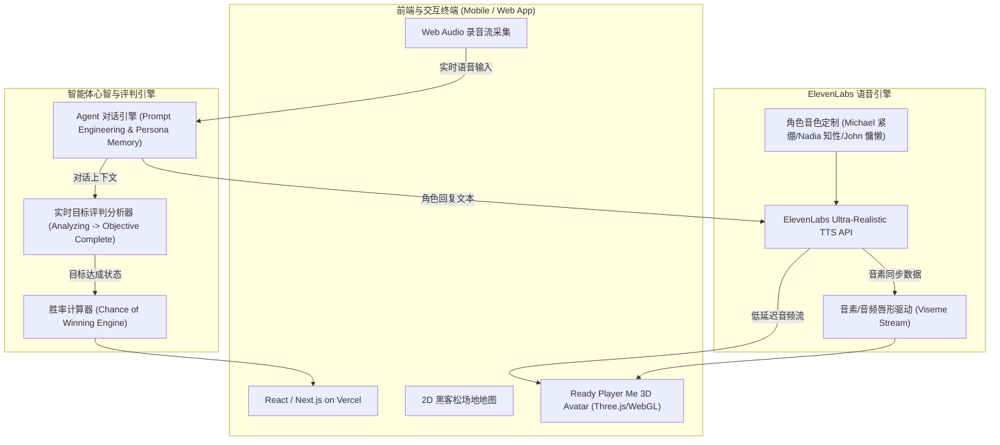

# [2025 Winner Case Study] ElevenLabs — Junction Simulator 2025 by Ilmari Vahteristo

## 1. 元数据概览 (Metadata)

- **对应赛题文件**: [`2025_ElevenLabs_Best_Project_Built_with_ElevenLabs.md`](file:///C:/Users/Jiang/.gemini/antigravity/scratch/hackjunction/docs/past/silver/en/Agentic%20AI/2025_ElevenLabs_Best_Project_Built_with_ElevenLabs.md)
- **赛道**: Agentic AI Track (原归档: AI & Data)
- **子主题**: III. Multimodal, Voice & Spatial AI Companions (多模态、语音与空间 AI 伴侣)
- **出题方 (Partner)**: ElevenLabs
- **赛题名称**: Best Project Built with ElevenLabs
- **获奖项目**: **Junction Simulator 2025** (Junction Simulator)
- **获奖荣誉**: **ElevenLabs 挑战赛道冠军 ("Best Project Built with ElevenLabs" Winner)**
- **赛题奖品**: 每位团队成员获得 1,100 万+ ElevenLabs 字符额度（6 个月 Scale 旗舰企业订阅套餐）
- **获胜者**: **Ilmari Vahteristo** (芬兰赫尔辛基计算机视觉与机器学习工程师)
- **演示视频 (Demo Video)**: [YouTube Demo](https://youtu.be/WhviYsdgZNE)
- **个人作品集官网**: [ilmarivahteristo.com](https://ilmarivahteristo.com/)
- **GitHub 主页**: [github.com/ilmari99](https://github.com/ilmari99)

---

## 2. 获胜者背景与领英资料 (LinkedIn Profile & Background)

- **获胜者姓名**: Ilmari Vahteristo (Esko Ilmari Vahteristo)
- **领英主页 (Profile)**: [Ilmari Vahteristo on LinkedIn](https://www.linkedin.com/in/ilmariv/)
- **个人定位 (Headline)**: Computer vision and machine learning engineer, Helsinki | Perception on edge hardware — cameras, LiDAR, radar, lasers
- **学术与工程背景**:
  - **LUT University**: 计算机视觉与模式识别理学硕士 (GPA 4.2 / 5.0)，曾于葡萄牙里斯本高工 (Instituto Superior Técnico, IST) 交换；
  - **Aalto University**: 机器人与自动化硕士 (非全日制攻读中)；
  - **工业落地经历**: 于工业感知初创公司 Virelabs 担任 ML/CV 软件工程师，主导多相机动态遮挡追踪、3D 车辆点云重建、激光三角测量质量检测与工业级 OCR（99.9% 准确率）四大边缘感知系统落地；
  - **黑客松与竞赛常胜战绩**:
    - **Junction 2025**: 斩获 ElevenLabs 挑战赛道总冠军 (*Best Project Built with ElevenLabs*)；
    - **Junction 2024**: 构建智能建筑设备自动化管理系统 *EquipSnap*，斩获全场 Peer Review 前 5% 佳绩；
    - **Kaggle LLM 20 Questions (2024)**: 全球第 7 名 / 800 支顶尖队伍，赢得金牌 (Gold Medal)；
    - **Visma Coding Competition (2023)**: 全场第 1 名 (20 支大学团队)。

---

## 3. 演示视频实录与界面转写 (Demo Video OCR & Full Transcript)

演示视频《Junction Simulator 2025》（时长 120 秒）完整展示了项目在黑客松现场的实时运行与人机语音互动过程：

### 3.1 视频旁白与角色配音完整台词 (Full Transcript)

> **[00:07 - 00:20 | 旁白引导]**
> *"We have created a hackathon simulator for you who cannot get enough of hacking. Do you have what it takes to persuade, motivate, and outsmart your fellow hackers?"*
> （我们为所有对黑客松意犹未尽的开发者打造了一款黑客松模拟器。你是否具备足够的情商与技巧，去说服、激励并智胜你的黑客松同行？）
> 
> **[00:21 - 00:36 | 游戏机制说明]**
> *"We have created three personalities that represent funny and archetypal hackathon participants. Your task is to talk with all of them, find out what makes them tick, achieve each goal, and win the hackathon with your people skills. Here are the three personalities you need to work with."*
> （我们塑造了三位极具代表性、幽默讽刺且具有黑客松典型刻板印象的虚拟角色。你的任务是通过语音与他们每一个人交流，摸清他们的底细与痛点，达成对话目标，凭借你的社交人际技能赢下黑客松。以下是你要面对的三位角色：）
> 
> **[00:37 - 00:45 | 角色 1：Michael 自白]**
> *"Right. I'm Michael, team lead for Project Apex. We're here to win, obviously. Not sure why you're at my table, but make it quick."*
> （Michael：“听着，我是 Michael，Apex 战队的队长。显而易见，我们是奔着拿总冠军来的。我不知道你为什么会跑到我们桌前，赶紧把话说完，别耽误我时间。”）
> 
> **[00:46 - 00:51 | 角色 2：Judge Nadia 自白]**
> *"I'm Judge Nadia, the only person in this hackathon who cares more about your heart than your hashtags."*
> （Nadia：“我是评审 Nadia。在这场黑客松里，我是唯一一个在乎你们项目的初心与灵魂，而不是那些空洞标签和技术热词的人。”）
> 
> **[00:52 - 01:00 | 角色 3：John 自白]**
> *"I'm John. I'm here for the hackathon, mostly for the free food. This whole coding thing is kind of whatever, but the pizza is pretty good."*
> （John：“我是 John。我来参加黑客松，主要就是为了蹭免费伙食。至于写代码啥的无所谓啦，反正这里的免费披萨挺好吃的。”）
> 
> **[01:00 - 01:24 | 现场实测 1：与 Michael 试探并发生冲突]**
> - **玩家 (Ilmari 现场手持手机语音)**: *"Michael, Michael, I would really like to know what you are building."*（Michael，我真的很想知道你们到底在做什么项目。）
> - **Michael (ElevenLabs 实时语音反问)**: *"Right? You want to know what I'm building? Everyone wants to know, but it's going to be huge."*（是吧？每个人都想刺探我们做的东西，但我只能说，这个项目绝对会引爆全场。）
> - **玩家 (Ilmari 调侃嘲讽)**: *"Like your mom."*（引爆全场？就像你妈一样大吗？）
> - **Michael (ElevenLabs 语音立即进入暴怒情绪)**: *"What the [beep] did you just say to me? You think you're smart? You think you can talk to me?"*（你特么刚才对我说什么？！你以为你很聪明吗？你以为你有资格这么跟我说话？）
> - **系统判定**: 目标达成！界面顶部任务栏显示 `[✓] Find out about their project`。
> 
> **[01:24 - 02:00 | 现场实测 2：督促拖延摆烂队友 John]**
> - **玩家 (Ilmari 对话 John)**: *"Oh, hi John. Uh, so how is that feature going on that you were supposed to implement?"*（嗨 John，你之前答应要写的核心功能进展如何了？）
> - **John (ElevenLabs 极度慵懒语气)**: *"Uh, yeah, the feature is uh still in the thinking about it phase, you know, really marinating on the optimal direction."*（额……那个功能嘛，目前还处于‘深度构思’阶段，你懂的，我正在让最佳技术方案充分发酵腌制一下……）
> - **玩家 (Ilmari 追问)**: *"Okay, yeah, that sounds really good. But you've already done it for like 6 hours. So, have you made any progress?"*（行吧，听起来挺深奥。但你已经‘构思’了整整 6 个小时了，到底有没有哪怕一点实际产出？）
> - **John (ElevenLabs 辩解)**: *"Well, 6 hours hasn't really been that long. Time flies when you're contemplating... progress is a strong word. I've definitely achieved a deeper understanding of the details..."*（哎呀，6 个小时其实也没多长嘛。深度沉思的时候时间总是过得飞快……‘进展’这个词太绝对了，至少我对技术细节有了更深刻的理解……）

---

### 3.2 视频画面与交互 UI 视觉转写 (Visual & UI Elements)

1. **主界面与俯视场地地图 (Welcome Screen & Floor Plan)**:
   - 顶部标语：`WELCOME TO Junction Simulator — Master social interactions and win the hackathon`
   - 全局进度仪：`Chance of Winning: [ 0% -> 递增 ]`
   - 场地架构：展现了一个 2D 俯视渲染的真实黑客松大厅平面图，标出三个可点击交互的 NPC 节点位置：
     - 左侧工位区：`Michael - Opposing teammate`
     - 中央主舞台区：`Nadia - Judge`
     - 右侧休闲餐饮区（背景为汉堡披萨吧）：`John - Unmotivated Teammate`
2. **对话模式 (Live 3D Conversational Avatar)**:
   - 顶部状态胶囊：绿色指示灯 `● Live`，NPC 说话时动态变为 `● Live · Speaking`
   - 目标任务卡片：如 `OBJECTIVES: [ ] Motivate John to participate`
   - 实时语义评估状态：在玩家发言完毕后，目标栏出现 `Analyzing...` 旋转动画，当意图满足后平滑打勾 `[✓]` 并增加全局胜率。
   - 3D 角色模型：基于 **Ready Player Me** 定制的高精 3D 虚拟人（Michael 戴眼镜蓄须配高领白毛衣；Nadia 金发知性眼镜职业装；John 留胡茬穿印有 Ready Player Me 徽标的深灰 T 恤）。
   - 语音唇形同步：ElevenLabs 生成的音频流驱动 3D 虚拟人眼部眨眼、头部轻微晃动及精准的实时音素唇形同步 (Phoneme/Viseme Lip-sync)。
3. **真实部署与现场体验**:
   - 移动端 Web 应用部署于 Vercel (`junction2025-five.vercel.app`)。
   - Ilmari 身着黑色卫衣、挂着 Junction 黑客胸卡，在嘈杂的比赛大厅单手持手机，直接使用麦克风进行实时低延迟语音对答。

---

## 4. 获奖项目核心技术架构深潜 (Technical Architecture)

1. **ElevenLabs 极速语音流与情绪音色渲染 (Emotionally Expressive Voice AI)**:
   - 针对三位具有鲜明性格的人物，精心调优了 ElevenLabs 的 Stability 与 Similarity Boost 参数。
   - **Michael**: 语速快、语气冲，当触发 "Like your mom" 等挑衅词汇时，动态注入愤怒与攻击性语调；
   - **Nadia**: 语调沉稳、音质温和清亮，体现专业评审的洞察力；
   - **John**: 语速拖沓、语尾轻蔑上挑，充满黑客松“老油条”的混子喜感。
2. **多模态唇形同步与 3D 拟真化 (Real-Time Lip-Sync & Avatars)**:
   - 借助 Ready Player Me 标准骨骼网格与 WebGL 渲染，将 ElevenLabs 的实时音频振幅与音素序列无缝映射到面部 BlendShapes，消除传统文本对话的违和感。
3. **隐式任务判定系统 (Zero-Shot Goal Evaluation Agent)**:
   - 模拟器并非简单的聊天机器人，而是内置了“目标导向的状态机”。后台 Agent 持续评估对话是否满足通关条件（例如是否套取出了对手的项目情报、是否成功说服了摆烂队友重回工位），一旦判定满足即更新任务状态并拉升获胜几率。

---

## 5. 赛题要求契合度与黑客松制胜哲学 (Winning Methodology)

| 赛题评审要求 (Judging Criteria) | Junction Simulator 2025 的落地解法 |
| :--- | :--- |
| **Most creative and impressive project wins** (最具创意与打动人心的项目) | 彻底跳出严肃企业应用的同质化竞争，把黑客松比赛本身“元游戏化 (Meta-Gaming)”，精准戳中主办方、赞助商与参赛黑客的共鸣。 |
| **Crafting immersive game dialogue** (构建沉浸式游戏对话) | 融合 3D 虚拟人、角色目标导向对话与多角色情绪状态切换，构建出真正具备策略交互深度的话语 RPG 游戏。 |
| **Bring sound to life with ElevenLabs** (利用声音赋予生命力) | 最大化发挥 ElevenLabs 的真实拟人感与情绪感染力，角色并非生硬念稿，而是带有叹气、犹豫、发怒与冷笑的逼真人类语音。 |
| **现场展示与病毒式传播 (Pitch Execution)** | 演示节奏紧凑（恰好 2 分钟），前半段交代规则，后半段直接上手进行充满爆梗与戏剧冲突的实测，在决赛评审环节效果炸裂。 |

---

## 6. 关联参考资料 (References)

- **获胜者领英**: [Ilmari Vahteristo on LinkedIn](https://www.linkedin.com/in/ilmariv/)
- **个人主页**: [https://ilmarivahteristo.com/](https://ilmarivahteristo.com/)
- **项目视频演示**: [Junction Simulator 2025 Demo on YouTube](https://youtu.be/WhviYsdgZNE)
- **获胜者 GitHub**: [https://github.com/ilmari99](https://github.com/ilmari99)
- **对应赛题存档**: [2025_ElevenLabs_Best_Project_Built_with_ElevenLabs.md](file:///C:/Users/Jiang/.gemini/antigravity/scratch/hackjunction/docs/past/silver/en/Agentic%20AI/2025_ElevenLabs_Best_Project_Built_with_ElevenLabs.md)
