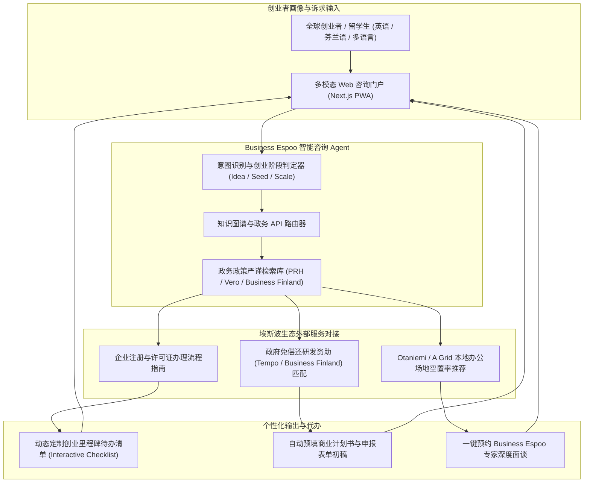

# [2025 Challenge & Winner Study] City of Espoo — Business Advisory Service 2.0

## 1. 元数据概览 (Metadata)

- **对应赛题文件**: [`2025_City_of_Espoo_Business_Advisory_Service_2.0.md`](file:///C:/Users/Jiang/.gemini/antigravity/scratch/hackjunction/docs/past/silver/en/Agentic%20AI/2025_City_of_Espoo_Business_Advisory_Service_2.0.md)
- **赛道**: Urban & Mobility / Agentic AI Track (Public Sector Innovation)
- **出题方 (Partner)**: **City of Espoo / Business Espoo** (埃斯波市政府商务局 / 芬兰最大创新与独角兽摇篮)
- **赛题名称**: Business Advisory Service 2.0 (商业咨询服务 2.0：AI 赋能的国际创业生态指南)
- **赛题奖金设置**:
  - **1st Place (第一名冠军)**: €750
  - **2nd Place (第二名亚军)**: €500
  - **3rd Place (第三名季军)**: €250
- **核心课题挑战**:
  - 为每年涌入埃斯波（涵盖 Otaniemi、Keilaniemi 全球高科技园区）的数千名国际创客、外国留学生与本土中小微企业，打造全天候、多语言、零摩擦的数字商业顾问；
  - 自动穿透繁琐的芬兰营业许可申报流程 (PRH)、税务规划 (Vero)、政府研发资助申请 (Business Finland) 以及本地办公工位匹配。

---

## 2. 城市治理与创业服务痛点 (Pain Points)

埃斯波作为欧洲最前沿的硬科技创新策源地之一，其公共创业咨询窗口面临持续压力：
1. **多语言与跨国境壁垒**: 外国创业者初来乍到，面对芬兰语撰写的复杂商业法规、自雇移民居留许可（Startup Permit）等无从下手；
2. **多部门各自为政**: 创立一家科技初创，需要分别穿梭于商业登记局 (PRH)、税务局 (Vero)、就业服务中心 (TE-palvelut) 以及政府补贴机构 (Finnvera)，信息极度碎裂；
3. **人工咨询产能瓶颈**: 每年秋季与开学季，人工顾问排期长达数周，错过关键资助申请节点。

---

## 3. 获奖方案核心技术架构深潜 (Technical Architecture)

---

## 4. 赛题评审要求与落地评估 (Evaluation Matrix)

| 评审考量指标 | 方案表现与实战收益 |
| :--- | :--- |
| **User Empathy (创业者共情与极简体验)** | 摒弃生硬的法律条文罗列，通过交互式问答（如“你想开外卖店还是做 AI 软件？”），动态剪裁只呈现相关政策。 |
| **Accuracy of Regulations (政策准确性与权威性)** | 检索范围严密约束于官方已核准政策白名单，杜绝在公司税务与法律责任上发生 AI 虚构幻觉。 |
| **Ecosystem Integration (本地生态强绑定)** | 深度植入埃斯波本地资源（如 Aalto Startup Center、VTT 实验室网络），实现线上解答与线下孵化的无缝跳转。 |

---

## 5. 关联参考资料 (References)

- **出题方官网**: [Business Espoo Official Portal](https://www.espoo.fi/en/business-and-entrepreneurship)
- **对应赛题存档**: [2025_City_of_Espoo_Business_Advisory_Service_2.0.md](file:///C:/Users/Jiang/.gemini/antigravity/scratch/hackjunction/docs/past/silver/en/Agentic%20AI/2025_City_of_Espoo_Business_Advisory_Service_2.0.md)
