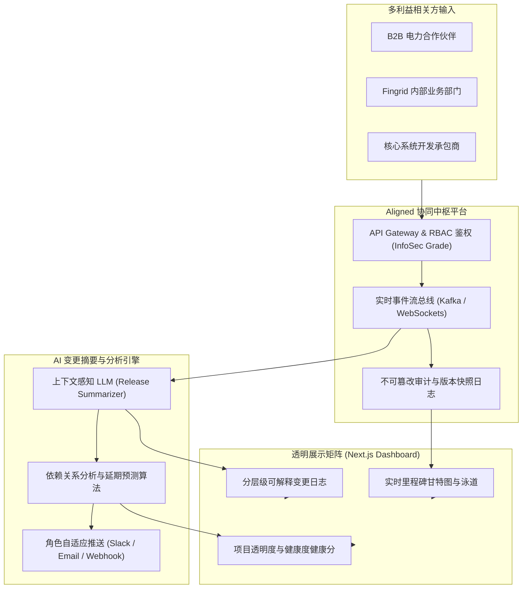

# [2025 Winner Case Study] Fingrid — Aligned by Team Evergreen (Baku Higher Oil School)

## 1. 元数据概览 (Metadata)

- **对应赛题文件**: [`2025_Fingrid_Empowering_Development_Transparency.md`](file:///C:/Users/Jiang/.gemini/antigravity/scratch/hackjunction/docs/past/silver/en/FinTech/2025_Fingrid_Empowering_Development_Transparency.md)
- **赛道**: Software Engineering / Enterprise & Grid Infrastructure
- **出题方 (Partner)**: **Fingrid** (芬兰国家电网运营商 / Transmission System Operator of Finland)
- **赛题名称**: Empowering Development Transparency (赋能系统开发与电网协同透明度)
- **获奖项目**: **Aligned**
- **获奖荣誉**: **Fingrid 赛题冠军 (Challenge Winner - 1st Place 🥇)**，创造阿塞拜疆团队在芬兰 Junction 全球总决赛的历史首胜
- **参赛战队**: **Team Evergreen** (来自阿塞拜疆巴库高等石油学院 / Baku Higher Oil School, BHOS)
- **核心成员**:
  - **Vugar Abdullayev**: 核心全栈开发与信息安全架构师 (BHOS 信息安全专业)
  - **Ismail Mammadzade**: 系统逻辑与数据工程师 (BHOS 信息安全专业)
  - **Gultaj Seyid**: 产品经理与交互体验设计师 (BHOS 信息安全专业)
  - **Nihad Alili**: 战队导师 (Team Mentor)
- **赛题奖金与奖励**: 现金奖励及与 Fingrid 电网技术团队的技术对接合作通道
- **官方报道与媒体收录**: [AzerTag 官方报道](https://azertag.az/) / [BHOS 官方新闻](https://bhos.edu.az/) / [InNews](https://innews.az/)

---

## 2. 获胜者背景与国际晋级历程 (Background & Road to Junction)

- **选拔背景**:
  - Team Evergreen 最初在阿塞拜疆赛区举办的 **JunctionX Baku '24: Unlock the Future** 黑客松中一举夺得全场总冠军，获得代表阿塞拜疆直通赫尔辛基全球 Junction 总决赛的黄金门票。
- **团队学术积淀**:
  - 团队成员全员来自阿塞拜疆最高学府之一——巴库高等石油学院 (BHOS) 的顶尖专业“信息安全工程 (Information Security)”，在分布式系统安全性、数据流可溯源性与企业级 RBAC 权限体系方面具备极高的工程严谨度。

---

## 3. 赛题痛点与项目解决方案 (Problem & Solution)

### 3.1 Fingrid 的电网业务痛点
作为芬兰国家电网的核心中枢，Fingrid 正在经历海量数字化系统升级与绿色电力并网改造。然而，电网软件功能需求、跨系统交付进度、供应商里程碑与 B2B 客户需求往往散落在不同的工单系统、Jira看板与电子邮件中。B2B 合作伙伴与内部各业务部门常常无法得知：
- 某项关键系统能力（如风电并网计量 API、负荷预测模块）具体处于哪个开发周期？
- 历史需求变更是由哪一方提出并批准的？
- 依赖项何时能够真正上线并接入生产环境？

### 3.2 Aligned 的中心化协同平台架构
Team Evergreen 打造了名为 **Aligned** 的一体化透明协同与智能追踪平台：
1. **单一事实来源 (Single Source of Truth)**: 将 B2B 合作伙伴、外部承包商与 Fingrid 内部核心工程团队的需求流彻底统一；
2. **实时里程碑可视化追踪**: 细粒度公开软件演进生命周期（需求提出 -> 架构评审 -> 沙盒测试 -> 生产上线）；
3. **AI 驱动的个性化意图通知与风险预警**: 基于大语言模型自动总结版本发布日志，针对不同层级的受众（技术开发者 vs 业务决策层）自动提炼与其密切相关的改动摘要，当关键路径依赖产生延期风险时提前发出告警；
4. **企业级合规与审计跟踪**: 借助团队的信息安全优势，原生设计了符合欧洲电力关键基础设施合规要求的细粒度访问控制与不可篡改审计日志。

---

## 4. 获奖项目核心技术架构深潜 (Technical Architecture)

### 核心设计闪光点：
1. **角色自适应分层展示 (Multi-Tier Transparency)**: 巧妙解决了“开放透明”与“信息过载/商业机密”之间的冲突。技术人员可查看具体接口签名变更，企业高管则看到交付里程碑与绿电接入时间窗口。
2. **AI Release Note 自动提炼**: 彻底终结了晦涩难懂的 Git Commit 和 Jira 工单堆砌，使非技术客户也能一目了然。

---

## 5. 赛题评审契合度分析 (Judging Criteria Alignment)

| Fingrid 评审标准 | Aligned 的攻关表现 |
| :--- | :--- |
| **Development Transparency (开发透明性)** | 提供端到端的交付全生命周期全景看板，彻底消除需求黑盒。 |
| **B2B User Experience (企业级用户体验)** | 界面简洁直观，降低企业客户沟通摩擦成本，省去大量往返沟通邮件。 |
| **AI Innovation & Practicality (AI 实用性)** | 将 AI 落地于实际的“文本摘要与风险感知”，而非华而不实的对话包装，真正服务于工程实务。 |
| **Security & Compliance (安全与合规)** | 信息安全专业团队操刀，满足欧洲关键基础设施的严苛数据治理标准。 |

---

## 6. 关联参考资料 (References)

- **参赛战队**: Team Evergreen (Baku Higher Oil School)
- **阿塞拜疆官方通讯社报道**: [Azertag News on Junction 2024 Winner](https://azertag.az/)
- **高等院校官方公告**: [Baku Higher Oil School News Portal](https://bhos.edu.az/)
- **对应赛题存档**: [2025_Fingrid_Empowering_Development_Transparency.md](file:///C:/Users/Jiang/.gemini/antigravity/scratch/hackjunction/docs/past/silver/en/FinTech/2025_Fingrid_Empowering_Development_Transparency.md)
