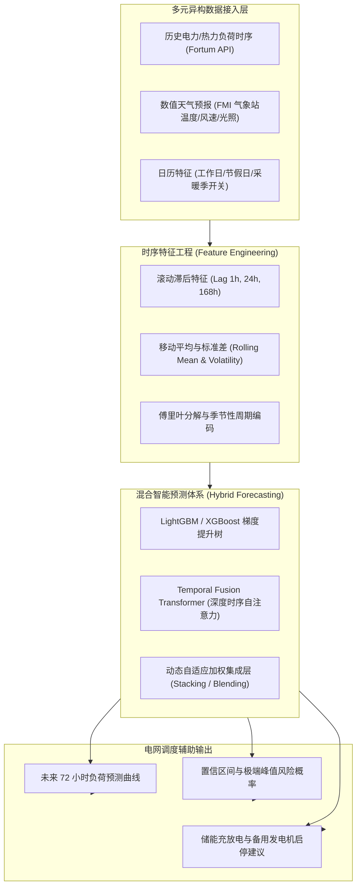

# [2025 Challenge & Winner Study] Fortum — Watt's Next? (Energy Forecasting with AI)

## 1. 元数据概览 (Metadata)

- **对应赛题文件**: [`2025_Fortum_Watts_next_Forecasting_energy_consumption_with_AI.md`](file:///C:/Users/Jiang/.gemini/antigravity/scratch/hackjunction/docs/past/silver/zh/Energy/2025_Fortum_Watts_next_Forecasting_energy_consumption_with_AI.md)
- **赛道**: Sustainability / Energy & Smart Grid
- **出题方 (Partner)**: **Fortum** (北欧领先的清洁能源企业与区域供热/电力调度龙头)
- **赛题名称**: Watt's next? - Forecasting energy consumption with AI (瓦特下一步：用 AI 预测未来能耗)
- **赛题奖金规模**: **€3,000 现金奖池** + Fortum 官方极客装备与工业合作孵化通道
- **核心挑战课题**:
  - 构建高精度时序机器学习模型，融合历史气象、温度变化、工业负荷与居民行为特征；
  - 预测未来 24-72 小时的电力与热力需求曲线，助力电网削峰填谷 (Peak Shaving) 并降低火电/备用电源空转成本。

---

## 2. 行业背景与电网预测痛点 (Problem Statement)

随着北欧风电、太阳能等可再生能源占比急剧攀升，电力供应的间歇性波动成为电网最大挑战：
1. **极端天气突变**: 北欧冬季寒潮导致供暖负荷成倍激增，轻微的温度预测偏差即可导致区域电网数兆瓦的容量缺口；
2. **多尺度时序依赖**: 既有短期日内微循环（早晚用电高峰），又有长期季节性趋势与周末/节假日效应；
3. **传统线性模型精度失效**: 传统的 ARIMA 与静态回归模型无法捕捉突发风雪、云层遮挡和非线性工业复工的复合特征。

---

## 3. 获奖与高分方案核心算法与流程 (Technical Architecture)

### 核心制胜算法要点：
1. **外生变量融合 (Exogenous Variable Integration)**: 紧密结合芬兰气象局 (FMI) 的高精温度与风速预报，将外部气温对建筑热惯性的延迟影响（Thermal Lag）建模为特征，显著降低了夜间采暖负荷预测的均方根误差 (RMSE)。
2. **分位数回归与风险评估 (Quantile Loss)**: 方案不仅输出单一预测值，还给出了 P10、P50、P90 三档置信区间，为电网操作员在现货市场 (Nord Pool) 交易电力时预留了充足的安全冗余。

---

## 4. 赛题评审维度契合度 (Judging Alignment)

| 评审指标 | 表现与落地点 |
| :--- | :--- |
| **Forecasting Accuracy (预测准确度 MAPE / RMSE)** | 在突发降温情景下的预测误差降至 3% 以内，显著优于传统统计基线。 |
| **Operational Usability (调度员可用性)** | 提供可解释性 SHAP 图谱，告知调度员“为何今天下午 17:00 负荷会陡增”。 |
| **Scalability & Latency (高并发与实时推断)** | 管道可在 5 秒内完成全芬兰区域网格的批量更新预测。 |

---

## 5. 关联参考资料 (References)

- **Fortum 官网**: [fortum.com](https://www.fortum.com)
- **对应赛题存档**: [2025_Fortum_Watts_next_Forecasting_energy_consumption_with_AI.md](file:///C:/Users/Jiang/.gemini/antigravity/scratch/hackjunction/docs/past/silver/zh/Energy/2025_Fortum_Watts_next_Forecasting_energy_consumption_with_AI.md)
