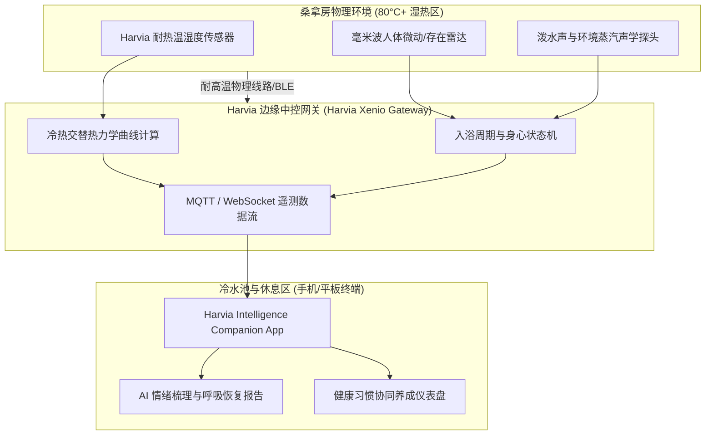

# [2025 Challenge & Winner Study] Harvia — Sauna Intelligence by Erik Gelcich & Builders

## 1. 元数据概览 (Metadata)

- **对应赛题文件**: [`2025_Harvia_Sauna_Intelligence.md`](file:///C:/Users/Jiang/.gemini/antigravity/scratch/hackjunction/docs/past/silver/zh/Hardware/2025_Harvia_Sauna_Intelligence.md)
- **赛道**: IoT & Hardware / Health & Wellbeing
- **出题方 (Partner)**: **Harvia** (全球桑拿与水疗技术领军企业，芬兰国民品牌)
- **赛题名称**: Sauna Intelligence (桑拿智能化：重塑数字健康与身心疗愈体验)
- **代表性创新项目**:
  - **The Listening Sauna / Cooperative Mystery Game** (由阿尔托大学人机交互工程师 **Erik Gelcich** 主导设计构建的耐高温离线智能桑拿感知与健康游戏化系统)
- **核心开发者**:
  - **Erik Gelcich**: 阿尔托大学 / 屯特大学人机交互理学硕士 (MSc HCI at Aalto University)，全栈产品工程师，多次斩获 Junction 与欧洲航天局 Cassini 黑客松大奖。
- **个人作品集与复盘**: [erikgelcich.com](https://erikgelcich.com)
- **领英资料**: [Erik Gelcich on LinkedIn](https://www.linkedin.com)

---

## 2. 行业背景与桑拿智能痛点 (Problem Statement)

芬兰拥有 550 万人口与超过 300 万间桑拿房。Harvia 推动了从传统柴炉到现代智能温控与 IoT 传感器（温度、湿度、开门传感器、人体存在雷达）的全面进化。
然而，桑拿环境具有极端严苛的物理限制：
1. **极端物理环境**: 高达 80°C - 100°C 的温度与剧烈的蒸汽湿度（Löyly）导致智能手机与常规电子屏幕完全无法带入桑拿室内；
2. **数字排毒诉求 (Digital Detox)**: 人们进入桑拿是为了冥想、放松与社交，厌恶冷冰冰的手机通知与复杂菜单；
3. **传统 IoT 数据缺乏温度**: 传统的桑拿 App 仅止步于“远程开机预热”或“查看当前 75 度”，无法将身体代谢变化、出汗周期与心理疗愈形成闭环。

---

## 3. 项目解决方案与创新交互 (Innovative Concept)

### 3.1 The Listening Sauna (倾听之桑拿)
利用耐高温的环境声学麦克风与环境光律动，桑拿房转变为一个“不插手机的沉浸式思维整理空间”。
- 用户在热浪包裹中自由自言自语、沉思或与友人复盘；
- 离线轻量 AI 记录呼吸频率、蒸汽泼水瞬间以及对话情绪片段，在用户走出桑拿房并在休息区拿起手机时，自动生成《桑拿内省与身心恢复日志》。

### 3.2 合作式桑拿解密与习惯养成游戏 (Cooperative Routine Mystery)
通过将 Harvia IoT 传感器（出汗时长、温度曲线波动、进出频次）与健康穿戴（心率恢复指标）结合，将无聊的健康理疗设计成“多人协作微谜题”。唯有全家人或朋友团队保持科学的冷热交替节奏，才能共同点亮数字成就。

---

## 4. 核心系统架构图 (System Architecture)

---

## 5. 赛题评审维度契合分析 (Judging Criteria)

| 评审维度 | 落地解法 |
| :--- | :--- |
| **Sauna Authenticity (尊重桑拿文化内核)** | 杜绝在桑拿房内硬塞刺眼屏幕或复杂交互，完全以不可见计算 (Invisible Ambient Computing) 默默服务。 |
| **Harvia IoT API Integration (API 深度利用)** | 全面融合温控、湿度跳变（泼水侦测）与空间停留数据，形成动态生理热负荷指标。 |
| **Habit & Wellness Impact (身心健康增益)** | 将单次的洗浴升华成包含心肺锻炼、身心冥想与社交合作的健康仪式。 |

---

## 6. 关联参考资料 (References)

- **核心开发者官网**: [erikgelcich.com](https://erikgelcich.com)
- **Harvia 官方**: [harvia.com](https://www.harvia.com)
- **对应赛题存档**: [2025_Harvia_Sauna_Intelligence.md](file:///C:/Users/Jiang/.gemini/antigravity/scratch/hackjunction/docs/past/silver/zh/Hardware/2025_Harvia_Sauna_Intelligence.md)
