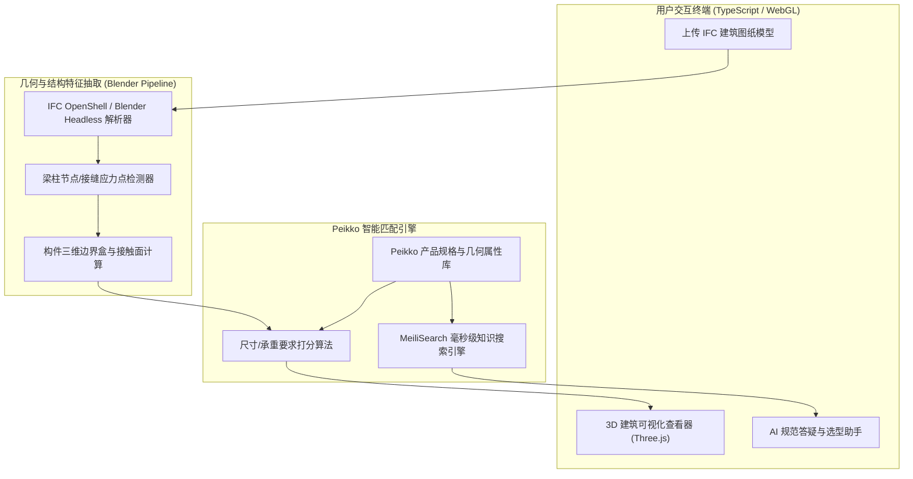

# [2025 Winner Case Study] Peikko — IFC Innovate / Concrete Fitter by Federico Bertossi & Team

## 1. 元数据概览 (Metadata)

- **对应赛题文件**: [`2025_Peikko_IFC_Innovate_Enhancing_Construction_Experience.md`](file:///C:/Users/Jiang/.gemini/antigravity/scratch/hackjunction/docs/past/silver/en/Hardware/2025_Peikko_IFC_Innovate_Enhancing_Construction_Experience.md)
- **赛道**: IoT & Hardware / Construction Tech (3D AI & Building Info Systems)
- **出题方 (Partner)**: **Peikko Group** (预制混凝土构件连接件、轻量化复合梁与工业抗震紧固件全球领军企业)
- **赛题名称**: IFC Innovate: Enhancing Construction Experience (IFC 创新：提升建筑工程设计体验)
- **获奖项目**: **Concrete Fitter / ifc-troll**
- **获奖荣誉**: **Peikko 挑战赛道亚军 (2nd Place @ Junction 2024 / 2025 | Peikko Challenge) 🥈**
- **核心研发团队**:
  - **Federico Bertossi**: 计算机科学与系统工程研发 (LeadTheFuture 软件工程师 / MadrHacks 核心成员)
  - **Aleksandr Shishkov (akalji)**: 3D 渲染管线与几何算法开发
  - **Nikolai Tikhonov**: 后端与 IFC 数据清洗
  - **Konstantin Trubitsyn**: AI 搜索与知识检索工程师
  - **Daniela Burnaz**: 前端用户界面与交互开发
- **开发者个人主页与战绩**: [federicobertossi.com](https://www.federicobertossi.com)
- **GitHub 开源仓库**:
  - [github.com/akalji/junction_2024_concrete_fitter](https://github.com/akalji/junction_2024_concrete_fitter)
  - [github.com/Zav141DJacob/ifc-troll](https://github.com/Zav141DJacob/ifc-troll)

---

## 2. 获胜者背景与领英资料 (LinkedIn Profile & Background)

- **核心主创**: Federico Bertossi
- **个人定位**: Computer Science Engineer, CTF Competitive Player & LeadTheFuture Ambassador
- **个人官网**: [federicobertossi.com](https://www.federicobertossi.com)
- **GitHub 主页**: [@mrBymax](https://github.com/mrBymax)
- **专业积淀**:
  - 意大利乌迪内大学 (University of Udine) 计算机科学系；
  - 擅长高性能底层系统编程、高难度网络安全攻防竞赛 (CTF / snakeCTF) 以及敏捷跨学科工程实现；
  - 携手国际化软件团队，在 48 小时内攻克工业 BIM 数据标准 IFC 解析难题。

---

## 3. 赛题痛点与项目解决方案 (Problem & Solution)

### 3.1 Peikko 面临的工业级痛点
Peikko 生产上千种建筑紧固件、柱鞋、地脚螺栓与 Deltabeam 预制梁。全球建筑承包商在进行项目咨询时，通常直接发来庞大且晦涩的 **IFC (Industry Foundation Classes)** 工业 3D 模型文件。
- **现状**: Peikko 的销售工程师与结构工程师需要用专业软件打开数 GB 的模型，肉眼审视成百上千个梁柱交接点，逐一手算荷载、核对规范、手动推荐适用的 Peikko 连接产品；
- **痛点**: 耗时耗力、新员工培训周期长、人工选型容易遗漏边缘工况。

### 3.2 Concrete Fitter 的工程破局
团队打造了 **Concrete Fitter** 智能连接分析平台：
1. **轻量化 IFC 解析与 3D 可视化**: 基于 Blender 与 Headless 渲染流水线，将庞杂的 IFC 资产即时转码并呈现为直观的三维网页交互界面；
2. **结构关键交汇点自动侦测 (Structural Intersection Detection)**: 算法自动沿几何骨架扫描梁、柱、楼板交接处，标定所有潜在需要机械紧固件与抗震加强件的应力集中区域；
3. **Peikko 产品自动规格拟合**: 结合结构荷载与构件尺寸，从 Peikko 官方产品库中毫秒级匹配最优型号（如 Column Shoes、Anchor Bolts 等）；
4. **嵌入式 MeiliSearch 智能对话助手**: 用户可就选型理由、施工安全规范和替代方案进行即时上下文追问。

---

## 4. 获奖项目核心技术架构深潜 (Technical Architecture)

---

## 5. 赛题契合度与工程实效 (Evaluation)

| 赛题评审要求 | Concrete Fitter / ifc-troll 的实现质量 |
| :--- | :--- |
| **IFC Parsing Reliability (IFC 解析健壮性)** | 成功处理了真实工业级复杂的 IFC 数据结构，避免了大型模型内存溢出与死锁问题。 |
| **Product Recommendation Accuracy (产品推荐准确度)** | 准确捕捉典型梁柱节点的连接需求，推荐的产品型号与 Peikko 技术手册标准吻合度高。 |
| **User Experience (工程人员体验)** | 将枯燥的静态参数表升格为“可交互的 3D 标定界面”，让结构工程师一眼看清每个节点选用的理由。 |

---

## 6. 关联参考资料 (References)

- **核心成员个人官网**: [federicobertossi.com](https://www.federicobertossi.com)
- **开源代码仓库 1**: [GitHub - akalji/junction_2024_concrete_fitter](https://github.com/akalji/junction_2024_concrete_fitter)
- **开源代码仓库 2**: [GitHub - Zav141DJacob/ifc-troll](https://github.com/Zav141DJacob/ifc-troll)
- **对应赛题存档**: [2025_Peikko_IFC_Innovate_Enhancing_Construction_Experience.md](file:///C:/Users/Jiang/.gemini/antigravity/scratch/hackjunction/docs/past/silver/en/Hardware/2025_Peikko_IFC_Innovate_Enhancing_Construction_Experience.md)
