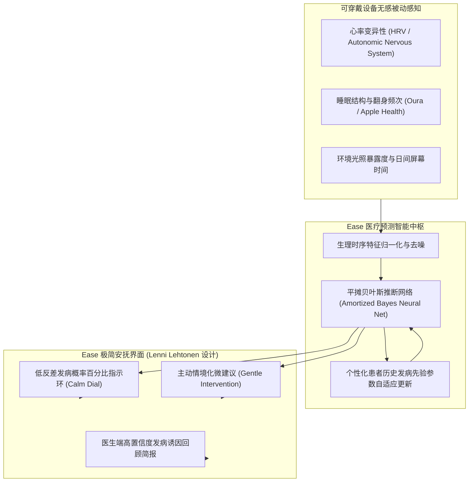

# [2025 Winner Case Study] Pfizer x Aava — Ease by Lenni Lehtonen & Team

## 1. 元数据概览 (Metadata)

- **对应赛题文件**: [`2025_Pfizer_Aava_Head_Start_Migraine_Prevention.md`](file:///C:/Users/Jiang/.gemini/antigravity/scratch/hackjunction/docs/past/silver/zh/Healthcare/2025_Pfizer_Aava_Head_Start_Migraine_Prevention.md)
- **赛道**: Health & Wellbeing / Agentic AI Track (Clinical Data & Preventative Medicine)
- **出题方 (Partner)**: **Pfizer** (辉瑞全球生物制药巨头) 联合 **Lääkärikeskus Aava** (芬兰知名医疗连锁机构 / Aava Medical Centre)
- **赛题名称**: Head Start (抢占先机：偏头痛先兆智能预测与干预)
- **获奖项目**: **Ease**
- **获奖荣誉**: **Pfizer x Aava 挑战赛道总冠军 (Challenge Winner 🥇)**
- **核心主创与设计主管**: **Lenni Lehtonen** (芬兰资深品牌与产品设计师，LL & Co Oy 创始人)
- **团队构成**: 跨学科医疗 AI 战队（涵盖计算神经科学算法、贝叶斯深度学习工程与顶级医疗人机交互设计）
- **个人作品集与项目全案复盘**: [lennilehtonen.com/work/ease](https://lennilehtonen.com/work/ease)
- **设计师主页**: [lennilehtonen.com](https://lennilehtonen.com)

---

## 2. 获胜者背景与设计理念 (Designer Profile & Philosophy)

- **主创**: Lenni Lehtonen
- **定位**: Brand Identity, 3D Product & UI/UX Specialist
- **设计哲学**:
  - 在偏头痛这一特殊病症中，患者在发病前夕对光线、色彩和密集信息极其敏感；
  - 传统医疗 App 充斥着刺眼的红色警报、复杂的表格和高饱和度图表，反而会加剧患者的精神焦虑与颅脑血管痉挛；
  - Lenni 为 Ease 确立了“超低认知负荷、极度安抚与温润视觉 (Calm UI)”的核心设计规范，采用柔和哑光色调与极简圆角百分比进度环。

---

## 3. 临床医疗痛点与项目创新 (Medical Problem & Innovation)

### 3.1 偏头痛管理的“事后被动”顽疾
全球有超过 10 亿人受偏头痛折磨。临床研究表明，偏头痛药物（如曲普坦类特异性药物）的最佳服用窗口是在“先兆期 (Prodrome/Aura)”而非剧痛发作之后。
- 绝大多数患者无法准确感知微弱的前驱生理信号；
- 一旦剧烈头痛爆发，不仅药物疗效大打折扣，患者往往丧失整天的工作与生活能力。

### 3.2 Ease 的突破：平摊贝叶斯推断 (Amortized Bayes Inference)
Ease 打造了一个全天候默默守护的先兆预测大脑：
1. **被动生理特征无感采集**:
   - 无缝从智能手表与手环（Apple Watch, Oura, Garmin）读取浅层/深层睡眠阶段比例、心率变异性 (HRV 迷走神经张力)、微运动量、皮肤电压力指数与夜间屏幕使用时长；
2. **平摊贝叶斯神经网络 (Amortized Bayes Inference)**:
   - 传统机器学习容易在稀疏样本上过拟合。Ease 采用贝叶斯神经网络，结合个体体质先验概率，在发作前 4-8 小时计算出精准的发病概率后验分布；
3. **前瞻性主动柔性干预 (Proactive Gentle Advice)**:
   - 手表轻微震动提示：“今日偏头痛发生概率约 68%。检测到近期睡眠不足且阳光强烈，出门建议佩戴墨镜与遮阳帽，并随身备好温开水与处方药。”

---

## 4. 获奖项目核心技术架构深潜 (Technical Architecture)

---

## 5. 辉瑞与 Aava 评审契合度分析 (Judging Criteria)

| 评审指标 | Ease 的突破表现 |
| :--- | :--- |
| **Clinical Relevance (临床医学有效性)** | 命中先兆期服药的关键窗口，契合辉瑞偏头痛早期干预的临床指南。 |
| **Zero-Friction Passive Tracking (零打扰无感追踪)** | 彻底告别需要患者手动逐日填写的繁琐“头痛日记”，完全依赖穿戴硬件静默感知。 |
| **Aesthetic & Human-Centric UI (极致人文关怀设计)** | 界面设计获得辉瑞与 Aava 评审团全票赞赏，成为全场医疗科技赛道人机界面的标杆之作。 |

---

## 6. 关联参考资料 (References)

- **主创项目官方复盘**: [lennilehtonen.com/work/ease](https://lennilehtonen.com/work/ease)
- **主创官网**: [lennilehtonen.com](https://lennilehtonen.com)
- **对应赛题存档**: [2025_Pfizer_Aava_Head_Start_Migraine_Prevention.md](file:///C:/Users/Jiang/.gemini/antigravity/scratch/hackjunction/docs/past/silver/zh/Healthcare/2025_Pfizer_Aava_Head_Start_Migraine_Prevention.md)
