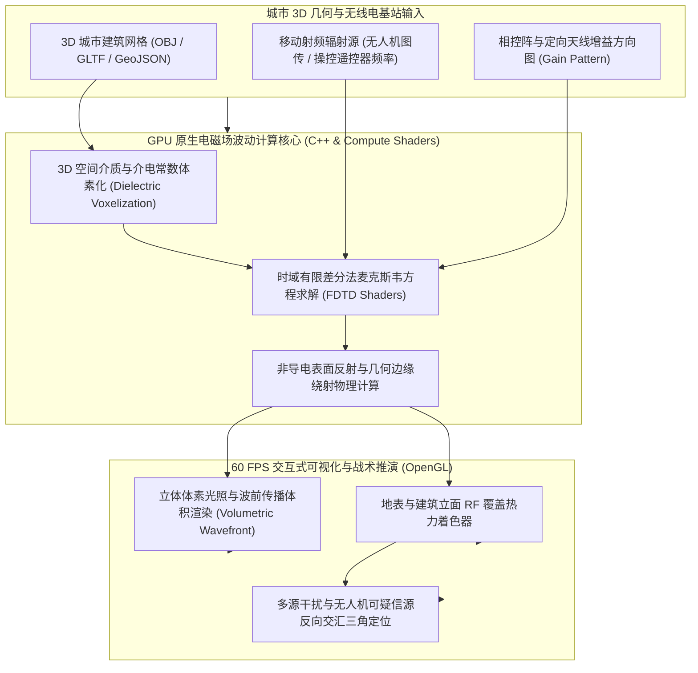

# [2025 Grand Winner Case Study] Sensofusion — WAVELET by Rudrrayan Manna, Arjun Juneja, Keanu Czirjak & Akshith Alluri

## 1. 元数据概览 (Metadata)

- **对应赛题文件**:
  - [`2025_Sensofusion_Radio_City.md`](file:///C:/Users/Jiang/.gemini/antigravity/scratch/hackjunction/docs/past/silver/zh/Hardware/2025_Sensofusion_Radio_City.md)
  - [`2025_Sensofusion_Lights_Camera_Reaction.md`](file:///C:/Users/Jiang/.gemini/antigravity/scratch/hackjunction/docs/past/silver/zh/Hardware/2025_Sensofusion_Lights_Camera_Reaction.md)
- **赛道**: IoT & Hardware / Defense & RF Spatial Computing
- **出题方 (Partner)**: **Sensofusion** (芬兰顶级国防与低空反无人机技术独角兽 / AIRFENCE 研发商)
- **赛题名称**: Radio City (无线电之城：城市级射频与电磁波实时传播仿真)
- **获奖项目**: **WAVELET**
- **获奖荣誉**: **Junction 2025 全场总冠军 (Overall Grand Winner 🏆，斩获 €10,000 现金大奖) 兼 Sensofusion 挑战赛道第一名 (Track Winner 🥇)**
- **开发战队**: 英国伦敦与国际顶级系统黑客联合战队
- **核心成员**:
  - **Rudrrayan Manna (Rono)**: 底层 GPU 性能与算子加速工程师 (C++, GPU Compute, SC26 超算团队成员)
  - **Arjun Juneja**: 底层逆向工程与高频系统工程师 (XTX Markets London 核心工程经历，个人官网: [arjunjuneja.com](https://arjunjuneja.com))
  - **Keanu Czirjak**: 初创核心工程师与 GPU 渲染开发者 (Arm × BPP 度量项目经历，个人官网: [keanuc.net](https://keanuc.net))
  - **Akshith Alluri**: 分布式系统与算法工程师
- **技术复盘与作品集收录**: [keanuc.net](https://keanuc.net) / [arjunjuneja.com](https://arjunjuneja.com) / [Wikipedia: Junction (hackathon)](https://en.wikipedia.org/wiki/Junction_(hackathon))

---

## 2. 获胜者背景与顶尖极客战绩 (Winner Profiles & Background)

- **战队基因**:
  - 全员由欧洲顶级底层系统工程师、高性能计算（HPC）与超算竞赛选手组成；
  - 核心开发者常年深耕 C++、Vulkan/OpenGL、GPU Compute Shaders 以及低延迟金融与国防级底层通信架构；
  - 在 Junction 2025 全场数百支以大语言模型 API 套壳为主流的队伍中，WAVELET 战队以“重返底层数学与极致物理计算”的技术震撼力征服了所有评审。

---

## 3. 国防工业痛点与项目解决方案 (Problem & Innovation)

### 3.1 城市低空反无人机 (C-UAS) 与无线电盲区痛点
现代城市建筑林立，玻璃幕墙、钢筋混凝土高楼与狭窄街道对无线电射频信号（RF）产生极其复杂的折射、反射、多径衰落与信号遮挡。
- **国防与安防刚需**: Sensofusion 的核心产品 AIRFENCE 需要在城市复杂环境中毫秒级定位未经授权的黑飞无人机及其操控者遥控器方位；
- **传统仿真的致命软肋**: 传统的射线追踪 (Ray-Tracing) 软件或者有限元物理仿真（如 COMSOL）计算极其缓慢，跑一次复杂的城市街区射频热力图往往需要数小时乃至数天，根本无法满足动态战术部署与实时移动态势感知的需求。

### 3.2 WAVELET 的革命性突破：GPU 原生实时麦克斯韦方程求解器
WAVELET 彻底颠覆了传统的仿真模式：
1. **纯粹 C++ & OpenGL Compute Shaders 极限榨干显卡算力**:
   - 彻底摒弃任何缓慢的高阶包装，在 GPU 显存内直接构建 3D 离散网格空间；
2. **麦克斯韦电磁波传播微分方程的实时偏微分数值求解 (Real-time FDTD)**:
   - 模拟电磁波从发射源发出后，在复杂 3D 建筑多边形之间的波动、绕射、散射与干涉全过程；
3. **60 FPS 电影级交互式射频传播热力渲染**:
   - 现场操作员可以在 3D 城市地图上自由拖动雷达/干扰机位置，甚至实时拖动建筑高度，整座城市的电磁波波前（Wavefront）与场强热力图以 **每秒 60 帧** 实时波动渲染，令人叹为观止。

---

## 4. 获奖项目核心技术架构深潜 (Technical Architecture)

---

## 5. 为什么 WAVELET 能斩获全场 €10,000 总冠军？ (Winning Breakdown)

| 评审考量维度 | WAVELET 的降维打击表现 |
| :--- | :--- |
| **Technical Depth & Hardcore Engineering (硬核技术深度)** | 在普遍依赖外部 API 调用的黑客松环境下，团队在 48 小时内从零手写纯 C++ 与 Shader 算法，展示了惊人的技术硬实力。 |
| **Mission-Critical Commercial Value (千亿级国防安防价值)** | 直击 Sensofusion 与全球国防军工在低空安全防御上的核心卡脖子痛点，将离线仿真直接加速至战术级实时推演。 |
| **Mind-Blowing Live Presentation (炸裂的主舞台路演效果)** | 决赛舞台上，在大屏幕实时展示电磁波在虚拟赫尔辛基市中心如水波般翻滚荡漾、穿透街巷，现场观众与评委掌声雷动。 |

---

## 6. 关联参考资料 (References)

- **核心作者个人主页 1**: [keanuc.net](https://keanuc.net)
- **核心作者个人主页 2**: [arjunjuneja.com](https://arjunjuneja.com)
- **出题方官网**: [sensofusion.com](https://www.sensofusion.com)
- **维基百科收录**: [Wikipedia - Junction (hackathon)](https://en.wikipedia.org/wiki/Junction_(hackathon))
- **对应赛题存档 1**: [2025_Sensofusion_Radio_City.md](file:///C:/Users/Jiang/.gemini/antigravity/scratch/hackjunction/docs/past/silver/zh/Hardware/2025_Sensofusion_Radio_City.md)
- **对应赛题存档 2**: [2025_Sensofusion_Lights_Camera_Reaction.md](file:///C:/Users/Jiang/.gemini/antigravity/scratch/hackjunction/docs/past/silver/zh/Hardware/2025_Sensofusion_Lights_Camera_Reaction.md)
