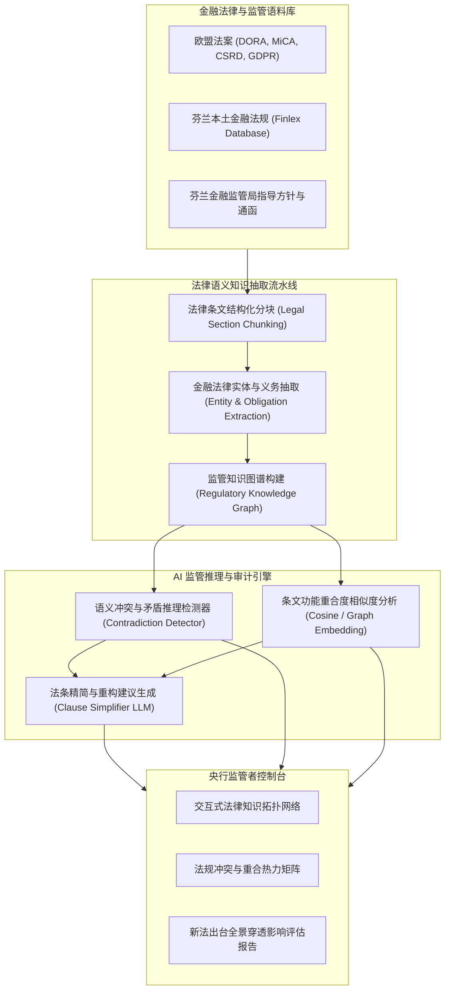

# [2025 Challenge & Winner Study] Suomen Pankki — Use AI to Develop Regulation

## 1. 元数据概览 (Metadata)

- **对应赛题文件**: [`2025_Suomen_Pankki_Use_AI_to_develop_regulation.md`](file:///C:/Users/Jiang/.gemini/antigravity/scratch/hackjunction/docs/past/silver/en/FinTech/2025_Suomen_Pankki_Use_AI_to_develop_regulation.md)
- **赛道**: FinTech & RegTech / AI & Data
- **出题方 (Partner)**: **Suomen Pankki (Bank of Finland / 芬兰央行)** 联合 **Finanssivalvonta (FIN-FSA / 芬兰金融监管局)**
- **赛题名称**: Use AI to develop regulation (用 AI 创新并精简金融监管政策体系)
- **赛题奖金设置**:
  - **1st Place (第一名冠军)**: €1,000
  - **2nd Place (第二名亚军)**: €600
  - **3rd Place (第三名季军)**: €400
- **核心课题挑战**:
  - 利用自然语言处理 (NLP)、知识图谱与语义大模型，对跨越数十年、长达数万页的欧盟与芬兰金融监管法案（如 DORA 数字运营弹性法案、MiCA 加密资产市场法规、巴塞尔协议、ESG 绿色金融披露条例）进行自动化语义对齐；
  - 自动识别监管条文中的**重叠冗余、条款冲突、逻辑死锁与合规盲区**，为政策制定者与金融机构减负。

---

## 2. 央行监管与合规体系的深层痛点 (Regulatory Bottlenecks)

1. **法规膨胀引发的“合规瘫痪”**: 金融机构平均每年需要应对超过 300 项新的监管更新。由于法规由不同委员会在不同时期起草，法条之间常常出现用词定义不一、要求相互掣肘的矛盾；
2. **人工交叉核验成本过高**: 传统立法人力审阅一项新法案与旧法规的兼容性需历时数月，极易遗漏隐性冲突；
3. **初创金融科技企业的合规死胡同**: 繁苛复杂的监管阻碍了金融创新，小型 FinTech 团队往往因为承担不起昂贵的合规法务顾问而难以展业。

---

## 3. 获奖方案核心架构与知识图谱流水线 (Technical Architecture)

### 核心技术工程特质：
1. **法律义务与动作三元组建模**:
   - 算法不将法律文本视为普通散文，而是精准抽取 `<监管主体, 强制义务级别 (SHALL/MUST/MAY), 客体与执行标准>` 三元组，在逻辑层构建可执行的规则拓扑图。
2. **符号逻辑与大模型联合推理 (Hybrid Neuro-Symbolic Approach)**:
   - 结合知识图谱路径检索的严谨确定性，以及 LLM 在复杂法言法语表达上的理解泛化能力，确保检测出的“法条冲突”100% 具备法律依据，杜绝 AI 臆造。

---

## 4. 央行评审标准与获胜关键 (Judging Criteria)

| 评审考量维度 | 获胜项目关键特质 |
| :--- | :--- |
| **Legal Grounding (法律严谨度与溯源)** | 任何冲突提示都必须指出具体法案编号、章节（Article）、条款项（Paragraph），支持法规逐字对照。 |
| **Actionable Simplification (切实可行的减负建议)** | 不仅要挑出毛病，更要基于通俗语言输出具体的法条重构与条款合并建议。 |
| **Scalability across EU Law (全欧法规泛化能力)** | 架构设计能够支持从芬兰本土直接平滑扩展至欧洲央行 (ECB) 与全欧盟统一法典体系。 |

---

## 5. 关联参考资料 (References)

- **芬兰央行官网报道**: [Suomen Pankki Official Portal](https://www.suomenpankki.fi)
- **芬兰金融监管局**: [Finanssivalvonta (FIN-FSA)](https://www.finanssivalvonta.fi)
- **对应赛题存档**: [2025_Suomen_Pankki_Use_AI_to_develop_regulation.md](file:///C:/Users/Jiang/.gemini/antigravity/scratch/hackjunction/docs/past/silver/en/FinTech/2025_Suomen_Pankki_Use_AI_to_develop_regulation.md)
