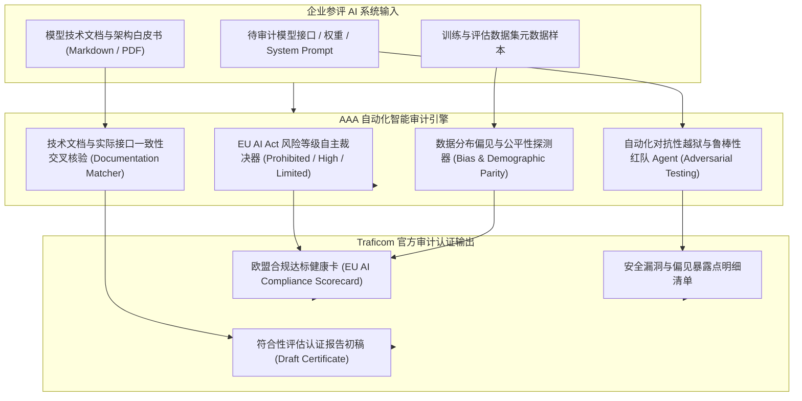

# [2025 Challenge & Winner Study] Traficom — AI Audit Aid (AAA)

## 1. 元数据概览 (Metadata)

- **对应赛题文件**: [`2025_Traficom_AI_Audit_Aid_AAA.md`](file:///C:/Users/Jiang/.gemini/antigravity/scratch/hackjunction/docs/past/silver/en/Agentic%20AI/2025_Traficom_AI_Audit_Aid_AAA.md)
- **赛道**: Security & Compliance / Agentic AI Track (Public Regulatory Innovation)
- **出题方 (Partner)**: **Traficom** (芬兰交通与通信局 / Finnish Transport and Communications Agency)
- **赛题名称**: AI Audit Aid (AAA) (人工智能合规审计助手)
- **赛题奖金设置**:
  - **1st Place (第一名冠军)**: €1,500
  - **2nd Place (第二名亚军)**: €1,000
  - **3rd Place (第三名季军)**: €500
- **核心课题挑战**:
  - 作为芬兰国家人工智能监管沙盒（AI Regulatory Sandbox）的核心主管单位，Traficom 亟需自动化软件方案，辅助政府审计官对企业部署的商用 AI 系统进行全生命周期合规审计；
  - 重点针对即将全面生效的《欧盟人工智能法案 (EU AI Act)》中的**高风险系统分级认定、模型透明度义务、数据偏见检测与鲁棒性验证**构建自动化审计流水线。

---

## 2. 行业监管痛点 (Regulatory Bottlenecks)

1. **EU AI Act 合规门槛高企**: 欧盟法规要求高风险 AI 系统提供详尽的技术文档、数据溯源、人类监督机制与持续红队测试日志，企业与审计员面对海量材料效率低下；
2. **黑盒算法无法穿透**: 传统软件测试用例无法直接套用于具有不确定性输出的大语言模型与多模态模型；
3. **缺乏标准化自动化工具**: 目前欧盟监管机构大多依赖人工阅读填表，缺乏一键自动运行的自动化合规扫描套件。

---

## 3. 获奖与高分方案核心技术架构深潜 (Technical Architecture)

### 核心技术工程特质：
1. **自动风险分级映射 (EU AI Act Taxonomy Engine)**:
   - 依据法规附录 III，自动对照企业系统的实际输入输出，判定属于高风险（如生物特征识别、招聘面试打分、关键基础设施）还是受限透明度风险。
2. **自主红队渗透对抗 (Automated Red-Teaming)**:
   - 内置对抗性智能体，自动向目标模型发起上千次诱导提示注入（Prompt Injection）、越狱和偏见探测，量化评估模型的防御鲁棒性。

---

## 4. 赛题评审考量标准 (Judging Criteria)

| 评审指标 | 方案表现与实战价值 |
| :--- | :--- |
| **Alignment with EU Regulations (与欧盟法规高度对齐)** | 审计报告完全依据 EU AI Act 官方技术标准与条目输出，具法律背书效力。 |
| **Automation & Practicality (高度自动化与低摩擦)** | 只需提供模型 API 密钥与简要说明，即可全自动生成 30 页深度合规评测卷。 |
| **Defensibility of Findings (审计结论可辩护性)** | 每一项不合规结论均附带不可抵赖的对抗测试输入输出日志证据。 |

---

## 5. 关联参考资料 (References)

- **Traficom 官方官网**: [traficom.fi](https://www.traficom.fi/en/)
- **欧盟人工智能法案官方条例**: [EU AI Act Portal](https://artificialintelligenceact.eu/)
- **对应赛题存档**: [2025_Traficom_AI_Audit_Aid_AAA.md](file:///C:/Users/Jiang/.gemini/antigravity/scratch/hackjunction/docs/past/silver/en/Agentic%20AI/2025_Traficom_AI_Audit_Aid_AAA.md)
