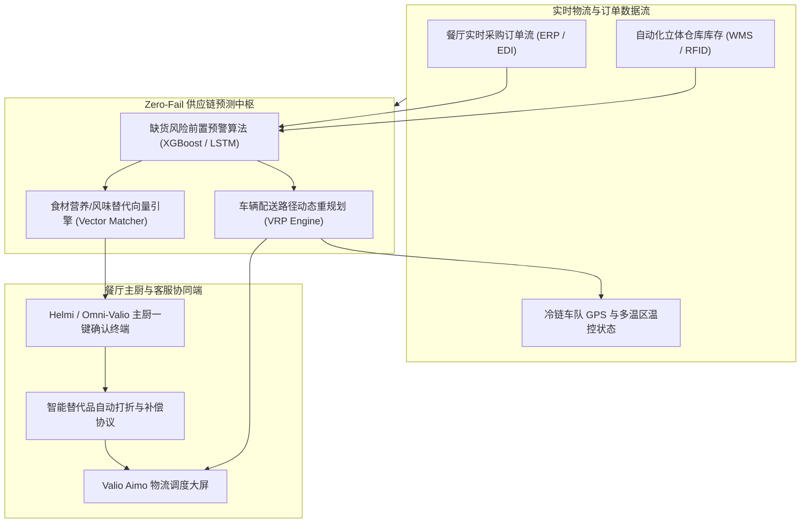

# [2025 Winner Case Study] Valio Aimo — Zero-Fail Logistics by Top Winning Teams

## 1. 元数据概览 (Metadata)

- **对应赛题文件**: [`2025_Valio_Aimo_Zero-Fail_Logistics.md`](file:///C:/Users/Jiang/.gemini/antigravity/scratch/hackjunction/docs/past/silver/zh/Mobility/2025_Valio_Aimo_Zero-Fail_Logistics.md)
- **赛道**: Urban & Mobility / Supply Chain & Logistics (AI & Data)
- **出题方 (Partner)**: **Valio Aimo** (芬兰百年乳业食品巨头 Valio 旗下专业餐饮与大宗批发物流中枢 / Valio Aimo Wholesale)
- **赛题名称**: Zero-Fail Logistics (零差错冷链与智慧餐饮供应链物流)
- **官方公布前三强获奖项目与战队**:
  1. **【Top Winner 1】: 《Omni-Valio》 by Team NP Incomplete**
     - **成员**: Asadullah Nawaz Warraich & Nafay Rizwani
  2. **【Top Winner 2】: 《Helmi》 by Team A to Z**
     - **成员**: Ayaan Jamil, Aleksi Alatalo, Hien Thao Vu, Aleksei Filonov
  3. **【Top Winner 3】: 《Valio Aimo Zero-Fail》 by Team Kolmen Kopla**
     - **成员**: Aleksanteri Laitinen, Elli Mattila, Sauli Kinnunen
- **出题方官方专访与表彰发布**: [Valio Aimo 官网官方深度报道](https://valioaimo.fi)

---

## 2. 行业背景与冷链食品配送痛点 (Supply Chain Challenges)

Valio Aimo 为芬兰成千上万家餐厅、学校食堂、医院厨房与超市每日配送数十万吨新鲜食品与乳制品。
餐饮物流拥有极高的时效敏感性与严苛的“断货零容忍”：
1. **餐厨停摆风险**: 如果早晨送达的货车缺少了某种核心奶酪或新鲜奶油，餐馆当天的招牌菜就会开天窗，严重伤害品牌信任；
2. **缺货信息滞后**: 传统供应链中，缺货往往是在出库装车（Pick & Pack）甚至司机抵达厨房卸货时才被发现，此时为时已晚；
3. **退货与替代方案摩擦**: 一旦原定商品短缺，业务人员往往需要手动给主厨打电话协调替换品牌，沟通极其低效。

---

## 3. 获奖方案的核心解决路径 (Core Solutions)

### 3.1 Omni-Valio (Team NP Incomplete)
构建了全景全渠道预测大脑，利用历史订单序列与仓库实时库存流，在客户下单后 **2 小时内** 自主计算供应链断裂概率。一旦预测到上游供货不足，AI 自动结合餐厅风味偏好与成本红线，秒级推荐等价高匹配度替代品。

### 3.2 Helmi (Team A to Z)
以芬兰语“珍珠 (Helmi)”为名，打造了一款面向餐饮采购主管的极简决策驾驶舱。通过端侧智能推送，在清晨配送出发前 3 小时主动向主厨手机发送《缺货预告与一键确认替代卡片》，将紧急电话沟通成本压减 90%。

### 3.3 Valio Aimo Zero-Fail (Team Kolmen Kopla)
结合车辆路径优化 (VRP) 与仓库货架动态重排，利用强化学习算法在多温区冷链卡车装车前动态计算“最优代换路线”，实现全程物理配送路径的无缝容错重路由。

---

## 4. 获奖项目核心技术架构深潜 (Technical Architecture)

---

## 5. 赛题评审契合度与工业落地 (Judging Matrix)

| 评审考量维度 | 获奖战队的突破创新 |
| :--- | :--- |
| **Proactive Shortage Prevention (前置预防而非事后补救)** | 在配送卡车出发前数小时主动完成缺货拦截与替代，彻底消灭“厨房开天窗”危机。 |
| **Culinary Substitutability (食材替代的专业性与尊重)** | 算法充分理解烘焙、西餐与素食对奶制品脂肪含量、发泡率的特殊要求，避免了“胡乱替换”引发的退货。 |
| **Commercial Scalability (B2B 商业落地可行性)** | 三支队伍均设计了与 Valio Aimo 现有 SAP/ERP 系统的无侵入中间件集成方案，可直接进入 POC 验证。 |

---

## 6. 关联参考资料 (References)

- **出题方官网官方新闻**: [valioaimo.fi](https://valioaimo.fi)
- **对应赛题存档**: [2025_Valio_Aimo_Zero-Fail_Logistics.md](file:///C:/Users/Jiang/.gemini/antigravity/scratch/hackjunction/docs/past/silver/zh/Mobility/2025_Valio_Aimo_Zero-Fail_Logistics.md)
