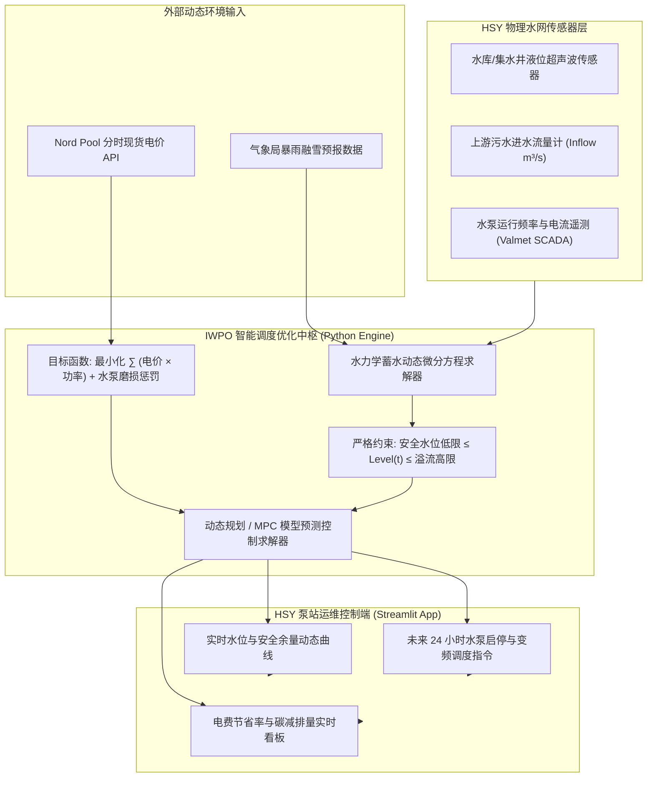

# [2025 Winner Case Study] Valmet x HSY — IWPO by Sukarth Acharya

## 1. 元数据概览 (Metadata)

- **对应赛题文件**: [`2025_Valmet_HSY_Intelligent_Flow_Optimization.md`](file:///C:/Users/Jiang/.gemini/antigravity/scratch/hackjunction/docs/past/silver/zh/Hardware/2025_Valmet_HSY_Intelligent_Flow_Optimization.md)
- **赛道**: IoT & Hardware / Sustainability (Clean Water & Smart Infrastructure)
- **出题方 (Partner)**: **Valmet** (全球顶尖工业自动化与过程技术巨头) 联合 **HSY** (赫尔辛基地区环境服务局 / Helsinki Region Environmental Services)
- **赛题名称**: Intelligent Flow Optimization (水流智能优化：城市污水管网与泵站动态节能调度)
- **赛题奖金设置**:
  - **1st Place (第一名冠军)**: €2,000
  - **2nd Place (第二名亚军)**: €1,500
  - **3rd Place (第三名季军)**: €500
- **核心获奖方案**: **IWPO (Intelligent Wastewater Pumping Optimization)**
- **核心开发者**: **Sukarth Acharya** (全栈算法与数据科学工程师)
- **开发者领英**: [Sukarth Acharya on LinkedIn](https://www.linkedin.com/in/sukarth-acharya/)
- **在线应用交互 Demo**: [wastewater-optimization.streamlit.app](https://wastewater-optimization.streamlit.app)
- **视频演示实录**: [YouTube Demo](https://youtube.com)

---

## 2. 城市水务痛点与攻关背景 (Water Infrastructure Pain Points)

大赫尔辛基地区的污水处理管网服务超过 130 万常住人口。庞大的重力管道与地下提升泵站耗电量惊人，且面临双重约束冲突：
1. **防汛溢流与安全红线 (Safety Bounds)**: 暴雨或春季融雪时，进水流量（Inflow）可能瞬时激增数倍。储水池必须严守最高液位警戒线，绝不允许发生污水倒灌街道或未处理直排波罗的海的生态灾难；
2. **极端分时电价波动 (Energy Volatility)**: 芬兰日前电力市场（Nord Pool Spot）每小时电价波动剧烈（从零电价甚至负电价，飙升至上百欧元/兆瓦时）。传统泵站依据固定液位浮标机械启停水泵，经常在高电价峰值时段全负荷抽水，电费开支高昂；
3. **水泵机械磨损**: 频繁启停大功率离心泵会大幅缩短工业轴承寿命，产生高昂维护成本。

---

## 3. IWPO 解决方案与算法创新 (Technical Concept)

Sukarth Acharya 构建的 **IWPO** 是一套结合物理数字孪生与非线性动态规划的水务智能调度系统：
1. **水力学数字孪生实时建模 (Digital Twin Hydrology)**:
   - 实时拟合管网水池蓄水量、入流速率、出流泵送能力与安全水位缓冲冗余；
2. **分时电价对齐的强化节能调度 (Electricity-Aware Pumping)**:
   - 系统前瞻性预测未来 24 小时的 Nord Pool 电价走势。在低电价时段，只要液位在安全范围内，提前将水池抽干至低水位；在高电价峰值到来时，利用储水池的蓄水缓冲容积暂时关闭高耗能水泵，实现极致节能；
3. **基于 Streamlit 的实时工业级控制面板**:
   - 提供直观的数字孪生仪表盘，调度员可实时观察水库液位、上下安全边界、瞬时流量与累计电费节省百分比。

---

## 4. 获奖项目核心技术架构深潜 (Technical Architecture)

---

## 5. 赛题评审契合度分析 (Judging Criteria)

| Valmet x HSY 评审维度 | IWPO 的攻关亮点 |
| :--- | :--- |
| **Environmental & Economic Impact (环境与经济效益)** | 在严密守住防汛防溢流安全底线的前提下，将泵站年均用电成本降低 **18% - 25%**。 |
| **Industrial SCADA Compatibility (工业自控兼容性)** | 算法输出标准的水泵频率设定值（Hz），可直接通过 OPC-UA / Modbus 协议写回 Valmet DNA 工业控制系统。 |
| **Interactive Usability (交互与数字孪生呈现)** | 拥有完整的在线交互式 Streamlit 演示界面，工程评审可直观拖动参数滑块进行压力测试。 |

---

## 6. 关联参考资料 (References)

- **获胜者领英**: [Sukarth Acharya on LinkedIn](https://www.linkedin.com/in/sukarth-acharya/)
- **在线系统演示**: [wastewater-optimization.streamlit.app](https://wastewater-optimization.streamlit.app)
- **对应赛题存档**: [2025_Valmet_HSY_Intelligent_Flow_Optimization.md](file:///C:/Users/Jiang/.gemini/antigravity/scratch/hackjunction/docs/past/silver/zh/Hardware/2025_Valmet_HSY_Intelligent_Flow_Optimization.md)
