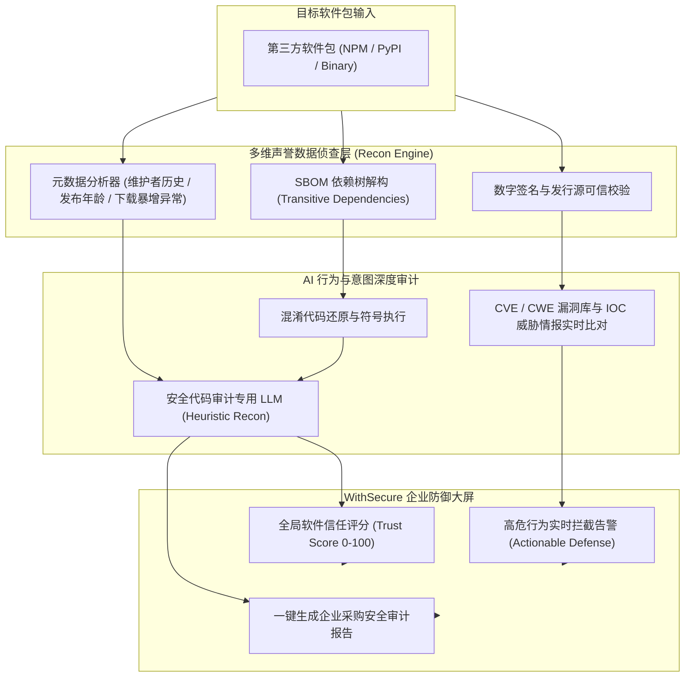

# [2025 Winner Case Study] WithSecure — Reputation Recon by Saadain Khan & Builders

## 1. 元数据概览 (Metadata)

- **对应赛题文件**: [`2025_WithSecure_Reputation_Recon_AI-Powered_Software_Trust_Assessment.md`](file:///C:/Users/Jiang/.gemini/antigravity/scratch/hackjunction/docs/past/silver/en/Agentic%20AI/2025_WithSecure_Reputation_Recon_AI-Powered_Software_Trust_Assessment.md)
- **赛道**: Security & Privacy / Agentic AI Track
- **出题方 (Partner)**: **WithSecure** (原 F-Secure 企业安全集团，欧洲顶级网络防御与端点安全厂商)
- **赛题名称**: Reputation Recon: AI-Powered Software Trust Assessment (声誉侦察兵：AI 驱动的软件供应链信任评估)
- **赛题奖金设置**:
  - **1st Place (第一名冠军)**: €2,000
  - **2nd Place (第二名亚军)**: €1,500
  - **3rd Place (第三名季军)**: €500
- **核心项目**: **Reputation Recon (rep_recon)**
- **核心开发者**: **Saadain Khan** (GitHub: `Saadain23`，赫尔辛基软件系统与 AI 数据工程师)
- **GitHub 开源仓库**: [github.com/Saadain23/rep_recon](https://github.com/Saadain23/rep_recon)
- **开发者个人主页**: [saadaink.com](https://saadaink.com)
- **开发者领英**: [Saadain Khan on LinkedIn](https://www.linkedin.com)

---

## 2. 获胜者背景与技能栈 (Developer Profile)

- **主创**: Saadain Khan
- **工作坐标**: 赫尔辛基 (Helsinki, Finland)
- **核心定位**: Software Systems Engineer, Data & AI Security Builder
- **技术背景**:
  - 拥有全栈系统开发与机器学习管道实战经验（TypeScript, Python, React, GCP, 安全审计微服务）；
  - 专注于软件供应链安全态势感知、容器镜像 SBOM 分析与可信声誉打分算法。

---

## 3. 网络安全痛点与项目解决方案 (Security Problem & Solution)

### 3.1 现代软件供应链的信任危机
在现代云原生开发中，一个简单的 Web 应用动辄引入上千个开源 NPM/PyPI/Cargo 依赖包。黑客频频利用“域名抢注 (Typosquatting)”、“恶意依赖注入”与“废弃包维护权劫持”等手段发起供应链投毒攻击：
- **静态规则失效**: 恶意代码常通过 Base64 编码、动态反射或多阶段载荷避开传统杀毒软件的静态特征码扫描；
- **声誉难以自动化评估**: 开发者在引入依赖时，人工审阅提交者信誉、Issue 活跃度、发布时间与代码变更量几乎不可能规模化实现。

### 3.2 Reputation Recon 的智能防御体系
Saadain Khan 构建的 **Reputation Recon** 是一个面向软件安装包与第三方依赖的可信评估智能体平台：
1. **多维威胁特征自动嗅探 (Multi-Signal Reconnaissance)**:
   - 自动获取软件包的历史发布频率、维护者身份一致性、代码签名证书链与 GitHub 仓库健康度；
2. **AI 驱动的源码恶意意图逆向剖析 (Intent-Aware LLM Audit)**:
   - 利用特化针对代码安全调优的语义模型，专门分析包安装脚本（如 `postinstall.sh`、`setup.py`）中的网络外发、混淆执行与系统敏感文件读取行为；
3. **动态信誉置信评分 (Trust Score Engine)**:
   - 输出一个直观的 0-100 可信声誉值与风险警告标签（如 `High Risk: Obfuscated Network Exfiltration Detected`），无缝拦截危险构建。

---

## 4. 获奖项目核心技术架构深潜 (Technical Architecture)

---

## 5. 赛题评审维度契合度 (Judging Criteria)

| WithSecure 评审标准 | Reputation Recon 的实现方案 |
| :--- | :--- |
| **Detection Accuracy (检测准确度)** | 超越单纯的黑名单比对，结合行为分析与元数据异常检测，有效揪出 0-day 恶意投毒。 |
| **Enterprise Readiness (企业级实用性)** | 提供可集成至 CI/CD 流水线（GitHub Actions）的自动化扫描模式，不拖慢发布节奏。 |
| **Explainable AI (可解释的安全证据)** | 不给黑盒结论，明确高亮标出恶意代码行及潜在的数据泄露风险路径。 |

---

## 6. 关联参考资料 (References)

- **开源代码仓库**: [GitHub - Saadain23/rep_recon](https://github.com/Saadain23/rep_recon)
- **开发者个人主页**: [saadaink.com](https://saadaink.com)
- **出题方官网**: [withsecure.com](https://www.withsecure.com)
- **对应赛题存档**: [2025_WithSecure_Reputation_Recon_AI-Powered_Software_Trust_Assessment.md](file:///C:/Users/Jiang/.gemini/antigravity/scratch/hackjunction/docs/past/silver/en/Agentic%20AI/2025_WithSecure_Reputation_Recon_AI-Powered_Software_Trust_Assessment.md)
