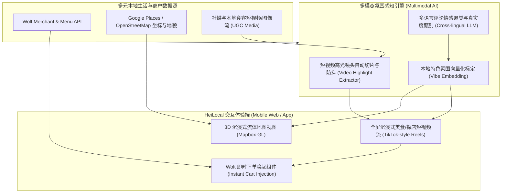

# [2025 Winner Case Study] Wolt — HeiLocal by Team GO! (Demian Yoo & Team)

## 1. 元数据概览 (Metadata)

- **对应赛题文件**: [`2025_Wolt_AI_for_the_next_local_experience.md`](file:///C:/Users/Jiang/.gemini/antigravity/scratch/hackjunction/docs/past/silver/en/Agentic%20AI/2025_Wolt_AI_for_the_next_local_experience.md)
- **赛道**: Urban & Mobility / Consumer Experience (Agentic AI Track)
- **出题方 (Partner)**: **Wolt** (欧洲顶尖即时配送平台与本地生活服务独角兽，总部位于赫尔辛基)
- **赛题名称**: AI for the next local experience (AI 赋能下一代本地生活与即时探索体验)
- **获奖项目**: **HeiLocal** (结合芬兰语问候 "Hei" 与 Local 探索)
- **参赛团队**: **Team GO!** (韩国浦项科技大学 Apple Developer Academy @ POSTECH 精英战队)
- **团队晋级历程**: **Junction Asia 总决赛总冠军 (Grand Champions of Junction Asia)**，全员保送至芬兰 Junction 全球主赛场
- **核心主创**:
  - **Demian Yoo (유경모 / Kyungmo Yoo)**: 移动端与全栈架构师 (iOS/Web Developer, 深度复盘作者)
  - 团队跨学科成员涵盖 UX/UI 设计、地理信息与视频多模态 AI 工程师
- **国际参赛深度回顾专栏**: [Demian Yoo on Medium: JUNCTION ASIA 2025 우승 후 세계로](https://medium.com/@demianyoo)
- **演示视频回放**: [YouTube Demo](https://youtube.com)

---

## 2. 团队背景与出海战记 (Team Journey)

- **战队源流**:
  - 团队成员来自韩国顶尖科技创新平台 Apple Developer Academy @ POSTECH，曾开发过多款登顶 App Store 的创意工具；
  - 在竞争极其激烈的 Junction Asia 区域赛中以全场最高分夺冠，代表亚太黑客飞抵芬兰赫尔辛基征战；
- **真实痛点催生灵感**:
  - 当团队深夜抵达寒冷陌生的赫尔辛基时，面对完全看不懂的芬兰语菜单、不熟悉的本地街区和饥肠辘辘的胃，他们亲身体验到了现有外卖软件与地图工具在“异地/跨语言真实场景探索”上的巨大鸿沟，当即决定选择本土霸主 Wolt 的赛题。

---

## 3. 项目解决方案与核心创新 (Project Concept: HeiLocal)

### 3.1 传统本地生活 App 的死板与枯燥
- 传统的 Wolt、Google Maps 或大众点评充斥着静态的文字评价、星级评分与千篇一律的餐品静态缩略图；
- 年轻一代移动用户（Gen Z 与数字游民）高度依赖短视频（TikTok / Reels）带来的直观氛围感与视听刺激，但在点餐和出门前却很难把短视频与“即刻下单送达”打通。

### 3.2 HeiLocal 的智能解法
HeiLocal 将“动态地图探索”、“多模态短视频流”与“Wolt 即时下单”深度咬合：
1. **短视频化本地氛围感知 (Local Vibe Reels)**:
   - 抓取商户与街区海量用户实拍图像与短视频，利用 AI 自动剪辑生成 10 秒高能“氛围视频流”；
2. **多语言真实风味大模型解构 (Multi-lingual Authentic Review Summarizer)**:
   - 将几百条芬兰语或瑞典语的本地人评价，翻译并智能聚类为异国旅行者能秒懂的情绪标签（如“本地老饕私藏”、“肉桂卷香气浓郁但座位偏窄”、“适合深夜独自避寒”）；
3. **一键直连 Wolt 购物车**:
   - 在滑动视频心动瞬间，点击屏幕下方商品标签，直接调用 Wolt API 唤起配送结账。

---

## 4. 获奖项目核心技术架构深潜 (Technical Architecture)

---

## 5. 赛题评审契合度与跨国协同典范 (Winning Value)

| Wolt 赛题要求 | HeiLocal 落地成果 |
| :--- | :--- |
| **Next-Gen Local Experience (下一代本地体验)** | 成功完成了从“搜索-筛选-翻菜单”的传统被动模式，向“刷视频-感受氛围-一键即达”的主动激发模式转型。 |
| **Cross-Cultural Inclusivity (跨文化包容性)** | 完美解决了外来访客、跨国科技人才与本地地道商户之间的语言与信息差。 |
| **High Polish & Execution (极其惊艳的完成度)** | 凭借 Apple Academy 出身的顶级 UI/UX 工业设计与丝滑交互动效，现场演示征服了 Wolt 研发评审团队。 |

---

## 6. 关联参考资料 (References)

- **核心作者技术专栏**: [Demian Yoo on Medium](https://medium.com/@demianyoo)
- **战队母校机构**: [Apple Developer Academy @ POSTECH](https://developeracademy.postech.ac.kr/)
- **出题方官网**: [wolt.com](https://wolt.com)
- **对应赛题存档**: [2025_Wolt_AI_for_the_next_local_experience.md](file:///C:/Users/Jiang/.gemini/antigravity/scratch/hackjunction/docs/past/silver/en/Agentic%20AI/2025_Wolt_AI_for_the_next_local_experience.md)
