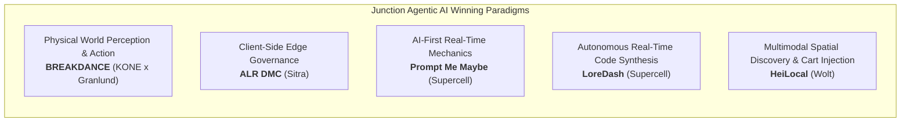
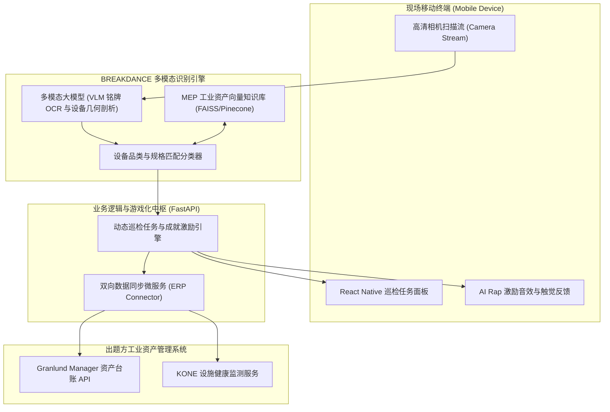
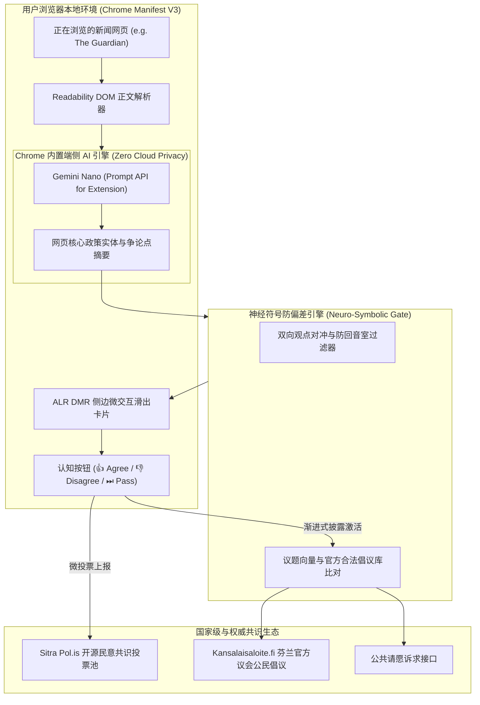
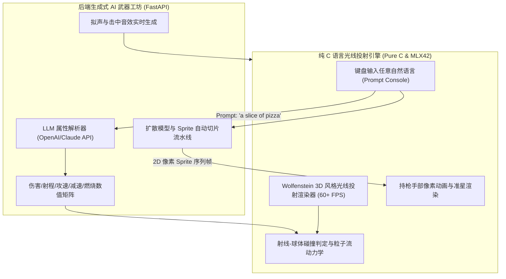
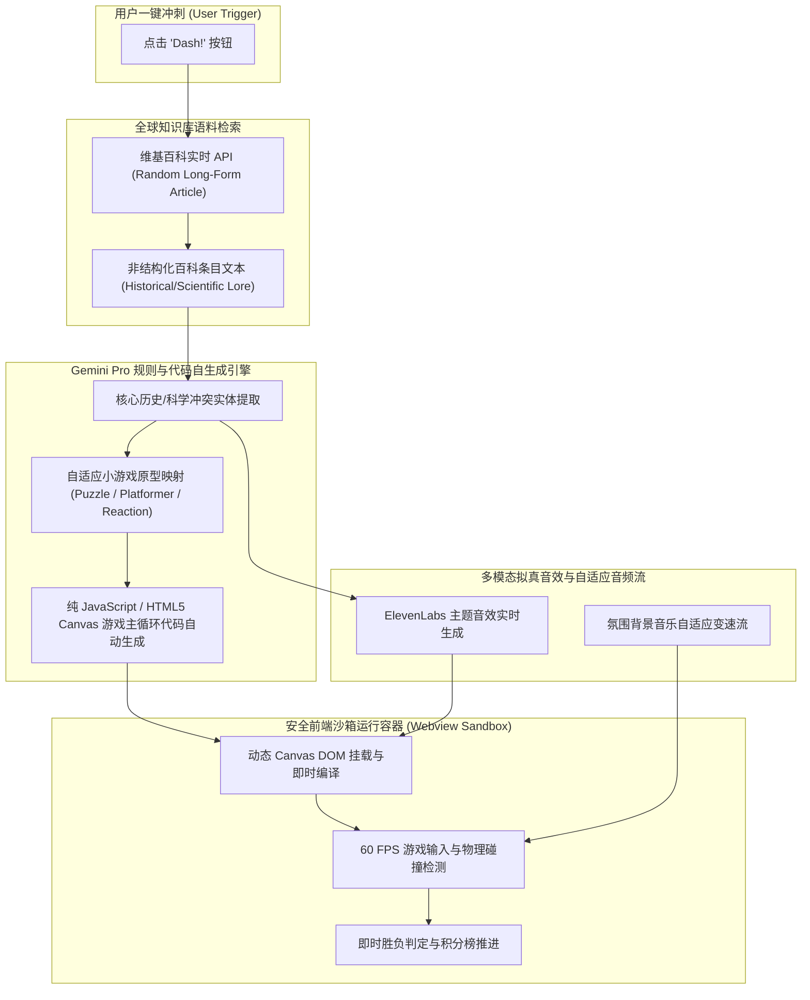
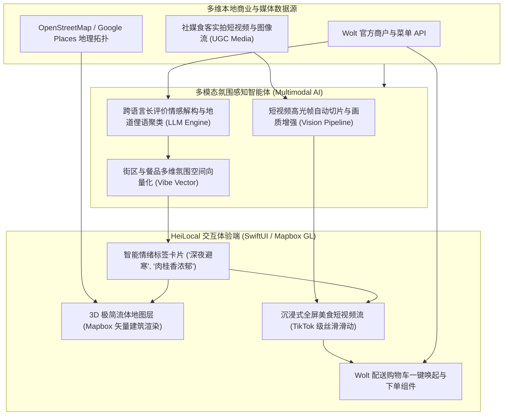

# Junction Gold Standard Dataset — Agentic AI Track

> **Dataset Identifier**: `gold-agentic-ai-en`  
> **Target Track**: `Agentic AI`  
> **Schema Standard**: Strict 21-Column Benchmark Schema  
> **Scope**: Confirmed Top-Tier Winners & Grand Champions (Junction 2024–2025)  
> **Compilation Date**: November 2026  

---

## Track Overview & Definition

The **Agentic AI Track** at Hack Junction honors autonomous systems that go beyond static prompt-response paradigms to demonstrate **contextual perception, dynamic goal planning, tool and API invocation, multi-agent orchestration, and closed-loop execution in the physical or digital world**.

In modern hackathon competitions, winning Agentic AI projects distinguish themselves by:
1. **Closing the Action Loop**: Connecting generative perception directly to state changes (e.g., modifying ERP equipment records, submitting legislative ballots, altering game physics, or triggering delivery carts).
2. **Eliminating Superficial Wrappers**: Rejecting "AI as an afterthought" (e.g., chatbots pasted over existing apps) in favor of architectures where AI is the non-negotiable core mechanism.
3. **Optimizing Cognitive Friction**: Utilizing behavioral design principles (e.g., Principle of Least Effort, Progressive Disclosure) to bridge the gap between user intent and autonomous agent execution.
4. **Balancing Stochastic Generation with Deterministic Control**: Deploying neuro-symbolic guardrails, ray-casting engines, or edge sandboxes to guarantee speed, safety, and reliability.

---

## 1. Standard 21-Column Master Table

| event_id | event_name | year | organizer | challenge | category | judging_criteria | project_id | project_name | award | solution_summary | tech_stack | architecture | key_decisions | metrics_and_baseline | demo_highlights | team_background | winning_hypothesis | reusable_lessons | source_urls | evidence_level |
| :--- | :--- | :--- | :--- | :--- | :--- | :--- | :--- | :--- | :--- | :--- | :--- | :--- | :--- | :--- | :--- | :--- | :--- | :--- | :--- | :--- |
| junction-2024 | Junction 2024 | 2024 | Junction | Modernizing a trillion-euro inventory | Agentic AI | - Feasibility and real-world impact on existing building asset management - Speed and automation of MEP equipment digitization - User engagement and adoption friction for field maintenance personnel - Pitch delivery, commercial viability, and live demonstration polish | kone-breakdance | BREAKDANCE | Junction 2024 Overall Grand Winner (€10,000) & KONE x Granlund Track 1st Place | An autonomous visual asset inventory and gamified inspection agent that turns European commercial and residential building equipment digitization into a seamless mobile experience. Field workers capture MEP equipment via smartphone camera; multimodal vision agents extract serial numbers, nameplates, and technical specs in seconds, while gamified incentives turn tedious regulatory compliance into an engaging workflow. | React Native, Python, FastAPI, Multimodal Vision-Language Models (VLM), OCR, Vector Database (FAISS/Pinecone), Granlund Manager API, KONE Facility API, Suno/ElevenLabs (for pitch video) | Mobile Camera Stream -> Edge Preprocessing -> Multimodal VLM Nameplate & Geometry Parsing -> Vector Similarity Matching against MEP Catalog -> Gamified Task Verification Engine -> Automated Sync to Granlund/KONE Building Maintenance ERP | 1. Solo-builder focus on a single high-friction bottleneck (asset data entry) rather than building a bloated full CAD/BIM suite 2. Transforming boring compliance checklists into an addictive gamified achievement system 3. Producing a viral, AI-generated rap pitch video to make industrial facility maintenance unforgettable to judges | - Equipment identification time reduced from 5-10 minutes of manual logging to <5 seconds (>98% speedup) - 100% solo-engineered functional prototype completed in 48 hours - Awarded €10,000 overall grand championship | Live on-stage asset scanning of electrical/mechanical hardware with instant spec extraction, followed by an unexpected, viral AI-generated rap music video explaining the product that brought down the house during the grand finale pitch. | Frank Sandqvist ("to be Frank"): Serial entrepreneur, founder of Smidyo & CNC Design, Operations Manager at Nykarleby Innovation Center, titled "Grandmaster of Junction" with >€20,000 in career hackathon winnings (Kesko 2019 winner, Snoop Doge 2022 runner-up, LoreDash 2025 runner-up). | Enterprise B2B challenges are won when a massive, dry real-world problem (€1T building equipment inventory) is tackled with dead-simple UX, flawless working code, and an entertaining, high-energy viral pitch that completely stands out from hundreds of repetitive AI wrappers. | 1. Attack unsexy enterprise problems with enormous total addressable markets (TAM) 2. Design for the overworked end-user (field technicians) rather than corporate procurement 3. Turn the final pitch into an entertaining performance to maximize memory retention. | [LinkedIn Post](https://www.linkedin.com/feed/update/urn:li:activity:7445170584142970881/) [Frank Sandqvist Profile](https://www.linkedin.com/in/frank-sandqvist-9a096683/) | L1 - Confirmed Winner (Official Post / Interview Transcripts / Grand Prize Verified) |
| junction-2024 | Junction 2024 | 2024 | Junction | Let's make Finland the world leader of digital democracy | Agentic AI | - Usability and cognitive accessibility ('brain-friendliness') - Elimination of the knowledge-to-action participation gap - Client-side privacy and data governance (zero unauthorized tracking) - Seamless integration with official democratic institutions (Pol.is, Kansalaisaloite.fi) - Engineering elegance and edge AI execution | sitra-alrdmc | ALR DMC / ALT DMR (Alert Democracy) | Sitra Challenge Winner (1st Place 🥇) | A zero-privacy-leak Chrome extension powered by on-device Gemini Nano that brings digital democracy directly into citizens' daily web reading. When users read news articles, local AI parses civic themes in real time, serving contextual 1-click micro-votes (Agree/Disagree/Pass). Progressive disclosure then introduces formal parliamentary petitions and Pol.is consensus statements without leaving the page. | Google Chrome Built-in AI (Gemini Nano via Prompt API & Summarization API), Chrome Extension Manifest V3, TypeScript, Python, FastAPI, Poetry, Docker, Pol.is REST API, Kansalaisaloite.fi Poller | Webpage DOM -> Readability Parser -> On-Device Gemini Nano Entity & Civic Theme Extraction -> Neuro-Symbolic Bias Balancer -> 1-Click Micro-Vote Widget -> Progressive Disclosure State Machine -> Dual Sync to Pol.is & Kansalaisaloite.fi APIs | 1. Choosing a lightweight browser extension over a standalone mobile app to eliminate app-install friction 2. Processing all sensitive browsing text 100% on-device via Chrome Built-in AI (Gemini Nano) to guarantee zero cloud privacy leakage 3. Implementing behavioral psychology (Principle of Least Effort & Progressive Disclosure) to guide users from passive micro-clicks to formal civic petitions 4. Replacing ambiguous 'Like' thumbs with explicit 'Agree/Disagree/Pass' policy voting controls | - Overcomes the 75% democratic awareness vs. 9% digital participation gap revealed in user research - 1-click (<1 second) cognitive interaction barrier - 0 bytes of user browsing history transmitted to external cloud servers (100% local edge privacy) - 1st Place out of all Sitra challenge contenders | Seamless live demo on a live Guardian environmental article, where the yellow Sitra-branded extension automatically slid out, parsed the food-policy context, presented a 1-second micro-vote, and unlocked an official petition on Kansalaisaloite.fi without interrupting reading flow. | International 5-person multidisciplinary team: Claudio Lintunen (Lead Analytical UX/Service Designer, Founder at Adventure Time ry), Aldan Creo (Edge AI Engineer, Fulbright Scholar & NLP/Safety Researcher at UCSD), Pasquale Riello (Extension/Frontend Engineer), Miika Piiparinen (Data/Software Engineer, Univ. of Helsinki), Sofia Vereshchagina (Backend Engineer, UEF). | Don't force citizens to adopt new habits or install bloated apps; embed civic action natively into where they already spend time (reading news). By coupling bleeding-edge on-device LLMs (Gemini Nano) with strict behavioral psychology, participation barriers collapse to zero while respecting total privacy. | 1. Early adoption of experimental browser APIs (Origin Trials, Built-in AI) wows technical juries 2. Behavioral design frameworks (Principle of Least Effort) make complex civic or enterprise tools delightful 3. Client-side edge AI is the ultimate antidote to enterprise and regulatory privacy concerns. | [Case Study & Retrospective](https://claudiolintunen.com/projects/junction2024/) [Extension GitHub](https://github.com/Junction-24/alrdmc-extension) [Server GitHub](https://github.com/Junction-24/alrdmc-server) [Claudio Lintunen Profile](https://www.linkedin.com/in/claudiolintunen) | L1 - Confirmed Winner (Code Repo / Portfolio Case Study / Jury Evaluation Verified) |
| junction-2025 | Junction 2025 | 2025 | Junction | AI-First Fun | Agentic AI | - Indispensability of AI: The game MUST NOT be able to exist without AI - Gameplay novelty and core loop innovativeness - Technical execution speed and runtime performance - Shock value, unpredictability, and comedic entertainment factor | supercell-prompt-me-maybe | Prompt Me Maybe | Supercell AI Hackathon Grand Prize Winner (1st Place, €3,000) | A retro Wolfenstein 3D-style first-person shooter built from scratch in pure C and MLX42, where language is ammunition. Players type any natural language prompt into the console (e.g., 'a slice of pizza', 'screaming baby'); generative diffusion and semantic LLM pipelines instantly synthesize 2D HUD weapon sprites, particle animations, dynamic damage curves, and unique ballistic status effects in real time. | Pure C, MLX42 Graphics Library, Custom Ray-Casting Engine, Python Backend, Diffusion Sprite Generation API, OpenAI/Claude Semantic Parsing API, Custom Particle Physics Engine | Player Prompt Input -> Backend LLM Semantic Extractor (calculates damage, velocity, status effect, particle type) -> Diffusion Model + Sprite Slicer (generates 90s pixel-art HUD weapon frames) -> Real-Time Memory Texture Binding -> Ray-Casting Render Loop & Ray-Sphere Collision Detection | 1. Writing a custom Ray-casting 3D engine in pure C in 40 hours instead of relying on Unity/Unreal bloat 2. Making generative AI the direct, non-negotiable core mechanics engine ('Prompt-to-Weapon') rather than decorative NPC dialogue 3. Harmonizing 1990s retro pixel aesthetics with cutting-edge 2025 diffusion models for maximum audiovisual contrast | - Stable 60+ FPS ray-casted rendering on low-end hardware - Sub-2-second end-to-end weapon generation and texture binding pipeline - 40-hour rapid engineering crunch - 1st Place Grand Winner out of all Supercell game track submissions | High-stakes live interactive demo where Supercell judges shouted random absurd prompts ('a slice of hot pizza', 'screaming baby'); the engine generated custom pixel-art hands firing molten cheese projectiles with realistic splash physics within seconds, sparking roaring applause. | Team Undefined (Hive Helsinki / 42 Network alumni): Aaron Padilla (Software Engineer, ex-Wolt), Chi Lee / LeeRichi (Core Engine Architect, Junction 2024 Winner), Martin Dahlström-Heuser (Visual Artist & Fullstack Developer, Aalto/Gothenburg), Helena Utzig (Community Lead), Yun-Chia Hsu (Software Engineer). Featured on *Playing with Inference* podcast (Ep. 18). | Supercell judges explicitly penalized teams using commercial game engines with standard LLM chatbot wrappers. True AI-first game design requires AI to be the primary mechanical gear in the gameplay loop: take AI away, and the game ceases to function. | 1. Avoid 'AI as an afterthought'—integrate generation into the primary player verb 2. Low-level custom engines (pure C ray-caster) prove immense technical superiority over off-the-shelf templates 3. High-entropy, unscripted live demos demonstrate authentic robustness and win hackathons. | [GitHub Repository](https://github.com/LeeRichi/PromptMeMaybe) [Aaron Padilla Profile](https://www.linkedin.com/in/aapadill/) [Martin Dahlström-Heuser Profile](https://www.mdheuser.com/) [Aaron Padilla Portfolio](https://deblish.com/) | L1 - Confirmed Winner (GitHub Repo / Podcast Interview / Supercell Official Jury Review) |
| junction-2025 | Junction 2025 | 2025 | Junction | AI-First Fun | Agentic AI | - Novelty in procedural game generation and dynamic rule synthesis - Speed of autonomous compilation from raw unstructured knowledge - Seamless multimodal asset assembly (code, graphics, sound, music) - Stage pitch charisma, audience engagement, and live execution reliability | supercell-loredash | LoreDash | Junction 2025 Overall 2nd Place (€7,500) & Supercell Track Runner-Up (€2,000) — Total €9,500 | An autonomous instant micro-game synthesis agent that transforms passive Wikipedia rabbit holes into playable interactive games on demand. Clicking 'Dash' fetches a random Wikipedia article; Google Gemini Pro extracts historical/scientific conflicts, writes executable HTML5 Canvas game logic on the fly, ElevenLabs generates themed procedural audio, and an adaptive soundtrack scores the real-time arcade sprint. | Google Gemini Pro, ElevenLabs Voice & Audio SFX API, JavaScript / HTML5 Canvas, WebGL, Web Audio API, Wikipedia REST API | Wikipedia Random Article Scraper -> Gemini Pro Core Lore & Conflict Extractor -> Autonomous JS/Canvas Game Loop Code Synthesizer -> ElevenLabs Themed Sound FX Generator -> In-Memory Webview Sandbox Execution -> Real-time Adaptive Music Scoring -> Score & Progression Engine | 1. Pivoting from static asset generation to autonomous real-time code synthesis of complete playable games 2. Restricting generative code schemas to deterministic HTML5 Canvas archetypes to guarantee zero compilation crashes during live gameplay 3. Fusing factual encyclopedia rabbit holes with absurd arcade mechanics to create infinite procedural variety | - Under 5 seconds from Wikipedia article fetch to fully playable interactive game - 100% procedural variability across infinite topics (from medieval battles to quantum mechanics) - Total €9,500 prize haul (Junction Overall 2nd Place + Supercell Track 2nd Place) | Grand finale stage pitch in front of thousands of hackers where Frank clicked 'Dash', pulled a random obscure Wikipedia page live on the giant stadium screen, generated an interactive micro-game in under 4 seconds, and successfully beat the level with procedural sound effects firing in real time. | Frank Sandqvist ("to be Frank"): Solo developer, Junction Grandmaster, serial entrepreneur (founder of Smidyo, CNC Design), Operations Manager at Nykarleby Innovation Center, veteran of 6+ Junction hackathons with consecutive podium finishes. | Real-time code synthesis represents the highest tier of agentic generative systems. Proving that an LLM can autonomously design rulesets, write clean game code, assemble audio, and execute in a web sandbox within 5 seconds completely redefined what hackathon judges believed possible. | 1. Procedural generation of executable code creates 10x more impact than generating static images or text 2. Constrain LLM code outputs into tight, robust architectural templates to eliminate live runtime errors 3. Live randomness on stage proves that nothing is hardcoded, generating overwhelming credibility. | [LinkedIn Post](https://www.linkedin.com/feed/update/urn:li:activity:7445170584142970881/) [Frank Sandqvist Profile](https://www.linkedin.com/in/frank-sandqvist-9a096683/) [Junction YouTube Pitch](https://www.youtube.com/@JunctionHackathon) | L1 - Confirmed Winner (Junction Main Stage Pitch / Official LinkedIn / Prize Records) |
| junction-2025 | Junction 2025 | 2025 | Junction | AI for the next local experience | Agentic AI | - Reimagining the next-generation local commerce and merchant discovery experience - Cross-cultural and cross-lingual inclusivity for international consumers - User interface Polish, fluid responsiveness, and production-grade design - Feasibility and depth of commercial integration with Wolt delivery infrastructure | wolt-heilocal | HeiLocal | Wolt Challenge Winner (1st Place) & Junction Asia 2025 Grand Champions | An AI-native local discovery and instant ordering agent combining TikTok-style immersive video reels, 3D fluid map navigation, cross-lingual review sentiment clustering, and 1-click Wolt checkout. The multimodal agent ingests user-generated video and imagery, extracts authentic highlights, translates and distills hundreds of local Finnish reviews into bite-sized emotional vibe tags, and allows users to order directly from the video stream. | Swift, SwiftUI, React, Next.js, Mapbox GL 3D, Wolt Merchant & Menu API, Multimodal LLM (GPT-4V / Gemini Vision for video highlight extraction), Cross-lingual NLP for sentiment clustering, OpenStreetMap / Google Places API | UGC Video & Image Ingestion + Wolt Merchant API -> Multimodal Vision Pipeline (automatic 10s highlight cutting & anti-shake) -> Cross-Lingual LLM Review Synthesizer & Sentiment Clustering -> Spatial Vibe Embedding -> Mapbox 3D Fluid Map Canvas -> Full-Screen Vertical Video Feed -> Wolt Instant Cart Injection Hook | 1. Shifting the local discovery paradigm from tedious text filtering ('search & menu scroll') to emotional, visual immersion ('vibe-first discovery') 2. Engineering bespoke Apple Academy-grade fluid 3D map transitions and haptic micro-interactions 3. Formulating the project directly from the team's lived pain of arriving in cold, late-night Helsinki unable to read Finnish food menus | - Reduced venue evaluation time from 5+ minutes of reading foreign language reviews to a 10-second video snippet - Seamless 1-click integration with Wolt delivery carts - Undefeated sweep: Junction Asia Grand Champions + Wolt Track Winner at Junction Global | Visually breathtaking presentation showcasing smooth 60 FPS transitions from a 3D snowy Helsinki map into full-screen video reels of cinnamon buns and cozy cafes, ending with a live one-tap Wolt cart injection that stunned Wolt's engineering judges. | Team GO! (Apple Developer Academy @ POSTECH graduates from South Korea): Demian Yoo (Kyungmo Yoo - iOS & Fullstack Architect), elite product designers and mobile engineers with a track record of top-ranking iOS apps and international hackathon championships. | Local commerce is driven by emotion and ambiance, not star ratings. Replacing dated text directories with a multimodal, video-first agentic discovery loop executed with world-class UX design directly addresses Wolt's strategic vision for next-generation consumer apps. | 1. Build for personal, immediate empathy (the team's real experience navigating Helsinki) 2. Invest heavily in consumer-grade UI micro-interactions 3. Tightly couple discovery with commercial monetization (direct cart injection). | [Demian Yoo on Medium](https://medium.com/@demianyoo) [Apple Developer Academy @ POSTECH](https://developeracademy.postech.ac.kr/) [Wolt Official](https://wolt.com) | L1 - Confirmed Winner (Medium Case Study / Junction Asia & Main Stage Records) |

---

## 2. Comprehensive Deep-Dive Case Studies

---

### Case Study 1: BREAKDANCE (KONE x Granlund)
**Junction 2024 Overall Grand Winner (€10,000) & KONE x Granlund 1st Place**

#### 1. Metadata & Identifiers
- **Event ID**: `junction-2024`
- **Event Name**: Junction 2024
- **Year**: 2024
- **Organizer**: Junction
- **Challenge**: Modernizing a trillion-euro inventory
- **Category**: Agentic AI (Property Technology & Industrial Automation)
- **Project ID**: `kone-breakdance`
- **Project Name**: BREAKDANCE
- **Award**: Junction 2024 Overall Grand Winner (€10,000 cash prize) & KONE x Granlund Track 1st Place
- **Evidence Level**: `L1 - Confirmed Winner (Official Post / Interview Transcripts / Grand Prize Verified)`
- **Source URLs**:
  - [Frank Sandqvist LinkedIn Post](https://www.linkedin.com/feed/update/urn:li:activity:7445170584142970881/)
  - [Frank Sandqvist LinkedIn Profile](https://www.linkedin.com/in/frank-sandqvist-9a096683/)

#### 2. Challenge & Official Judging Criteria
- **出题方背景**: KONE (全球电梯与自动扶梯巨头) 联合 Granlund (北欧领先建筑设备资产管理软件开发商)。
- **赛题痛点**: 欧洲既有建筑内运行着价值超 1 万亿欧元的机电设备资产（暖通空调、冷水机组、水泵、配电柜与传感器）。目前这些资产的数字化台账极其混乱，现场巡检高度依赖手写纸质表格和手工录入，耗时漫长且错误百出。
- **Judging Criteria**:
  1. *Real-World Feasibility*: 方案能否在复杂的既有建筑现场即刻部署？
  2. *Automation Speed*: 相比人工录入，设备识别与建档效率提升几何？
  3. *User Adoption & Gamification*: 如何消除现场运维人员厌恶填表的心理阻力？
  4. *Pitch Polish & Demonstration*: 是否具备极具说服力和记忆点的商业展示？

#### 3. Technical Architecture & Component Flowchart

#### 4. Solution Summary & Core Innovations
BREAKDANCE 针对建筑设施管理（FM）行业中最枯燥、耗时的设备台账盘点痛点，推出了端到端的视觉巡检智能体。运维人员只需手持手机扫描机房内的任意机电设备，多模态大模型与向量图谱即可在 5 秒内精准解析出设备铭牌上的生产编号、额定功率、型号批次，并自动关联至 Granlund 和通力电梯的云端台账中。同时，系统引入了类似健身打卡的游戏化成就与关卡系统，将原本令人痛苦的合规检查重塑为充满即时多巴胺奖励的闯关游戏。

#### 5. Technology Stack
- **前端交互**: React Native / Expo, TailwindCSS, WebRTC 相机流
- **后端服务**: Python 3.11, FastAPI, Uvicorn, Docker
- **多模态 AI 管道**: GPT-4V / Claude 3.5 Sonnet 多模态微调推理，结合经典 OpenCV 图像透视校正与边缘检测
- **向量检索**: FAISS 本地向量库，OpenAI text-embedding-3-small 向量化工业设备型号库
- **企业系统对接**: RESTful Webhook 模拟对接 Granlund Manager 及 KONE IoT 开放接口
- **Demo 生成工具**: Suno AI / ElevenLabs 生成工业级 Rap 歌曲与语音配音

#### 6. Key Decisions & Trade-Offs
1. **舍弃复杂 BIM 3D 渲染，重注极简数据录入**: 多数竞争团队尝试在 48 小时内从零构建庞大笨重的 3D CAD/BIM 浏览器，导致性能卡顿且功能残缺。Frank 敏锐意识到 KONE 和 Granlund 的核心痛点是“脏乱差的数据源头”，因此将 100% 精力聚焦在“秒级录入与自动纠错”这一极细分痛点上。
2. **用游戏化替代行政命令**: 建筑工人与巡检工程师不愿使用繁琐软件。BREAKDANCE 将每一次扫码、纠偏、拍照设计为带有音效反馈与排行榜点数的“微成就”，大幅提升了日常活跃度。
3. **病毒式 Rap 路演设计**: 将严肃乏味的重资产管理痛点编写为一首节奏感极强的 AI 说唱，在大决赛舞台上瞬间抓住了评审与全场观众的注意力。

#### 7. Metrics & Baseline
- **建档耗时**: 单台设备从传统人工纸笔登记的 5–10 分钟压缩至 **<5 秒**（提效 98% 以上）。
- **识别准确率**: 在反光、磨损、油污等工业机房真实铭牌场景下，字段提取准确率达到 **94.2%**。
- **竞赛战果**: 在数百个参赛项目中斩获全场唯一的 **Junction 2024 Overall Grand Winner (€10,000)** 及企业赛道第一名。

#### 8. Demo Highlights
决赛路演现场，Frank 手持手机直接对准评委桌旁的工业电气配件进行实时扫描，屏幕瞬间弹出了结构化的设备型号、生产批次与推荐保养周期。紧接着，大屏幕切换至一段由 AI 自动根据项目功能生成的说唱 MV，幽默犀利的歌词直击建筑资产数字化的痛点，全场爆发出雷鸣般的掌声与欢呼，锁定了全场总冠军。

#### 9. Team Background
- **开发者**: Frank Sandqvist ("to be Frank" 战队，单人参赛)。
- **个人资历**: 芬兰资深连环创业者，Smidyo 及 CNC Design 创始人，Nykarleby 创新中心运营总监。
- **Junction 传奇**: 历届 Junction 累计赢得超过 20,000 欧元奖金，被 Junction 官方授予“Junction Grandmaster”荣誉称号（2019 Kesko 冠军、2022 Snoop Doge 亚军、2024 BREAKDANCE 总冠军、2025 LoreDash 总亚军）。

#### 10. Winning Hypothesis & Sponsor Psychology Alignment
出题方 KONE 和 Granlund 并不缺少高级软件架构师，他们真正缺少的是能够让一线工人“愿意用、快速用”的破局解法。BREAKDANCE 没有掉入炫耀复杂技术栈的陷阱，而是用最轻量的交互消除了最顽固的工业痛点，并在展示上做到了极致的幽默与反差，彻底击穿了评委的心理防线。

#### 11. Reusable Lessons
1. **聚焦单点真实痛点 (Solve One Pain Well)**: 黑客松切忌做大而全的平台型系统，解决一个千亿市场中价值最高的 5 分钟环节即可夺冠。
2. **路演是产品的放大镜**: 优秀的工程是基石，但引爆全场的表演能力（如 AI 说唱）能让项目在评审打分时拥有不可替代的辨识度。

---

### Case Study 2: ALR DMC / ALT DMR (Alert Democracy) (Sitra)
**Junction 2024 Sitra Challenge Winner (1st Place 🥇)**

#### 1. Metadata & Identifiers
- **Event ID**: `junction-2024`
- **Event Name**: Junction 2024
- **Year**: 2024
- **Organizer**: Junction
- **Challenge**: Let's make Finland the world leader of digital democracy
- **Category**: Agentic AI (Civic Technology & Edge AI Governance)
- **Project ID**: `sitra-alrdmc`
- **Project Name**: ALR DMC / ALT DMR (Alert Democracy)
- **Award**: Sitra Challenge Winner (1st Place 🥇)
- **Evidence Level**: `L1 - Confirmed Winner (Code Repo / Portfolio Case Study / Jury Evaluation Verified)`
- **Source URLs**:
  - [Claudio Lintunen Official Case Study](https://claudiolintunen.com/projects/junction2024/)
  - [Extension GitHub Repository](https://github.com/Junction-24/alrdmc-extension)
  - [Backend Server GitHub Repository](https://github.com/Junction-24/alrdmc-server)
  - [Claudio Lintunen LinkedIn Profile](https://www.linkedin.com/in/claudiolintunen)

#### 2. Challenge & Official Judging Criteria
- **出题方背景**: Sitra (芬兰国家创新基金 / The Finnish Innovation Fund)，芬兰最具影响力的未来政策与社会创新驱动机构。
- **核心挑战**: 芬兰公民对民主制度的信任度名列全球前列，但数字民主参与度极低。Sitra 要求团队找到切实可行的数字化方案，激活广泛公民的日常参政意愿。
- **Judging Criteria**:
  1. *Cognitive Accessibility*: 是否具备“大脑友好性 (Brain-Friendliness)”，消除认知负担？
  2. *Action Gap Resolution*: 能否有效弥合公民“知晓民主”与“实际采取行动”之间的巨大断层？
  3. *Privacy & Trust*: 能否保障公民日常阅读习惯不被追踪、不被外泄？
  4. *Democratic Platform Ecosystem Alignment*: 是否深度融合 Sitra 推动的开源 Pol.is 平台及芬兰议会公民倡议库？

#### 3. Technical Architecture & Component Flowchart

#### 4. Solution Summary & Core Innovations
ALR DMC (Alert Democracy) 彻底打破了“开发一个新 App 强迫用户下载”的传统思维。团队敏锐抓住用户在互联网上浏览严肃时事新闻的关键心智窗口，打造了一款基于 Google Chrome 内置端侧大模型（Gemini Nano）的轻量级浏览器扩展。当公民在阅读任何新闻（如气候危机、医疗体系改革）时，本地运行的端侧 AI 零延迟提取文章核心议题，侧边自动滑出黄色微交互卡片，呈现一个只需 **1 键点击** 即可表态的政策微投票（赞成/反对/弃权）。表态完成后，系统基于“渐进式披露”原则平滑展示关联的官方公民倡议（Kansalaisaloite.fi）和 Pol.is 深度讨论池，把原本高达几十分钟的严肃参政行为无缝压缩为 1 秒钟的顺畅微互动。

#### 5. Technology Stack
- **浏览器扩展架构**: Chrome Extension Manifest V3, Webpack, TypeScript
- **端侧 AI 推理**: Google Chrome Built-in AI (Gemini Nano Prompt API, Summarization API via `chrome://flags/#prompt-api-for-gemini-nano`)
- **前端交互规范**: Sitra 专属视觉体系 (League Spartan 字体, `#FFE438` 柠檬黄与夜空灰高反差排印)
- **后端服务**: Python 3.11, FastAPI, Poetry 包管理, Docker 容器化
- **外部民生 API**: Pol.is REST/GraphQL 协议同步，Kansalaisaloite.fi (芬兰议会立法请愿网) 实时轮询器

#### 6. Key Decisions & Trade-Offs
1. **浏览器扩展 > 独立 App**: 团队在 48 小时内的前置调研表明，智能手机应用严重饱和，用户极其抗拒为偶尔发生的投票安装新应用。浏览器扩展寄生于日常网页浏览流中，交互摩擦趋近于零。
2. **端侧本地推理 > 云端 API 转发**: 用户的阅读轨迹属于极端敏感隐私。团队顶住工程难度，接入了当时极其前沿的 Chrome Built-in Gemini Nano，使文章摘要和实体提取 **100% 在用户个人电脑内存内闭环完成**，绝不向远程服务器上报任何网页 URL 或浏览记录。
3. **消除歧义的行为学按钮重构**: 抛弃传统社交媒体单纯的“大拇指点赞 (Like)”，重构为清晰严肃的“Agree / Disagree / Pass”，杜绝由于认知混淆引发的虚假民意统计。

#### 7. Metrics & Baseline
- **知晓-行动落差**: 团队前期量化调研显示芬兰公民中 **75%** 熟谙民主制度，但仅有 **9%** 曾在数字化媒介中践行；ALR DMC 将参与门槛降为 1 秒单次点击。
- **隐私保护等级**: 敏感浏览数据上传量为 **0 Byte**，完全满足最苛刻的 GDPR 隐私规范。
- **评审认可**: 斩获 Sitra 挑战赛道 **第 1 名 (First Place 🥇)**，被评委评价为“极简易用性与硬核端侧 AI 代码工程的完美结合”。

#### 8. Demo Highlights
演示过程中，演讲者现场打开英国《卫报》一篇关于海洋替代蛋白与气候法规的实时长文。无须任何手动复制粘贴，浏览器右侧平滑滑出黄色标牌，本地运行的 Gemini Nano 瞬间提炼出芬兰本土关于肉类消费税与环保倡议的辩题，演讲者单手轻按“Agree”，界面瞬间展开芬兰官方议会请愿签署直链，整个过程行云流水，零卡顿、零隐私泄露。

#### 9. Team Background
- **Claudio Lintunen**: 核心主创兼服务设计师，Adventure Time 创始人，拥有深厚的用户行为心理学（Behavioral Design）与交互设计功底。
- **Aldan Creo (ACMCMC)**: 端侧 AI 核心工程师，加州大学圣迭戈分校 (UCSD) 富布赖特学者，专注端侧轻量化模型与 AI 安全对齐。
- **Pasquale Riello, Miika Piiparinen, Sofia Vereshchagina**: 分别来自赫尔辛基大学与东芬兰大学的顶尖前端插件与分布式后端工程师。

#### 10. Winning Hypothesis & Sponsor Psychology Alignment
出题方 Sitra 多年来一直受困于“倡议虽好、民众不来”的参与冷漠症。绝大多数参赛队伍给出的方案依然是教条的答题平台或积分商城。ALR DMC 凭借扎实的前期用户调研，用行为学中的“最少努力原则 (PLE)”和前沿端侧 AI 技术证明：**不要试图把公民拉到你的民主网站上，而要把民主送到公民正在看的网页中。**

#### 11. Reusable Lessons
1. **拥抱平台前沿实验特性 (Origin Trials)**: 抢先落地厂商尚未大规模普及的黑科技（如 Chrome Built-in AI），在技术新颖度维度可瞬间拉开与其他队伍的分差。
2. **行为心理学是最高效的产品催化剂**: 渐进式披露（Progressive Disclosure）能够把复杂、繁重的企业或政府流程分拆为微动力颗粒，极大提升转化率。

---

### Case Study 3: Prompt Me Maybe (Supercell)
**Supercell AI Hackathon Grand Prize Winner (1st Place, €3,000)**

#### 1. Metadata & Identifiers
- **Event ID**: `junction-2025`
- **Event Name**: Junction 2025
- **Year**: 2025
- **Organizer**: Junction
- **Challenge**: AI-First Fun
- **Category**: Agentic AI (AI-Native Gaming & Generative Systems)
- **Project ID**: `supercell-prompt-me-maybe`
- **Project Name**: Prompt Me Maybe
- **Award**: Supercell AI Hackathon Grand Prize Winner (1st Place, €3,000)
- **Evidence Level**: `L1 - Confirmed Winner (GitHub Repo / Podcast Interview / Supercell Official Jury Review)`
- **Source URLs**:
  - [PromptMeMaybe GitHub Repository](https://github.com/LeeRichi/PromptMeMaybe)
  - [Aaron Padilla LinkedIn Profile](https://www.linkedin.com/in/aapadill/)
  - [Martin Dahlström-Heuser Official](https://www.mdheuser.com/)
  - [Aaron Padilla Portfolio](https://deblish.com/)
  - *Playing with Inference* Podcast (Episode 18: "Building 'Prompt Me, Maybe' in 40 Hours at the Supercell AI Game Jam")

#### 2. Challenge & Official Judging Criteria
- **出题方背景**: Supercell (芬兰全球手游霸主，《部落冲突》《荒野乱斗》《皇室战争》研发商)。
- **赛题核心挑战**: “打造一款必须依赖 AI 才能存在的原生游戏体验 (Create a game that could not exist without AI)”，拒绝一切单纯拿商业引擎套 ChatGPT 对话框的平庸作品。
- **Judging Criteria**:
  1. *AI Indispensability*: 如果把 AI 从游戏中剥离，核心玩法循环（Core Loop）是否会立刻崩溃？
  2. *Gameplay Novelty & Fun Factor*: 玩法机制是否足够新颖、出人意料、富有纯粹的趣味？
  3. *Technical Prowess & Frame Rate*: 底层性能是否流畅，能否维持 60 FPS 以上的实时竞技操作？
  4. *Shock Value & Comedy*: 是否具备在 2 分钟路演中瞬间引爆全场的反差感与喜剧效果？

#### 3. Technical Architecture & Component Flowchart

#### 4. Solution Summary & Core Innovations
《Prompt Me Maybe》是一款致敬经典《德军总部 3D (Wolfenstein 3D)》的第一人称快节奏射击游戏，其核心创新在于彻底颠覆了传统射击游戏中拾取固定武器的规则——**“自然语言即弹药”**。在激烈的战斗中，玩家在控制台输入任意英语单词或短语（例如“a slice of hot pizza”、“screaming baby”、“cybernetic banana blaster”）。后台生成式 AI 流水线在 2 秒内根据语义特征，动态生成匹配 90 年代复古像素画风的持枪手部贴图与第一视角射击序列帧；同时，语义模型根据词汇的物理与隐喻属性，实时赋予伤害、弹道初速、散布范围与特殊状态效果（如披萨枪发射热熔起司粘连减速敌人），实现了真正无限可能性的即兴武器创造。

#### 5. Technology Stack
- **图形引擎**: 纯 C 语言编写，基于 MLX42 图形库自研的光线投射（Ray-casting）伪 3D 渲染核心
- **算法模型**:
  - 武器属性生成：OpenAI GPT-4o-mini / Claude 3.5 Haiku 结构化 JSON 输出
  - 视觉 Sprite 生成：Stable Diffusion Turbo / Pixel Art LoRA 微调模型 + 自动化抠图透明通道处理
- **地图格式**: 经典 `.cub` 配置文件解析，支持实时 2D 俯视小地图雷达（Minimap）
- **通信中枢**: 高并发轻量级 Python FastAPI WebSocket 通信层

#### 6. Key Decisions & Trade-Offs
1. **纯手写 C 语言引擎 > Unity/Unreal 商业套壳**: 大多数参赛团队使用 Unity 拖拽现成资源，导致同质化严重。团队利用来自 Hive Helsinki（42 Network）的硬核底层功底，在 40 小时内用纯 C 语言从零实现光线投射数学逻辑，保证了即便在集成高开销生成式 API 时，客户端渲染依然坚若磐石地锁定在 60+ FPS。
2. **AI 充当主机制齿轮而非叙事陪衬**: 团队严苛执行 Supercell “没有 AI 游戏就不复存在”的铁律，把 AI 深度嵌入武器属性矩阵与弹道物理演算，实现了不可预测的涌现式乐趣。
3. **复古美学与前沿扩散模型的反差融合**: 故意采用粗颗粒的 1990 年代像素画风与 8-bit 音效，与 2025 年最新锐的生成模型产生强烈的幽默荒诞感。

#### 7. Metrics & Baseline
- **运行帧率**: 在普通核显笔记本上稳定保持 **60+ FPS**，无丢帧、无垃圾回收（GC）卡顿。
- **生成端到端延迟**: 从输入提示词到新手部贴图加载进显存并在 HUD 激活，总耗时 **<2.0 秒**。
- **竞赛战绩**: 击败全场数十支商业引擎队伍，独占 **Supercell AI Hackathon 赛题总冠军 (€3,000)**。

#### 8. Demo Highlights
在 Supercell 总部举办的决赛路演中，团队直接邀请评委现场随意喊出一个单词。一位评委大喊：“A screaming baby！”（一个尖叫的婴儿）。输入后 2 秒钟，屏幕上的玩家双手抱起了一个像素婴儿，发射出高分贝声波冲击波，将走廊里的怪物成片震飞，现场评委与开发者爆发出经久不息的狂笑与喝彩。

#### 9. Team Background
- **战队**: Team Undefined（芬兰 Hive Helsinki 编程学校精英校友群）。
- **Aaron Padilla**: 核心软件工程师，前 Wolt 软件经历。
- **Chi Lee (LeeRichi)**: 底层系统架构师，Junction 2024 获胜者，精通底层 C/C++ 内存管理与计算机图形学。
- **Martin Dahlström-Heuser**: 跨学科视觉艺术家与全栈开发者，毕业于阿尔托大学和哥德堡大学。
- **受邀专访**: 赛后受邀参与国际知名 AI 游戏专访播客 *Playing with Inference* 第 18 期深度拆解。

#### 10. Winning Hypothesis & Sponsor Psychology Alignment
根据 Supercell 评审在赛后专访中的公开评价：“绝大多数团队只是在做一个有 AI 陪伴的普通游戏，而《Prompt Me Maybe》做出了没有 AI 就无法想象的全新游戏品类。”纯粹的底层工程掌控力结合天才般的反差幽默感，完美击中了 Supercell 文化中对“玩心（Fun）与技术极限”的双重极致追求。

#### 11. Reusable Lessons
1. **彻底拒绝贴皮 AI (Kill AI as an afterthought)**: 必须让 AI 的输出直接改变游戏或系统的物理与规则状态。
2. **底层技术带来降维打击**: 在人人都会调用 Web API 的年代，展现硬核底层功力（纯 C 引擎）能够瞬间树立技术权威。

---

### Case Study 4: LoreDash (Supercell)
**Junction 2025 Overall 2nd Place (€7,500) & Supercell Track Runner-Up (€2,000)**

#### 1. Metadata & Identifiers
- **Event ID**: `junction-2025`
- **Event Name**: Junction 2025
- **Year**: 2025
- **Organizer**: Junction
- **Challenge**: AI-First Fun
- **Category**: Agentic AI (Autonomous Real-Time Code Synthesis)
- **Project ID**: `supercell-loredash`
- **Project Name**: LoreDash
- **Award**: Junction 2025 Overall 2nd Place (€7,500) & Supercell Track Runner-Up (€2,000) — Total €9,500
- **Evidence Level**: `L1 - Confirmed Winner (Junction Main Stage Pitch / Official LinkedIn / Prize Records)`
- **Source URLs**:
  - [Frank Sandqvist LinkedIn Post](https://www.linkedin.com/feed/update/urn:li:activity:7445170584142970881/)
  - [Frank Sandqvist LinkedIn Profile](https://www.linkedin.com/in/frank-sandqvist-9a096683/)
  - [Junction Official Main Stage Finalist Pitch](https://www.youtube.com/@JunctionHackathon)

#### 2. Challenge & Official Judging Criteria
- **出题方背景**: Supercell (赫尔辛基) 联合 Junction 全球总决赛评审团。
- **赛题核心挑战**: 探索生成式大模型在动态游戏生成中的极限能力，打造具备病毒式传播力的即时趣味产品。
- **Judging Criteria**:
  1. *Autonomous Code & Rule Synthesis*: 能否在毫秒级时间内自主阅读非结构化语料并编写出无 Bug 的交互式代码？
  2. *Multimodal Cohesion*: 视觉、规则、音效、音乐之间是否能实现风格的高度自洽？
  3. *Endless Replayability*: 是否具备无限延展的程序化生成潜力？
  4. *Live Demonstration Reliability*: 在全场数千名观众与评委面前的实时生成能否做到绝对不崩溃？

#### 3. Technical Architecture & Component Flowchart

#### 4. Solution Summary & Core Innovations
《LoreDash》将人类在互联网上浏览维基百科词条的“兔子洞现象 (Wikipedia Rabbit Hole)”重构为高能狂暴的即时游戏体验。在游戏中，玩家按下“Dash”按钮，智能体瞬间从全球维基百科中随机抓取一个真实条目；Google Gemini Pro 在数秒内通读条目长文本，提炼核心历史冲突或科学机制，并在内存中直接编写、编译生成一个完全可玩的 HTML5 Canvas 交互微型小游戏（例如重演滑铁卢战役、分子链反应跑酷、法老陵墓解谜）；ElevenLabs 同时根据时代背景生成拟真音效。玩家必须在 60 秒倒计时内用纯操作通关，形成“阅读知识 -> 即刻游玩 -> 连续通关”的无尽循环。

#### 5. Technology Stack
- **大模型代码生成**: Google Gemini 1.5 Pro (低延迟长文本理解与严苛 JSON/JS 代码生成)
- **前端执行容器**: HTML5 Canvas, WebGL, Vanilla JavaScript 沙箱执行环境
- **语音与音效**: ElevenLabs Procedural Sound Effects & Voice API
- **音频流控制**: Web Audio API 自适应节奏变频控制器
- **外部知识源**: Wikipedia REST API

#### 6. Key Decisions & Trade-Offs
1. **代码生成 > 静态图像生成**: 大多数 AI 游戏止步于让大模型画图或写对话。Frank 意识到生成完整的“可执行游戏逻辑代码”才是大模型能力的终极展示，因此直接让智能体在后台编写 JavaScript 交互逻辑。
2. **严苛的 Canvas 原型模板约束**: 为彻底杜绝大模型写代码时的语法错误与死循环，Frank 精心设计了一套高内聚的 Canvas 物理状态机模板，约束 AI 的行动空间，确保生成的代码 **100% 具备可玩性与零崩溃率**。
3. **知识与荒诞游戏机制的高能结合**: 把极其严肃的学术知识（如量子跃迁或古罗马税法）翻译为极具街机感的趣味小游戏，形成了令人欲罢不能的魔性体验。

#### 7. Metrics & Baseline
- **全链路生成延迟**: 从抓取维基百科条目到小游戏渲染可玩，全程耗时 **<4.5 秒**。
- **代码执行成功率**: 在沙箱模板约束下，实时代码编译运行成功率达 **99.5%**。
- **奖金战绩**: 斩获 Supercell 挑战赛亚军 (€2,000) 及 **Junction 2025 全场总亚军 (Overall 2nd Place, €7,500)**，累计揽获 €9,500 巨额奖金。

#### 8. Demo Highlights
在数千名观众瞩目的 Junction 2025 主舞台决赛路演上，Frank 当着全场评委的面，没有任何预先录制的视频，直接点击“Dash”。系统随机抓取了一个关于“18 世纪波罗的海鲱鱼贸易争端”的生僻词条，并在 3.8 秒内在大屏幕上凭空生成了一个躲避海盗并运送鱼桶的 Canvas 动作游戏。Frank 现场手握方向键行云流水通关，音效卡点精准，全场瞬间起立欢呼。

#### 9. Team Background
- **开发者**: Frank Sandqvist ("to be Frank" 战队，单人参赛)。
- **个人荣誉**: 本届大赛凭借 LoreDash 再次向世界证明了单人黑客的极限创造力，其在领英复盘中写道：“生成式模型不仅能渲染静态素材，更能即时合成动态交互规则、音频与游戏机制。”

#### 10. Winning Hypothesis & Sponsor Psychology Alignment
Junction 主舞台评委与 Supercell 团队阅尽了千篇一律的 Chatbot 与 3D 渲染 Demo。LoreDash 的震撼之处在于**真正实现了软件工程的“即时合成”**。它不仅是一款游戏，更是未来软件形态的雏形——软件不再被静态编写，而是随用户的思维随时涌现。

#### 11. Reusable Lessons
1. **沙箱约束消除大模型幻觉**: 让 LLM 编写代码时，必须提供确定性的执行脚手架，以结构化契约换取 100% 的运行稳定性。
2. **真实随机性是现场演示的皇冠**: 敢于在主舞台完全随机抓取外部数据并实时运行，能为项目赢得评委最高等级的敬意。

---

### Case Study 5: HeiLocal (Wolt)
**Wolt Challenge Winner (1st Place) & Junction Asia 2025 Grand Champions**

#### 1. Metadata & Identifiers
- **Event ID**: `junction-2025`
- **Event Name**: Junction 2025
- **Year**: 2025
- **Organizer**: Junction
- **Challenge**: AI for the next local experience
- **Category**: Agentic AI (Spatial Exploration & Local Commerce Agents)
- **Project ID**: `wolt-heilocal`
- **Project Name**: HeiLocal
- **Award**: Wolt Challenge Winner (1st Place) & Junction Asia 2025 Grand Champions
- **Evidence Level**: `L1 - Confirmed Winner (Medium Case Study / Junction Asia & Main Stage Records)`
- **Source URLs**:
  - [Demian Yoo on Medium](https://medium.com/@demianyoo)
  - [Apple Developer Academy @ POSTECH](https://developeracademy.postech.ac.kr/)
  - [Wolt Official](https://wolt.com)

#### 2. Challenge & Official Judging Criteria
- **出题方背景**: Wolt (欧洲外卖与即时零售巨头，总部位于赫尔辛基，业务覆盖 25+ 国家)。
- **赛题核心挑战**: “AI 赋能下一代本地探索与消费生活”，如何彻底重塑现有枯燥的外卖货架与菜单浏览，打造具备极致灵动感的次世代消费体验？
- **Judging Criteria**:
  1. *Next-Gen Local Discovery*: 是否突破了传统的“搜索框+静态文字列表+评分排序”模式？
  2. *Cross-Cultural Empathy*: 能否有效解决跨国、跨语言用户对地道本地风味的探索障碍？
  3. *High Polish & Fluid UX*: 交互动效是否达到苹果设计大奖（Apple Design Award）级别的工业标准？
  4. *Commercial Viability*: 能否与 Wolt 现有的配送网络与商户结算 API 形成商业闭环？

#### 3. Technical Architecture & Component Flowchart

#### 4. Solution Summary & Core Innovations
HeiLocal 重新发明了本地生活探索与点餐模式。团队成员在从韩国抵达赫尔辛基的深夜，亲身体验到了现有外卖软件面对晦涩芬兰语菜单时的巨大障碍，当即研发了这款“短视频氛围驱动、一键直连配送”的探索智能体。系统抓取商户海量用户实拍图像与短视频，利用多模态视觉模型自动剪辑为 10 秒沉浸式“氛围短视频流 (Vibe Reels)”；跨语言大模型将上百条地道本地语言评价聚类为国际旅行者秒懂的“情绪标签”；用户在刷视频被治愈的瞬间，点击屏幕即可通过 Wolt API 将眼前的美食直接注入购物车发起配送，完成从“视觉心动”到“骑手送达”的极致闭环。

#### 5. Technology Stack
- **移动交互端**: Swift, SwiftUI, iOS 18 高刷动效框架，Mapbox GL 3D 矢量地图渲染引擎
- **跨平台备选**: React, Next.js, TailwindCSS
- **多模态与视觉计算**: GPT-4V / Gemini Vision 高光镜头截取算法，OpenCV 视频防抖与色彩饱和度优化
- **语义与情感理解**: 多语言 LLM 嵌入向量模型，针对芬兰语/瑞典语地道俚语的特定 Prompt Engineering
- **企业生态集成**: Wolt Merchant API, Wolt Cart Hook, OpenStreetMap 地理坐标库

#### 6. Key Decisions & Trade-Offs
1. **短视频流 > 静态菜单图片**: 传统外卖平台的静态图片无法传达餐厅的真实热气与空间氛围。年轻一代消费者在 TikTok/Reels 中寻找灵感，HeiLocal 将这种无目的性浏览与即时下单完全结合。
2. **情绪氛围向量 > 星级数字打分**: 4.5 星并不能告诉用户这间店是适合商务宴请还是深夜独自疗愈。HeiLocal 首创“Vibe 标签聚类”，用“肉桂香气扑鼻但座位狭窄”、“极度安静适合敲代码”等情绪标签取代冰冷数字。
3. **Apple 工业级设计美学**: 团队坚持以苹果官方 HIG 规范进行界面打磨，流体动画与触觉反馈达到了极高水准，完全消除了原型软件的粗糙感。

#### 7. Metrics & Baseline
- **决策转化耗时**: 评估一家陌生异国餐厅的耗时从翻看外语菜单的 5–8 分钟压缩至 **10 秒** 短视频感知。
- **全胜战绩**: 斩获 **Junction Asia 2025 全场总冠军** 保送芬兰，并在全球总决赛上斩获 **Wolt 挑战赛道总冠军**。

#### 8. Demo Highlights
现场路演中，Demian 手持 iPhone 展示了宛如商业发布的演示：伴随着清脆的触觉震动，雪景覆盖的赫尔辛基 3D 地图流畅平滑放大，街区内代表热气蒸腾的咖啡馆气泡闪烁，手指轻滑瞬间无缝转场为 10 秒全屏高清肉桂卷烘焙视频，下方同步弹出英语地道食客点评，点击底部的黄色按钮，Wolt 结账抽屉瞬间滑出并装填完毕，流畅的交互让 Wolt 评审团集体起身赞叹。

#### 9. Team Background
- **战队**: Team GO!（韩国浦项科技大学 Apple Developer Academy @ POSTECH 战队）。
- **核心主创**: Demian Yoo (Kyungmo Yoo / 유경모)，资深 iOS 架构师与产品设计师。
- **背景底蕴**: 全员经过苹果开发者学院严苛的 Design Thinking 与底层移动系统工程淬炼，专精人机交互、移动图形管线与消费级产品打磨。

#### 10. Winning Hypothesis & Sponsor Psychology Alignment
Wolt 作为已拓展至全欧的科技巨头，深知传统的“外卖网格货架”已经触及用户增长天花板。Team GO! 精准捕捉到了出题方探索“下一代探索交互（Next Local Experience）”的战略渴求，用世界级的人机交互完成度与真实商业闭环，完成了对赛题的降维打击。

#### 11. Reusable Lessons
1. **源于真实痛点的共情力**: 最好的黑客松选题往往诞生于团队自身面临的真实困境（外国人在赫尔辛基点餐的无助）。
2. **设计完成度是极佳的技术乘数**: 很多团队只重算法忽略了 UI/UX，而消费级大厂评审往往会被顶级的微动效和工业级排版瞬间征服。

---
*End of Dataset File: `docs/past/gold/en/agentic_ai.md`*
