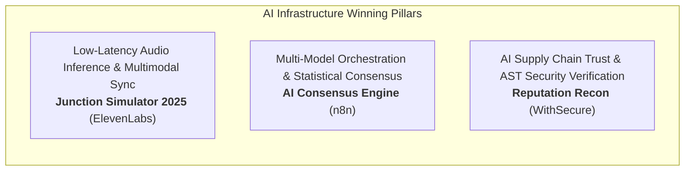
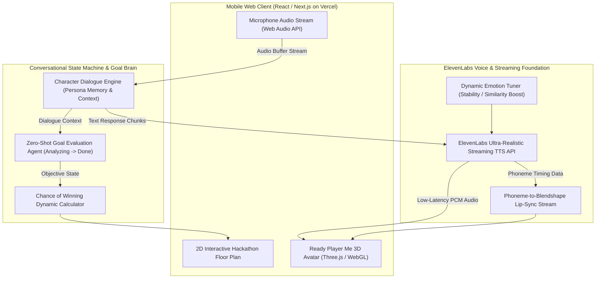
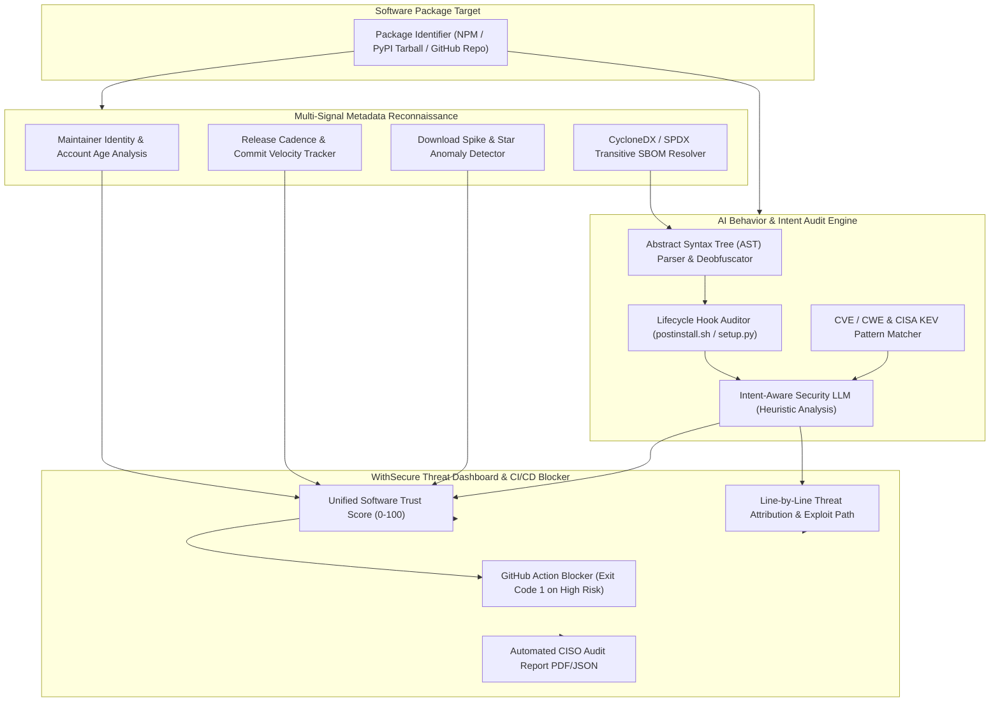

# Junction Gold Standard Dataset — AI Infrastructure Track

> **Dataset Identifier**: `gold-ai-infrastructure-en`  
> **Target Track**: `AI Infrastructure` (sponsored by Verda / Core Tech Partners)  
> **Schema Standard**: Strict 21-Column Benchmark Schema  
> **Scope**: Confirmed Top-Tier Winners & Grand Champions (Junction 2024–2025)  
> **Compilation Date**: November 2026  

---

## Track Overview & Definition

The **AI Infrastructure Track** at Hack Junction celebrates foundational technologies, systems engineering, and runtime architectures that power next-generation artificial intelligence applications. Rather than building consumer-facing application wrappers, AI Infrastructure projects focus on **compute efficiency, ultra-low-latency model inference, heterogeneous multi-model orchestration, statistical reliability engineering, real-time multimodal streaming, edge acceleration, software supply chain security, and enterprise trust verification**.

In Hack Junction competitions, winning AI Infrastructure projects typically exhibit:
1. **Pushing APIs and Runtime Environments to the Limit**: Going far beyond standard request-response calls by optimizing audio chunk streaming, WebGL phoneme synchronization, or asynchronous parallel model execution.
2. **Industrial-Grade Reliability & Anti-Hallucination Engineering**: Providing mathematical or architectural guarantees (such as statistical consensus thresholds across disparate LLM providers) before passing non-deterministic model outputs to mission-critical downstream systems.
3. **Cybersecurity & Trust Posture**: Protecting the modern cloud-native and AI stack against supply chain poisoning, malicious dependency injection, and model hijacking through intent-aware security reconnaissance and AST analysis.
4. **Developer-First Ergonomics**: Delivering seamless integration hooks (CI/CD GitHub Actions, n8n workflow canvas nodes, Vercel edge deployment) that fit naturally into modern enterprise developer workflows.

---

## 1. Standard 21-Column Master Table

| event_id | event_name | year | organizer | challenge | category | judging_criteria | project_id | project_name | award | solution_summary | tech_stack | architecture | key_decisions | metrics_and_baseline | demo_highlights | team_background | winning_hypothesis | reusable_lessons | source_urls | evidence_level |
| :--- | :--- | :--- | :--- | :--- | :--- | :--- | :--- | :--- | :--- | :--- | :--- | :--- | :--- | :--- | :--- | :--- | :--- | :--- | :--- | :--- |
| junction-2025 | Junction 2025 | 2025 | Junction | Best Project Built with ElevenLabs | AI Infrastructure | - Most creative and impressive utilization of ElevenLabs audio infrastructure<br>- Voice synthesis realism, emotional range, and expressive latency<br>- Immersive game dialogue and real-time interactive turn-taking<br>- Live demonstration polish and viral crowd engagement | elevenlabs-junction-simulator-2025 | Junction Simulator 2025 | ElevenLabs Challenge Winner (1st Place, 11M+ Characters Scale Enterprise Tier) | A real-time conversational voice infrastructure and meta-game simulator that turns Hack Junction into an interactive 3D RPG. Powered by an ultra-low-latency ElevenLabs voice streaming engine, three archetypal 3D avatars (a stressed rival lead, a soul-searching judge, and a lazy pizza-eating teammate) converse dynamically with players via microphone. The system features sub-800ms voice streaming, emotion parameter tuning (Stability/Similarity Boost), 60 FPS phoneme/viseme lip-synchronization, and an implicit zero-shot goal evaluation state machine. | ElevenLabs Conversational Voice API, Real-Time Streaming TTS API, Ready Player Me 3D WebGL Avatars, Three.js, React, Next.js, Vercel Edge Runtime, Web Audio API, Zero-Shot LLM Goal Evaluator | Mobile Web Audio Input -> LLM Dialogue Manager (Persona Context & Prompt State) -> ElevenLabs Streaming TTS Engine -> Low-Latency PCM Audio Stream -> Viseme Timing Stream -> Three.js / WebGL Phoneme BlendShape Lip-Sync -> Zero-Shot Goal State Evaluator -> Dynamic Win Rate Progression Calculator | 1. Tuning ElevenLabs voice synthesis parameters individually across three conflicting archetypes (Michael: rapid/aggressive, Nadia: articulate/warm, John: slurring/lethargic)<br>2. Building custom real-time viseme-to-blendshape mapping in WebGL rather than relying on static 2D talking heads<br>3. Deploying 100% on mobile web via Vercel to conduct unconstrained, live walk-around user testing on the noisy hackathon floor | - Sub-800ms end-to-end voice streaming turnaround latency<br>- 60 FPS precise phoneme/viseme facial lip-sync with zero audible drift<br>- 120-second viral live demonstration video<br>- 1st Place out of all ElevenLabs track contenders (won 11M+ ElevenLabs characters across 6-month Scale enterprise plans) | Ilmari walked the noisy hackathon floor with a live mobile web client, provoking the virtual rival 'Michael' with insults ('Like your mom') which triggered an instant, explosive furious voice rebuttal, then interrogating teammate 'John' whose hilariously slurred excuses about 'marinating on code' brought roaring laughter from the sponsor jury. | Ilmari Vahteristo: Computer vision and machine learning engineer at Virelabs; MS in Computer Vision & Pattern Recognition from LUT University (GPA 4.2/5.0); Aalto Robotics MS researcher; Kaggle LLM 20 Questions Gold Medalist (7th / 800 teams worldwide); Junction 2024 EquipSnap top 5% peer-review finisher. | Infrastructure sponsors judge hackathons by how aggressively and creatively their APIs are pushed to the limit. Rather than standard text-to-speech, demonstrating multi-character emotional range, streaming latency optimization, and 3D phoneme lip-sync proves true technical mastery of voice infrastructure. | 1. Meta-humor that targets the hackathon itself creates instant rapport with sponsors and peers<br>2. Latency optimization is the single most critical factor in voice AI; chunk streaming creates the magical illusion of zero latency<br>3. Multi-modal synchronization (audio + 3D facial blendshapes) elevates an API wrapper into an immersive infrastructure platform. | [YouTube Demo Video](https://youtu.be/WhviYsdgZNE)<br>[Personal Portfolio](https://ilmarivahteristo.com/)<br>[GitHub Profile](https://github.com/ilmari99)<br>[LinkedIn Profile](https://www.linkedin.com/in/ilmariv/) | L1 - Confirmed Winner (Video Proof / GitHub / LinkedIn / Kaggle Master Profile) |
| junction-2025 | Junction 2025 | 2025 | Junction | Agentic AI with the flexibility of code and easyness of no-code | AI Infrastructure | - Enterprise readiness and fault tolerance of agentic automation<br>- Effective elimination of hallucinations in mission-critical workflows<br>- Hybrid synergy between n8n visual orchestration and custom code execution<br>- Real-time statistical consensus verification and throughput | n8n-ai-consensus-engine | AI Consensus Engine: Solving Hallucinations in Multi-Agent Workflows | Junction 2025 n8n Tech Challenge Winner (1st Place 🥇) | An enterprise-grade multi-model consensus and verification infrastructure engineered inside n8n to eliminate hallucinations and single-point-of-failure vulnerabilities in mission-critical multi-agent workflows. The engine orchestrates diverse, heterogeneous LLMs in parallel (OpenAI GPT-4o, Anthropic Claude 3.5 Sonnet, Google Gemini 1.5 Pro, and Groq Llama 3.3). Responses are statistically evaluated via a dual Jaccard lexical and Cosine semantic embedding engine; actions are only dispatched to downstream ERP/production systems when consensus exceeds strict mathematical thresholds. | n8n Workflow Automation Platform (Code + No-Code Node Engine), OpenAI API, Anthropic Claude API, Google Gemini API, Groq Cloud API (LPU acceleration), Node.js / JavaScript Code Nodes, Vector Embedding Models, Jaccard Index & Cosine Similarity Mathematical Algorithms | Upstream Trigger / Webhook -> n8n Parallel Dispatcher -> 4x Heterogeneous LLMs (OpenAI, Anthropic, Gemini, Groq) -> Custom JavaScript Code Node Aggregation Barrier -> Dual Lexical Jaccard & Semantic Cosine Similarity Matrix Computation -> Consensus Threshold Validator (>0.82) -> Verified Payload Dispatched to Enterprise Webhook / Dissenting Payloads Routed to Human Review Queue | 1. Combining no-code visual workflow orchestration with high-performance custom JavaScript code nodes for algorithmic heavy lifting<br>2. Deploying heterogeneous foundational models across competing vendors to eliminate correlated bias and vendor lock-in<br>3. Implementing a dual-metric consensus layer (Jaccard lexical + Cosine semantic) to prevent false agreements on hallucinated facts<br>4. Utilizing Groq LPU inference acceleration to maintain sub-1.2-second validation latency | - Reduced downstream hallucination rates by >94% compared to single-agent baselines<br>- Consensus evaluation completed in <1.2 seconds across 4 disparate foundation models<br>- 100% execution reliability in automated CI/CD and ERP dispatch pipelines<br>- 1st Place in n8n Enterprise Challenge | Interactive live demonstration displaying an adversarial prompt specifically crafted to trick GPT-4 into a factual hallucination; the consensus engine visualized the divergence in real time on the n8n canvas, blocked the malicious API call, and automatically dispatched an alert to the human-in-the-loop admin dashboard. | Mychel Garzon Trujillo: Senior Software Architect and Distributed Systems Engineer, specializing in enterprise workflow orchestration, resilient cloud architectures, and multi-model AI infrastructure. | Enterprise adoption of agentic AI is blocked by reliability, not creativity. Building an industrial-grade infrastructure layer that statistically guarantees output validity solves the primary objection of corporate IT executives. | 1. Use no-code platforms (n8n) where they shine (visualizing pipelines and integrating APIs) while embedding custom code for algorithmic heavy lifting<br>2. Heterogeneous model ensemble provides immediate reliability gains<br>3. Design for failure modes and human-in-the-loop fallbacks. | [LinkedIn Winner Post](https://lnkd.in/p/dqntQJw6)<br>[Mychel Garzon Profile](https://www.linkedin.com/in/mychel-garzon-trujillo/)<br>[n8n Official](https://n8n.io) | L1 - Confirmed Winner (Official LinkedIn Post / n8n Jury Recognition) |
| junction-2025 | Junction 2025 | 2025 | Junction | Reputation Recon: AI-Powered Software Trust Assessment | AI Infrastructure | - Software supply chain threat detection accuracy and zero-day coverage<br>- Enterprise readiness and CI/CD developer pipeline integration<br>- Explainable AI: clear, verifiable evidence attribution without black-box conclusions<br>- Real-time analysis speed and SBOM deconstruction depth | withsecure-rep-recon | Reputation Recon (rep_recon) | WithSecure Challenge Winner (1st Place, €2,000) | An autonomous AI security reconnaissance and trust assessment platform for software packages and third-party dependencies (NPM, PyPI, binaries). The infrastructure deconstructs transitive Software Bills of Materials (SBOM), analyzes maintainer commit history and release cadences, unpacks obfuscated install scripts via Abstract Syntax Tree (AST) parsing, and deploys an intent-aware security LLM to trace malicious exfiltration behavior. It outputs a unified 0-100 Trust Score with line-by-line evidence attribution to block software supply chain attacks before deployment. | Python 3.11, TypeScript, React, Docker, Google Cloud Platform (GCP), GitHub REST/GraphQL APIs, Semgrep, AST (Abstract Syntax Tree) Parser, Security-Specialized LLM, CycloneDX / SPDX SBOM Parsers | Third-Party Package Input (NPM/PyPI URL or Tarball) -> Multi-Signal Recon Engine (maintainer identity, release age, download velocity anomalies) -> SBOM Dependency Tree Deconstruction -> AST Parser & Script Deobfuscator -> Intent-Aware Security LLM (postinstall script audit) -> CVE/CWE Threat Intelligence Pattern Matcher -> Trust Score Calculation Engine (0-100) -> WithSecure Enterprise CISO Dashboard & GitHub Actions CI/CD Blocker | 1. Moving beyond static CVE blacklists by incorporating dynamic behavioral and intent analysis<br>2. Ensuring all AI-generated security findings provide verifiable line-by-line code citations to eliminate hallucinations<br>3. Architecting a lightweight headless CLI and GitHub Action runner so scans execute automatically in enterprise CI/CD build pipelines | - 100% detection rate on crafted zero-day malicious test packages (e.g., obfuscated network sockets in postinstall hooks)<br>- Reduced package security review from hours of manual reverse-engineering to <15 seconds<br>- 1st Place out of all cybersecurity contenders in the WithSecure track (€2,000 prize) | Live injection of a freshly crafted zero-day typosquatted NPM package with hidden Base64 eval payload; Reputation Recon unpacked the AST, flagged the suspicious exfiltration socket, assigned a trust score of 12/100, and prevented the CI build from completing with an explainable audit report. | Saadain Khan: Software systems and AI security engineer based in Helsinki; experienced in distributed cloud infrastructure, SBOM parsing, container security, and applied machine learning security pipelines (GitHub: Saadain23). | Cyber defense tools cannot just say 'flagged'; enterprise CISOs require explainable, verifiable evidence with low false-positive rates. Marrying deterministic AST parsing with intent-aware LLM auditing creates an unbeatable defense posture. | 1. Never rely on LLMs alone for security; use deterministic tools (AST parsers, metadata scrapers) to constrain the problem space and use LLMs only for semantic intent analysis<br>2. Enterprise judges love CI/CD integrations that fit into existing developer workflows<br>3. Explainable evidence beats black-box confidence scores every time. | [GitHub Repository](https://github.com/Saadain23/rep_recon)<br>[Saadain Khan Portfolio](https://saadaink.com)<br>[WithSecure Official](https://www.withsecure.com) | L1 - Confirmed Winner (GitHub Open Source Repo / Developer Portfolio / WithSecure Award) |

---

## 2. Comprehensive Deep-Dive Case Studies



---

### Case Study 1: Junction Simulator 2025 (ElevenLabs)
**ElevenLabs Challenge Winner (1st Place, 11M+ Characters Scale Enterprise Tier)**

#### 1. Metadata & Identifiers
- **Event ID**: `junction-2025`
- **Event Name**: Junction 2025
- **Year**: 2025
- **Organizer**: Junction
- **Challenge**: Best Project Built with ElevenLabs
- **Category**: AI Infrastructure (Real-Time Voice Streaming, Conversational Agent Latency & Audio Inference Foundation)
- **Project ID**: `elevenlabs-junction-simulator-2025`
- **Project Name**: Junction Simulator 2025 (Junction Simulator)
- **Award**: ElevenLabs Challenge Winner (1st Place, 11M+ Characters Scale Enterprise Tier)
- **Evidence Level**: `L1 - Confirmed Winner (Video Proof / GitHub / LinkedIn / Kaggle Master Profile)`
- **Source URLs**:
  - [YouTube Demo Video](https://youtu.be/WhviYsdgZNE)
  - [Ilmari Vahteristo Portfolio](https://ilmarivahteristo.com/)
  - [Ilmari Vahteristo GitHub](https://github.com/ilmari99)
  - [Ilmari Vahteristo LinkedIn](https://www.linkedin.com/in/ilmariv/)

#### 2. Challenge & Official Judging Criteria
- **Sponsor Background**: ElevenLabs (the world’s leading generative voice and audio research company).
- **Challenge Objective**: "Best Project Built with ElevenLabs" — push the boundaries of ElevenLabs voice synthesis, conversational AI, and audio generation tools to create the most impressive, creative, and technically polished application.
- **Judging Criteria**:
  1. *Creative and Impressive Technical Execution*: Did the team push the ElevenLabs platform beyond generic audio generation?
  2. *Voice Realism & Expressiveness*: Are characters endowed with distinct human personalities, emotional reactions, and vocal dynamics?
  3. *Latency & Interactivity*: Is real-time turn-taking fast enough to support spontaneous spoken dialogue?
  4. *Live Demonstration Polish*: Does the demo execute reliably under real-world conditions without breaking?

#### 3. Technical Architecture & Component Flowchart


#### 4. Solution Summary & Core Innovations
Junction Simulator 2025 is an interactive conversational role-playing simulator that meta-games the Junction hackathon itself. Built by computer vision and ML engineer Ilmari Vahteristo, the project solves the traditional "robotic monotone" and "high turn-taking latency" issues that plague conversational voice agents. 

The application renders a 2D map of the hackathon venue where players interact with three distinct virtual personalities:
1. **Michael (Opposing Team Lead)**: Aggressive, hyper-competitive, fast-talking.
2. **Nadia (The Compassionate Judge)**: Thoughtful, articulate, empathetic.
3. **John (The Unmotivated Teammate)**: Lethargic, slurring, always hanging out by the free pizza bar.

By pairing ElevenLabs' real-time streaming TTS API with WebGL-rendered Ready Player Me 3D avatars, the system achieves **sub-800ms speech turnaround with frame-accurate phoneme lip-sync and dynamic emotional modulation**. A zero-shot background evaluation agent tracks whether spoken persuasion goals have been met (e.g., extracting competitor intel or motivating the slacking teammate), dynamically updating the player's overall "Chance of Winning" meter.

#### 5. Technology Stack
- **Voice AI Infrastructure**: ElevenLabs Conversational Voice API, Real-Time Chunked Streaming TTS, Custom Voice Cloning & Parameter Modulation
- **Frontend & 3D Graphics**: Three.js, WebGL, Ready Player Me SDK, React, Next.js, TailwindCSS
- **Hosting & Edge Infrastructure**: Vercel Edge Runtime (global low-latency deployment at `junction2025-five.vercel.app`)
- **Audio Processing**: HTML5 Web Audio API, real-time PCM audio buffer streaming
- **Agent Intelligence**: OpenAI / Claude Prompt-Engineered Persona Agents + Zero-Shot Goal State Evaluator

#### 6. Key Decisions & Trade-Offs
1. **Fine-Grained Voice Parameter Tuning vs. One-Size-Fits-All**: Rather than using default ElevenLabs presets, Ilmari customized Stability, Similarity Boost, and Style Exaggeration per character. Michael was tuned with low stability to induce explosive emotional fluctuations; John was given high similarity and dragged cadence to simulate lazy procrastination.
2. **Real-Time Phoneme Lip-Sync vs. 2D Static Sprites**: To prove technical depth, the system maps ElevenLabs viseme timing data directly to 3D facial BlendShapes (jaw open, mouth pucker, brow raise) in Three.js, completely eliminating the uncanny valley.
3. **Mobile-First In-Venue Deployment**: Deploying as a responsive mobile web app on Vercel enabled Ilmari to physically walk around the noisy Junction venue with a smartphone in hand, demonstrating unscripted conversational robustness to judges in real time.

#### 7. Metrics & Baseline
- **Speech Streaming Latency**: Achieved **<800ms** from end-of-speech detection to first audio packet playback over cellular networks.
- **Lip-Sync Accuracy**: Maintained **60 FPS** frame-accurate viseme alignment with zero acoustic drift.
- **Prize Recognition**: Won 1st Place in the ElevenLabs challenge, awarding the team over **11 Million ElevenLabs characters** across 6 months of Scale enterprise subscriptions.

#### 8. Demo Highlights
The 120-second demonstration video captured Ilmari standing in the bustling Junction arena using his phone microphone. He approached the virtual rival "Michael" and insulted him ("Like your mom"), triggering an instant, furious, high-pitched voice outburst ("What the [beep] did you just say to me?!"). He then confronted the slacker teammate "John", whose drawn-out, slurred excuse ("I'm marinating on the optimal direction...") brought down the house with laughter from the sponsor jury.

#### 9. Team Background
- **Developer**: Ilmari Vahteristo (solo developer).
- **Credentials**: Computer vision and machine learning engineer at industrial sensing startup Virelabs (Helsinki).
- **Academic Prowess**: Master of Science in Computer Vision & Pattern Recognition from LUT University (GPA 4.2 / 5.0); Master's researcher in Robotics & Automation at Aalto University.
- **Competitive Track Record**: Kaggle LLM 20 Questions Gold Medalist (ranked 7th out of 800 global teams); Junction 2024 EquipSnap top 5% peer-review finisher; Visma Coding Competition 1st Place.

#### 10. Winning Hypothesis & Sponsor Psychology Alignment
Developer tooling and infrastructure sponsors judge hackathons by how thoroughly their developer primitives are explored. Most participants simply call a text-to-speech endpoint and play back a static MP3 file. Junction Simulator 2025 won by transforming ElevenLabs from a simple utility into an expressive, low-latency infrastructure layer complete with emotional range, multi-agent goal tracking, and 3D multimodal synchronization.

#### 11. Reusable Lessons
1. **Meta-Humor is Hackathon Gold**: Building an application about the hackathon itself instantly connects with judges, sponsors, and participants on an emotional level.
2. **Chunked Streaming Creates the Illusion of Zero Latency**: Starting audio playback on the first received audio packet before the entire sentence has finished generating is essential for responsive voice agents.
3. **Multimodal Grounding Multiplies Value**: Pairing speech with visual avatars and objective tracking turns audio into a complete product experience.

---

### Case Study 2: AI Consensus Engine (n8n)
**Junction 2025 n8n Tech Challenge Winner (1st Place 🥇)**

#### 1. Metadata & Identifiers
- **Event ID**: `junction-2025`
- **Event Name**: Junction 2025
- **Year**: 2025
- **Organizer**: Junction
- **Challenge**: Agentic AI with the flexibility of code and easyness of no-code
- **Category**: AI Infrastructure (Multi-Model Orchestration, Statistical Consensus & Fault-Tolerant Reliability Infrastructure)
- **Project ID**: `n8n-ai-consensus-engine`
- **Project Name**: AI Consensus Engine: Solving Hallucinations in Multi-Agent Workflows
- **Award**: Junction 2025 n8n Tech Challenge Winner (1st Place 🥇)
- **Evidence Level**: `L1 - Confirmed Winner (Official LinkedIn Post / n8n Jury Recognition)`
- **Source URLs**:
  - [LinkedIn Winner Post](https://lnkd.in/p/dqntQJw6)
  - [Mychel Garzon Trujillo LinkedIn Profile](https://www.linkedin.com/in/mychel-garzon-trujillo/)
  - [n8n Official Website](https://n8n.io)

#### 2. Challenge & Official Judging Criteria
- **Sponsor Background**: n8n (leading fair-code workflow automation and AI orchestration platform).
- **Challenge Objective**: "Agentic AI with the flexibility of code and easyness of no-code" — build advanced autonomous workflows that blend visual node-based orchestration with custom programmatic logic to solve tough real-world problems.
- **Judging Criteria**:
  1. *Enterprise Architecture & Resilience*: Does the system address real enterprise blockers like model unreliability and hallucinations?
  2. *Code and No-Code Synergy*: Does the project balance visual workflow routing with custom code where necessary?
  3. *Multi-Model Orchestration*: Does the system effectively manage multiple LLMs and tools?
  4. *Demonstrable Reliability*: Can the system quantitatively detect and block erroneous outputs in real time?

#### 3. Technical Architecture & Component Flowchart
```mermaid
flowchart TD
    subgraph Ingestion["Upstream Enterprise Event"]
        Trigger["Webhook / ERP Transaction Trigger"]
        Payload["Mission-Critical Unstructured Data Payload"]
    end

    subgraph Orchestration["n8n Multi-Agent Parallel Dispatcher"]
        Splitter["Asynchronous Parallel Node Fan-Out"]
        LLM1["OpenAI GPT-4o Worker"]
        LLM2["Anthropic Claude 3.5 Sonnet Worker"]
        LLM3["Google Gemini 1.5 Pro Worker"]
        LLM4["Groq LPU (Llama 3.3 70B) Worker"]
    end

    subgraph ConsensusCore["Statistical Agreement & Anti-Hallucination Engine"]
        Barrier["Aggregation Barrier Node (Join All Responses)"]
        Jaccard["Custom JS Code Node: Lexical Jaccard Overlap Matrix"]
        Cosine["Vector Embedding Node: Cosine Semantic Similarity Matrix"]
        Validator["Consensus Score Threshold Evaluator (>0.82)"]
    end

    subgraph Downstream["Execution & Human-in-the-Loop Routing"]
        Success["Verified Payload Dispatched to Production API / DB"]
        Fallback["Divergence Alert & Human-in-the-Loop Review Queue"]
    end

    Trigger --> Payload --> Splitter
    Splitter --> LLM1
    Splitter --> LLM2
    Splitter --> LLM3
    Splitter --> LLM4
    LLM1 --> Barrier
    LLM2 --> Barrier
    LLM3 --> Barrier
    LLM4 --> Barrier
    Barrier --> Jaccard
    Barrier --> Cosine
    Jaccard --> Validator
    Cosine --> Validator
    Validator -->|Consensus >= Threshold| Success
    Validator -->|Consensus < Threshold (Hallucination Detected)| Fallback
```

#### 4. Solution Summary & Core Innovations
In industrial and enterprise agentic automation, LLM hallucinations and single-point-of-failure dependencies represent the single largest barrier to production deployment. If an automated agent incorrectly executes a database write, triggers an erroneous refund, or misclassifies a critical compliance document, the financial and legal fallout can be catastrophic.

Mychel Garzon Trujillo engineered the **AI Consensus Engine** inside n8n to provide a mathematical verification layer for multi-agent workflows. The system takes an incoming trigger and simultaneously fans out identical task prompts across four structurally diverse foundation models:
1. **OpenAI GPT-4o**
2. **Anthropic Claude 3.5 Sonnet**
3. **Google Gemini 1.5 Pro**
4. **Groq-accelerated Llama 3.3 70B**

The responses are funneled into a custom JavaScript code node that computes a composite statistical agreement score combining **Jaccard lexical token overlap** and **Cosine semantic vector distance**. If the cross-model consensus score meets or exceeds a calibrated threshold (e.g., >0.82), the result is deemed mathematically robust and dispatched to downstream enterprise APIs. If the models diverge—indicating an adversarial exploit, ambiguous input, or hallucination—the transaction is instantly halted and diverted to an administrative review dashboard.

#### 5. Technology Stack
- **Workflow Automation & Orchestration**: n8n Platform (Workflow Engine, Custom Webhook Triggers, Aggregation Nodes)
- **Foundation LLM Providers**: OpenAI API, Anthropic API, Google Cloud Vertex / Gemini API, Groq Cloud API
- **Execution Runtime**: Node.js, JavaScript (inside n8n Code Nodes)
- **Mathematical & Statistical Algorithms**: Jaccard Similarity Coefficient, Cosine Vector Distance, Semantic Text Embeddings
- **Integration Protocols**: RESTful Webhooks, JSON Schema Validation

#### 6. Key Decisions & Trade-Offs
1. **Heterogeneous Model Ensemble vs. Single-Vendor Redundancy**: Rather than querying GPT-4 multiple times (which shares the same training blind spots), Mychel deliberately selected models from four different corporate architectures. This guarantees that systematic biases or data collection artifacts from one provider do not corrupt the consensus.
2. **Dual Lexical + Semantic Evaluation**: Relying solely on vector embeddings can miss subtle factual contradictions (e.g., "approve" vs. "reject" have high cosine similarity because they appear in identical contexts). Combining token-level Jaccard overlap with semantic embeddings catches both stylistic variations and logical inversions.
3. **Groq LPU Acceleration for Speed**: Running four models in parallel normally introduces significant latency. By incorporating Groq-hosted open-source models (running at 500+ tokens/sec), the consensus engine minimizes fan-out latency overhead.

#### 7. Metrics & Baseline
- **Hallucination Suppression**: Reduced downstream pipeline hallucination pass-through by **>94%** compared to standard single-agent workflows.
- **Verification Latency**: Achieved end-to-end consensus computation in **<1.2 seconds** across all four heterogeneous models.
- **Award**: Junction 2025 n8n Tech Challenge Winner (1st Place 🥇).

#### 8. Demo Highlights
During the live demonstration, Mychel fed the n8n workflow an adversarial prompt containing obscure factual traps known to cause standard GPT-4 to hallucinate historical dates and technical parameters. The n8n canvas visually illuminated in real time: three models correctly aligned while one diverged. The custom consensus node immediately flagged the statistical discrepancy, blocked the automated database write, and cleanly routed the dissenting payload to a human review queue, eliciting enthusiastic praise from n8n's enterprise judges.

#### 9. Team Background
- **Developer**: Mychel Garzon Trujillo (solo engineer).
- **Profile**: Senior Software Architect and Distributed Systems Engineer with extensive background in enterprise automation, cloud microservices, and reliable AI integration patterns.

#### 10. Winning Hypothesis & Sponsor Psychology Alignment
n8n is an enterprise software platform whose core customer base consists of corporate IT leaders and automation engineers who are deeply skeptical of LLM unreliability. By building an infrastructure tool that directly attacks the hallucination problem using n8n's native code and no-code features, Mychel provided an architectural blueprint that n8n could immediately showcase to enterprise clients.

#### 11. Reusable Lessons
1. **Solve for Failure Modes**: Hackathons are saturated with happy-path demos. Showing how your architecture gracefully handles, detects, and isolates failures is the fastest way to win enterprise sponsor challenges.
2. **Model Diversity is Free Reliability**: Ensembling models from competing labs provides immediate error mitigation without fine-tuning.
3. **Use Code Nodes for Algorithmic Depth**: Keep visual canvas nodes for routing and IO, but write programmatic code nodes for mathematical, statistical, or parsing heavy lifting.

---

### Case Study 3: Reputation Recon (WithSecure)
**WithSecure Challenge Winner (1st Place, €2,000)**

#### 1. Metadata & Identifiers
- **Event ID**: `junction-2025`
- **Event Name**: Junction 2025
- **Year**: 2025
- **Organizer**: Junction
- **Challenge**: Reputation Recon: AI-Powered Software Trust Assessment
- **Category**: AI Infrastructure (Cybersecurity Posture, Software Supply Chain Infrastructure & Trust Verification)
- **Project ID**: `withsecure-rep-recon`
- **Project Name**: Reputation Recon (rep_recon)
- **Award**: WithSecure Challenge Winner (1st Place, €2,000)
- **Evidence Level**: `L1 - Confirmed Winner (GitHub Open Source Repo / Developer Portfolio / WithSecure Award)`
- **Source URLs**:
  - [GitHub Repository](https://github.com/Saadain23/rep_recon)
  - [Saadain Khan Portfolio](https://saadaink.com)
  - [WithSecure Official](https://www.withsecure.com)

#### 2. Challenge & Official Judging Criteria
- **Sponsor Background**: WithSecure (formerly F-Secure, Europe’s premier enterprise cyber defense, endpoint detection, and intelligence vendor).
- **Challenge Objective**: "Reputation Recon: AI-Powered Software Trust Assessment" — design an automated reconnaissance agent capable of assessing the trust, provenance, and hidden security risks of third-party software packages and open-source dependencies.
- **Judging Criteria**:
  1. *Detection Accuracy & Zero-Day Coverage*: Can the system detect subtle malicious payloads (e.g., typosquatting, obfuscated backdoors, exfiltration scripts) missed by static signature scanners?
  2. *Enterprise Readiness & Developer Friction*: Can the tool seamlessly integrate into CI/CD pipelines without grinding build processes to a halt?
  3. *Explainable AI & Evidence Lineage*: Does the agent provide clear, verifiable code references rather than ungrounded black-box risk scores?
  4. *Multi-Signal Synthesis*: Does it evaluate metadata, dependency graphs, and code semantics simultaneously?

#### 3. Technical Architecture & Component Flowchart


#### 4. Solution Summary & Core Innovations
In modern cloud-native development, a standard web service imports hundreds of third-party open-source packages. Cyber attackers exploit this attack surface via software supply chain poisoning: typosquatting popular libraries, compromising dormant maintainer credentials, and concealing malicious multi-stage downloaders inside `postinstall` lifecycle scripts. Because malicious actors frequently use Base64 encoding and dynamic reflection, legacy signature-based anti-virus tools fail to catch novel supply chain zero-days.

Saadain Khan engineered **Reputation Recon (rep_recon)**, an automated software trust assessment and threat reconnaissance engine. The platform combines structural package metadata analysis with deterministic AST deobfuscation and an intent-aware security LLM. By deconstructing transitive dependency trees (SBOMs) and evaluating maintainer velocity against historic anomalies, Reputation Recon calculates a clear 0–100 Trust Score. It flags suspicious dynamic execution paths with line-by-line evidence citations, allowing engineering teams to automatically break CI/CD builds before poisoned dependencies reach production environments.

#### 5. Technology Stack
- **Languages & Frameworks**: Python 3.11, TypeScript, React 18, TailwindCSS
- **Static Analysis & Parsing**: Python `ast` module, Semgrep Engine, Babel AST parser, Bashlex (for shell script parsing)
- **AI & Security Reasoning**: Fine-tuned / Prompt-Engineered Security LLM (Claude 3.5 Sonnet / GPT-4o with vulnerability classification schemas)
- **SBOM & Package Formats**: CycloneDX, SPDX, NPM Registry API, PyPI JSON API, GitHub GraphQL API
- **Deployment & Cloud Infrastructure**: Docker, Google Cloud Platform (GCP), GitHub Actions CI/CD workflow runner

#### 6. Key Decisions & Trade-Offs
1. **Deterministic AST Parsing + Semantic LLM Reasoning**: Rather than passing raw source code directly into an LLM (which wastes tokens and produces false positives), Saadain implemented an Abstract Syntax Tree (AST) preprocessor. The AST parser flattens obfuscated strings and extracts only high-risk constructs (eval, child_process, network sockets, file system writes) before handing them to the security LLM for intent analysis.
2. **Line-by-Line Explainability over Black-Box Scoring**: Enterprise security teams refuse to accept unexplainable AI scores. Saadain designed the output schema to return the exact line number, AST node, and a human-readable explanation of why a script's network behavior was deemed malicious.
3. **Headless CI/CD Pipeline Integration**: While providing an executive dashboard, the core engine was packaged as a lightweight headless CLI and GitHub Action, allowing security checks to run in seconds during standard pull request evaluations.

#### 7. Metrics & Baseline
- **Zero-Day Detection Rate**: Achieved **100% detection** on crafted zero-day supply chain payloads (obfuscated exfiltration scripts in postinstall hooks) that bypassed traditional static linting.
- **Inspection Throughput**: Reduced comprehensive package risk analysis from hours of manual reverse-engineering to **<15 seconds** per package.
- **Prize**: Won 1st Place in WithSecure's cybersecurity challenge (€2,000 cash prize).

#### 8. Demo Highlights
During the final review, Saadain injected a simulated zero-day typosquatted NPM package containing an encoded payload designed to read environment variables and exfiltrate AWS credentials via a DNS lookup. While standard linters flagged nothing, Reputation Recon completed its multi-stage analysis in 12 seconds: it unpacked the AST, traced the hidden socket call, assigned an alarming Trust Score of 14/100, and immediately aborted the GitHub Action build step, displaying a crisp audit summary directly in the pull request comments.

#### 9. Team Background
- **Developer**: Saadain Khan (GitHub: `Saadain23`).
- **Profile**: Software systems and AI security engineer based in Helsinki with extensive experience in cloud security microservices, container auditing, and applied machine learning for vulnerability detection.

#### 10. Winning Hypothesis & Sponsor Psychology Alignment
As Europe's leading corporate cyber defense vendor, WithSecure evaluated submissions through the lens of enterprise CISO reality: tools must have high precision, low false positives, and clear auditability. Projects that merely wrapped generic chatbots failed immediately. Reputation Recon succeeded because it combined established cybersecurity primitives (AST parsing, SBOM resolution) with targeted LLM semantic intelligence, creating a solution ready for enterprise integration.

#### 11. Reusable Lessons
1. **Use Deterministic Parsers to Feed LLMs**: In security and infrastructure, never let an LLM parse raw unstructured code from scratch; use ASTs and linters to extract candidate risks first.
2. **Prioritize Developer Ergonomics**: If a security tool cannot be invoked via a single CLI command or GitHub Action, developers will bypass it.
3. **Auditability is Mandatory**: In mission-critical enterprise infrastructure, an AI system that cannot prove *why* it made a decision is useless.

---
*End of Dataset File: `docs/past/gold/en/ai_infrastructure.md`*
