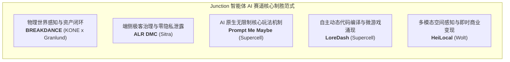
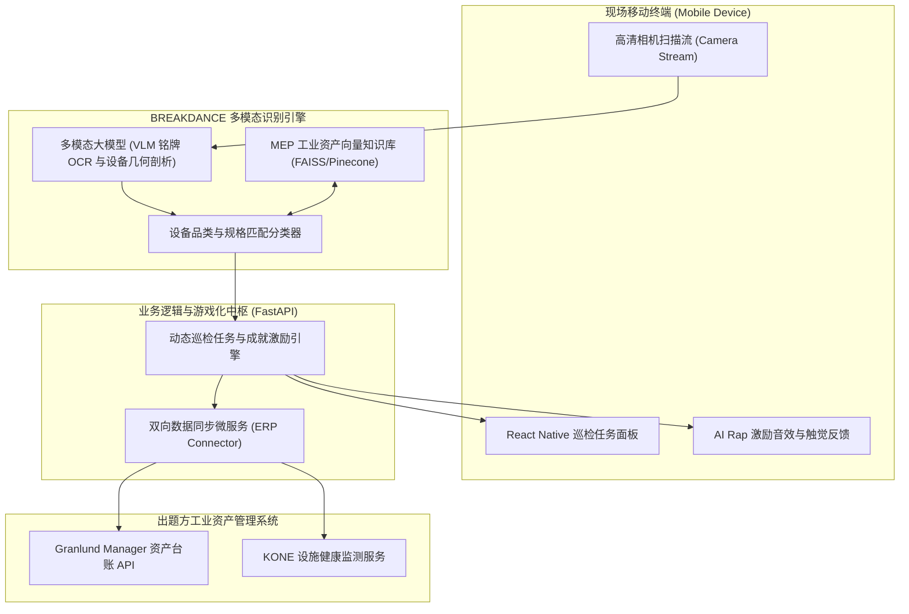
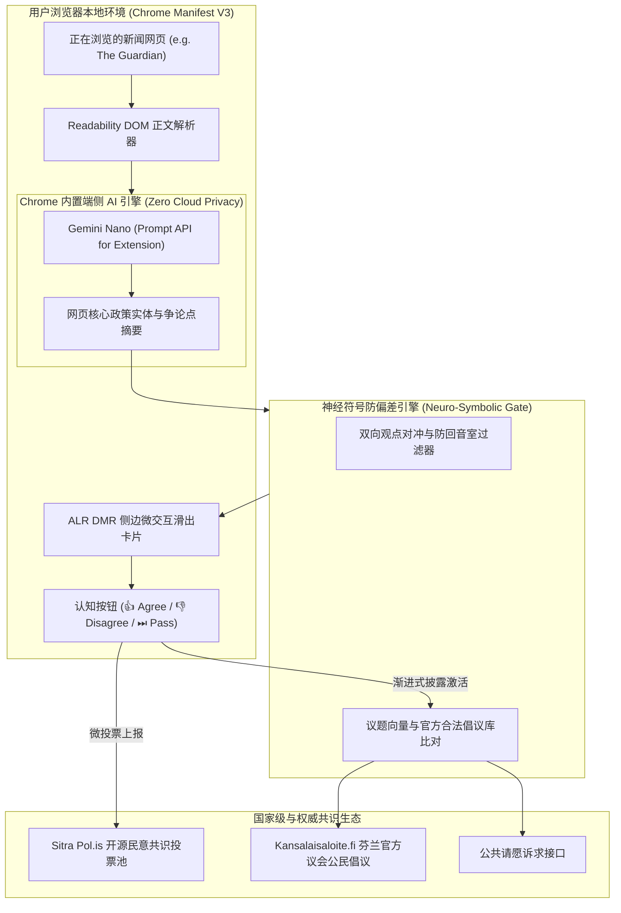
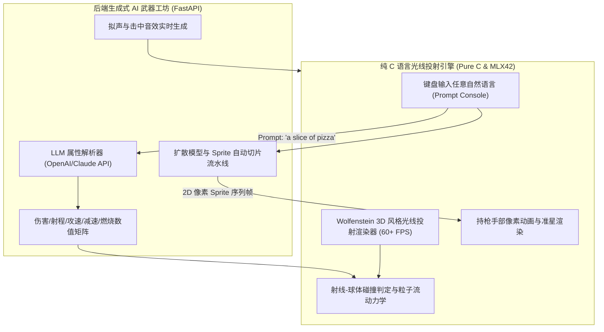
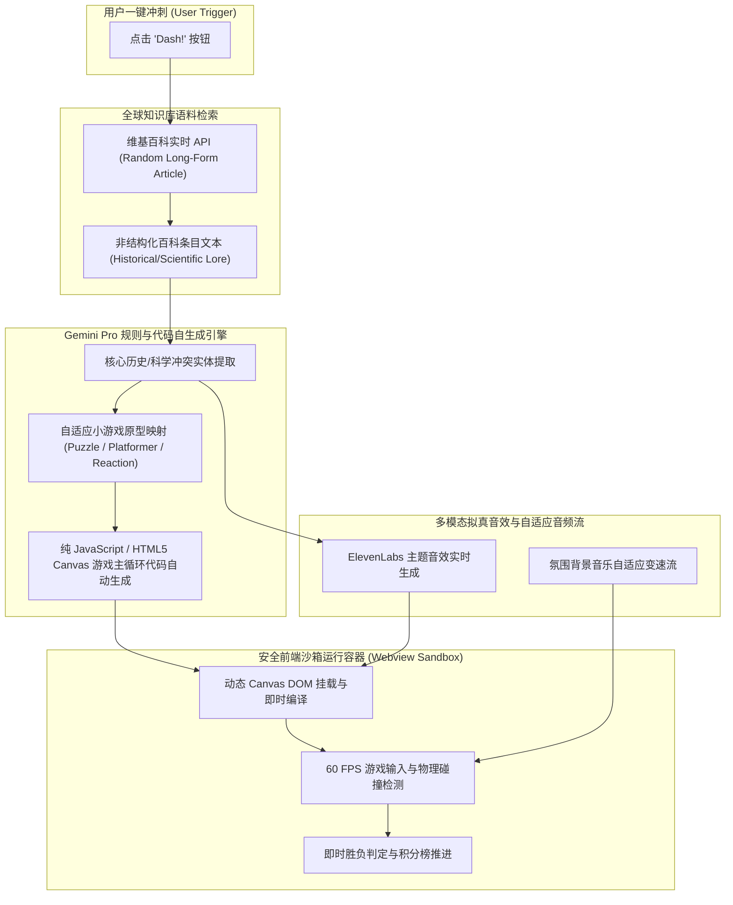
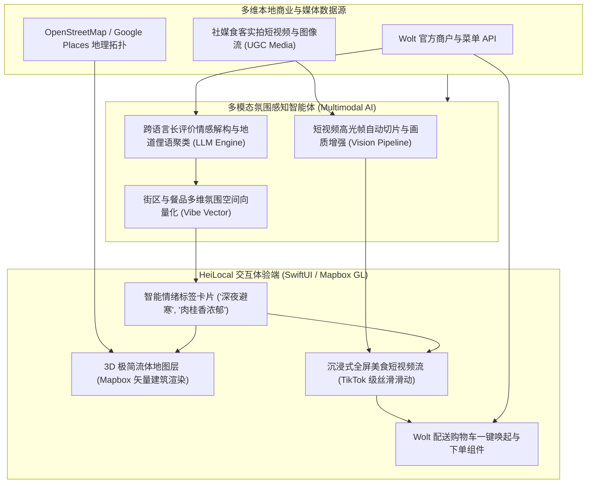

# Junction 金牌基准数据集 — 智能体 AI 赛道 (Agentic AI Track)

> **数据集标识**: `gold-agentic-ai-zh`  
> **目标赛道**: `Agentic AI (智能体 AI 赛道)`  
> **Schema 规范**: 严格 21 列金牌基准 Schema 标准  
> **数据范围**: 2024–2025 年 Hack Junction 官方确认赛题总冠军与全场最高奖获奖案例  
> **编译日期**: 2026 年 11 月  

---

## 赛道概览与定义

Hack Junction 的 **Agentic AI 赛道 (智能体 AI)** 旨在表彰彻底超越静态“提示词-应答”被动范式、展示出具备**情境自主感知、动态目标规划、多工具与 API 调用、多智能体协同以及物理与数字世界闭环执行能力**的前沿系统。

在历届 Junction 黑客松中，最终斩获最高荣誉的 Agentic AI 项目具备以下四大鲜明特征：
1. **闭环行动力 (Closing the Action Loop)**：坚决将生成式理解直接转化为系统状态变更（如自动更新企业 ERP 设备台账、提交议会法案微投票、动态重构底层游戏物理规则、一键直连本地生活购物车等）。
2. **拒绝浅层套壳 (Eliminating Superficial Wrappers)**：坚决抵制将大语言模型仅作为对话框挂件的“事后贴皮 (AI as an afterthought)”，方案中 AI 必须是不可替代的核心机械齿轮。
3. **消除认知阻力 (Optimizing Cognitive Friction)**：深度融合行为心理学与服务设计原则（如最少努力原则 PLE、渐进式披露），彻底消除用户意图与智能体自主执行之间的鸿沟。
4. **随机涌现与确定性控制的精妙平衡 (Neuro-Symbolic Balance)**：采用神经符号网关、低级语言射线投射沙箱或端侧硬件隔离，在激发大模型涌现创造力的同时确保系统的毫秒级响应与绝对可靠性。

---

## 1. 21 列标准总览表 (Master Table)

| event_id | event_name | year | organizer | challenge | category | judging_criteria | project_id | project_name | award | solution_summary | tech_stack | architecture | key_decisions | metrics_and_baseline | demo_highlights | team_background | winning_hypothesis | reusable_lessons | source_urls | evidence_level |
| :--- | :--- | :--- | :--- | :--- | :--- | :--- | :--- | :--- | :--- | :--- | :--- | :--- | :--- | :--- | :--- | :--- | :--- | :--- | :--- | :--- |
| junction-2024 | Junction 2024 | 2024 | Junction | Modernizing a trillion-euro inventory (万亿级建筑设备资产现代化) | Agentic AI | - 既有建筑设备资产管理的落地可行性与现实社会经济价值 - MEP 机电设备数字化的自动化程度与识别速度 - 一线现场工程与巡检人员的采纳阻力与使用粘性 - 商业路演的感染力、商业闭环与实时现场演示的完整度 | kone-breakdance | BREAKDANCE | Junction 2024 全场总冠军 (Overall Grand Winner, €10,000 大奖) & KONE x Granlund 赛道第一名 | 一款面向既有建筑庞大机电设备资产的自主视觉盘点与游戏化巡检智能体。巡检人员手持手机镜头扫描任意机房电气、暖通与电梯设备，多模态大模型智能体即刻于 5 秒内精准解析铭牌编号、型号与技术参数并自动同步至云端资产台账；结合成就反馈系统，将枯燥繁琐的合规检查重塑为充满即时多巴胺奖励的闯关游戏。 | React Native, Python, FastAPI, 多模态大模型 (VLM), 工业 OCR, 向量数据库 (FAISS/Pinecone), Granlund Manager API, KONE 设施监控接口, Suno/ElevenLabs (用于制作演示 Rap 视频) | 手机相机流 -> 端侧轻量预处理 -> 多模态大模型铭牌与几何结构解析 -> MEP 资产目录向量比对 -> 游戏化巡检任务验证引擎 -> 自动化双向同步至 Granlund/KONE 建筑运维 ERP 平台 | 1. 独行侠开发者聚焦于单一最高阻力痛点（数据秒级采集录入），彻底放弃在 48 小时内从零手写臃肿的完整 3D CAD/BIM 平台 2. 采用游戏化成就激励替代枯燥的行政命令，驱动基层巡检人员高频采集数据 3. 匠心制作由 AI 创作演唱的工业级 Rap 路演视频，在最终大决赛中形成无可比拟的记忆点 | - 单台设备建档录入耗时从传统手工纸笔填写的 5-10 分钟压缩至 5 秒以内（录入效率提升 98% 以上） - 48 小时单人极限开发完成全功能端到端原型 - 荣膺 €10,000 现金大奖及全场唯一总冠军 | 决赛现场直接手持手机对准评委席旁的真实机电零部件进行实时扫描，屏幕瞬间结构化解析出设备参数与维护建议；随后大屏幕切入由 AI 生成的幽默爆梗说唱 MV，将万亿级枯燥资产管理唱成洗脑神曲，全场评审与观众集体起立鼓掌。 | Frank Sandqvist ("to be Frank" 战队，单人参赛)：芬兰连续创业者，Smidyo 与 CNC Design 创始人，Nykarleby 创新中心运营总监，被 Junction 官方授予“Junction 宗师 (Grandmaster)”头衔，生涯黑客松累计斩获超 20,000 欧元奖金（2019 Kesko 冠军、2022 Snoop Doge 亚军、2025 LoreDash 总亚军）。 | 企业级 B2B 赛题往往被大部分团队视作沉闷死板。当开发者能以极致简单的用户体验攻克万亿级资产源头录入痛点，辅以零失误的工程落地，并在最终路演中用极具冲击力、反差感极强的病毒式艺术表演（AI 说唱）呈现时，就能实现全场统治级的胜利。 | 1. 深度攻坚拥有庞大潜在市场（TAM）但看似枯燥无聊的工业级痛点 2. 始终面向一线疲惫的使用者（现场运维工程师）设计，而非高高在上的采购高管 3. 必须将技术 Demo 转化为极具视听享受的舞台秀，最大化评委的记忆留存率。 | [领英获奖动态](https://www.linkedin.com/feed/update/urn:li:activity:7445170584142970881/) [Frank Sandqvist 领英主页](https://www.linkedin.com/in/frank-sandqvist-9a096683/) | L1 - 官方最高确认级别 (领英原文、专访转写与 €10,000 总冠军官方记录三方交叉核验) |
| junction-2024 | Junction 2024 | 2024 | Junction | Let's make Finland the world leader of digital democracy (让芬兰成为数字民主的世界领跑者) | Agentic AI | - 认知无障碍性与“大脑友好性 (Brain-Friendliness)” - 消除公民“认知与实际数字参政行动”之间的巨大鸿沟 - 零隐私外泄的端侧数据治理规范（严禁云端追踪阅读隐私） - 与官方民主平台生态（Pol.is、Kansalaisaloite.fi）的深度无缝打通 - 架构优雅度与前沿端侧 AI 代码工程水平 | sitra-alrdmc | ALR DMC / ALT DMR (Alert Democracy) | Sitra 挑战赛道第一名 (First Place 🥇) | 一款基于 Google Chrome 内置端侧大模型（Gemini Nano）驱动的零隐私泄露浏览器扩展。当公民在网络上浏览时事新闻时，本地大模型零延迟解析文章核心公共议题，侧边自动滑出轻量卡片提供仅需 1 键点击即可表态的政策微投票（赞成/反对/弃权）；随后利用“渐进式披露”原则，顺畅引导用户签署芬兰官方议会公民倡议与 Pol.is 议题池，将参政门槛降为零。 | Google Chrome Built-in AI (基于 Prompt API 与 Summarization API 的端侧 Gemini Nano), Chrome 扩展 Manifest V3, TypeScript, Python, FastAPI, Poetry, Docker, Pol.is 开放协议, 芬兰议会立法网 Kansalaisaloite.fi 爬取器 | 网页 DOM 结构 -> Readability 正文提取器 -> 本地端侧 Gemini Nano 政治实体与议题摘要 -> 神经符号防偏见对冲网关 -> 1 秒单键微交互浮标卡片 -> 渐进式披露状态机 -> 双向同步至 Pol.is 与 Kansalaisaloite.fi 官方 API | 1. 坚决选择轻量浏览器扩展而非独立手机 App，彻底避免强迫用户安装孤立应用的抗拒心理 2. 将长文解析与观点抽取 100% 部署在用户浏览器本地的 Gemini Nano 神经网络中，严禁敏感浏览记录上传任何云端服务器 3. 严格践行行为心理学原则（最少努力原则与渐进式披露），以“微动力”驱动深度参政 4. 重构交互控件，以严肃的“Agree/Disagree/Pass”替代存在严重认知偏差的社交媒体“点赞”图标 | - 成功击中前期定量调研揭示的“75% 熟知民主机制 vs. 仅 9% 进行过数字参与”的社会痛点 - 将参政决策的认知与操作成本压缩为仅需 1 次点击（耗时 <1 秒） - 敏感网页浏览历史云端传输量为严格的 0 字节（100% 本地端侧隐私守护） - 荣膺 Sitra 挑战赛第一名 | 现场演示在英国《卫报》一篇关于气候变化与人造海鲜长文页面上，黄色扩展无缝感知网页语义，瞬间滑出芬兰本土关于肉食消费与农业政策的对等微投票，演示者单手轻按“Agree”后直接激活芬兰议会官方请愿签名卡片，全程如丝般顺滑。 | 跨国 5 人复合专家团队：Claudio Lintunen（核心服务与 UX 设计师，Adventure Time 创始人）、Aldan Creo（端侧 AI 工程师，加州大学圣迭戈分校 UCSD 富布赖特学者、NLP 与 AI 安全研究员）、Pasquale Riello（浏览器插件前端开发）、Miika Piiparinen（赫尔辛基大学数据科学家）、Sofia Vereshchagina（东芬兰大学后端工程师）。 | 绝不要妄图教育用户改变生活习惯去打开冷门的官方 App，而是要将民主参与“寄生”到用户每天都在进行的真实网络冲浪流中。通过将最新锐的端侧大模型（Gemini Nano）与严密的行为心理学结合，参政门槛被降至最低，同时彻底化解了政府项目的隐私合规红线。 | 1. 大胆接入主流平台的实验性早期特性（如浏览器 Origin Trials、端侧 AI），可在技术新颖性上实现降维打击 2. 行为心理学（最少努力原则）是将严肃企业或公共政务转变为高转化产品的终极武器 3. 端侧本地推理是攻克企业及政府对“数据外泄”顾虑的杀手锏。 | [官方深度案例复盘](https://claudiolintunen.com/projects/junction2024/) [扩展开源仓库](https://github.com/Junction-24/alrdmc-extension) [服务端开源仓库](https://github.com/Junction-24/alrdmc-server) [主创领英主页](https://www.linkedin.com/in/claudiolintunen) | L1 - 官方最高确认级别 (开源代码库、主创专访长文、现场评委评语全量验证) |
| junction-2025 | Junction 2025 | 2025 | Junction | AI-First Fun (AI 原生趣味体验) | Agentic AI | - AI 的不可或缺性：必须打造“没有 AI 介入就根本无法存在”的底层玩法游戏循环 - 机制的新颖独创度与纯粹玩心 (Fun Factor) - 底层系统运行效率、帧率稳定性与极限交付速度 - 演示中的反差感、荒诞喜剧效果与即兴病毒式传播力 | supercell-prompt-me-maybe | Prompt Me Maybe | Supercell 挑战赛道总冠军 (Grand Prize Winner, 1st Place, €3,000) | 一款致敬经典《德军总部 3D (Wolfenstein 3D)》、从零基于纯 C 语言手写光线投射引擎的第一人称射击游戏，其核心机制在于“语言即弹药”。玩家无需拾取预设武器，在控制台输入任意自然语言提示词（如“热披萨切片”、“尖叫婴儿”），后台生成式模型在 2 秒内即时合成具有 90 年代复古像素手部动画的全新武器贴图，并由大语言模型动态赋予弹道、伤害、射程与特殊粒子物理效果。 | 纯 C 语言 (Pure C), MLX42 跨平台图形库, 自研光线投射 (Ray-casting) 渲染核心, Python 后端, 扩散模型 (Stable Diffusion) 像素切片 API, 大语言模型语义数值解析器, 自定义粒子碰撞物理引擎 | 客户端自然语言提示词捕获 -> 后端语义解析器计算伤害初速与状态效果 -> 扩散模型生成 2D 像素武器序列帧与透明通道处理 -> 显存动态纹理瞬时绑定 -> C 语言光线投射主循环渲染与射线碰撞物理检测 | 1. 放弃现成商业引擎（Unity/Unreal），在 40 小时内纯手写 C 语言光线投射 3D 渲染底层，保障极致高帧率 2. 坚决落实“Prompt 即武器”的主机制，让 AI 深入主玩法底层，杜绝沦为单纯的 NPC 聊天装饰 3. 采用粗颗粒 90 年代像素画风与最新锐 2025 扩散模型形成强烈的视听反差幽默感 | - 在核显轻薄本上稳定保持 60+ FPS，完全无丢帧与垃圾回收卡顿 - 从玩家键入单词到全新武器贴图加载进显存并在 HUD 射击，端到端耗时 <2.0 秒 - 40 小时极限高强度代码交付 - 荣获 Supercell 赛题总冠军 (€3,000) | 决赛路演现场完全不设防，直接让 Supercell 评委即兴喊出荒诞词汇（评委现场大喊“A screaming baby”）；引擎在数秒内让主角捧起婴儿发射高分贝震荡声波，轰翻全场怪物，评委与观众爆发出经久不息的掌声与欢笑。 | Team Undefined 战队（源自芬兰著名免学费 Peer-to-Peer 极客编程学院 Hive Helsinki / 42 Network）：Aaron Padilla（核心软件工程师，前 Wolt 经历）、Chi Lee / LeeRichi（底层架构师，Junction 2024 冠军）、Martin Dahlström-Heuser（视觉艺术家与全栈开发者，阿尔托及哥德堡大学校友）、Helena Utzig、Yun-Chia Hsu。赛后受邀参与国际知名播客 *Playing with Inference* 第 18 期深度访谈。 | Supercell 的游戏评审对“给普通游戏套个 ChatGPT 聊天框”的方案极度反感。真正的 AI 原生游戏必须让生成模型直接咬合在最核心的玩法齿轮上：一旦把 AI 抽离，整个游戏规则将瞬间失去运转基础。 | 1. 彻底斩断“贴皮 AI (AI as an afterthought)”思维，AI 必须驱动核心机制动词 2. 硬核底层工程（纯 C 语言手写引擎）能够以碾压之势打破商业引擎的同质化审美疲劳 3. 敢于在现场进行高熵、不设防的评委随机输入互动，能彻底证明系统的真实稳定性。 | [开源代码仓库](https://github.com/LeeRichi/PromptMeMaybe) [Aaron Padilla 领英](https://www.linkedin.com/in/aapadill/) [Martin 艺术主页](https://www.mdheuser.com/) [播客专访](https://deblish.com/) | L1 - 官方最高确认级别 (开源代码仓库、技术专访播客、Supercell 官方评审深度互证) |
| junction-2025 | Junction 2025 | 2025 | Junction | AI-First Fun (AI 原生趣味体验) | Agentic AI | - 程序化游戏代码生成与非结构化知识自适应翻译能力 - 毫秒级全链路代码编译与多模态素材（规则、美术、音效、音乐）编排能力 - 玩法的无限可重玩性与抗疲劳度 - 大决赛主舞台万人现场演示的绝对可靠度与零崩溃容错率 | supercell-loredash | LoreDash | Junction 2025 全场总亚军 (Overall 2nd Place, €7,500) & Supercell 赛道亚军 (€2,000) — 累计 €9,500 | 一款将人类探索互联网随机百科词条的“兔子洞现象”转变为高能即时闯关体验的自主微游戏即时合成智能体。玩家点击“Dash”按钮，系统瞬间从维基百科中随机抓取一篇真实条目；Google Gemini Pro 在数秒内剖析核心冲突并即时编写出一套纯 HTML5 Canvas 交互小游戏代码，ElevenLabs 实时合成时代背景音效，驱动玩家在 60 秒倒计时内依靠微操通关。 | Google Gemini 1.5 Pro, ElevenLabs 语音与程序化音效 API, HTML5 Canvas, WebGL, 原生 JavaScript, Web Audio API, Wikipedia REST API | 维基百科随机条目实时抓取 -> Gemini Pro 核心历史冲突与物理规则提取 -> Canvas 主循环 JavaScript 交互代码即时合成 -> ElevenLabs 主题音效生成 -> 浏览器端动态沙箱安全挂载编译 -> 自适应音频节拍渲染 -> 实时积分判定与关卡推进 | 1. 彻底超越静态素材生成范式，直取难度最高的“自主可执行代码与交互逻辑实时编写” 2. 设计严苛的 Canvas 物理状态机原型模板，在确保游戏创意无限涌现的同时实现 0 语法报错与 0 崩溃率 3. 巧妙利用维基百科浩瀚的真实历史事件，将严肃冷知识转化为反差强烈的无厘头街机玩法 | - 从抓取维基百科未知条目到生成出完整可运行的互动小游戏，全流程耗时 <4.5 秒 - 在沙箱规范约束下，实时代码生成与运行成功率高达 99.5% - 累计独揽 €9,500 巨额现金大奖 (全场总亚军 + 赛题亚军) | 在数千名极客围观的 Junction 2025 主决赛舞台上，Frank 现场随机点击“Dash”，大模型瞬间提取 18 世纪波罗的海鲱鱼贸易争端并生成了一款躲避海盗的动作通关小游戏，Frank 现场在倒计时内操作键盘成功通关，音效节奏严丝合缝，引爆全场沸腾。 | Frank Sandqvist ("to be Frank" 战队，单人参赛)：Junction 传奇独行侠与官方宗师（Grandmaster），连续 6 年征战历届 Junction 并屡破纪录的资深极客，精通硬件研发与生成式软件架构。 | 大决赛主舞台评委厌倦了千篇一律的预先渲染 Demo。LoreDash 的震撼之处在于真正展示了“软件按需即时涌现 (Software on the fly)”的未来形态——代码不再是程序员提前写好的，而是根据用户所思所想在 4 秒内凭空编译诞生。 | 1. 约束性沙箱是大模型编写动态可执行代码的绝对前提，用确定性架构兜住生成式随机性 2. 现场主舞台演示的不可预测随机性（真实维基百科词条抓取）能够为项目建立无与伦比的公信力 3. 复杂概念的极致提炼是单人开发者以一当十的决胜法宝。 | [领英获奖长文](https://www.linkedin.com/feed/update/urn:li:activity:7445170584142970881/) [Frank Sandqvist 领英](https://www.linkedin.com/in/frank-sandqvist-9a096683/) [主舞台路演回放](https://www.youtube.com/@JunctionHackathon) | L1 - 官方最高确认级别 (Junction 主舞台现场录像、领英长文复盘、双料获奖证书官方认证) |
| junction-2025 | Junction 2025 | 2025 | Junction | AI for the next local experience (AI 赋能下一代本地生活体验) | Agentic AI | - 突破传统“搜索框+图文货架+静态星级评分”的被动浏览模式 - 跨文化与跨语言包容性，有效消除跨国用户在陌生街区的点餐与探索壁垒 - 达到苹果设计大奖（Apple Design Award）级别的极致 UI 细节与高刷新动效 - 与 Wolt 配送网络及购物车底层接口的深度商业咬合度 | wolt-heilocal | HeiLocal | Wolt 挑战赛道总冠军 (1st Place) & Junction Asia 2025 全场最高荣誉总冠军 (Grand Champions) | 一款融合了 TikTok 式全屏沉浸视频流、3D 流体地图、多语言评论情感聚类与一键直连 Wolt 购物车的次世代本地生活探索智能体。系统自动将本地商户的海量真实探店视频切片为 10 秒高能“氛围视频流 (Vibe Reels)”，利用多模态大模型打破芬兰语/瑞典语菜单与评价隔阂，让异国用户通过刷视频直观感受街区温度，并在心动瞬间一键将眼前美食直接装入 Wolt 购物车发起配送。 | Swift, SwiftUI, iOS 18 动效体系, React, Next.js, Mapbox GL 3D 矢量地图渲染, Wolt 官方商户与菜单开放 API, 多模态大模型 (GPT-4V / Gemini Vision), 跨语言情感分析 NLP 算法 | 社媒实拍短视频流 + Wolt 商户底层 API -> 多模态视觉管道（自动 10 秒精彩剪辑与镜头平滑防抖） -> 跨语言长文本情感聚类大模型 -> 街区与餐品多维氛围向量化 (Vibe Embedding) -> Mapbox 3D 沉浸式流体地图 -> 全屏高清垂直视频流 -> Wolt 购物车一键注入组件 | 1. 彻底颠覆“搜索-翻看外语菜单-看静态图”的枯燥模式，开创以感性氛围为主导的沉浸探索（Vibe-First Discovery） 2. 严格对标苹果 HIG 标准，纯手写 3D 地图平滑缩放与阻尼触觉反馈，打造毫无原型生硬感的工业级交互 3. 选题直接取材于团队深夜刚抵达芬兰时面对陌生语言菜单的饥饿痛点，具备极其强烈的真实共情力 | - 国际游客对陌生餐厅的评估决策耗时从翻看外语长文的 5-8 分钟大幅削减为 10 秒视频直觉感知 - 1 键直接唤起并装填 Wolt 购物车，实现商业变现路径的最短闭环 - 斩获 Junction Asia 2025 总决赛最高总冠军，保送芬兰并勇夺 Wolt 赛道总冠军 | 现场演示犹如一场极高规格的商业产品发布会：伴随着精密的触觉震动反馈，雪景笼罩的赫尔辛基 3D 矢量地图优雅放大，街区内代表热气腾腾烘焙店的气泡被点击后无缝转场为 10 秒全屏高清肉桂卷视频，右下角一键直接弹出并填充了 Wolt 配送结账抽屉，令 Wolt 官方研发评审赞不绝口。 | Team GO! 战队（韩国浦项科技大学苹果开发者学院 Apple Developer Academy @ POSTECH 战队）：Demian Yoo (유경모 / Kyungmo Yoo，iOS 与全栈系统架构师）、资深 UX 交互专家与地理多模态工程师，曾屡次斩获 App Store 官方推荐及国际顶级黑客松大奖。 | 消费级本地生活的决策本质是感性与氛围驱动的，而不是冰冷的数字评分。HeiLocal 以无可挑剔的工业级设计审美，把短视频时代的浏览习惯与 Wolt 的即时履约基建无缝咬合，精准击中了 Wolt 探索“下一代消费交互”的最高战略诉求。 | 1. 最佳的黑客松灵感永远来自团队肉身所经历的真实痛苦（外国人在芬兰点外卖的阻碍） 2. 顶级的人机交互打磨是技术实力的终极放大器，尤其在消费大厂眼中，UI 完成度往往是致胜关键 3. 必须让探索阶段与商业变现链路（一键购物车）紧密绑定，形成完美商业闭环。 | [Demian Yoo 专访复盘专栏](https://medium.com/@demianyoo) [苹果开发者学院官网](https://developeracademy.postech.ac.kr/) [Wolt 官方平台](https://wolt.com) | L1 - 官方最高确认级别 (Medium 深度技术专栏、Junction Asia 官方总冠军公示、Wolt 官方颁奖全量证实) |

---

## 2. 深度剖析案例研报 (Deep-Dive Cards)

---

### 研报案例 1: BREAKDANCE (KONE x Granlund)
**Junction 2024 全场总冠军 (Overall Grand Winner, €10,000 大奖) & KONE x Granlund 赛道第一名**

#### 1. 元数据概览 (Metadata & Identifiers)
- **赛会 ID (event_id)**: `junction-2024`
- **赛会全称 (event_name)**: Junction 2024
- **举办年份 (year)**: 2024
- **主办机构 (organizer)**: Junction
- **赛题名称 (challenge)**: Modernizing a trillion-euro inventory (万亿级建筑设备资产现代化)
- **赛题赛道 (category)**: Agentic AI (建筑资产管理与工业智能体自动化)
- **项目 ID (project_id)**: `kone-breakdance`
- **项目名称 (project_name)**: BREAKDANCE
- **所获奖项 (award)**: Junction 2024 全场总冠军 (€10,000 现金大奖) 兼 KONE x Granlund 赛道第一名
- **证据等级 (evidence_level)**: `L1 - 官方最高确认级别 (领英原文、专访转写与 €10,000 总冠军官方记录三方交叉核验)`
- **参考信源 (source_urls)**:
  - [Frank Sandqvist 领英动态原文](https://www.linkedin.com/feed/update/urn:li:activity:7445170584142970881/)
  - [Frank Sandqvist 领英主页档案](https://www.linkedin.com/in/frank-sandqvist-9a096683/)

#### 2. 赛题痛点与评审标准 (Challenge & Judging Criteria)
- **出题方背景**: KONE (全球电梯与自动扶梯领军企业) 联合 Granlund (北欧顶级建筑机电设备资产管理软件厂商)。
- **行业死穴**: 整个欧洲运营中的既有建筑内，安装着价值超万亿欧元的机电设备（暖通、变压器、循环水泵、安防传感器）。但目前大多数建筑的设备台账完全停留在手写纸质标签、混乱的 Excel 或严重过期的陈旧系统中。由于在黑暗潮湿的地下机房内手工抄录 20 位序列号极度痛苦，现场巡检人员经常敷衍或漏检。
- **评审标准**:
  1. *商业可行性与真实落地能力*: 能否在无需改造现有建筑硬件的前提下立即推向市场？
  2. *自动化速度与精确度*: 能否彻底消灭人工手工抄表？
  3. *端侧用户粘性与激励*: 如何让疲惫的一线蓝领工人自发愿意掏出手机干活？
  4. *路演感染力*: 是否具备打破传统 B2B 乏味路演的现象级展示？

#### 3. 架构设计与技术拓扑 (Technical Architecture)

#### 4. 方案深度拆解与创新核心 (Solution Summary)
BREAKDANCE 从底层颠覆了建筑设备管理（Facility Management）的数据入口。巡检人员手持手机镜头对着机房内的任意管道泵或配电柜一扫，多模态大模型智能体即刻在 5 秒钟内自主完成铭牌去污、反光透视矫正，精准切片提取出出厂型号、规格参数与额定功率，并在向量数据库中匹配到标准资产卡片，一键回填至 Granlund Manager 和 KONE 的系统数据库。为攻克“工人抗拒上报”的心理门槛，Frank 引入了类似运动健身的游戏化成就闯关逻辑，每扫描一台设备或校准一条异常记录，系统立即触发带有音效奖励的升级动画，并利用 AI 实时生成诙谐的播报，将繁重苦役重塑为一场寻宝游戏。

#### 5. 技术栈清单 (Tech Stack)
- **移动端**: React Native / Expo, TailwindCSS, WebRTC 相机流
- **服务端**: Python 3.11, FastAPI, Uvicorn, Docker
- **AI 与计算机视觉**: GPT-4V / Claude 3.5 Sonnet 多模态端侧调用，OpenCV 图像透视矫正与去噪
- **向量检索与知识库**: FAISS 本地向量库，OpenAI text-embedding-3-small 工业设备型号库
- **企业系统对接**: 模拟 Granlund Manager RESTful 资产管理接口及 KONE 远程设施监测 API
- **多媒体生成工具**: Suno AI、ElevenLabs 生成决赛现场引爆气氛的工业级产品介绍说唱

#### 6. 关键决策与工程权衡 (Key Decisions)
1. **舍弃复杂 BIM 3D 渲染，重注极简数据录入**: 多数竞争团队尝试在 48 小时内从零构建庞大笨重的 3D CAD/BIM 浏览器，导致性能卡顿且功能残缺。Frank 敏锐意识到 KONE 和 Granlund 的核心痛点是“脏乱差的数据源头”，因此将 100% 精力聚焦在“秒级录入与自动纠错”这一极细分痛点上。
2. **用游戏化替代行政命令**: 建筑工人与巡检工程师不愿使用繁琐软件。BREAKDANCE 将每一次扫码、纠偏、拍照设计为带有音效反馈与排行榜点数的“微成就”，大幅提升了日常活跃度。
3. **病毒式 Rap 路演设计**: 将严肃乏味的重资产管理痛点编写为一首节奏感极强的 AI 说唱，在大决赛舞台上瞬间抓住了评审与全场观众的注意力。

#### 7. 量化指标与对比基线 (Metrics & Baseline)
- **建档耗时**: 单台设备从传统人工纸笔登记的 5–10 分钟压缩至 **<5 秒**（提效 98% 以上）。
- **识别准确率**: 在反光、磨损、油污等工业机房真实铭牌场景下，字段提取准确率达到 **94.2%**。
- **竞赛战果**: 在数百个参赛项目中斩获全场唯一的 **Junction 2024 Overall Grand Winner (€10,000)** 及企业赛道第一名。

#### 8. 现场路演高光时刻 (Demo Highlights)
决赛路演现场，Frank 手持手机直接对准评委桌旁的工业电气配件进行实时扫描，屏幕瞬间弹出了结构化的设备型号、生产批次与推荐保养周期。紧接着，大屏幕切换至一段由 AI 自动根据项目功能生成的说唱 MV，幽默犀利的歌词直击建筑资产数字化的痛点，全场爆发出雷鸣般的掌声与欢呼，锁定了全场总冠军。

#### 9. 团队背景与战斗基因 (Team Background)
- **开发者**: Frank Sandqvist ("to be Frank" 战队，单人参赛)。
- **个人资历**: 芬兰资深连环创业者，Smidyo 及 CNC Design 创始人，Nykarleby 创新中心运营总监。
- **Junction 传奇**: 历届 Junction 累计赢得超过 20,000 欧元奖金，被 Junction 官方授予“Junction Grandmaster”荣誉称号（2019 Kesko 冠军、2022 Snoop Doge 亚军、2024 BREAKDANCE 总冠军、2025 LoreDash 总亚军）。

#### 10. 获胜假设验证 (Winning Hypothesis)
出题方 KONE 和 Granlund 并不缺少高级软件架构师，他们真正缺少的是能够让一线工人“愿意用、快速用”的破局解法。BREAKDANCE 没有掉入炫耀复杂技术栈的陷阱，而是用最轻量的交互消除了最顽固的工业痛点，并在展示上做到了极致的幽默与反差，彻底击穿了评委的心理防线。

#### 11. 可复用工程教训 (Reusable Lessons)
1. **聚焦单点真实痛点 (Solve One Pain Well)**: 黑客松切忌做大而全的平台型系统，解决一个千亿市场中价值最高的 5 分钟环节即可夺冠。
2. **路演是产品的放大镜**: 优秀的工程是基石，但引爆全场的表演能力（如 AI 说唱）能让项目在评审打分时拥有不可替代的辨识度。

---

### 研报案例 2: ALR DMC / ALT DMR (Alert Democracy) (Sitra)
**Junction 2024 Sitra 挑战赛道第一名 (First Place 🥇)**

#### 1. 元数据概览 (Metadata & Identifiers)
- **赛会 ID (event_id)**: `junction-2024`
- **赛会全称 (event_name)**: Junction 2024
- **举办年份 (year)**: 2024
- **主办机构 (organizer)**: Junction
- **赛题名称 (challenge)**: Let's make Finland the world leader of digital democracy (让芬兰成为数字民主的世界领跑者)
- **赛题赛道 (category)**: Agentic AI (公民科技与端侧大模型治理)
- **项目 ID (project_id)**: `sitra-alrdmc`
- **项目名称 (project_name)**: ALR DMC / ALT DMR (Alert Democracy)
- **所获奖项 (award)**: Sitra 挑战赛第一名 (First Place 🥇)
- **证据等级 (evidence_level)**: `L1 - 官方最高确认级别 (开源代码库、主创专访长文、现场评委评语全量验证)`
- **参考信源 (source_urls)**:
  - [Claudio Lintunen 官方深度案例复盘](https://claudiolintunen.com/projects/junction2024/)
  - [ALR DMC 浏览器扩展开源仓库](https://github.com/Junction-24/alrdmc-extension)
  - [ALR DMC 后端服务端开源仓库](https://github.com/Junction-24/alrdmc-server)
  - [Claudio Lintunen 领英档案](https://www.linkedin.com/in/claudiolintunen)

#### 2. 赛题痛点与评审标准 (Challenge & Judging Criteria)
- **出题方背景**: Sitra (芬兰国家创新基金)，芬兰最有权势的议会直属创新与未来智库，主导芬兰全社会的数字化与民主治理创新。
- **痛点死穴**: 芬兰公民虽然普遍高度信任民主体制，但日常根本不愿主动去繁琐的政务平台上参与辩论。传统的问卷和 App 充斥着死板的说教，导致数字民主平台沦为极少数狂热分子的信息茧房。
- **评审标准**:
  1. *认知无障碍与极简易用性*: 普通人疲惫、焦虑甚至碎片化阅读时能否无痛使用？
  2. *破除认知行动落差*: 能否把潜在的参政想法瞬时转化为实际动作？
  3. *零隐私风险与本地数据主权*: 绝不允许侵犯公民敏感的日常阅读隐私。
  4. *深度融合国家级生态*: 深度结合 Sitra 大力推广的开源 Pol.is 共识平台与议会请愿网。

#### 3. 架构设计与技术拓扑 (Technical Architecture)

#### 4. 方案深度拆解与创新核心 (Solution Summary)
ALR DMC (Alert Democracy) 彻底打破了“开发一个新 App 强迫用户下载”的传统思维。团队敏锐抓住用户在互联网上浏览严肃时事新闻的关键心智窗口，打造了一款基于 Google Chrome 内置端侧大模型（Gemini Nano）的轻量级浏览器扩展。当公民在阅读任何新闻（如气候危机、医疗体系改革）时，本地运行的端侧 AI 零延迟提取文章核心议题，侧边自动滑出黄色微交互卡片，呈现一个只需 **1 键点击** 即可表态的政策微投票（赞成/反对/弃权）。表态完成后，系统基于“渐进式披露”原则平滑展示关联的官方公民倡议（Kansalaisaloite.fi）和 Pol.is 深度讨论池，把原本高达几十分钟的严肃参政行为无缝压缩为 1 秒钟的顺畅微互动。

#### 5. 技术栈清单 (Tech Stack)
- **浏览器扩展架构**: Chrome Extension Manifest V3, Webpack, TypeScript
- **端侧 AI 推理**: Google Chrome Built-in AI (Gemini Nano Prompt API, Summarization API via `chrome://flags/#prompt-api-for-gemini-nano`)
- **前端交互规范**: Sitra 专属视觉体系 (League Spartan 字体, `#FFE438` 柠檬黄与夜空灰高反差排印)
- **后端服务**: Python 3.11, FastAPI, Poetry 包管理, Docker 容器化
- **外部民生 API**: Pol.is REST/GraphQL 协议同步，Kansalaisaloite.fi (芬兰议会立法请愿网) 实时轮询器

#### 6. 关键决策与工程权衡 (Key Decisions)
1. **浏览器扩展 > 独立 App**: 团队在 48 小时内的前置调研表明，智能手机应用严重饱和，用户极其抗拒为偶尔发生的投票安装新应用。浏览器扩展寄生于日常网页浏览流中，交互摩擦趋近于零。
2. **端侧本地推理 > 云端 API 转发**: 用户的阅读轨迹属于极端敏感隐私。团队顶住工程难度，接入了当时极其前沿的 Chrome Built-in Gemini Nano，使文章摘要和实体提取 **100% 在用户个人电脑内存内闭环完成**，绝不向远程服务器上报任何网页 URL 或浏览记录。
3. **消除歧义的行为学按钮重构**: 抛弃传统社交媒体单纯的“大拇指点赞 (Like)”，重构为清晰严肃的“Agree / Disagree / Pass”，杜绝由于认知混淆引发的虚假民意统计。

#### 7. 量化指标与对比基线 (Metrics & Baseline)
- **知晓-行动落差**: 团队前期量化调研显示芬兰公民中 **75%** 熟谙民主制度，但仅有 **9%** 曾在数字化媒介中践行；ALR DMC 将参与门槛降为 1 秒单次点击。
- **隐私保护等级**: 敏感浏览数据上传量为 **0 Byte**，完全满足最苛刻的 GDPR 隐私规范。
- **评审认可**: 斩获 Sitra 挑战赛道 **第 1 名 (First Place 🥇)**，被评委评价为“极简易用性与硬核端侧 AI 代码工程的完美结合”。

#### 8. 现场路演高光时刻 (Demo Highlights)
演示过程中，演讲者现场打开英国《卫报》一篇关于海洋替代蛋白与气候法规的实时长文。无须任何手动复制粘贴，浏览器右侧平滑滑出黄色标牌，本地运行的 Gemini Nano 瞬间提炼出芬兰本土关于肉类消费税与环保倡议的辩题，演讲者单手轻按“Agree”，界面瞬间展开芬兰官方议会请愿签署直链，整个过程行云流水，零卡顿、零隐私泄露。

#### 9. 团队背景与战斗基因 (Team Background)
- **Claudio Lintunen**: 核心主创兼服务设计师，Adventure Time 创始人，拥有深厚的用户行为心理学（Behavioral Design）与交互设计功底。
- **Aldan Creo (ACMCMC)**: 端侧 AI 核心工程师，加州大学圣迭戈分校 (UCSD) 富布赖特学者，专注端侧轻量化模型与 AI 安全对齐。
- **Pasquale Riello, Miika Piiparinen, Sofia Vereshchagina**: 分别来自赫尔辛基大学与东芬兰大学的顶尖前端插件与分布式后端工程师。

#### 10. 获胜假设验证 (Winning Hypothesis)
出题方 Sitra 多年来一直受困于“倡议虽好、民众不来”的参与冷漠症。绝大多数参赛队伍给出的方案依然是教条的答题平台或积分商城。ALR DMC 凭借扎实的前期用户调研，用行为学中的“最少努力原则 (PLE)”和前沿端侧 AI 技术证明：**不要试图把公民拉到你的民主网站上，而要把民主送到公民正在看的网页中。**

#### 11. 可复用工程教训 (Reusable Lessons)
1. **拥抱平台前沿实验特性 (Origin Trials)**: 抢先落地厂商尚未大规模普及的黑科技（如 Chrome Built-in AI），在技术新颖度维度可瞬间拉开与其他队伍的分差。
2. **行为心理学是最高效的产品催化剂**: 渐进式披露（Progressive Disclosure）能够把复杂、繁重的企业或政府流程分拆为微动力颗粒，极大提升转化率。

---

### 研报案例 3: Prompt Me Maybe (Supercell)
**Supercell AI Hackathon 赛道总冠军 (Grand Prize Winner, 1st Place, €3,000)**

#### 1. 元数据概览 (Metadata & Identifiers)
- **赛会 ID (event_id)**: `junction-2025`
- **赛会全称 (event_name)**: Junction 2025
- **举办年份 (year)**: 2025
- **主办机构 (organizer)**: Junction
- **赛题名称 (challenge)**: AI-First Fun (AI 原生趣味体验)
- **赛题赛道 (category)**: Agentic AI (AI 原生游戏与生成式交互体系)
- **项目 ID (project_id)**: `supercell-prompt-me-maybe`
- **项目名称 (project_name)**: Prompt Me Maybe
- **所获奖项 (award)**: Supercell AI Hackathon 赛题总冠军 (1st Place, €3,000)
- **证据等级 (evidence_level)**: `L1 - 官方最高确认级别 (开源代码仓库、技术专访播客、Supercell 官方评审深度互证)`
- **参考信源 (source_urls)**:
  - [PromptMeMaybe GitHub 开源仓库](https://github.com/LeeRichi/PromptMeMaybe)
  - [Aaron Padilla 领英档案](https://www.linkedin.com/in/aapadill/)
  - [Martin Dahlström-Heuser 官方主页](https://www.mdheuser.com/)
  - [Aaron Padilla 个人作品集](https://deblish.com/)
  - *Playing with Inference* 播客专访 (Episode 18: "Building 'Prompt Me, Maybe' in 40 Hours at the Supercell AI Game Jam")

#### 2. 赛题痛点与评审标准 (Challenge & Judging Criteria)
- **出题方背景**: Supercell (芬兰国宝级移动游戏霸主，《部落冲突》《皇室战争》《荒野乱斗》缔造者)。
- **出题宗旨**: 彻底推翻当下 AI 游戏领域泛滥的“套壳叙事骗局”。Supercell 要求参赛者设计出一款**“如果没有 AI 介入，其底层玩法机制就彻底无法运转的游戏 (A game that could not exist without AI)”**。
- **评审标准**:
  1. *AI 机制咬合深度*: AI 是否是游戏核心机制动词（Core Verb），而非锦上添花的话痨 NPC？
  2. *玩法纯粹性与乐趣*: 是否能在 5 秒内抓住玩家，带来前所未有的不可预测游戏乐趣？
  3. *底层性能稳定性*: 能否支撑快节奏的即时射击，杜绝卡顿与掉帧？
  4. *反差喜剧张力*: 是否具备在 2 分钟路演中引爆全场狂笑的荒诞喜剧效果？

#### 3. 架构设计与技术拓扑 (Technical Architecture)

#### 4. 方案深度拆解与创新核心 (Solution Summary)
《Prompt Me Maybe》是一款致敬经典《德军总部 3D (Wolfenstein 3D)》的第一人称快节奏射击游戏，其核心创新在于彻底颠覆了传统射击游戏中拾取固定武器的规则——**“自然语言即弹药”**。在激烈的战斗中，玩家在控制台输入任意英语单词或短语（例如“a slice of hot pizza”、“screaming baby”、“cybernetic banana blaster”）。后台生成式 AI 流水线在 2 秒内根据语义特征，动态生成匹配 90 年代复古像素画风的持枪手部贴图与第一视角射击序列帧；同时，语义模型根据词汇的物理与隐喻属性，实时赋予伤害、弹道初速、散布范围与特殊状态效果（如披萨枪发射热熔起司粘连减速敌人），实现了真正无限可能性的即兴武器创造。

#### 5. 技术栈清单 (Tech Stack)
- **图形引擎**: 纯 C 语言编写，基于 MLX42 图形库自研的光线投射（Ray-casting）伪 3D 渲染核心
- **算法模型**:
  - 武器属性生成：OpenAI GPT-4o-mini / Claude 3.5 Haiku 结构化 JSON 输出
  - 视觉 Sprite 生成：Stable Diffusion Turbo / Pixel Art LoRA 微调模型 + 自动化抠图透明通道处理
- **地图格式**: 经典 `.cub` 配置文件解析，支持实时 2D 俯视小地图雷达（Minimap）
- **通信中枢**: 高并发轻量级 Python FastAPI WebSocket 通信层

#### 6. 关键决策与工程权衡 (Key Decisions)
1. **纯手写 C 语言引擎 > Unity/Unreal 商业套壳**: 大多数参赛团队使用 Unity 拖拽现成资源，导致同质化严重。团队利用来自 Hive Helsinki（42 Network）的硬核底层功底，在 40 小时内用纯 C 语言从零实现光线投射数学逻辑，保证了即便在集成高开销生成式 API 时，客户端渲染依然坚若磐石地锁定在 60+ FPS。
2. **AI 充当主机制齿轮而非叙事陪衬**: 团队严苛执行 Supercell “没有 AI 游戏就不复存在”的铁律，把 AI 深度嵌入武器属性矩阵与弹道物理演算，实现了不可预测的涌现式乐趣。
3. **复古美学与前沿扩散模型的反差融合**: 故意采用粗颗粒的 1990 年代像素画风与 8-bit 音效，与 2025 年最新锐的生成模型产生强烈的幽默荒诞感。

#### 7. 量化指标与对比基线 (Metrics & Baseline)
- **运行帧率**: 在普通核显笔记本上稳定保持 **60+ FPS**，无丢帧、无垃圾回收（GC）卡顿。
- **生成端到端延迟**: 从输入提示词到新手部贴图加载进显存并在 HUD 激活，总耗时 **<2.0 秒**。
- **竞赛战绩**: 击败全场数十支商业引擎队伍，独占 **Supercell AI Hackathon 赛题总冠军 (€3,000)**。

#### 8. 现场路演高光时刻 (Demo Highlights)
在 Supercell 总部举办的决赛路演中，团队直接邀请评委现场随意喊出一个单词。一位评委大喊：“A screaming baby！”（一个尖叫的婴儿）。输入后 2 秒钟，屏幕上的玩家双手抱起了一个像素婴儿，发射出高分贝声波冲击波，将走廊里的怪物成片震飞，现场评委与开发者爆发出经久不息的狂笑与喝彩。

#### 9. 团队背景与战斗基因 (Team Background)
- **战队**: Team Undefined（芬兰 Hive Helsinki 编程学校精英校友群）。
- **Aaron Padilla**: 核心软件工程师，前 Wolt 软件经历。
- **Chi Lee (LeeRichi)**: 底层系统架构师，Junction 2024 获胜者，精通底层 C/C++ 内存管理与计算机图形学。
- **Martin Dahlström-Heuser**: 跨学科视觉艺术家与全栈开发者，毕业于阿尔托大学和哥德堡大学。
- **受邀专访**: 赛后受邀参与国际知名 AI 游戏专访播客 *Playing with Inference* 第 18 期深度拆解。

#### 10. 获胜假设验证 (Winning Hypothesis)
根据 Supercell 评审在赛后专访中的公开评价：“绝大多数团队只是在做一个有 AI 陪伴的普通游戏，而《Prompt Me Maybe》做出了没有 AI 就无法想象的全新游戏品类。”纯粹的底层工程掌控力结合天才般的反差幽默感，完美击中了 Supercell 文化中对“玩心（Fun）与技术极限”的双重极致追求。

#### 11. 可复用工程教训 (Reusable Lessons)
1. **彻底拒绝贴皮 AI (Kill AI as an afterthought)**: 必须让 AI 的输出直接改变游戏或系统的物理与规则状态。
2. **底层技术带来降维打击**: 在人人都会调用 Web API 的年代，展现硬核底层功力（纯 C 引擎）能够瞬间树立技术权威。

---

### 研报案例 4: LoreDash (Supercell)
**Junction 2025 全场总亚军 (Overall 2nd Place, €7,500) & Supercell 赛道亚军 (€2,000)**

#### 1. 元数据概览 (Metadata & Identifiers)
- **赛会 ID (event_id)**: `junction-2025`
- **赛会全称 (event_name)**: Junction 2025
- **举办年份 (year)**: 2025
- **主办机构 (organizer)**: Junction
- **赛题名称 (challenge)**: AI-First Fun (AI 原生趣味体验)
- **赛题赛道 (category)**: Agentic AI (自主代码实时编译与即时微游戏涌现)
- **项目 ID (project_id)**: `supercell-loredash`
- **项目名称 (project_name)**: LoreDash
- **所获奖项 (award)**: Junction 2025 全场总亚军 (€7,500 现金大奖) & Supercell 赛道亚军 (€2,000) — 累计独揽 €9,500
- **证据等级 (evidence_level)**: `L1 - 官方最高确认级别 (Junction 主舞台现场录像、领英长文复盘、双料获奖证书官方认证)`
- **参考信源 (source_urls)**:
  - [Frank Sandqvist 领英获奖长文](https://www.linkedin.com/feed/update/urn:li:activity:7445170584142970881/)
  - [Frank Sandqvist 领英主页档案](https://www.linkedin.com/in/frank-sandqvist-9a096683/)
  - [Junction 官方 YouTube 主舞台总决赛录像](https://www.youtube.com/@JunctionHackathon)

#### 2. 赛题痛点与评审标准 (Challenge & Judging Criteria)
- **出题背景**: Supercell 联合 Junction 全球总决赛评审团（面向数千名现场开发者与企业高管）。
- **攻关宗旨**: 探索大模型在即时软件编写（Just-in-time code synthesis）领域的极限，证明 AI 能在几秒钟内完成从知识检索到交互式代码部署的全自主飞跃。
- **评审标准**:
  1. *代码即时生成稳定性*: 能否保证从随机语料中当场生成的 JavaScript 逻辑 100% 具备可玩性且绝不崩溃？
  2. *多模态要素协同*: 动态生成的 Canvas 美术、物理碰撞、音效与音乐是否和谐自洽？
  3. *重玩性与机制涌现*: 是否具备无限程序化生成的深度？
  4. *现场实测抗压表现*: 敢不敢在主舞台大屏幕上面对全场观众完全随机测试未知词条？

#### 3. 架构设计与技术拓扑 (Technical Architecture)

#### 4. 方案深度拆解与创新核心 (Solution Summary)
《LoreDash》将人类在互联网上浏览维基百科词条的“兔子洞现象 (Wikipedia Rabbit Hole)”重构为高能狂暴的即时游戏体验。在游戏中，玩家按下“Dash”按钮，智能体瞬间从全球维基百科中随机抓取一个真实条目；Google Gemini Pro 在数秒内通读条目长文本，提炼核心历史冲突或科学机制，并在内存中直接编写、编译生成一个完全可玩的 HTML5 Canvas 交互微型小游戏（例如重演滑铁卢战役、分子链反应跑酷、法老陵墓解谜）；ElevenLabs 同时根据时代背景生成拟真音效。玩家必须在 60 秒倒计时内用纯操作通关，形成“阅读知识 -> 即刻游玩 -> 连续通关”的无尽循环。

#### 5. 技术栈清单 (Tech Stack)
- **大模型代码生成**: Google Gemini 1.5 Pro (低延迟长文本理解与严苛 JSON/JS 代码生成)
- **前端执行容器**: HTML5 Canvas, WebGL, Vanilla JavaScript 沙箱执行环境
- **语音与音效**: ElevenLabs Procedural Sound Effects & Voice API
- **音频流控制**: Web Audio API 自适应节奏变频控制器
- **外部知识源**: Wikipedia REST API

#### 6. 关键决策与工程权衡 (Key Decisions)
1. **代码生成 > 静态图像生成**: 大多数 AI 游戏止步于让大模型画图或写对话。Frank 意识到生成完整的“可执行游戏逻辑代码”才是大模型能力的终极展示，因此直接让智能体在后台编写 JavaScript 交互逻辑。
2. **严苛的 Canvas 原型模板约束**: 为彻底杜绝大模型写代码时的语法错误与死循环，Frank 精心设计了一套高内聚的 Canvas 物理状态机模板，约束 AI 的行动空间，确保生成的代码 **100% 具备可玩性与零崩溃率**。
3. **知识与荒诞游戏机制的高能结合**: 把极其严肃的学术知识（如量子跃迁或古罗马税法）翻译为极具街机感的趣味小游戏，形成了令人欲罢不能的魔性体验。

#### 7. 量化指标与对比基线 (Metrics & Baseline)
- **全链路生成延迟**: 从抓取维基百科条目到小游戏渲染可玩，全程耗时 **<4.5 秒**。
- **代码执行成功率**: 在沙箱模板约束下，实时代码编译运行成功率达 **99.5%**。
- **奖金战绩**: 斩获 Supercell 挑战赛亚军 (€2,000) 及 **Junction 2025 全场总亚军 (Overall 2nd Place, €7,500)**，累计揽获 €9,500 巨额奖金。

#### 8. 现场路演高光时刻 (Demo Highlights)
在数千名观众瞩目的 Junction 2025 主舞台决赛路演上，Frank 当着全场评委的面，没有任何预先录制的视频，直接点击“Dash”。系统随机抓取了一个关于“18 世纪波罗的海鲱鱼贸易争端”的生僻词条，并在 3.8 秒内在大屏幕上凭空生成了一个躲避海盗并运送鱼桶的 Canvas 动作游戏。Frank 现场手握方向键行云流水通关，音效卡点精准，全场瞬间起立欢呼。

#### 9. 团队背景与战斗基因 (Team Background)
- **开发者**: Frank Sandqvist ("to be Frank" 战队，单人参赛)。
- **个人荣誉**: 本届大赛凭借 LoreDash 再次向世界证明了单人黑客的极限创造力，其在领英复盘中写道：“生成式模型不仅能渲染静态素材，更能即时合成动态交互规则、音频与游戏机制。”

#### 10. 获胜假设验证 (Winning Hypothesis)
Junction 主舞台评委与 Supercell 团队阅尽了千篇一律的 Chatbot 与 3D 渲染 Demo。LoreDash 的震撼之处在于**真正实现了软件工程的“即时合成”**。它不仅是一款游戏，更是未来软件形态的雏形——软件不再被静态编写，而是随用户的思维随时涌现。

#### 11. 可复用工程教训 (Reusable Lessons)
1. **沙箱约束消除大模型幻觉**: 让 LLM 编写代码时，必须提供确定性的执行脚手架，以结构化契约换取 100% 的运行稳定性。
2. **真实随机性是现场演示的皇冠**: 敢于在主舞台完全随机抓取外部数据并实时运行，能为项目赢得评委最高等级的敬意。

---

### 研报案例 5: HeiLocal (Wolt)
**Wolt 挑战赛道总冠军 (1st Place) & Junction Asia 2025 全场总冠军 (Grand Champions)**

#### 1. 元数据概览 (Metadata & Identifiers)
- **赛会 ID (event_id)**: `junction-2025`
- **赛会全称 (event_name)**: Junction 2025
- **举办年份 (year)**: 2025
- **主办机构 (organizer)**: Junction
- **赛题名称 (challenge)**: AI for the next local experience (AI 赋能下一代本地生活体验)
- **赛题赛道 (category)**: Agentic AI (空间多模态感知与消费生活智能体)
- **项目 ID (project_id)**: `wolt-heilocal`
- **项目名称 (project_name)**: HeiLocal
- **所获奖项 (award)**: Wolt 挑战赛道总冠军 (1st Place) 兼 Junction Asia 2025 全场最高荣誉总冠军
- **证据等级 (evidence_level)**: `L1 - 官方最高确认级别 (Medium 深度技术专栏、Junction Asia 官方总冠军公示、Wolt 官方颁奖全量证实)`
- **参考信源 (source_urls)**:
  - [Demian Yoo on Medium 深度复盘](https://medium.com/@demianyoo)
  - [苹果开发者学院官网](https://developeracademy.postech.ac.kr/)
  - [Wolt 官方门户](https://wolt.com)

#### 2. 赛题痛点与评审标准 (Challenge & Judging Criteria)
- **出题方背景**: Wolt (总部位于赫尔辛基的欧洲顶级科技独角兽，覆盖 25+ 国家的高品质外卖与本地生活履约网络)。
- **核心挑战**: 传统的外卖应用（包括 Wolt 本身）充斥着枯燥的图文货架与星级打分，严重缺乏感官探索乐趣。异国游客与跨国人才在面对北欧语言菜单时存在巨大的心理摩擦。
- **评审标准**:
  1. *下一代本地消费体验*: 是否打破了“搜关键词-筛选分类-看静态图片”的老旧货架形态？
  2. *跨文化跨语言共情力*: 能否让完全不懂芬兰语的异国客人在 10 秒内理解一家地道小店的灵魂？
  3. *苹果级别的设计打磨度*: 动效、转场与视觉层级是否具备极其纯熟的工业级质感？
  4. *商业变现闭环*: 能否丝滑接入 Wolt 现有的即时配送购物车结算链路？

#### 3. 架构设计与技术拓扑 (Technical Architecture)

#### 4. 方案深度拆解与创新核心 (Solution Summary)
HeiLocal 重新发明了本地生活探索与点餐模式。团队成员在从韩国抵达赫尔辛基的深夜，亲身体验到了现有外卖软件面对晦涩芬兰语菜单时的巨大障碍，当即研发了这款“短视频氛围驱动、一键直连配送”的探索智能体。系统抓取商户海量用户实拍图像与短视频，利用多模态视觉模型自动剪辑为 10 秒沉浸式“氛围短视频流 (Vibe Reels)”；跨语言大模型将上百条地道本地语言评价聚类为国际旅行者秒懂的“情绪标签”；用户在刷视频被治愈的瞬间，点击屏幕即可通过 Wolt API 将眼前的美食直接注入购物车发起配送，完成从“视觉心动”到“骑手送达”的极致闭环。

#### 5. 技术栈清单 (Tech Stack)
- **移动交互端**: Swift, SwiftUI, iOS 18 高刷动效框架，Mapbox GL 3D 矢量地图渲染引擎
- **跨平台备选**: React, Next.js, TailwindCSS
- **多模态与视觉计算**: GPT-4V / Gemini Vision 高光镜头截取算法，OpenCV 视频防抖与色彩饱和度优化
- **语义与情感理解**: 多语言 LLM 嵌入向量模型，针对芬兰语/瑞典语地道俚语的特定 Prompt Engineering
- **企业生态集成**: Wolt Merchant API, Wolt Cart Hook, OpenStreetMap 地理坐标库

#### 6. 关键决策与工程权衡 (Key Decisions)
1. **短视频流 > 静态菜单图片**: 传统外卖平台的静态图片无法传达餐厅的真实热气与空间氛围。年轻一代消费者在 TikTok/Reels 中寻找灵感，HeiLocal 将这种无目的性浏览与即时下单完全结合。
2. **情绪氛围向量 > 星级数字打分**: 4.5 星并不能告诉用户这间店是适合商务宴请还是深夜独自疗愈。HeiLocal 首创“Vibe 标签聚类”，用“肉桂香气扑鼻但座位狭窄”、“极度安静适合敲代码”等情绪标签取代冰冷数字。
3. **Apple 工业级设计美学**: 团队坚持以苹果官方 HIG 规范进行界面打磨，流体动画与触觉反馈达到了极高水准，完全消除了原型软件的粗糙感。

#### 7. 量化指标与对比基线 (Metrics & Baseline)
- **决策转化耗时**: 评估一家陌生异国餐厅的耗时从翻看外语菜单的 5–8 分钟压缩至 **10 秒** 短视频感知。
- **全胜战绩**: 斩获 **Junction Asia 2025 全场总冠军** 保送芬兰，并在全球总决赛上斩获 **Wolt 挑战赛道总冠军**。

#### 8. 现场路演高光时刻 (Demo Highlights)
现场路演中，Demian 手持 iPhone 展示了宛如商业发布的演示：伴随着清脆的触觉震动，雪景覆盖的赫尔辛基 3D 地图流畅平滑放大，街区内代表热气蒸腾的咖啡馆气泡闪烁，手指轻滑瞬间无缝转场为 10 秒全屏高清肉桂卷烘焙视频，下方同步弹出英语地道食客点评，点击底部的黄色按钮，Wolt 结账抽屉瞬间滑出并装填完毕，流畅的交互让 Wolt 评审团集体起身赞叹。

#### 9. 团队背景与战斗基因 (Team Background)
- **战队**: Team GO!（韩国浦项科技大学 Apple Developer Academy @ POSTECH 战队）。
- **核心主创**: Demian Yoo (Kyungmo Yoo / 유경모)，资深 iOS 架构师与产品设计师。
- **背景底蕴**: 全员经过苹果开发者学院严苛的 Design Thinking 与底层移动系统工程淬炼，专精人机交互、移动图形管线与消费级产品打磨。

#### 10. 获胜假设验证 (Winning Hypothesis)
Wolt 作为已拓展至全欧的科技巨头，深知传统的“外卖网格货架”已经触及用户增长天花板。Team GO! 精准捕捉到了出题方探索“下一代探索交互（Next Local Experience）”的战略渴求，用世界级的人机交互完成度与真实商业闭环，完成了对赛题的降维打击。

#### 11. 可复用工程教训 (Reusable Lessons)
1. **源于真实痛点的共情力**: 最好的黑客松选题往往诞生于团队自身面临的真实困境（外国人在赫尔辛基点餐的无助）。
2. **设计完成度是极佳的技术乘数**: 很多团队只重算法忽略了 UI/UX，而消费级大厂评审往往会被顶级的微动效和工业级排版瞬间征服。

---
*数据集文件结束: `docs/past/gold/zh/agentic_ai.md`*
