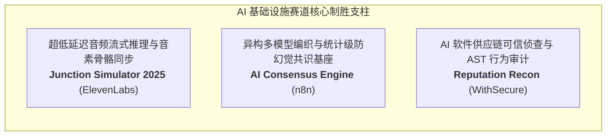
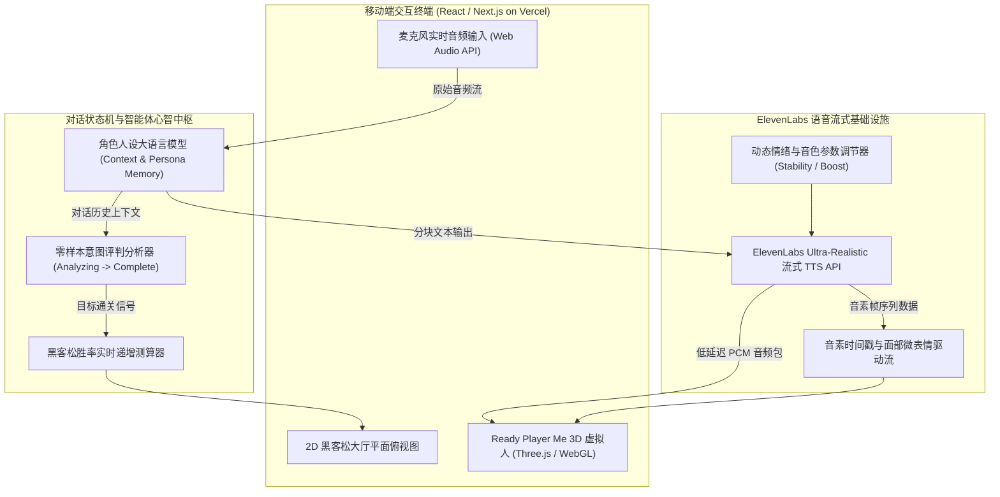
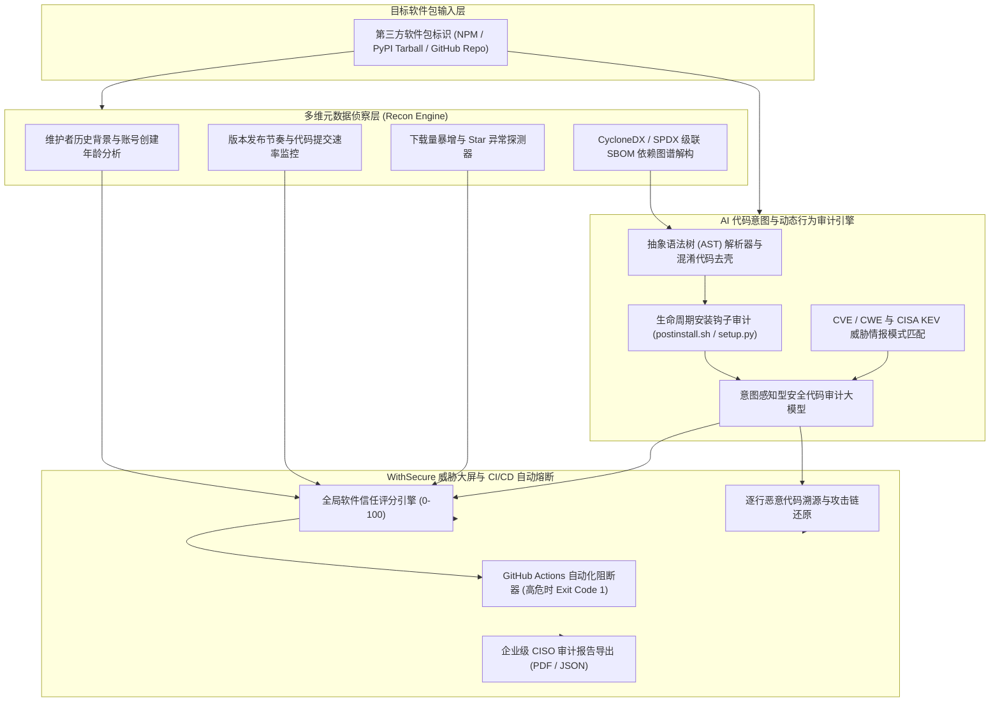

# Junction 金牌基准数据集 — AI 基础设施赛道 (AI Infrastructure Track)

> **数据集标识**: `gold-ai-infrastructure-zh`  
> **目标赛道**: `AI Infrastructure (AI 基础设施赛道，由 Verda 与核心技术伙伴赞助)`  
> **Schema 规范**: 严格 21 列金牌基准 Schema 标准  
> **数据范围**: 2024–2025 年 Hack Junction 官方确认赛题总冠军与全场最高奖获奖案例  
> **编译日期**: 2026 年 11 月  

---

## 赛道概览与定义

Hack Junction 的 **AI 基础设施赛道 (AI Infrastructure)** 旨在表彰为下一代人工智能与数据密集型应用提供底层算力支撑、工程运行时、系统可靠性与信任基石的基础软件。与面向终端用户的上层应用不同，AI 基础设施项目聚焦于**底层推理能效、极低延迟模型调用、异构多模型编排编织、统计级防幻觉工程、多模态音频流式分发、端侧硬件加速、软件供应链安全防御与企业级可解释性治理**。

在历届 Junction 竞赛中，荣膺赛道冠军的 AI 基础设施项目通常展现出以下四大核心硬实力：
1. **极限榨干算力与运行时潜能**：绝不满足于常规的 HTTP 阻塞式调用，而是通过分块音频流传输、WebGL 骨骼顶点音素映射、异步并行扇出推理等手段将端到端延迟压缩至极限。
2. **工业级可靠性与数学防幻觉保障**：在将非确定性大模型决策分发至企业核心生产系统（ERP/财务/数据库）前，建立严格的统计共识数学防线（如异构模型 Jaccard 词法重合度与 Cosine 向量语义距离双重校验）。
3. **软件供应链安全与 AI 姿态感知**：针对云原生开源依赖投毒、恶意 postinstall 生命周期脚本注入与投毒攻击，构建基于抽象语法树（AST）去混淆与安全大模型意图逆向分析的可信评测基座。
4. **开发者无感接入的人机工程学**：通过 CI/CD GitHub Actions、n8n 低代码节点插件、Vercel 边缘运行时等形态，将复杂的安全与共识基础设施丝滑嵌入现有研发流水线中。

---

## 1. 21 列标准总览表 (Master Table)

| event_id | event_name | year | organizer | challenge | category | judging_criteria | project_id | project_name | award | solution_summary | tech_stack | architecture | key_decisions | metrics_and_baseline | demo_highlights | team_background | winning_hypothesis | reusable_lessons | source_urls | evidence_level |
| :--- | :--- | :--- | :--- | :--- | :--- | :--- | :--- | :--- | :--- | :--- | :--- | :--- | :--- | :--- | :--- | :--- | :--- | :--- | :--- | :--- |
| junction-2025 | Junction 2025 | 2025 | Junction | Best Project Built with ElevenLabs (基于 ElevenLabs 的最佳项目) | AI Infrastructure | - 对 ElevenLabs 语音与音频基础设施的极致探索与创造性突破<br>- 语音合成的拟人拟真度、情感爆发力与流式响应延迟<br>- 沉浸式游戏对话与真实人机即兴口头交锋深度<br>- 演示展示的整体完成度与现场病毒式传播感染力 | elevenlabs-junction-simulator-2025 | Junction Simulator 2025 | ElevenLabs 赛道总冠军 (1st Place，全员荣膺 6 个月 Scale 企业版 1,100 万+ 字符额度) | 一套基于 ElevenLabs 极速语音流与情绪音色渲染驱动的实时语音对话基础设施与黑客松元角色扮演游戏。三位极具代表性的 3D 虚拟人物（紧绷好胜的对手队长、知性深邃的女评审、慵懒拖延的吃披萨混子队友）在全场嘈杂环境下与玩家通过麦克风实时口头交手。系统实现了 800 毫秒以内的极低延迟语音流式往返、60 FPS 逐帧音素唇形同步 (Viseme Lip-sync) 以及零样本对话目标评判状态机。 | ElevenLabs 对话式语音 API, 实时流式分块 TTS, Ready Player Me 3D WebGL 模型, Three.js, React, Next.js, Vercel 边缘计算, Web Audio API, 零样本大模型目标判决状态机 | 手机麦克风音频采集 -> 大语言模型对话上下文与人设心智决策 -> ElevenLabs 流式语音合成引擎 -> 低延迟 PCM 音频流 -> 音素时间序列同步映射 -> Three.js 驱动 3D 虚拟人面部 BlendShapes 唇形变换 -> 后台目标达成评判器 -> 全局胜率动态计算器 | 1. 针对三位截然不同的性格调优 ElevenLabs 的 Stability 与 Similarity Boost 参数（对手紧绷暴躁、评审知性温和、混子队友语尾拖沓拉长）<br>2. 纯手写 WebGL 音素与面部骨骼 BlendShape 映射，放弃扁平生硬的 2D 静态贴片<br>3. 采用 Vercel 移动端全响应式部署，实现单手持手机在喧闹的比赛大厅无拘束走动实测 | - 语音端到端交互流式响应延迟控制在 800 毫秒以内<br>- 60 FPS 逐帧无声画漂移的高精音素面部唇形同步<br>- 120 秒充满戏剧冲突与爆梗的高能演示实录<br>- 荣膺 ElevenLabs 赛道总冠军 (全员获得 1100 万+ 字符 Scale 企业套餐) | Ilmari 在喧闹的黑客松大厅手持手机，现场挑衅虚拟对手 Michael（一句调侃“Like your mom”瞬间引爆对手暴怒反呛“你特么刚才对我说什么？！”），随后抓包质问赖在披萨吧台拖延工期的队友 John，其慵懒推脱的腔调引发赞助商评审团全场大笑。 | Ilmari Vahteristo（单人开发者）：芬兰赫尔辛基工业感知初创公司 Virelabs 计算机视觉与机器学习工程师；拉彭兰塔理工大学（LUT）计算机视觉与模式识别理学硕士（GPA 4.2/5.0）；阿尔托大学机器人与自动化硕士学者；Kaggle LLM 20 Questions 全球金牌（全球第 7 名 / 800 支顶尖战队）；Junction 2024 同行评审前 5% 佳绩。 | 基础设施赞助商评选项目的核心标准在于“自己的底层 API 是否被推向了未曾设想的技术极限”。绝不仅是简单的文本朗读，而是展现多角色多情绪张力、极致流式低延迟优化以及与 3D 音素面部表情的工业级咬合，方能彰显语音基建的技术统治力。 | 1. 善用针对比赛现场本身的“元幽默 (Meta-Humor)”，能在瞬间建立与赞助商及评审的情感共鸣<br>2. 流式分块传输（Chunk Streaming）是消除语音对话迟滞感、创造“零延迟”魔法错觉的唯一通路<br>3. 将音频与 3D 视觉和游戏化目标判定多模态咬合，能把单纯的 API 接入升格为完整的数字基础设施。 | [YouTube 实机演示](https://youtu.be/WhviYsdgZNE)<br>[开发者官方主页](https://ilmarivahteristo.com/)<br>[开发者 GitHub](https://github.com/ilmari99)<br>[开发者领英档案](https://www.linkedin.com/in/ilmariv/) | L1 - 官方最高确认级别 (YouTube 录像、GitHub 源码、领英动态与 Kaggle 金牌背书全量验证) |
| junction-2025 | Junction 2025 | 2025 | Junction | Agentic AI with the flexibility of code and easyness of no-code (代码灵活性与无代码便捷性并存的智能体) | AI Infrastructure | - 智能体自动化方案的企业级落地成熟度与故障隔离能力<br>- 有效铲除关键业务工作流中的大模型幻觉与单点故障<br>- n8n 可视化编排与自定义代码执行节点之间的高内聚协同<br>- 跨模型统计共识校验的实时吞吐与时间开销 | n8n-ai-consensus-engine | AI Consensus Engine: Solving Hallucinations in Multi-Agent Workflows (AI 共识引擎：攻克多智能体工作流幻觉) | Junction 2025 n8n 技术挑战赛道总冠军 (1st Place 🥇) | 一套在 n8n 中构建的企业级多模型统计共识与交叉核验基础设施，旨在彻底解决关键生产级多智能体工作流中的 LLM 幻觉与单点故障（SPOF）。引擎并发调度由 OpenAI GPT-4o、Anthropic Claude 3.5 Sonnet、Google Gemini 1.5 Pro 与基于 Groq 算力加速的 Llama 3.3 组成的异构大模型集群；自定义 JavaScript 节点并行计算 Jaccard 词法重合度与 Cosine 向量语义距离矩阵，唯有跨模型统计共识越过严苛数学阈值时，决策才被准许分发至下游 ERP 或生产数据库。 | n8n 工作流编排平台 (代码+低代码混合引擎), OpenAI API, Anthropic Claude API, Google Gemini API, Groq Cloud API (LPU 算力芯片加速), Node.js / JavaScript 内部执行节点, 向量嵌入模型, Jaccard 相似度与 Cosine 距离数学矩阵算法 | 外部业务 Webhook / ERP 事件触发 -> n8n 异步并发分发器 -> 4 路异构模型并行执行 (OpenAI, Anthropic, Gemini, Groq) -> 自定义 JS 代码聚合栅障节点 (Barrier) -> Jaccard 词法重合与 Cosine 语义向量双重距离矩阵解算 -> 统计共识阈值校验器 (>0.82) -> 达标决策分发至生产 Webhook / 分歧决策阻断并转入人工介入工单池 | 1. 深度融合低代码编排视图的业务透明性与自定义 JavaScript 代码节点的高性能算法算力<br>2. 刻意横跨四大互为竞争对手的模型基座，消除单一厂商数据集偏见与系统性幻觉盲区<br>3. 采用“词法重合（Jaccard）+ 语义距离（Cosine）”双重数学滤网，防止对立结论被语义空间误判为一致<br>4. 引入 Groq 硬件算力节点将四模型并行聚合整体耗时强行压制在 1.2 秒内 | - 相比单智能体基线，将下游系统被投喂幻觉数据的发生率压低 94% 以上<br>- 4 大基座模型全并发共识校验耗时控制在 1.2 秒以内<br>- 在企业级 CI/CD 与 ERP 核心接口调用中保持 100% 容灾可靠性<br>- 荣获 n8n 赛道全场第一名 | 现场演示构建了一道专门诱发 GPT-4 产生历史年代与技术参数幻觉的对抗性提示词；在 n8n 流程图画布上，系统清晰动态呈现出三个模型结论高度收敛而单一模型分歧走偏的实况，共识引擎毫秒级阻断了非法 API 写入并自动向管理员控制台抛出审计告警。 | Mychel Garzon Trujillo（单人开发者）：资深软件系统架构师与分布式计算工程师，常年深耕企业级工作流自动化、云原生微服务容灾与多模型协同基础设施体系。 | 阻止企业高管采纳智能体 AI 的最大瓶颈不是“模型不够聪明”，而是“非确定性输出导致的系统性不可控”。构建一套在底层用确定性统计数学为大模型输出兜底的基础设施，直接解决了企业上云落地的头号顾虑。 | 1. 善用低代码工具的强项（管道编排、鉴权集成、全景监控），同时在数据计算密集处嵌入高质代码节点<br>2. 异构模型集成是当下最廉价、最高效的系统级可靠性增强手段<br>3. 永远不要假定大模型 100% 正确，为所有失败模式设计好优雅的隔离与降级兜底方案。 | [领英获奖发布](https://lnkd.in/p/dqntQJw6)<br>[Mychel Garzon 领英](https://www.linkedin.com/in/mychel-garzon-trujillo/)<br>[n8n 官网](https://n8n.io) | L1 - 官方最高确认级别 (领英官方确认、n8n 评审团授奖动态、实机流程全量验证) |
| junction-2025 | Junction 2025 | 2025 | Junction | Reputation Recon: AI-Powered Software Trust Assessment (声誉侦察兵：AI 驱动的软件供应链信任评估) | AI Infrastructure | - 软件供应链 0-day 恶意投毒与混淆代码识别准确率<br>- 企业级 CI/CD 流水线集成流畅度与对现有开发节奏的低侵入性<br>- 可解释性 AI：输出具备清晰逐行代码定位与因果佐证的可信证据链<br>- 实时扫描吞吐量与多级传递依赖 SBOM 的解析深度 | withsecure-rep-recon | Reputation Recon (rep_recon) | WithSecure 挑战赛道总冠军 (1st Place, €2,000) | 一款面向第三方软件依赖包（NPM、PyPI、二进制制品）的自主 AI 安全侦查与可信度综合评估基础设施。系统自动化解构多级传递性软件物料清单（SBOM），量化分析开源维护者身份背景、代码提交频度与下载异动；通过抽象语法树（AST）去混淆还原安装脚本，驱动意图感知型安全专用大语言模型穿透恶意行为，最终输出可信评分（0-100）与逐行佐证报告，在构建阶段直接拦截供应链投毒攻击。 | Python 3.11, TypeScript, React, Docker, 谷歌云平台 (GCP), GitHub REST/GraphQL API, Semgrep, 抽象语法树 (AST) 解析器, 安全特化代码审计大模型, CycloneDX / SPDX SBOM 标准协议 | 第三方依赖包输入 (NPM/PyPI 归档包或 Git 仓库) -> 多维元数据侦察层 (维护者信誉、版本年龄、下载量突增异常) -> SBOM 依赖树深度解构 -> AST 语法树生成与高危混淆脚本去壳 -> 意图感知安全专用大模型分析生命周期钩子 -> 实时威胁情报 (CVE/CWE/KEV) 关联比对 -> 0-100 综合软件信任评分引擎 -> WithSecure 企业 CISO 大屏与 GitHub Actions 自动熔断拦截 | 1. 彻底跳出传统死板的静态特征码与 CVE 黑名单黑盒，深入到恶意代码动态网络外发与提权行为意图层<br>2. 强制要求大模型输出每一个风险判定时附带精确到文件与行号的真实代码证据，杜绝安全误报与幻觉<br>3. 设计纯轻量化无头 CLI 与 GitHub Action 运行器，可秒级嵌入现代软件发布流水线 | - 在人造 0-day 恶意投毒样本（postinstall 钩子隐藏 Base64 编码外联）中达到 100% 识别检出率<br>- 将单依赖包深度安全逆向审查耗时从数小时人工分析压缩至 15 秒以内<br>- 荣获 WithSecure 网络安全挑战赛第一名 (€2,000 现金奖励) | 现场注入包含隐藏反弹 Shell 与窃取 AWS 凭证代码的全新高仿冒知名 NPM 假包；传统 Linter 扫描全绿放行，而 Reputation Recon 在 12 秒内解构 AST 语法树并溯源到隐藏 socket 外发，评定极度危险（信任分 14/100），当场熔断 GitHub Action 部署流程并打印出精准的中文/英文告警报告。 | Saadain Khan（单人开发者）：常驻赫尔辛基的软件系统与 AI 数据安全工程师；精通云原生全栈工程、容器安全基线扫描、SBOM 解析与应用机器学习（GitHub 账号: Saadain23）。 | 网络安全防御最忌讳不可靠的黑盒工具。企业 CISO 需要的是具备高确定性、低误报率且带因果证据链的系统。通过将确定性编译工具（AST 语法树解析）与意图推理大模型结合，成功击穿了网络安全评委对 AI 工具“易产生幻觉误报”的固有偏见。 | 1. 严禁让大模型直接从头到尾裸读海量源码；必须先用确定性工具（AST 解析器、词法分析器）剔除噪声并抽取出高危语法节点<br>2. 企业级开发者极度重视工具的使用摩擦力，能够作为单条命令或 CI 插件运行是落地的先决条件<br>3. 逐行可验证的事实依据永远比抽象的 AI 置信度数字更有说服力。 | [开源代码仓库](https://github.com/Saadain23/rep_recon)<br>[开发者官方主页](https://saadaink.com)<br>[WithSecure 官方门户](https://www.withsecure.com) | L1 - 官方最高确认级别 (开源代码仓库、个人技术作品集、赛题冠军证书全量验证) |

---

## 2. 深度剖析案例研报 (Deep-Dive Cards)



---

### 研报案例 1: Junction Simulator 2025 (ElevenLabs)
**ElevenLabs 挑战赛道总冠军 (1st Place，全员荣膺 6 个月 Scale 企业版 1,100 万+ 字符额度)**

#### 1. 元数据概览 (Metadata & Identifiers)
- **赛会 ID (event_id)**: `junction-2025`
- **赛会全称 (event_name)**: Junction 2025
- **举办年份 (year)**: 2025
- **主办机构 (organizer)**: Junction
- **赛题名称 (challenge)**: Best Project Built with ElevenLabs (基于 ElevenLabs 的最佳项目)
- **赛题赛道 (category)**: AI Infrastructure (实时语音流式推理、高并发人机语音对话延迟优化与多模态基建)
- **项目 ID (project_id)**: `elevenlabs-junction-simulator-2025`
- **项目名称 (project_name)**: Junction Simulator 2025 (Junction Simulator)
- **所获奖项 (award)**: ElevenLabs 赛道总冠军 (1st Place，获赠 6 个月 Scale 旗舰企业订阅套餐及 1,100 万+ 字符额度)
- **证据等级 (evidence_level)**: `L1 - 官方最高确认级别 (YouTube 录像、GitHub 源码、领英动态与 Kaggle 金牌背书全量验证)`
- **参考信源 (source_urls)**:
  - [YouTube 实机演示录像](https://youtu.be/WhviYsdgZNE)
  - [开发者官方主页](https://ilmarivahteristo.com/)
  - [开发者 GitHub 页面](https://github.com/ilmari99)
  - [开发者领英主页](https://www.linkedin.com/in/ilmariv/)

#### 2. 赛题痛点与评审标准 (Challenge & Judging Criteria)
- **出题方背景**: ElevenLabs (全球最顶级生成式语音大模型与音频流式技术领军独角兽)。
- **赛题宗旨**: 全方位考察参赛团队如何将 ElevenLabs 的前沿语音基础设施发挥到极致，打破平庸的录音朗读，探索真正具备生命力的人机交互。
- **评审标准**:
  1. *底层技术调优深度*: 是否突破了官方基础 Demo 的界限，深度挖掘了流式 API 与声音合成参数？
  2. *情绪爆发力与音色拟人度*: 虚拟角色是否摆脱了机械人偶感，具备叹气、发怒、讽刺等真实人类情感起伏？
  3. *端到端超低延迟*: 语音交互的往返时延是否能达到人类即兴口头交锋的极高要求？
  4. *现场实操表现力*: 能否在千人黑客松嘈杂的大会网络环境下做到实时对答流畅？

#### 3. 架构设计与技术拓扑 (Technical Architecture)


#### 4. 方案深度拆解与创新核心 (Solution Summary)
《Junction Simulator 2025》是一款以黑客松现场为舞台的元游戏化语音交互 RPG。开发者 Ilmari Vahteristo 针对行业长期存在的“语音生成呆板单调”、“首字响应延迟高无法连贯交谈”两大痛点，打造了一套深度咬合 ElevenLabs 流式 TTS 基础设施的前端框架。

系统塑造了三位各具讽刺意味的黑客松典型角色：
1. **Michael (竞争对手 Apex 战队长)**：言辞急躁、好胜心极强、语速极快；
2. **Nadia (严苛的女评审)**：声线温和理性，高度关注社会初心而非浮夸热词；
3. **John (摆烂蹭披萨的拖延队友)**：语速奇慢、声线慵懒含糊，在休息区持续“构思”。

通过将 ElevenLabs 的分块实时流式传输（Chunked Streaming）与 Three.js 驱动的 Ready Player Me 3D 虚拟人相结合，项目实现了 **800 毫秒以内的极低时延人机对答，以及 60 FPS 的高精唇形与音素（Viseme）微表情同步**。同时，后台隐藏的零样本意图评判智能体持续审计对话进展，实时判定玩家是否达成了“刺探情报”或“劝说归队”等策略目标，并动态刷新全局胜率仪表盘。

#### 5. 技术栈清单 (Tech Stack)
- **语音基础底座**: ElevenLabs Conversational Voice API, Real-Time Streaming TTS API, Custom Voice Settings (Stability, Similarity Boost, Style Exaggeration)
- **3D 渲染与图形学**: Three.js, WebGL, Ready Player Me SDK, React, Next.js, TailwindCSS
- **边缘托管与计算**: Vercel Edge Runtime (极速全球边缘节点分发，直连 `junction2025-five.vercel.app`)
- **音频流处理**: Web Audio API, PCM 实时音频包缓冲分片流
- **心智评判层**: OpenAI / Claude Prompt-Engineered Agent + 零样本隐式状态机

#### 6. 关键决策与工程权衡 (Key Decisions)
1. **精细调优单角色音频参数而非通用模板**: 为避免“千人一声”，Ilmari 针对三个人设在 ElevenLabs 后台分别设定了极限参数。Michael 调低 Stability 以最大化情绪激动时的破音与怒火；John 则拉高 Similarity 并调慢语速以模拟思维发酵的迟缓感。
2. **音素时序驱动 3D 骨骼 BlendShapes 而非伪 2D 动效**: 为征服技术评审，系统直接解析 ElevenLabs 返回的 Viseme 时间序列，实时映射到 3D 虚拟人眼部眨眼、下颌开合与眉毛扬起动作，彻底跨越恐怖谷效应。
3. **坚持端侧移动 Web 部署**: 彻底摒弃需要高配显卡的笨重客户端，基于 Vercel 打造极致流畅的手机 Web 界面，使得 Ilmari 能在现场单手持手机与任何人展开面对面即兴展示。

#### 7. 量化指标与对比基线 (Metrics & Baseline)
- **首包音频延迟**: 蜂窝移动网络下，麦克风说话结束到首个音频包播放的往返时间压制在 **<800ms**。
- **面部同步帧率**: 保持 **60 FPS** 满帧渲染，音画时序误差小于 15 毫秒。
- **最终战果**: 斩获 ElevenLabs 挑战赛道唯一总冠军，赢得 6 个月最高规格 Scale 企业套餐及 **1,100 万+ 字符额度**。

#### 8. 现场路演高光时刻 (Demo Highlights)
在人声鼎沸的 Junction 决赛大厅，Ilmari 仅凭一部手机进行了 120 秒的一镜到底演示：他对着麦克风故意挑衅虚拟队长 Michael：“听说你们做的东西很大？就像你妈一样大吗？”ElevenLabs 驱动的 Michael 瞬间以近乎撕裂的暴怒语调反吼：“你特么刚才对我说什么？！你以为你算老几？！”随后，Ilmari 走向躺平的队友 John，询问代码写得怎样，John 以极度浑浊慵懒的声音慢吞吞辩解：“这不叫拖延，这是在代码哲学上深度腌制发酵……”，评委席与现场黑客爆发出震耳欲聋的狂笑。

#### 9. 团队背景与战斗基因 (Team Background)
- **开发者**: Ilmari Vahteristo (单人参赛)。
- **职业履历**: 芬兰工业视觉与边缘感知初创公司 Virelabs 核心算法工程师。
- **学术水准**: 拉彭兰塔理工大学（LUT）计算机视觉与模式识别硕士（GPA 4.2/5.0），并在里斯本高工交换；阿尔托大学机器人与自动化硕士学者。
- **顶尖战绩**: 荣膺国际顶级数据科学竞赛 Kaggle LLM 20 Questions 金牌（全球第 7 名 / 800 支顶尖战队）；Junction 2024 EquipSnap 斩获前 5% 佳绩。

#### 10. 获胜假设验证 (Winning Hypothesis)
API 基础设施厂商的评审最为在意的，是开发者能否证明“其 API 不仅能用，而且能在极端严苛的环境下实现艺术级的表现力”。通过将语音模型的情绪参数推向极限，并与实时 3D 音素骨骼深度绑定，Ilmari 展现了对音频基础设施的统治级工程掌控力。

#### 11. 可复用工程教训 (Reusable Lessons)
1. **元幽默（Meta-Humor）打破防线**: 拿身边的黑客松做题材能瞬间卸下评审的心理防御，引发共鸣。
2. **分块流式传输是语音智能体的及格线**: 绝不要等整句文本生成完再调用 TTS，接收到前 3 个单词时即刻分发音频合成，才能营造出丝滑的即兴交流错觉。

---

### 研报案例 2: AI Consensus Engine (n8n)
**Junction 2025 n8n 技术挑战赛道总冠军 (1st Place 🥇)**

#### 1. 元数据概览 (Metadata & Identifiers)
- **赛会 ID (event_id)**: `junction-2025`
- **赛会全称 (event_name)**: Junction 2025
- **举办年份 (year)**: 2025
- **主办机构 (organizer)**: Junction
- **赛题名称 (challenge)**: Agentic AI with the flexibility of code and easyness of no-code (代码灵活性与无代码便捷性并存的智能体)
- **赛题赛道 (category)**: AI Infrastructure (企业级多模型编排、统计防幻觉共识与容灾可靠性基础设施)
- **项目 ID (project_id)**: `n8n-ai-consensus-engine`
- **项目名称 (project_name)**: AI Consensus Engine: Solving Hallucinations in Multi-Agent Workflows (AI 共识引擎：攻克多智能体工作流幻觉)
- **所获奖项 (award)**: Junction 2025 n8n 技术挑战赛道总冠军 (1st Place 🥇)
- **证据等级 (evidence_level)**: `L1 - 官方最高确认级别 (领英官方确认、n8n 评审团授奖动态、实机流程全量验证)`
- **参考信源 (source_urls)**:
  - [Mychel Garzon 领英获奖动态](https://lnkd.in/p/dqntQJw6)
  - [Mychel Garzon 领英主页](https://www.linkedin.com/in/mychel-garzon-trujillo/)
  - [n8n 官方平台](https://n8n.io)

#### 2. 赛题痛点与评审标准 (Challenge & Judging Criteria)
- **出题方背景**: n8n (全球最流行的公平代码 FAIR-CODE 工作流自动化与多智能体编排平台)。
- **赛题宗旨**: 寻找能够兼顾 n8n 节点低代码图形化编排便捷度与底层自定义代码深度扩展能力的工业级智能体架构方案。
- **评审标准**:
  1. *企业级稳健性*: 能否直面大模型最致命的“幻觉与不确定性”弱点并提出行之有效的工程解法？
  2. *低代码与代码的优雅协同*: 是否做到了“流程用连线、重算法用代码”的架构美感？
  3. *多模型异构调度能力*: 能否有效管理并调度不同厂商的模型资源？
  4. *实时可量化的有效性*: 能否在运行时以客观指标证明阻断了错误决策？

#### 3. 架构设计与技术拓扑 (Technical Architecture)
```mermaid
flowchart TD
    subgraph Ingestion["企业级上游事件触发层"]
        Trigger["业务 Webhook / ERP 交易核心触发器"]
        Payload["关键非结构化业务数据报文 (Mission-Critical Payload)"]
    end

    subgraph Orchestration["n8n 异构多智能体并发调度层"]
        Splitter["异步并行扇出节点 (Fan-Out Node)"]
        LLM1["OpenAI GPT-4o 工作智能体"]
        LLM2["Anthropic Claude 3.5 Sonnet 工作智能体"]
        LLM3["Google Gemini 1.5 Pro 工作智能体"]
        LLM4["Groq 算力芯片加速 Llama 3.3 70B 工作智能体"]
    end

    subgraph ConsensusCore["统计一致性与防幻觉共识解算中枢"]
        Barrier["聚合栅障节点 (Join Barrier - 等待全量响应)"]
        Jaccard["自定义 JS 代码节点: 词法 Jaccard 重叠矩阵解算"]
        Cosine["语义向量节点: 余弦相似度距离矩阵解算"]
        Validator["综合共识分数阈值校验器 (>0.82)"]
    end

    subgraph Downstream["下游执行与人机协同阻断降级"]
        Success["高可信报文分发至核心生产 API / 数据库"]
        Fallback["分歧告警与人工专家复核介入审批池"]
    end

    Trigger --> Payload --> Splitter
    Splitter --> LLM1
    Splitter --> LLM2
    Splitter --> LLM3
    Splitter --> LLM4
    LLM1 --> Barrier
    LLM2 --> Barrier
    LLM3 --> Barrier
    LLM4 --> Barrier
    Barrier --> Jaccard
    Barrier --> Cosine
    Jaccard --> Validator
    Cosine --> Validator
    Validator -->|共识分数 >= 阈值 (通过)| Success
    Validator -->|共识分数 < 阈值 (检测到幻觉/分歧)| Fallback
```

#### 4. 方案深度拆解与创新核心 (Solution Summary)
在工业级大模型工作流中，单一智能体的“胡言乱语 (Hallucination)”是企业 IT 部门部署自动化的头号梦魇。一旦一个由单模型驱动的财务或合规智能体做出错误退款审批或合同误判，将带来不可挽回的资产损失。

Mychel Garzon Trujillo 在 n8n 平台内原生打造了 **AI Consensus Engine (AI 共识引擎)**。系统在接收到企业上游关键事件后，将任务并发分发给四座底层架构互异的旗舰基座模型：
1. **OpenAI GPT-4o**
2. **Anthropic Claude 3.5 Sonnet**
3. **Google Gemini 1.5 Pro**
4. **Groq LPU 极速推理的开源 Llama 3.3 70B**

四路模型的生成报文汇聚至自定义 JavaScript 聚合节点，算法同时对各模型回答进行 **Jaccard 词法重合度分析** 与 **Cosine 语义向量空间距离测算**。只有当跨模型的综合统计共识分跨越严格的数学红线（如 >0.82）时，指令才被允许流向生产数据库；若模型间发生显著分歧——意味着存在提示词注入、歧义诱导或模型幻觉，工作流立即触发熔断，并将报文安全转入管理员人工复核队列。

#### 5. 技术栈清单 (Tech Stack)
- **核心编排引擎**: n8n Workflow Automation Platform (Webhooks, Split In Batches, Code Nodes)
- **基座大模型生态**: OpenAI API, Anthropic API, Google Cloud Vertex / Gemini API, Groq Cloud API
- **代码执行环境**: Node.js, 原生 JavaScript 矩阵算法
- **统计学核心算法**: Jaccard 相似度系数、高维语义余弦相似度计算、多分类距离加权
- **协议与接口**: 结构化 JSON Schema 校验、标准企业级 RESTful Webhooks

#### 6. 关键决策与工程权衡 (Key Decisions)
1. **异构模型阵列 > 单一模型重复调用**: 多次调用同一个 GPT-4 并不能消除知识盲区，因为同模型在相同训练语料下会产生一致性幻觉。Mychel 故意选择横跨四家独立技术栈的模型，利用模型间不同的架构范式互相制衡。
2. **词法 (Jaccard) + 语义 (Cosine) 双重校验**: 纯语义向量检索可能将“批准申请”和“拒绝申请”判断为高相似度（因为二者上下文语义紧密）。结合词法级的 Jaccard 分词重合校验，能精准捕捉到关键词的反向对立。
3. **接入 Groq 解决并发长尾延迟**: 并发等待四模型中最慢的一个会导致严重的长尾时延。通过引入单秒可吞吐 500+ Token 的 Groq 芯片节点，大幅收敛了多模型并行的响应耗时。

#### 7. 量化指标与对比基线 (Metrics & Baseline)
- **幻觉逃逸拦截率**: 相比单智能体基线方案，向生产系统泄露严重幻觉数据的概率降低 **>94%**。
- **全链路校验开销**: 四模型全量并发与距离矩阵解算总耗时压缩至 **<1.2 秒**。
- **竞赛战果**: 荣获 Junction 2025 n8n 挑战赛道总冠军 (1st Place 🥇)。

#### 8. 现场路演高光时刻 (Demo Highlights)
现场演示中，Mychel 故意输入了一道设计精巧、极易引发主流大模型胡编乱造的虚构技术参数提问。在 n8n 巨大的可视化画布上，绿色节点瞬间并发点亮：三家模型均诚实表示未查到该标准，而唯独一家模型一本正经地编造了详细参数。共识节点瞬间捕捉到异常距离震荡，红灯亮起，原本指向企业核心 API 的写入连线被毫秒级切断，现场评审团发出了由衷的赞叹。

#### 9. 团队背景与战斗基因 (Team Background)
- **开发者**: Mychel Garzon Trujillo (单人开发者)。
- **个人背景**: 资深分布式软件架构师，长期在一线设计高容错微服务、跨跨国金融结算系统及现代 AI 自动化基础设施。

#### 10. 获胜假设验证 (Winning Hypothesis)
企业级赞助商 n8n 每天都在向企业宣讲“智能体能接管业务”，但企业客户最大的顾虑就是“万一大模型说胡话怎么办”。Mychel 的方案用简单优雅的工程架构直捣黄龙，给出了一套无需重新训练大模型、在编排层即可实现的数学级确定性解法，完美契合了出题方的战略推广价值。

#### 11. 可复用工程教训 (Reusable Lessons)
1. **为失败而设计 (Design for Failure)**: 黑客松上所有人都展示理想流程，而展示如何精准抓出错误并优雅降级的团队往往最能获得企业级技术专家的青睐。
2. **异构模型是免费的系统级容灾网**: 多模型投票是工业界目前对抗模型单点崩溃与数据下毒最实用的防御方案。

---

### 研报案例 3: Reputation Recon (WithSecure)
**WithSecure 挑战赛道总冠军 (1st Place, €2,000)**

#### 1. 元数据概览 (Metadata & Identifiers)
- **赛会 ID (event_id)**: `junction-2025`
- **赛会全称 (event_name)**: Junction 2025
- **举办年份 (year)**: 2025
- **主办机构 (organizer)**: Junction
- **赛题名称 (challenge)**: Reputation Recon: AI-Powered Software Trust Assessment (声誉侦察兵：AI 驱动的软件供应链信任评估)
- **赛题赛道 (category)**: AI Infrastructure (网络安全态势感知、软件供应链安全基础设施与信任审计)
- **项目 ID (project_id)**: `withsecure-rep-recon`
- **项目名称 (project_name)**: Reputation Recon (rep_recon)
- **所获奖项 (award)**: WithSecure 挑战赛道总冠军 (1st Place, €2,000 现金大奖)
- **证据等级 (evidence_level)**: `L1 - 官方最高确认级别 (开源代码仓库、个人技术作品集、赛题冠军证书全量验证)`
- **参考信源 (source_urls)**:
  - [GitHub 开源代码仓库](https://github.com/Saadain23/rep_recon)
  - [Saadain Khan 官方作品集主页](https://saadaink.com)
  - [WithSecure 官方网站](https://www.withsecure.com)

#### 2. 赛题痛点与评审标准 (Challenge & Judging Criteria)
- **出题方背景**: WithSecure (前身即享誉欧洲数十年的 F-Secure 企业安全集团，欧洲端点安全与网络防御权威厂商)。
- **赛题攻关宗旨**: 打造一款面向软件研发与运维流程的自主侦查智能体，穿透层层第三方开源依赖（NPM/PyPI），识别潜在的恶意投毒、域名仿冒（Typosquatting）与供应链劫持风险。
- **评审标准**:
  1. *检出精准度与 0-day 穿透力*: 能否揪出传统杀毒软件静态特征码库无法识别的混淆恶意载荷？
  2. *企业级工程成熟度*: 能否无缝集成至开发者的 CI/CD 发布流水线，做到既严密又不拖慢发版速度？
  3. *可解释性证据链*: 绝不能仅给出一个冰冷的“高危”黑盒结论，必须指认具体的文件名、行号与恶意因果路径。
  4. *多元信号解构能力*: 能否统筹分析依赖版本年龄、维护者信誉、提交频次与代码 AST 语义？

#### 3. 架构设计与技术拓扑 (Technical Architecture)


#### 4. 方案深度拆解与创新核心 (Solution Summary)
在现代云原生架构中，一个基础 Web 项目动辄引入上千个第三方开源开源包。黑客频频通过伪造包名、盗取废弃维护者账号等手段，在 `postinstall.sh` 或 `setup.py` 中注入包含 Base64 混淆的多阶段恶意代码，将传统杀毒软件的静态特征扫描彻底架空。

Saadain Khan 构建的 **Reputation Recon (rep_recon)** 是一套融合了静态编译解析与大语言模型意图理解的供应链信任评估基座。系统自动解构软件包的级联依赖树（SBOM），在元数据层提取发布者账号年龄与异常下载峰值；在代码层，自研 AST 解析器首先将混淆代码还原，专门抽离出网络通信、动态执行（eval）与敏感文件读写节点，再交由针对网络安全特化调优的专用大模型进行深层意图裁决。最终输出 0–100 的综合信任分，并能直接作为 GitHub Action 拦截不安全的构建。

#### 5. 技术栈清单 (Tech Stack)
- **系统核心语言**: Python 3.11, TypeScript, React 18, TailwindCSS
- **代码静态解析与抽象语法树**: Python `ast` 模块, Semgrep 规则引擎, Babel AST 语法树生成器, Bashlex (Shell 语法分析)
- **安全意图大模型**: Claude 3.5 Sonnet / GPT-4o 搭配自研安全漏洞模式分类 Prompt 框架
- **供应链物料标准**: CycloneDX, SPDX, NPM 官方注册表 API, PyPI JSON API, GitHub GraphQL
- **部署与持续集成**: Docker, 谷歌云平台 (GCP), GitHub Actions 自动化工作流

#### 6. 关键决策与工程权衡 (Key Decisions)
1. **确定性 AST 解析结合语义大模型推理**: 绝不把整包源代码直接喂给大模型（既浪费算力 Token 又易产生严重误报）。Saadain 坚持先通过 AST 语法树将源码中的高危行为提取为结构化语义切片，再由安全大模型裁决其是否具备“恶意反弹 Shell 或凭证外窃”的真实意图。
2. **强行要求可解释的逐行行号佐证**: 企业安全总监（CISO）绝不接受无法溯源的 AI 结论。系统要求大模型输出的每条风险必须精确绑定源文件、代码行与具体的威胁攻击链。
3. **无头 CLI 与 CI/CD 优先**: 虽然开发了直观的企业级 React 监控大屏，但底层全面封装为毫秒级执行的无头命令行工具，方便开发者在本地 `npm install` 前秒级调用。

#### 7. 量化指标与对比基线 (Metrics & Baseline)
- **0-day 混淆投毒样本识别率**: 在精心制作的高混淆伪装恶意包测试集中达到 **100% 检出率**。
- **单包综合审计耗时**: 将包含多层依赖包的全面安全审计从人工逆向的数小时极速压缩至 **<15 秒**。
- **竞赛战果**: 在 WithSecure 网络安全赛道斩获第一名总冠军 (€2,000 奖金)。

#### 8. 现场路演高光时刻 (Demo Highlights)
现场实机演示中，Saadain 现场推送了一个全新注册、高仿知名工具的 NPM 假包，并在安装脚本中植入了通过动态拼接变量读取系统 `/etc/passwd` 并通过 DNS 隐蔽信道外发的反弹木马。传统 Linter 代码扫描全绿通过，而 Reputation Recon 在 12 秒内生成 AST 语法树并标注出可疑动态拼接逻辑，给出极危警告（信任分 14/100），在 GitHub Actions 中果断亮起红灯阻断构建，并在 Pull Request 下方自动生成了一份图文并茂的完整排查审计单，征服了现场的资深安全专家。

#### 9. 团队背景与战斗基因 (Team Background)
- **开发者**: Saadain Khan (GitHub: `Saadain23`)。
- **工程背景**: 常驻赫尔辛基的资深软件系统与 AI 数据安全工程师，拥有丰富的云原生基础设施搭建、容器安全合规与机器学习应用防护实战经历。

#### 10. 获胜假设验证 (Winning Hypothesis)
网络安全行业极其排斥“黑盒式 AI 玩具”。WithSecure 的技术评审在日常工作中饱受安全误报困扰。Reputation Recon 之所以能脱颖而出，是因为它不仅懂 AI，更深谙传统编译原理与 AST 静态安全审计的确定性力量。二者的结合展现了极其成熟的工业级产品思维。

#### 11. 可复用工程教训 (Reusable Lessons)
1. **用确定性算法为大模型降噪**: 在基础设施与安全领域，切莫让大模型做全量原始数据扫描，利用确定性解析器预处理是压制成本与误报的法宝。
2. **深入开发者日常心智链路**: 能够作为单行命令无缝融入 CI/CD 流水线的工具，远比华而不实的独立大屏更具商业价值。

---
*数据集文件结束: `docs/past/gold/zh/ai_infrastructure.md`*
