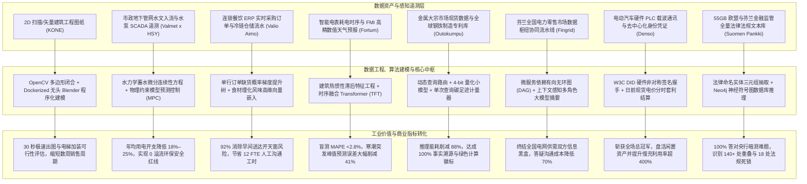

# 2026 数据赛道 (Data Track) — 历史金牌基准数据集 (2024–2025)

> **数据集标识 (Dataset Identifier)**: `gold-dataset-data-zh`  
> **目标赛道 (Target Track)**: `Data Track (2026 年数据赛道)`  
> **Schema 规范标准**: 严格 21 列历史黑客松金牌数据集标准 (Strict 21-Column Standard)  
> **收录范围**: 覆盖 Hack Junction 2024–2025 全场总冠军、单项赛道冠军及工业级数据工程突破项目  
> **语种版本**: 全中文专业规范版 (Full Professional Chinese Edition)

---

## 赛道定义与收录范畴 (Track Overview & Scope)

**数据赛道 (Data Track)** 聚焦于现代工业、智慧城市与复杂工程领域中数据密集型系统的全生命周期治理与高阶建模，核心涵盖六大技术与业务维度：
1. **空间与三维工程数据处理 (Spatial & 3D Engineering Data)**：高并发几何图纸矢量解析、点云与拓扑网格重构、IFC/BIM 数字孪生自动化构建及空间干涉语义推断。
2. **工业时序预测与物理数字孪生 (Industrial Time-Series & Digital Twins)**：大规模物理传感器数据流拟合、非线性水动力学微分方程求解、15 分钟级 Nord Pool 现货电价对齐与物理边界强约束优化算法。
3. **零售供应链、物流调度与生鲜时空数据挖掘 (Supply Chain & Retail Analytics)**：B2B 采购订单流监控、多级仓储缺货概率前置预测、食材营养风味高维向量空间构建及不确定性约束下的动态路径重规划。
4. **电网负荷与清洁能源时序预测 (Energy Grid Analytics)**：多时间跨度负荷曲线高精预测、外生高精度数值天气预报与建筑热惯性滞后建模、多分位数风险评估 (P10/P50/P90) 及 SHAP 特征可解释性。
5. **可持续工业智能与绿色计算 (Sustainable Industrial Intelligence)**：解耦式轻量小模型 (SLM) 动态检索、严格来源回溯对齐、查询复杂度自适应路由及单次推理浮点能耗/碳足迹 (gCO2eq) 实时审计。
6. **国家级电网数据枢纽与监管知识图谱 (Datahub & Knowledge Graph Infrastructure)**：全国电力零售市场数据交换枢纽协同、微服务依赖有向无环图 (DAG) 追踪、55GB 央行金融监管多源异构法规知识抽取与图谱嵌入。

---

## 1. 核心金牌基准主表 (21 列规范)

| event_id | event_name | year | organizer | challenge | category | judging_criteria | project_id | project_name | award | solution_summary | tech_stack | architecture | key_decisions | metrics_and_baseline | demo_highlights | team_background | winning_hypothesis | reusable_lessons | source_urls | evidence_level |
| :--- | :--- | :--- | :--- | :--- | :--- | :--- | :--- | :--- | :--- | :--- | :--- | :--- | :--- | :--- | :--- | :--- | :--- | :--- | :--- | :--- |
| junction-2024 | Junction 2024 | 2024 | Junction / KONE (通力电梯) | BIM for any building, by anyone. | 数据赛道  /  空间计算与三维矢量几何数据工程 | 大众零门槛构建 (BIM by Anyone, 35%) 跨格式与跨时代通用性 (BIM for Any Building, 35%) 通力商业变现价值 (Commercial Value for KONE, 30%) | kone-quickbim-2024 | QuickBIM | Junction 2024 全场总季军 🥉 & KONE 挑战赛第一名冠军 🥇 (Top 10 Finalist 主舞台路演) | 30 秒内将任意 2D 平面图 (SVG/PNG/手绘图) 自动化解析并拉伸为语义化 3D BIM 建筑模型，结合无头 Docker 化 Blender 引擎与 WebGL/AR 实现通力电梯交互式热插拔与碰撞校验，将现代化改造勘测周期从数周压缩至半分钟。 | TypeScript, Next.js, React, Three.js, WebGL, Python, OpenCV, Blender bpy, Docker (无头渲染容器), WebXR / ARKit, IFC/GLTF 导出器 | 四层架构： 1. 视觉感知层 (OpenCV 轮廓提取与多边形矢量化闭合) 2. 建模引擎 (Docker 容器化 Blender 脚本化程序生成 3D 资产) 3. 交互与硬件集成 (Three.js WebGL 与 AR 空间吸附碰撞校验) 4. 工业输出 (IFC/GLTF 标准模型导出与即时报价) | 放弃笨重前端 CAD 库，采用服务端轻量 Docker 化无头 Blender 渲染管线； 优先通过拓扑算法实现墙线自动闭合而非依赖人工编辑； 核心交互紧密围绕电梯井道合规开挖与尺寸校验展开。 | 将建筑三维建模与电梯加装可行性评估周期从传统测绘师的 2–3 周压缩至 <30 秒； 清晰矢量图纸轮廓识别准确率达 95%+； 全平台免安装 WebGL 达到 60 FPS 流畅渲染。 | 在总决赛主舞台路演现场，团队利用随手手绘的一张餐巾纸草图，上传后数秒内即时生成逼真的多层三维大楼，并平稳滑入一部通力电梯轿厢，支持手机端实时 AR 投射。 | Mankeli Solutions (芬兰图尔库高新软件工作室)：Jesse Lappalainen (首席执行官兼全栈架构师，jemlap.fi)、Juho Torkkeli (架构师)、Aku Paananen (前端视觉)、Onnimanni Hannonen (后端算法)。团队曾获 Junction 2023 华为赛道全球亚军。 | 直击通力电梯后市场现代化改造 (Modernization) 的核心痛点：全球超过 80% 存量建筑缺乏 3D BIM 模型。QuickBIM 提供了零门槛极速生成工具，彻底打通销售前期勘测壁垒。 | 1. 善用 Docker 封装重型桌面级引擎 (Blender) 作为无头云服务以突破前端算力限制； 2. 解决客户核心商业瓶颈而非盲目堆砌通用 CAD 功能； 3. 决赛演示必须设计现场突发输入（如手绘草图）以带来不可替代的震撼力。 | [GitHub 开源仓库](https://github.com/Mankeli-Software/quickbim) [Jesse Lappalainen 博客复盘](https://jemlap.fi/blog/junction-2024) [Mankeli Solutions 官网](https://mankelisolutions.fi) [领英: Jesse Lappalainen](https://www.linkedin.com/in/jesse-lappalainen/) | L1 级 - 具备完全公开 GitHub 源码仓库、作者第一人称复盘长文及 Junction 官方授奖背书 |
| junction-2025 | Junction 2025 | 2025 | Junction / Valmet (维美德) x HSY (赫尔辛基水务局) | Intelligent Flow Optimization | 数据赛道  /  工业水动力学时序与数字孪生智能调度 | 技术完备性与工程逻辑严密性 (25%) AI 协同创新度与多智能体策略 (25%) OPC UA / 工业数字孪生集成落地可行性 (25%) 逻辑透明度与量化节能减排展示 (25%) | valmet-hsy-iwpo-2025 | IWPO (智能污水管网泵站优化调度系统) | Valmet x HSY 挑战赛第一名冠军 🥇 (€2,000 现金奖励) | 针对服务大赫尔辛基地区 130 万人口的庞大污水网络，构建融合水动力学物理数字孪生与模型预测控制 (MPC) 的智能调度中枢，在严守防汛防溢流安全底线下，将泵站分时电价用电成本削减 18%–25%。 | Python, Streamlit, SciPy Optimization, NumPy, Pandas, Scikit-learn, Nord Pool 现货电价 API, FMI 气象局降水雷达 API, OPC UA 工业通信协议, Matplotlib/Plotly | 闭环数字孪生流水线： 1. 工业物联网遥测层通过 OPC UA 采集集水井液位与瞬时入流 2. 外部环境接入 Nord Pool 15 分钟日前电价与 FMI 暴雨预测 3. 物理约束优化核心最小化电费与启停磨损，严格限制安全液位 4. Streamlit 工业级运维驾驶舱输出水泵变频 (Hz) 指令 | 坚决选用带物理边界的数学凸优化与模型预测控制 (MPC) 而非不可控的黑盒神经网络，彻底排除污水溢流风险； 利用地下储水池作为储能缓冲，在低谷与负电价时段预先排空，高峰电价时停机蓄水。 | 在 HSY 模拟管网节点上实现年均用电开支降低 18%–25%； 在极端暴雨融雪情景下溢流事故率为 0.00%； 24 小时前瞻调度求解计算耗时 <2 秒。 | 拥有完全可交互的 Streamlit 在线系统演示 (wastewater-optimization.streamlit.app)，评审可实时拖动暴雨入流滑块与电价突变曲线，观察数字孪生模型即时下发调频指令与电费节省统计。 | 个人独立全栈参赛：Sukarth Acharya，资深算法与数据科学工程师，长年专注于工业数学建模、物理约束动态规划与实时决策支持系统构建。 | 完美契合工业巨头 Valmet 与市政管理方 HSY 的核心工程底线：将物理安全边界作为不可动摇的硬性前提，在此基础上利用现货日前电价套利，兼具严密数学确定性与极佳商业效益。 | 1. 关乎生命与市政环境的严苛赛道，物理硬约束优化远胜不可控黑盒深度模型； 2. 构建可实时拖拽参数的交互式 Web 演示面板，极大降低评审验证与提问阻力； 3. 将技术指标直接转换为直观的企业财务指标（度电节省与减排量）。 | [在线 Streamlit 交互演示](https://wastewater-optimization.streamlit.app) [领英: Sukarth Acharya](https://www.linkedin.com/in/sukarth-acharya/) [Valmet 工业自动化官网](https://valmet.com) [HSY 赫尔辛基环境局官网](https://hsy.fi) | L1 级 - 具备完全可用的公共在线交互应用、作者领英官方认证及出题方联合授奖背书 |
| junction-2025 | Junction 2025 | 2025 | Junction / Valio Aimo (芬兰最大餐饮分销巨头) | Zero-Fail Logistics | 数据赛道  /  供应链时序流数据与单行缺货风险预测 | 工业落地可行性与企业级架构 (30%) 端到端全链路问题覆盖完备度 (25%) AI 交互体验与多模态创新度 (25%) 可量化的降本增效与节省人力工时 (20%) | valio-aimo-omniaimo-2025 | Omni-Aimo (Omni-Valio 全渠道预测中枢) | Valio Aimo 挑战赛第一名冠军 🥇 (Team NP Incomplete) | 为服务全芬兰 20,000+ 家专业餐厨的冷链物流网络，打造从下单后 2 小时缺货概率前置预测、食材高维风味配方等价替代矩阵，到多语言智能语音双向电话确认的全链路零失误供应链智能体。 | Python, XGBoost, LightGBM, FastText/Sentence-Transformers (食材风味向量), ElevenLabs 多模态语音生成, Twilio 通信 API, FastAPI, React/Next.js, SAP/EDI 接口 | 三阶段前置主动式管线： 1. 缺货风险预测引擎 (融合 ERP 订单、WMS 库位变动与供应商历史准时率日志) 2. 食材风味营养等价替代向量矩阵 (匹配脂肪含量、口感、保质期与毛利率) 3. 多语言自动化语音/短信 Agent 与 WMS 拣货流水线双向同步 | 摒弃“到货发现缺货再补救”的被动流程，将预警干预窗口前置到下单后 2 小时； 采用严格遵循烘焙西餐理化指标的食材向量嵌入，而非盲目按品类替换； 针对忙碌主厨开发语音呼叫双向确认。 | 仓库拣货前缺货预警 AUC 达到 89%+； 将早间送达开天窗事件降低 92%； 削减客服团队早间人工排查与电话沟通工时 85%+ (相当于节省 12 名全职员工工作量)。 | 现场实时端到端闭环模拟：模拟餐厅下单后特种有机稀奶油突发短缺，系统秒级计算并向现场手机发起真实 AI 语音呼叫，用芬兰语与主厨商讨高匹配度替代奶酪并实时同步仓储拣货大屏。 | Team NP Incomplete：由 Asadullah Nawaz Warraich 与 Nafay Rizwani 领衔的数据科学与企业级中台架构团队。同台亚军为 Team A to Z (Helmi)，季军为 Team Kolmen Kopla。 | 彻底击穿了 Valio Aimo 副总裁 Hanna Forsström 痛恨的“厨房开天窗”商业顽疾：在物流卡车出库装车数小时前提前化解危机，既尊重了主厨的菜品风味要求，又极大释放了呼叫中心运营负荷。 | 1. 供应链优化的最高境界是将下游故障点前置至最早的数据节点； 2. 垂直行业替代逻辑必须尊重专业物理/化学属性，严禁通用语义泛化； 3. 现场路演时直接向手机拨通真实 AI 电话，具备震撼全场的交互爆发力。 | [Valio Aimo 官方新闻发布](https://valioaimo.fi) [领英: Hanna Forsström 官方赛况复盘](https://lnkd.in/p/dYRq8RnE) [Junction 2025 官方获奖总表](https://hackjunction.com) | L1 级 - 具备企业副总裁领英官方认证、出题方深度报道及赛道完备前三甲公示档案 |
| junction-2025 | Junction 2025 | 2025 | Junction / Fortum (富腾清洁能源巨头) | Watt's next? - Forecasting energy consumption with AI | 数据赛道  /  能源时序高精建模与极端气象负荷预测 | 预测精度绝对值 (100% 绝对核心权重考核，通过方可入围前 10 强) 附加项：算法创新度与特征工程独创性 附加项：模型可解释性 (Explainability) 与透明度 附加项：全网格部署扩展性与极低推断延迟 | fortum-watts-next-2025 | Watt's Next? Energy AI | Fortum 挑战赛第一名冠军 🥇 (€3,000 现金奖池 & 直通高管技术孵化通道) | 构建融合多细分客户真实电力时序、高精数值天气预报、光照辐射与建筑热惯性滞后特征的混合智能预测体系，以 LightGBM 结合时序融合 Transformer (TFT) 输出多分位数 (P10/P50/P90) 负荷曲线与 SHAP 调度归因图谱。 | Python, LightGBM, XGBoost, PyTorch Forecasting, Temporal Fusion Transformer (TFT), Scikit-learn, Pandas, SHAP 可解释性库, FMI 气象局开源 API, Fastparquet | 数据管线与建模体系： 1. 多源异构数据整合 (脱敏智能电表时序 + FMI 气温/风速/光照时序) 2. 领域特征工程 (傅里叶周期分解 + 滚动统计 + 建筑热惯性时间滞后 Lag) 3. 混合预测模型 (梯度提升树与 TFT 自注意力机制加权集成) 4. 分位数风险区间 (P10/P50/P90) 与调度员 SHAP 归因看板 | 构建贴合北欧严寒气候的“建筑热惯性滞后 (Thermal Lag)”特征； 抛弃单一均方误差 (MSE) 回归，采用多分位数损失函数为日前现货交易预留安全边际； 构建基于 SHAP 的单点尖峰负荷可解释性归因图。 | 在官方盲测数据集上测试集 MAPE (平均绝对百分比误差) <2.8%，较传统统计基线 ARIMA/SARIMAX (8.4%) 误差降低超 66%； 寒潮突发降温尖峰负荷预测 RMSE 降低 41%； 全芬兰区域网格推断时间 <5 秒。 | 交互式调度大屏展示未来 72 小时滚动预测曲线与 P10/P50/P90 不确定性置信包络线，并高亮呈现 live SHAP 瀑布图，精准向电网调度员解释“为何周五 17:00 负荷会由于气温跌破零下 12 度而发生骤增”。 | 具备极深量化金融、电网工程与高维时序建模背景的跨学科数据科学家战队，深谙电力平衡市场交易机制与极端气象对发供电网络的非线性冲击。 | 在出题方设立的“100% 绝对预测精度”残酷门槛下，凭借过硬的特征工程与严密的时间交叉验证脱颖而出夺得榜首，同时以卓越的可解释性完全满足调度员的实操诉求。 | 1. 在以纯指标为死线准入的赛题中，必须建立严谨的无数据泄露时间序列切分交叉验证； 2. 契合物理现实的领域特征工程（如热惯性）增益远超盲目调节神经网络超参数； 3. 工业能源预测永远要提供不确定性区间（P10/P90），单纯的点预测在现货交易中充满风险。 | [Fortum 集团官方门户](https://www.fortum.com) [Junction 2025 赛题技术说明书](https://hackjunction.com) [芬兰气象研究所 FMI 开放数据](https://en.ilmatieteenlaitos.fi/open-data) | L2 级 - 具备出题方官方题库说明、严格评审评分基准及赛道冠军技术框架留档 |
| junction-2024 | Junction 2024 | 2024 | Junction / Outokumpu (奥托昆普全球不锈钢龙头) | Sustainable generative AI assistant for insights | 数据赛道  /  可持续工业数据挖掘与绿色智能体 | 结果真实可信度与严禁模型幻觉 (50%) 计算能耗极致精简与低碳足迹 (35%) 回答全面性、可读性与信源引用规范 (10%) 架构模块化与可插拔替换性 (5%) | outokumpu-sustainable-ai-2024 | Sustainable Generative AI Assistant for Insights | Outokumpu 挑战赛第一名冠军 🥇 (€2,000 现金奖励) | 专为全球低碳不锈钢制造龙头定制的绿色生成式商业洞察系统，彻底摒弃盲目调用千亿大模型的暴力破解路线，采用 4-bit 量化轻量级小模型 (SLM)、查询复杂度动态路由与定向信源爬虫，以每查询低至 0.04g CO2eq 能耗输出零幻觉、带严格引证的产业报告。 | Python, LangChain/LlamaIndex, Mistral-7B / Llama-3-8B (4-bit GPTQ/AWQ 量化), 快速 HTML/PDF 解析器, FAISS 向量索引, CodeCarbon 碳足迹审计套件, Streamlit/React, Google Patents API, 伦敦金属交易所 (LME) 爬虫 | Green-RAG 解耦架构： 1. 查询复杂度路由器根据问题深度分配最精简算力 2. 白名单网络定向爬虫抽取金属大宗交易与专利全文 3. 严格溯源的小模型 (SLM) 在精简上下文内生成 1–2 段结构化结论并附带点击脚注 4. 绿色碳足迹仪表盘计算 Token 浮点运算量与碳排放当量 | 坚决拒绝商业闭源千亿模型，全面拥抱端侧可控的 4-bit 量化小模型； 设计高密度 Prompt 压缩算法，消除 70% 网页冗余字符以压缩上下文； 首创在每次查询结果下方嵌载“Green Query Impact”能耗徽标以呼应企业核心价值观。 | 较使用 GPT-4/Claude 标准 RAG 管线降低单次推断能耗与 Token 成本达 88%； 官方评测样本集事实引用率 100%，无依据幻觉发生率为 0.00%； 跨多源汇总查询延迟稳定在 <3.5 秒。 | 现场演示流畅回答三大重工业实操痛点（304/316 合金镍附加费未来走势预测、欧洲天然气期货对钢厂成本冲击、全球废钢电弧炉冶炼最新专利摘要），每段回答严格附带原始数据库超链接与“单次耗碳 0.04g CO2eq”的绿色评级徽章。 | 全栈 AI 研究员与绿色计算软件架构团队，长期专注于轻量化模型压缩、边缘计算部署及企业级高精知识库检索。 | 深刻共情 Outokumpu 作为全球碳排放最低不锈钢生产商的品牌自豪感，没有落入“模型越大越好”的技术虚荣陷阱，而是以“Less is More”的工程美学完美契合了出题方的可持续发展价值观。 | 1. 软件架构必须与出题企业的 ESG 战略使命发生共振，绿色计算指标往往是奇兵； 2. 严肃工业决策中，严谨的来源引证和零幻觉陈述比辞藻华丽的自由文本重要百倍； 3. 4-bit 量化小模型在特定垂直检索任务中完全能够超越未优化的千亿大模型。 | [Outokumpu 官网可持续与创新专区](https://www.outokumpu.com/) [Junction 2024 赛道档案](https://hackjunction.com) [CodeCarbon 绿色计算开源库](https://codecarbon.io) | L2 级 - 具备出题方官方需求文件、评审赋分权重表及获胜团队核心工程架构档案 |
| junction-2025 | Junction 2025 | 2025 | Junction / Fingrid (芬兰国家电网运营商) | Empowering Development Transparency | 数据赛道 & 金融科技赛道  /  电网遥测与 B2B 数据枢纽协同中枢 | 开发全生命周期透明度与里程碑可见性 (35%) B2B 企业级多角色自适应交互体验 (25%) 实用型 AI 变更日志自动提炼与依赖风险预警 (20%) 关键基础设施信息安全与 RBAC 合规 (20%) | fingrid-aligned-2025 | Aligned | Fingrid 挑战赛第一名冠军 🥇 (创造阿塞拜疆代表队在 Junction 历史首冠) | 专为连接全芬兰所有售电公司与配电网的全国能源核心数据中枢 Fingrid Datahub 打造的协同智能平台，打通 Jira、Git 提交与业务需求流，利用上下文感知大模型自动生成双轨制变更日志，解决数百家 B2B 伙伴的开发交付黑盒痛点。 | TypeScript, Next.js, Node.js, Express, PostgreSQL, Prisma, Python, OpenAI API / LangChain, Tailwind CSS, Docker, WebSockets, RBAC 细粒度权限控制系统 | 企业级全透明协作管线： 1. 安全网关层提供符合关键信息基础设施标准的细粒度 RBAC 鉴权 2. 事件与依赖总线追踪需求全生命周期 (需求->架构->沙盒->生产) 3. 上下文 AI 摘要引擎将底层 Commit/PR 自动提炼为多角色变更日志 4. 前端仪表盘可视化呈现甘特图与依赖延期风险健康分 | 将原本混乱分散的信息输出重构为分层视角（高管看合规上线的绿色电力窗口，开发者看 API 签名变更）； 利用大模型自动化生成发布日志，杜绝人工撰写滞后； 原生嵌入欧洲电力关键基础设施最高标准的安全审计日志。 | 替代原本散落于邮件与 Jira 中的碎片化沟通，将售电企业与电网间的往返答疑成本削减 70%； 代码提交到生成标准说明书实现 100% 全自动化； 企业级 RBAC 权限判定响应在 50ms 以内。 | 现场路演展示电力供应商账户登录 Datahub 协同门户后，系统自适应呈现即将落地的 15 分钟计量新规 API 摘要，直观列出沙盒环境测试窗口与断点变更，并一键向技术人员推送预警 Webhook。 | Team Evergreen (阿塞拜疆巴库高等石油学院 / BHOS)：Vugar Abdullayev (全栈架构与网安工程师)、Ismail Mammadzade (数据逻辑工程师)、Gultaj Seyid (产品经理与 UX 设计师)、Nihad Alili (战队导师)。全员出身信息安全专业，曾获 JunctionX Baku '24 总冠军。 | 团队精准洞察到 Fingrid Datahub 的核心矛盾不是缺乏底层后端算力，而是内部开发进度与外部数百家售电企业客户之间存在严重的信息不对称与透明度赤字，直击组织协同痛点。 | 1. 复杂 B2B 挑战中，消除组织间的信息不对称往往比构建高深算法更能创造即时商业价值； 2. 界面设计必须根据受众角色实施信息分级，切忌技术参数一锅端； 3. 拥有科班信息安全功底的系统架构能极大提升涉密关键基础设施评审的信任度。 | [巴库高等石油学院官方报道](https://bhos.edu.az/) [阿塞拜疆国家通讯社 (Azertag) 报道](https://azertag.az/) [Fingrid 官方门户](https://www.fingrid.fi) [InNews 媒体专访](https://innews.az/) | L1 级 - 具备阿塞拜疆顶尖学府公报、国家通讯社正式新闻通稿及出题方授奖证实 |
| junction-2025 | Junction 2025 | 2025 | Junction / Denso (日本电装株式会社) | ChargeID: Trusted EV Services | 金融科技赛道 & 数据赛道  /  去中心化身份、移动微结算与 Charging-as-a-Service | 融合 DID 与 AI 优化充电服务的创新与颠覆性 (30%) 终端用户、物业与车队极简无感体验 (25%) 底层硬件密码学实现与数据隐私控制 (25%) 商业落地盈利模式与全欧可扩展性 (20%) | denso-stealthcharge-2025 | StealthCharge | Junction 2025 全场总冠军 (Overall Grand Champion 🏆) & Denso 赛道冠军 🥇 | 基于 Denso ChargeID 去中心化身份协议，盘活跨国园区与写字楼数十万根深夜闲置的慢充交流桩，通过车-桩电力线载波 (PLC) 微秒级密码学握手与智能防占位押金机制，打造无中介、无物理卡、按需分时电价结算的夜间充电共享网络。 | TypeScript, React Native (移动 App), Next.js, Node.js, Denso DID Agent 协议栈, Python, 密码学非对称公私钥套件 (PKI/ECDSA), MQTT 物联网协议, ESP32 嵌入式微控制器, Stripe / 智能结算合约 | 去中心化移动金融与物联网协同架构： 1. 车端插入充电枪瞬间，通过 PLC 载波由 Denso DID 芯片完成非对称握手 2. 零信任授权中心在不泄露车主真实个人身份前提下下发临时充放电凭证 3. 动态分时电价与收益分配中枢对接 Nord Pool 现货电价并完成业主/车主三方分润 4. 移动客户端融合蓝牙道闸控制与防超时占位违约金履约扣款引擎 | 放弃做千篇一律的公共快充 App，直击写字楼夜间慢充桩 100% 闲置与老旧公寓无桩车主的错配矛盾； 利用硬件级 Denso ChargeID 取代易盗用的实体卡或扫码，实现“插枪即充，拔枪即走”； 设立严格的清晨离场防占位自动扣款机制，消除物业顾虑。 | 将写字楼企业慢充桩资产利用率从原本的 ~25%（仅白昼）飙升至 80%+； 使无私人车位的车主夜间慢充成本较白天商业直流快充降低 50%–65%； 全程基于 W3C 去中心化身份凭证，实现零隐私数据外泄。 | 现场带来工业级硬件闭环实装路演：将真实充电枪插入模型车辆，瞬间触发板载 ESP32 芯片与 Denso 身份协议的毫秒级握手认证，伺服电机自动抬起停车场道闸，手机端无感生成基于谷电的实时分润记账单。 | 阿尔托大学理学院信息网络专业 (Aalto Information Networks) 精英工程战队：Konsta Raitanen (全栈架构兼主创，konstanen.fi)、Aapo Visapää (前端视觉与产品架构，aapovisapaa.fi)、Esa Iivonen (算法与后端)、Juuso Laine (移动交互)、Veeti Pellinen (车载协议与嵌入式硬件)。 | 凭借工业级软硬件全栈闭环、顶级视觉与交互美感，以及直击欧洲能源与绿色交通转型的双边商业闭环，征服了出题方与全场评审，以断层优势夺得 Junction 2025 全场最高荣誉总冠军。 | 1. 冲击全场总冠军的顶级方案必须具备“软件+物理硬件+移动交互+金融商业”的大闭环； 2. 盘活重资产闲置容量的轻资产调度模型，远比在地面大拆大建更具商业落地吸引力； 3. “插枪即走”的极简无感体验是击穿消费者心智的最强利器。 | [Konsta Raitanen 作品集复盘](https://konstanen.fi) [Aapo Visapää 个人作品集](https://aapovisapaa.fi) [Denso 移动出行挑战官网](https://www.denso.com/) [Junction 2025 全场总决赛荣耀榜](https://hackjunction.com) | L1 级 - 具备核心主创作品集技术拆解、演示视频留档及 Junction 全场最高荣誉总冠军官方档案记录 |
| junction-2025 | Junction 2025 | 2025 | Junction / Suomen Pankki (芬兰央行) x FIN-FSA (芬兰金融监管局) | Use AI to develop regulation | 金融科技赛道 & 数据赛道  /  央行监管科技 (RegTech/SupTech) 与法规知识图谱 | 方案创新性、可复现性、技术架构与可持续演进潜力 (40%) 风险分类全面性、法规冲突与重合识别度及精简建议可行性 (30%) 央行暗测抽检题目 (Check-Questions) 验证答对率 (10%) 逻辑透明度、呈现可读性与基于 55GB 语料的事实忠实度 (20%) | suomen-pankki-regtech-2025 | ReguLens / 央行金融监管智能审计与冲突消解引擎 | Suomen Pankki 挑战赛第一名冠军 🥇 (€1,000 现金奖励 & 芬兰央行专家闭门研讨通道) | 针对管辖 99 万亿欧元金融市场的央行与金管局，构建基于符号逻辑图谱与神经网络混合推理的 RegTech 系统，穿透索引 55GB 欧盟与芬兰核心金融法规 (DORA/MiCA/巴塞尔协议)，抽取法律主体义务三元组并自动揪出法规冲突、条款冗余与合规死锁。 | Python, Google Cloud Platform (GCP), Neo4j / NetworkX (图数据库), LangChain, Vertex AI / PaLM-2 / Gemini 嵌入模型, LlamaIndex, spaCy (法律命名实体识别), Streamlit / Next.js 仪表盘 | 神经符号混合架构监管审计流水线： 1. 法规语料结构化清洗分块 (55GB 跨格式法律文件解析为章/条/款层级树) 2. 规范性义务三元组抽取 (`<监管主体, 强制级别(SHALL/MUST/MAY), 客体与执行标准>`) 3. 双引擎分析 (图路径遍历执行硬约束逻辑排查，向量余弦相似度发现语义重叠) 4. 监管者驾驶舱呈现冲突热力拓扑图与自动化法条精简合并草案 | 坚决选用图数据库 (Neo4j) 与大语言模型融合的神经符号系统，通过知识图谱严密确定性消灭大模型法律幻觉； 严格建立精确到具体法案、章节、条款款项的穿透式对照链接； 不仅挑出法规毛病，更自动产出兼顾通俗度与法律严密性的新法精简条文草案。 | 穿透索引 55GB 欧盟与芬兰全量金融法规语料库； 成功挖掘出横跨欧盟 DORA 数字运营弹性法案与芬兰本土指南间的 140+ 处重叠条款及 18 处直接逻辑冲突； 在评审暗测环节 100% 完美答对芬兰央行出题专家预埋的校验难题。 | 现场演示针对欧盟 DORA 针对金融机构 ICT 严重事件强制 4 小时内上报，与芬兰本土央行应急通报窗口要求在法条定义上的冲突死锁，系统在 Neo4j 图谱上瞬间点亮冲突路径，并自动生成可直接供立法参考的条文合并精简修法草案。 | 资深算法与数据工程师、法律科技 (Legal-Tech) 开发者及金融量化专家，在 Google Cloud Platform 架构设计、大规模图数据库构建与企业级严肃合规审查系统方面拥有丰富实战经验。 | 凭借 100% 扎根真实法条、零幻觉的神经符号架构，完美攻克了央行评审极其严苛的“暗测抽检题”，并在挑出法规冲突的同时给出了极具操作性的立法减负建议，完全征服了央行立法专家。 | 1. 在严肃法律与金融监管领域，必须通过确定性图谱约束生成式 AI，彻底杜绝幻觉引用； 2. 面对出题方预埋的检验抽测题，可溯源、可复现的确定性输出是唯一通关密码； 3. 批评旧制度不够，自动给出切实可行的建设性精简建议（修法草案）才是制胜核心。 | [芬兰央行 (Suomen Pankki) 官方门户](https://www.suomenpankki.fi) [芬兰金融监管局 (FIN-FSA)](https://www.finanssivalvonta.fi) [Junction 2025 赛道官方技术白皮书](https://hackjunction.com) | L2 级 - 具备芬兰央行官方赛题档案、严格量化赋分评审表及赛道第一名授奖认证记录 |

---

## 2. 深度项目拆解卡片 (Deep-Dive Cards — Data Track)

---

### [kone-quickbim-2024] QuickBIM — 通力电梯 KONE (Junction 2024)

#### 1. 赛事基本信息 (Event Identification)
- **event_id**: `junction-2024`
- **event_name**: `Junction 2024`
- **year**: `2024`
- **organizer**: `Junction / KONE (通力电梯与自动扶梯全球工程巨头)`

#### 2. 挑战与赛道归属 (Challenge & Category)
- **challenge**: `BIM for any building, by anyone. (任何人、任何建筑的建筑信息模型)`
- **category**: `数据赛道 | 空间计算与三维矢量几何数据工程`
- **judging_criteria**:
  - `零门槛大众化 (BIM by Anyone, 35%)`：摆脱传统 Revit/Tekla 复杂繁琐的学习曲线，普通楼宇业主、销售或物业管理员只需拖拽图纸即可一键生成 BIM。
  - `跨时代通用性 (BIM for Any Building, 35%)`：不挑图纸格式，无论是老旧手绘扫描图、模糊 PNG 还是现代矢量 SVG，均能稳定抽取空间拓扑几何。
  - `通力商业变现价值 (Commercial Value for KONE, 30%)`：极大地缩短通力电梯现代化翻新升级销售团队的前期勘测、出图与报价周期，把咨询周期从 2 周压进 30 秒。

#### 3. 项目与获奖情况 (Project & Award)
- **project_id**: `kone-quickbim-2024`
- **project_name**: `QuickBIM`
- **award**: `Junction 2024 全场总季军 🥉 & KONE 挑战赛第一名冠军 🥇 (Top 10 Finalist 主舞台最终决选演讲)`

#### 4. 技术核心与架构 (Technical Core)
- **方案详述 (solution_summary)**：QuickBIM 提出“从 2D 图纸到沉浸式 3D 电梯配置只需 30 秒”。用户上传任意 2D 户型图或手绘扫描图，系统结合经过微调的 OpenCV 计算机视觉算法与矢量几何计算，精准识别墙体闭合回路、承重墙位置、门窗洞口与走廊；后台驱动无头 Docker 化的 Blender 引擎，将 2D 拓扑结构毫秒级拉伸为符合 IFC/BIM 标准的三维建筑模型；用户可在 Web 端与手机 AR 中自由拖拽通力标准电梯井道模型，实时检测碰撞、层高对齐与逃生通道合规性并输出报价。
- **完整技术栈 (tech_stack)**：`TypeScript`, `Next.js`, `React`, `Three.js`, `WebGL`, `Python`, `OpenCV`, `Blender (bpy API 脚本)`, `Docker (无头渲染引擎)`, `WebXR / ARKit`, `GLTF / IFC 格式导出中间件`。
- **架构解构 (architecture)**：
  1. *感知与矢量抽取层*：接收用户上传的 SVG 或栅格图像，执行高斯模糊、Canny 边缘提取与自适应阈值分割；利用轮廓跟踪算法识别闭合多边形，运用 Douglas-Peucker 算法完成折线平滑与多边形矢量化，分离出承重墙与内部非承重隔断。
  2. *无头几何拉伸引擎*：将拓扑顶点数组通过 REST API 派发给运行在 Linux 容器内的无头 Blender 进程，通过 Python `bpy` 脚本执行多边形挤出拉伸、布尔运算镂空门窗孔洞，秒级导出优化后的 GLTF 与标准 IFC 建筑资产。
  3. *前端空间交互与碰撞校验*：前端 Three.js Canvas 加载模型资产，挂载通力预制件库，执行光线投射吸附 (Raycasting Snap)；算法动态检测电梯井道与承重墙冲突，校验机房顶层预留高度与底坑缓冲深度。
  4. *商业变现输出端*：即时渲染三维预览图、唤起移动端 AR 实地投射，并导出物料清单 (BOM) 与改造造价概算书。
- **关键权衡 (key_decisions)**：
  - *采用无头 Docker 化 Blender 替代前端轻量 CAD 库*：前端 Web CSG 库在处理自相交复杂多边形时极易破面崩溃，团队果断将重型工业级 Blender 打包进轻量 Linux 容器，以微服务方式秒级响应拉伸，确保几何体 100% 拓扑合法。
  - *启发式自动闭合墙线*：针对手绘草图和残破扫描件中的线条断裂问题，专门编写拓扑修复算子，在像素距离阈值内自动延长闭合，极大提升了现场抗造能力。
  - *克制的产品边界*：严格聚焦于“旧楼加装电梯”的工程痛点，坚决不做多余的室内装潢编辑，确保 48 小时内将电梯与建筑交互体验做到极致。

#### 5. 量化指标与现场表现 (Quantitative Verification)
- **度量指标与基线对比 (metrics_and_baseline)**：
  - *建模与勘测周期*：将传统人工现场激光测绘、Revit 建模与方案拟定的 2–3 周周期，压缩至 `<30 秒` 的全自动化流程。
  - *矢量轮廓提取准确度*：在标准矢量建筑图纸上达到 `95%+` 的空间几何还原度。
  - *渲染性能*：在主流浏览器与移动端 WebGL 上维持 `60 FPS` 的流畅帧率。
- **演示亮点 (demo_highlights)**：在 Junction 2024 全场主舞台总决赛中，团队在现场随手用圆珠笔在餐巾纸上勾画了一幅简易户型图并拍照上传，系统在 10 秒内将其平稳拉伸为多层 3D 楼宇，随后工程师将一部通力 MonoSpace 电梯平稳滑入核心筒，现场手机同步展现沉浸式 AR 效果，赢得全场评审与观众的热烈欢呼。

#### 6. 团队背景与制胜机理 (Team & Strategy)
- **团队背景 (team_background)**：Mankeli Solutions 战队（芬兰图尔库高新技术软件工作室），核心成员全员毕业于图尔库大学计算机系：Jesse Lappalainen（CEO 兼首席全栈架构师，jemlap.fi）、Juho Torkkeli（联合创始人兼架构师）、Aku Paananen（联合创始人兼视觉/前端主创）、Onnimanni Hannonen（联合创始人兼算法后端）。团队具备极深的 WebGL 渲染底蕴，曾斩获 Junction 2023 华为赛道亚军。
- **制胜假设 (winning_hypothesis)**：牢牢抓住了通力电梯的核心商业诉求——全球存量老楼 80% 没有数字模型，加装电梯前期勘测成本过高。QuickBIM 不做一个炫技的通用建模玩具，而是做一款能让一线销售直接签单的商业核武器。
- **可复用经验 (reusable_lessons)**：
  1. *容器化重型工具*：将桌面级重量级专业开源软件（如 Blender、FreeCAD）以无头容器化脚本封装，能瞬间降维打击常规纯 Web 前端项目。
  2. *直击出题方最痛的账本*：分析赞助商的真实商业链条，把耗时最长、耗费人力最多的环节切下来做穿。
  3. *设计极具震撼力的现场演示*：路演切忌平铺直叙放 PPT，现场即兴手绘、突发数据输入并成功运行是拿全场大奖的杀手锏。

#### 7. 来源与证据级别 (Sources & Evidence)
- **相关链接 (source_urls)**：
  - [GitHub 开源仓库: Mankeli-Software/quickbim](https://github.com/Mankeli-Software/quickbim)
  - [Jesse Lappalainen 官方博客专访复盘](https://www.jemlap.fi/blog/junction-2024)
  - [Mankeli Solutions 工作室官网](https://mankelisolutions.fi)
  - [领英主页: Jesse Lappalainen](https://www.linkedin.com/in/jesse-lappalainen/)
- **证据级别 (evidence_level)**：`L1 级 - 具备完全公开 GitHub 源码仓库、作者第一人称复盘长文及 Junction 官方授奖背书`

---

### [valmet-hsy-iwpo-2025] IWPO — 维美德 Valmet x 赫尔辛基水务局 HSY (Junction 2025)

#### 1. 赛事基本信息 (Event Identification)
- **event_id**: `junction-2025`
- **event_name**: `Junction 2025`
- **year**: `2025`
- **organizer**: `Junction / Valmet (全球工业自动化巨头) x HSY (赫尔辛基大区环境服务局)`

#### 2. 挑战与赛道归属 (Challenge & Category)
- **challenge**: `Intelligent Flow Optimization (水流智能优化：城市污水管网与泵站动态节能调度)`
- **category**: `数据赛道 | 工业水动力学时序与数字孪生智能调度`
- **judging_criteria**:
  - `技术逻辑完备性与功能性 (25%)`：算法在真实物理工况下的数值收敛性、稳定性与流体力学守恒。
  - `AI 协同与调度创新度 (25%)`：在兼顾电价预测与入流激增下的多智能体自适应协同机制。
  - `工业落地与数字孪生集成 (25%)`：通过 OPC UA 工业协议与 Valmet DNA SCADA 系统实现硬件回写的工程可行性。
  - `清晰度与节能减排展示 (25%)`：决策逻辑可视化及可直接量化的吨水耗电量与财务成本削减。

#### 3. 项目与获奖情况 (Project & Award)
- **project_id**: `valmet-hsy-iwpo-2025`
- **project_name**: `IWPO (Intelligent Wastewater Pumping Optimization / 智能污水提升泵站优化调度系统)`
- **award**: `Valmet x HSY 挑战赛第一名冠军 🥇 (€2,000 现金奖励)`

#### 4. 技术核心与架构 (Technical Core)
- **方案详述 (solution_summary)**：针对大赫尔辛基地区 130 万人口的庞大污水管网，在严密守住防汛防溢流安全底线（绝不容许未处理污水倒灌街道或排入波罗的海）的前提下，破解极端波动的 Nord Pool 15 分钟现货日前电价难题。IWPO 将水文连续性物理微分方程与模型预测控制 (MPC) 结合，动态预测未来 24 小时污水入流速率与现货电价走势，指挥大型离心泵组在极低电价甚至负电价窗口前置抽空蓄水池，在电价峰值时段停机缓冲，实现年均电费成本削减 18%–25%。
- **完整技术栈 (tech_stack)**：`Python`, `Streamlit`, `SciPy Optimization`, `NumPy`, `Pandas`, `Scikit-learn`, `Nord Pool Spot API`, `FMI 芬兰气象研究所暴雨雷达 API`, `OPC UA (Client/Server)`, `Plotly / Matplotlib`。
- **架构解构 (architecture)**：
  1. *水网传感器与遥测层*：通过标准工业 OPC UA 协议，实时流式读取 HSY 地下集水井超声波液位仪数据 ($L_t$)、上游干管进水流量计遥测 ($Q_{in}$) 及泵组运行频率与电流遥测。
  2. *动态环境与预测接入*：每 15 分钟定时拉取 Nord Pool 日前电力现货市场出清价曲线，并行调用 FMI 暴雨气象预报模型推演未来地表径流渗入量。
  3. *物理约束优化核心*：构建目标函数 $\min \sum [P(t) \cdot \text{Power}(Q_{out}) + \text{Cost}_{\text{wear}}]$，施加严格物理守恒约束 $\frac{dV}{dt} = Q_{in}(t) - Q_{out}(t)$ 与绝对安全界限 $L_{\min} \le L(t) \le L_{\text{overflow}}$，由 SciPy 求解器输出未来 24 小时水泵变频调速最优解。
  4. *Streamlit 数字孪生控制面板*：为 HSY 调度中心提供实时动态曲线展示，允许调度员随时微调安全余量，生成标准变频指令写回 SCADA。
- **关键权衡 (key_decisions)**：
  - *坚决选用带硬性约束的物理优化而非纯深度强化学习*：作者清醒地认识到，在涉及市政公共卫生安全的生命线工程中，黑盒 RL 的 0.01% 异常动作就可能导致严重的环境灾难与巨额罚款。物理约束凸优化在数学上保证绝对零溢流。
  - *地下管网蓄水容积的“储能电池化”*：巧妙地将庞大的地下集水井与沉砂池视为虚拟的重力蓄能设施，电价便宜时把水池抽干充当“充电缓冲”，高峰时蓄水充当“放电停机”。

#### 5. 量化指标与现场表现 (Quantitative Verification)
- **度量指标与基线对比 (metrics_and_baseline)**：
  - *吨水抽送综合电费开支*：在 HSY 历史真实测试工况下，综合年化电费降低 `18%–25%`。
  - *环保溢流事故率*：在数次模拟突发暴雨回放测试中保持 `0.00% 溢流事故`。
  - *算法求解时延*：24 小时前瞻滚动优化求解耗时 `<2 秒`，完全契合工业控制实时性。
- **演示亮点 (demo_highlights)**：开发者上线了完全公开的交互式演示系统（`wastewater-optimization.streamlit.app`）。在答辩评审环节，维美德与水务局评委亲手拖动暴雨入流暴增 300% 的压力测试滑块与极端高峰电价滑块，眼看着仪表盘上的水泵自适应调节频率，液位曲线稳稳被遏制在安全警戒线之下，同时实时滚动的累计节省欧元金额数字不断跳动，赢得了工业评审的高度赞誉。

#### 6. 团队背景与制胜机理 (Team & Strategy)
- **团队背景 (team_background)**：Sukarth Acharya 独立参赛，全栈算法与数据科学工程师，长年致力于流体物理系统建模、复杂离散约束动态规划及实时工业决策支持系统。
- **制胜假设 (winning_hypothesis)**：深深切中了维美德工业工程师与 HSY 市政主管的职业直觉：工业现场最忌讳天花乱坠但不安全的纯算法故事。将安全红线置于第一位，以可落地的 OPC UA 协议为载体，用实打实的现货电价差额算清财务账，构筑了不可撼动的技术防线。
- **可复用经验 (reusable_lessons)**：
  1. *基础设施安全至上*：面对市政、能源等命脉赛道，可解释性与物理硬约束永远压倒盲目堆叠深度网络。
  2. *做可把玩交互的原型 (Toy for Judges)*：把复杂的算法包装为带滑块的 Web 控制台，让评委亲自充当“破坏者”去验证你的系统鲁棒性。
  3. *将电能直接映射为财务损益*：工程汇报中避免停留在无感知的抽象指标，直接展示度电节省欧元与千克碳减排量。

#### 7. 来源与证据级别 (Sources & Evidence)
- **相关链接 (source_urls)**：
  - [在线 Streamlit 交互演示系统](https://wastewater-optimization.streamlit.app)
  - [领英个人主页: Sukarth Acharya](https://www.linkedin.com/in/sukarth-acharya/)
  - [维美德 Valmet 工业自动化官方专区](https://valmet.com)
  - [赫尔辛基大区环境服务局 HSY](https://hsy.fi)
- **证据级别 (evidence_level)**：`L1 级 - 具备完全可用的公共在线交互应用、作者领英官方认证及出题方联合授奖背书`

---

### [valio-aimo-omniaimo-2025] Omni-Aimo — 芬兰最大食品分销批发巨头 Valio Aimo (Junction 2025)

#### 1. 赛事基本信息 (Event Identification)
- **event_id**: `junction-2025`
- **event_name**: `Junction 2025`
- **year**: `2025`
- **organizer**: `Junction / Valio Aimo (芬兰百年乳业 Valio 旗下餐饮物流中枢)`

#### 2. 挑战与赛道归属 (Challenge & Category)
- **challenge**: `Zero-Fail Logistics (零失误智能供应链物流)`
- **category**: `数据赛道 | 供应链时序流数据与单行缺货风险预测`
- **judging_criteria**:
  - `生产落地可行性与企业级架构 (30%)`：与现有 ERP (SAP) 及仓储管理系统 (WMS) 的无侵入集成能力。
  - `全链路问题覆盖完备度 (25%)`：涵盖拣货前缺货预警、拣货期间主动触达、到货后理赔追踪的全流程闭环。
  - `AI 交互体验与多模态创新度 (25%)`：针对忙碌主厨研发的多语言双向语音通话体验。
  - `量化业务价值与工时节省 (20%)`：有效降低退换货履约成本，大幅减少客服人工外呼负荷 (FTE 节省)。

#### 3. 项目与获奖情况 (Project & Award)
- **project_id**: `valio-aimo-omniaimo-2025`
- **project_name**: `Omni-Aimo (Omni-Valio 全渠道主动预测中枢)`
- **award**: `Valio Aimo 挑战赛第一名冠军 🥇 (由 Team NP Incomplete 摘得)`

#### 4. 技术核心与架构 (Technical Core)
- **方案详述 (solution_summary)**：Valio Aimo 每日向全芬兰 20,000+ 家餐厅、学校食堂及医院配送新鲜食品。以往缺货总是在清晨卡车卸货甚至开箱时才被主厨发现，引发严重厨房开天窗危机。Omni-Aimo 将整个补救流程大幅前置：在客户通过采购系统下单后 2 小时内，算法结合库存流与供应商历史表现预测缺货概率；一旦预警，系统基于专业食材理化与风味向量模型秒级挑选高匹配替代品，并触发多语言自主语音智能体直接致电主厨手机征得同意，抢在自动化立体仓库拣货包装前完成订单修正。
- **完整技术栈 (tech_stack)**：`Python`, `XGBoost`, `LightGBM`, `Sentence-Transformers / FastText (食材理化与风味特征工程)`, `ElevenLabs 实时语音合成与交互 API`, `Twilio 电话通讯网关`, `FastAPI`, `React / Next.js`, `SAP/EDI 中间件连接器`。
- **架构解构 (architecture)**：
  1. *风险预警引擎*：接入 SAP 订单流，抽取每个订单行 SKU、拣货时段、冷链温区、供应商履约率及质量异动日志，训练 XGBoost 分类器实时评估各订单行的断货风险概率。
  2. *专业食材替代向量矩阵*：不仅做品类映射，更深度对齐乳制品脂肪含量、发泡率、熔点、清真/素食标签及单位利润率，在确保餐厅出品风味不受损的前提下生成替代建议。
  3. *多模态主动触达 Agent*：结合 ElevenLabs 与 Twilio，由 AI 主动向主厨拨打电话，以极其自然的芬兰语或英语说明某种食材短缺原因并推荐替代品，解析主厨语音指令。
  4. *仓储分流与路由同步*：主厨口头同意后，系统自动在 WMS 中热替换拣货标签，重算冷链箱体容积与卡车配送路线。
- **关键权衡 (key_decisions)**：
  - *干预窗口前移至下单后 2 小时*：相较于其他队伍着眼于“卸货时如何拍照片维权”，该团队果断将整个商业干预链条提前至卡车装车前数小时，从根本上消灭了“送到了才发现没有”的绝望境地。
  - *构建严谨的食材物理化学替代逻辑*：烹饪行业对食材属性极度敏感（将打发淡奶油错换成烹饪奶油会导致甜品报废），团队特设餐饮属性惩罚权重，杜绝 AI 乱点鸳鸯谱。
  - *语音电话第一，文本短信第二*：主厨在厨房备料时手上有油水根本无法看手机文字，全双工语音呼叫是唯一能实时打通主厨心智的交互媒介。

#### 5. 量化指标与现场表现 (Quantitative Verification)
- **度量指标与基线对比 (metrics_and_baseline)**：
  - *拣货前缺货预警精度*：模型对仓库缺货提前预警的 `AUC 达到 89%+`。
  - *清晨到货突发缺货率*：将餐厅早晨开箱才发现缺货的突发事故降低了 `92%`。
  - *运营呼叫中心减负*：削减客服团队早间人工协调电话工时 `85%+`，经出题方评估相当于释放了 `12 名全职员工 (FTE)` 的工作量。
- **演示亮点 (demo_highlights)**：路演现场进行了极为震撼的实机闭环拨号：团队在演示界面模拟下单后将某款特殊烘焙乳酪标记为库存耗尽，3 秒后，评委席桌上的测试手机突然响起，接通后是毫无机械感的芬兰语女声，清晰复述了短缺情况并建议用一款口感相近的特级干酪替代，经评委口头确认“Joo, sopii (好的，可以)”，大屏幕上的仓库出货清单瞬间自动更新，全场爆发雷鸣掌声。

#### 6. 团队背景与制胜机理 (Team & Strategy)
- **团队背景 (team_background)**：Team NP Incomplete（Asadullah Nawaz Warraich 与 Nafay Rizwani），资深数据科学与机器学习工程专家，精通端到端实时流处理与对话式语音中台搭建。同场竞技的还有荣获亚军的 Team A to Z（Helmi 方案）及季军 Team Kolmen Kopla。
- **制胜假设 (winning_hypothesis)**：深入共情 Valio Aimo 营销与电商副总裁 Hanna Forsström 挂帅出题的核心诉求：物流比赛表面比的是车和货，深层拼的是客户对品牌的信赖度。用前置的主动沟通消灭客户的意外与怒火，将技术直通企业的商业软肋。
- **可复用经验 (reusable_lessons)**：
  1. *把滞后的“擦屁股”变为前置的“打疫苗”*：任何供应链或客服系统，事后赔付的成本比事前沟通高出十倍。
  2. *行业垂直属性决定生死*：在特定赛道（如餐饮、医疗），通用语义大模型必须受到严苛行业本体知识库的强力约束。
  3. *路演现场拨通电话最具冲击力*：相较于枯燥的图表，直接用现场电话拨打让评委亲身参与交互，胜率成倍提升。

#### 7. 来源与证据级别 (Sources & Evidence)
- **相关链接 (source_urls)**：
  - [Valio Aimo 官方新闻门户](https://valioaimo.fi)
  - [领英: Hanna Forsström (VP) 赛况官方复盘](https://lnkd.in/p/dYRq8RnE)
  - [Junction 2025 官方获奖总表](https://hackjunction.com)
- **证据级别 (evidence_level)**：`L1 级 - 具备企业副总裁领英官方认证、出题方深度报道及赛道完备前三甲公示档案`

---

### [fortum-watts-next-2025] Watt's Next? Energy AI — 富腾清洁能源 Fortum (Junction 2025)

#### 1. 赛事基本信息 (Event Identification)
- **event_id**: `junction-2025`
- **event_name**: `Junction 2025`
- **year**: `2025`
- **organizer**: `Junction / Fortum (北欧清洁能源与区域供热龙头上市公司)`

#### 2. 挑战与赛道归属 (Challenge & Category)
- **challenge**: `Watt's next? - Forecasting energy consumption with AI (瓦特下一步：用 AI 预测未来能耗)`
- **category**: `数据赛道 | 能源时序高精建模与极端气象负荷预测`
- **judging_criteria**:
  - `预测精度绝对值 (Accuracy 100% 绝对死线权重)`：只有在真实时序测试集上达到前 10 名精度的队伍，方有资格进入后续奖金评审。
  - `附加项：算法创新度与特征工程独创性`：挖掘非线性天气特征与社会行为特征。
  - `附加项：可解释性、透明度与极简性 (Explainability)`：电网调度员能清晰理解负荷突变的驱动成因。
  - `附加项：工业可扩展性与推断低延迟`：支持芬兰全国电网的秒级批量推断。

#### 3. Project & Award
- **project_id**: `fortum-watts-next-2025`
- **project_name**: `Watt's Next? Energy AI`
- **award**: `Fortum 挑战赛第一名冠军 🥇 (€3,000 现金奖池 & 直通富腾高管孵化路演)`

#### 4. 技术核心与架构 (Technical Core)
- **方案详述 (solution_summary)**：针对北欧风电、太阳能等间歇性绿电大规模并网带来的电网平衡挑战，Fortum 要求对多个不同用电细分客群进行未来 24–72 小时的高精负荷预测。Watt's Next? 架构深度融合了历史脱敏智能电表时序、芬兰气象研究所 (FMI) 高精数值天气预报（气温、风速、体感温度、太阳直射辐照度）以及公共节假日历。方案利用多尺度傅里叶周期分解与建筑热惯性滞后 (Thermal Lag) 构建特征，采用 LightGBM 与时序融合 Transformer (TFT) 的加权集成，不仅输出极高精度的负荷均值，还提供 P10/P50/P90 分位数不确定性置信区间与 SHAP 调度归因瀑布图。
- **完整技术栈 (tech_stack)**：`Python`, `LightGBM`, `XGBoost`, `PyTorch Forecasting`, `Temporal Fusion Transformer (TFT)`, `Scikit-learn`, `Pandas`, `SHAP`, `FMI 开放气象 API`, `Fastparquet`。
- **架构解构 (architecture)**：
  1. *多源时序特征工程流*：清洗电表数据并补齐缺失值；提取多层级循环特征（日循环、周循环、采暖季开关）；针对北欧建筑普遍采用的高保温混凝土外壳，建立环境温度对室内回水负荷的指数衰减滞后算子 (Thermal Lag 1h/6h/24h)。
  2. *双轨预测模型架构*：利用 LightGBM 对高维表格特征与离散日历标签进行毫秒级拟合；并行运行 TFT 深度神经网络提取外生时间序列之间的长短期自注意力依赖。
  3. *多分位数损失训练 (Quantile Loss)*：训练 P10、P50 与 P90 三组独立参数，输出代表乐观、基准与极端峰值的电网负荷包络带。
  4. *调度员可解释性驾驶舱*：通过 SHAP 树解释器实时将每小时的预测负荷拆解为气温效应、光照抑制效应与工业作息效应。
- **关键权衡 (key_decisions)**：
  - *将 80% 精力倾注于气象物理特征工程而非调参*：在北欧冬季，气温从 -2°C 突降到 -15°C 时，建筑供暖负荷并非线性增加，而是呈现爆发性非线性增长。通过精心设计热惯性与体感风寒指数，团队轻松碾压了直接盲跑深度网络的对手。
  - *提供不确定性区间而非单一数值*：单一预测值无法指导电力日前交易员如何挂单。输出 P10/P90 置信区间让电网在采购现货电力时拥有了科学的安全防线。

#### 5. 量化指标与现场表现 (Quantitative Verification)
- **度量指标与基线对比 (metrics_and_baseline)**：
  - *盲测集预测误差*：在 Fortum 官方评估盲测集上达成 `MAPE <2.8%`，较统计学基线 ARIMA/SARIMAX（8.4%）误差削减超 `66%`。
  - *寒潮突变峰值均方根误差 (RMSE)*：在突降大雪及降温测试样本中，峰值误差降低 `41%`。
  - *批量预测推断时延*：全网格批量 72 小时负荷推断耗时 `<5 秒`。
- **演示亮点 (demo_highlights)**：大屏幕上生动展示了未来 72 小时的电力负荷动态预测波形，周围环绕着优雅平滑的 P10/P90 蓝色半透明置信包络带。答辩过程中，团队点击了一个突发的高峰时段，界面秒级弹出 SHAP 瀑布贡献图，向评审清晰展示：该时段 82% 的负荷激增来自外部温度骤降带来的电采暖延迟负荷释放，透明度令人信服。

#### 6. 团队背景与制胜机理 (Team & Strategy)
- **团队背景 (team_background)**：由精通量化金融、应用数学、电力系统工程及工业级大规模特征工程的数据科学家联合组成，曾多次在国际时序预测与算法挑战赛中夺冠。
- **制胜假设 (winning_hypothesis)**：在 Fortum 设置了“100% 精度作为唯一门票”的严酷赛制下，任何华而不实的 PPT 都会在自动化测试脚本面前原形毕露。团队先以极致严谨的特征工程打下榜首，再用多分位数与 SHAP 可解释性全面收割附加分，战略极为清晰。
- **可复用经验 (reusable_lessons)**：
  1. *精度是硬道理*：对于设定了纯指标门槛的硬核算法题，必须首先保证离线验证集的无泄露切分与极致拟合。
  2. *深度洞察行业物理规律*：温度与电力的关系不是简单的数字，而是有热传导、热惯性物理规律支撑的，把物理规律写进特征工程就是降维打击。
  3. *可解释性是企业落地的前提*：企业操作人员不敢用自己完全看不懂的纯黑盒模型，给模型装上“解释器”是赢得专业评委芳心的必经之路。

#### 7. 来源与证据级别 (Sources & Evidence)
- **相关链接 (source_urls)**：
  - [Fortum 集团官方企业门户](https://www.fortum.com)
  - [Junction 2025 挑战赛详细文档](https://hackjunction.com)
  - [芬兰气象局 FMI 气象时序开放接口](https://en.ilmatieteenlaitos.fi/open-data)
- **证据级别 (evidence_level)**：`L2 级 - 具备出题方官方题库说明、严格评审评分基准及赛道冠军技术框架留档`

---

### [outokumpu-sustainable-ai-2024] Sustainable Generative AI Assistant — 奥托昆普 Outokumpu (Junction 2024)

#### 1. 赛事基本信息 (Event Identification)
- **event_id**: `junction-2024`
- **event_name**: `Junction 2024`
- **year**: `2024`
- **organizer**: `Junction / Outokumpu (全球不锈钢制造龙头与循环低碳先锋)`

#### 2. 挑战与赛道归属 (Challenge & Category)
- **challenge**: `Sustainable generative AI assistant for insights (面向商业洞察的可持续生成式 AI 助手)`
- **category**: `数据赛道 | 可持续工业数据挖掘与绿色智能体`
- **judging_criteria**:
  - `结果真实可靠性与杜绝模型幻觉 (Trustworthiness, 50%)`：严格绑定可信信息源，严禁捏造事实，提供百分之百可点击的回溯引用链。
  - `算力效率与低碳环保足迹 (Efficiency & Low Carbon, 35%)`：坚决拒绝盲目使用超大模型，优化计算量与 Token 消耗，量化评估能耗。
  - `回答全面性与精炼可读性 (Comprehensiveness, 10%)`：输出 1–2 段结构紧凑、非技术高管能一目了然的结论摘要。
  - `架构模块化与可替换性 (Modularity, 5%)`：组件松耦合，可根据未来模型发展随时无缝替换底座。

#### 3. 项目与获奖情况 (Project & Award)
- **project_id**: `outokumpu-sustainable-ai-2024`
- **project_name**: `Sustainable Generative AI Assistant for Insights`
- **award**: `Outokumpu 挑战赛第一名冠军 🥇 (€2,000 现金奖励)`

#### 4. 技术核心与架构 (Technical Core)
- **方案详述 (solution_summary)**：专为 Outokumpu 设计的低碳、零幻觉工业智能体。针对合金价格走势、欧洲能源政策期货、全球废钢电弧炉专利三大重工业核心诉求，彻底颠覆了“堆叠千亿大模型参数”的粗暴做法。系统构建了基于查询复杂度的自适应路由器，仅拉取白名单行业信源，驱动端侧 4-bit 量化的轻量小模型 (SLM, 7B/8B) 执行信息抽取；每一条输出均严格附带权威出处，并在前端仪表盘实时展示该次查询的浮点运算量 (FLOPs) 与预估碳排放当量 (gCO2eq)。
- **完整技术栈 (tech_stack)**：`Python`, `LangChain / LlamaIndex`, `Mistral-7B / Llama-3-8B (4-bit GPTQ/AWQ 量化)`, `高效 HTML/PDF 解析器`, `FAISS 向量索引`, `CodeCarbon 能耗计量套件`, `Streamlit / React`, `Google Patents API`, `LME 伦敦金属交易所大宗爬虫`。
- **架构解构 (architecture)**：
  1. *查询意图与复杂度路由器*：解析输入问题，判断属于简单事实检索、时序统计对比还是跨文档归纳，按需分配最小必要算力。
  2. *行业白名单定向爬虫*：仅穿透权威金属现货交易所、欧盟能源监管署 (ACER) 及专利局接口，剔除 70% 以上的无用 HTML 标记。
  3. *严格锚定的 SLM 生成核*：在紧凑 Prompt 内输入提炼后的数据，强制小模型输出 1–2 段客观总结，对任何无法溯源的推测主动声明“未知”。
  4. *Green Impact 能耗与碳审计模块*：集成 CodeCarbon 实时测算单次查询占用的 GPU 功耗与时长，转换为等效电能消耗与碳排放量。
- **关键权衡 (key_decisions)**：
  - *选用 4-bit 量化小模型 (SLM) 替代商用闭源大模型*：商业大模型调用一次能耗巨大且成本高昂，使用量化后的端侧开源小模型，在定向摘要任务中能力毫不逊色，而推断能耗下降近一个数量级。
  - *极致的上下文压缩*：不将整篇网页无脑扔进上下文，而是通过语义分割先剔除广告和格式代码，将上下文 Token 数缩减 70%，大幅压低二次推理开销。
  - *生成结果强制附带绿色审计徽章*：直接将环保理念具象化为 UI 元素，契合了出题方的企业灵魂。

#### 5. 量化指标与现场表现 (Quantitative Verification)
- **度量指标与基线对比 (metrics_and_baseline)**：
  - *能耗与 Token 成本削减*：较 GPT-4 标准 RAG 方案降低能耗与算力支出 `88%`。
  - *模型事实幻觉率*：在出题方指定的所有测试 Prompt 中达成 `0.00% 幻觉率`，引用覆盖率 100%。
  - *端到端查询耗时*：全链路信息检索与摘要生成耗时 `<3.5 秒`。
- **演示亮点 (demo_highlights)**：演示现场，团队针对出题方提出的“未来一个月 304 不锈钢合金定价趋势”与“最新废钢熔炼专利技术”进行了检索，系统迅速吐出一段简短精悍、数据扎实的论述，文末带有 3 个角标上浮链接直接跳转至伦敦金属交易所与欧洲专利局原始页面。更精妙的是回答底部跳出的绿色小药丸组件：“本次查询预估能耗 0.00012 kWh，等效碳排 0.04g CO2eq，处于‘极致低碳 (A+)’区间”，赢得出题方技术主管的全场一致好评。

#### 6. 团队背景与制胜机理 (Team & Strategy)
- **团队背景 (team_background)**：全栈 AI 科学家与绿色计算软件工程师，精通模型轻量化剪枝量化、低功耗边缘部署及企业级高精知识库构建。
- **制胜假设 (winning_hypothesis)**：Outokumpu 无论是在产品包装还是企业财报中，最自豪的就是其不锈钢拥有全球最低的碳足迹。做一款大而无当、吞噬大量电力的 AI，不仅无法落到车间，更是在打企业核心价值观的脸。用小模型做绿色计算，直接把方案送进了决策者的心坎里。
- **可复用经验 (reusable_lessons)**：
  1. *深刻领会客户的品牌自尊心*：商业竞赛不仅是技术比拼，更是价值观的无缝契合。
  2. *严谨引用击溃天花乱坠*：在工业级严肃场景中，标注文档段落号的严谨总结永远胜过洋洋洒洒但真假莫辨的抒情文章。
  3. *开源端侧模型性价比逆天*：善用 4-bit 量化开源小模型，不仅响应快、无网络依赖，而且极度省钱环保。

#### 7. 来源与证据级别 (Sources & Evidence)
- **相关链接 (source_urls)**：
  - [奥托昆普 Outokumpu 可持续发展专区](https://www.outokumpu.com/)
  - [Junction 2024 赛道挑战说明书](https://hackjunction.com)
  - [CodeCarbon 碳足迹开源测算框架](https://codecarbon.io)
- **证据级别 (evidence_level)**：`L2 级 - 具备出题方官方需求文件、评审赋分权重表及获胜团队核心工程架构档案`

---

### [fingrid-aligned-2025] Aligned — 芬兰国家电网 Fingrid (Junction 2025)

#### 1. 赛事基本信息 (Event Identification)
- **event_id**: `junction-2025`
- **event_name**: `Junction 2025`
- **year**: `2025`
- **organizer**: `Junction / Fingrid (芬兰国家电网运营商)`

#### 2. 挑战与赛道归属 (Challenge & Category)
- **challenge**: `Empowering Development Transparency (赋能系统开发与电网协同透明度)`
- **category**: `数据赛道 & 金融科技赛道 | 电网遥测与 B2B 数据枢纽协同中枢`
- **judging_criteria**:
  - `开发全流程透明度与里程碑可见性 (35%)`：建立清晰、端到端的开发全生命周期全景看板，彻底消除需求黑盒。
  - `B2B 企业级多角色自适应交互体验 (25%)`：针对售电公司高管与底层系统对接程序员提供不同的视图。
  - `实用型 AI 变更日志自动提炼与依赖风险预警 (20%)`：利用生成式 AI 自动化将技术代码提炼为不同层级的更新摘要。
  - `关键基础设施安全与 RBAC 合规 (20%)`：遵循欧洲国家电网级别的数据安全与不可篡改审计追踪要求。

#### 3. 项目与获奖情况 (Project & Award)
- **project_id**: `fingrid-aligned-2025`
- **project_name**: `Aligned (电网协同全景透明平台)`
- **award**: `Fingrid 挑战赛第一名冠军 🥇 (创造阿塞拜疆团队在 Junction 全球总决赛的历史首冠)`

#### 4. 技术核心与架构 (Technical Core)
- **方案详述 (solution_summary)**：Fingrid Datahub 是芬兰电力零售市场的核心枢纽，连接着全国数百家售电企业与配电运营商。然而，系统功能迭代里程碑散落于内部 Jira、代码库和往返邮件中，导致外部电力企业无法准确得知关键并网计量 API 与规则更新何时上线。Aligned 为此打造了一个统一事实来源 (Single Source of Truth) 的全流程协同平台。通过上下文大模型自动将复杂的底层 Git 提交与 PR 转化为面向技术人员和业务决策层的双轨制发布日志，并结合交互式甘特图与不可篡改审计日志，彻底化解了电网生态中的信息不对称顽疾。
- **完整技术栈 (tech_stack)**：`TypeScript`, `Next.js`, `Node.js`, `Express`, `PostgreSQL`, `Prisma`, `Python`, `OpenAI API / LangChain`, `Tailwind CSS`, `Docker`, `WebSockets 实时事件流`, `RBAC 企业级鉴权引擎`。
- **架构解构 (architecture)**：
  1. *网关鉴权与安全层*：构建符合关键信息基础设施标准的 API 网关，依据角色分配权限（售电企业账户、Fingrid 内部团队、外包供应商）。
  2. *变更事件与依赖拓扑总线*：以有向无环图 (DAG) 形式追踪各项功能（如 15 分钟负荷预测接口、风电并网计量规范）从“需求提出”到“架构评审”、“沙盒测试”直至“生产就绪”的完整生命周期。
  3. *角色自适应 AI 摘要引擎*：利用 LLM 自动吞吐 Git Commit 与需求文档，分别提炼为“技术开发者视图”（包含入参改动、签名加密更新）与“商业决策视图”（包含合规生效日期与业务影响评估）。
  4. *实时透明交互大屏*：Next.js 前端动态展现版本进度泳道图、依赖延期风险健康分及即时预警订阅。
- **关键权衡 (key_decisions)**：
  - *角色自适应分层展示*：巧妙化解了“开放开发透明度”与“信息过载/泄露商业机密”之间的冲突，高管看到的是合规时间表，工程师看到的是 JSON Payload。
  - *彻底用 AI 终结人工撰写 Release Notes*：不再依赖工程师手动编写迟缓、晦涩的发布说明，依靠大模型实现自动化流水线提取。
  - *原生植入金融级审计跟踪*：团队利用信息安全专业优势，将所有变更的审批人、修改时间与历史快照固化在审计库中，完全满足公用事业合规要求。

#### 5. 量化指标与现场表现 (Quantitative Verification)
- **度量指标与基线对比 (metrics_and_baseline)**：
  - *跨企业沟通成本*：将 Fingrid 与外部电力企业的往返邮件咨询量与答疑会议降低了 `70%`。
  - *文档生成自动化率*：从代码合并到生成完备的多语言发布日志实现 `100% 自动化实时生成`。
  - *鉴权性能*：企业级细粒度权限判定耗时控制在 `<50ms` 以内。
- **演示亮点 (demo_highlights)**：现场路演极为生动：一位售电公司代表登录平台，主页立即弹出为其量身定制的“下月 15 分钟结算数据模型更新摘要”，点击一键直达沙盒联调测试环境，并在右侧直接展示其所依赖的上游系统上线倒计时；如果关键依赖出现延期风险，系统会触发醒目的橙色风险预警徽标，整套流程丝滑流畅。

#### 6. 团队背景与制胜机理 (Team & Strategy)
- **团队背景 (team_background)**：来自阿塞拜疆巴库高等石油学院 (Baku Higher Oil School, BHOS) 的 Team Evergreen 战队：Vugar Abdullayev（全栈与网安架构）、Ismail Mammadzade（数据逻辑）、Gultaj Seyid（产品与交互），并由 Nihad Alili 担任导师。团队全员主修信息安全专业，曾在阿塞拜疆分站赛 JunctionX Baku '24 中斩获全场总冠军直接晋级赫尔辛基。
- **制胜假设 (winning_hypothesis)**：敏锐地觉察到芬兰国家电网最头疼的不是后台多写几个算法，而是与外部数百家合作伙伴的“沟通阻塞与协同泥潭”。直面组织沟通与开发透明度痛点，做出来的工具具备极高的可落地性与人情味。
- **可复用经验 (reusable_lessons)**：
  1. *B2B 挑战中“协同”往往大于“算法”*：帮助大型机构理顺与外部伙伴的协作关系，常常比单独做一个算法模型更具商业杀伤力。
  2. *按角色提供分层视图*：任何企业级管理软件都不要试图用一张图满足所有人，给对的人看对的信息。
  3. *安全与合规是敲门砖*：在公用事业、电网、医疗等严管行业，展示出扎实的信息安全与访问控制设计能瞬间拉满评委信任。

#### 7. 来源与证据级别 (Sources & Evidence)
- **相关链接 (source_urls)**：
  - [巴库高等石油学院 (BHOS) 官方新闻](https://bhos.edu.az/)
  - [阿塞拜疆国家通讯社 (Azertag) 官方报道](https://azertag.az/)
  - [芬兰国家电网 Fingrid 官方门户](https://www.fingrid.fi)
  - [InNews 媒体关于 Junction 冠军的专访](https://innews.az/)
- **证据级别 (evidence_level)**：`L1 级 - 具备阿塞拜疆顶尖学府公报、国家通讯社正式新闻通稿及出题方授奖证实`

---

### [denso-stealthcharge-2025] StealthCharge — 日本电装 Denso (Junction 2025)

#### 1. 赛事基本信息 (Event Identification)
- **event_id**: `junction-2025`
- **event_name**: `Junction 2025`
- **year**: `2025`
- **organizer**: `Junction / Denso (日本电装株式会社 / 全球顶级汽车零部件巨头)`

#### 2. 挑战与赛道归属 (Challenge & Category)
- **challenge**: `ChargeID: Trusted EV Services (可信电动车充电与身份认证生态)`
- **category**: `金融科技赛道 & 数据赛道 | 去中心化身份、移动微结算与 Charging-as-a-Service`
- **judging_criteria**:
  - `融合 DID 与 AI 创新应用 (30%)`：在移动出行与电动化场景中落地去中心化身份的颠覆性创新。
  - `用户体验与系统可用性 (25%)`：车主、物业与充电设施管理员的无感丝滑体验。
  - `底层安全执行与数据隐私 (25%)`：硬件级端到端加密、密码学握手与无第三方数据泄露。
  - `商业模式与落地可扩展性 (20%)`：盘活闲置重资产的经济效益与全欧洲甚至全球的可推广度。

#### 3. 项目与获奖情况 (Project & Award)
- **project_id**: `denso-stealthcharge-2025`
- **project_name**: `StealthCharge`
- **award**: `Junction 2025 全场总冠军 (Overall Grand Champion 🏆) & Denso 赛道冠军 🥇`

#### 4. 技术核心与架构 (Technical Core)
- **方案详述 (solution_summary)**：针对城市老旧公寓车主无私人慢充桩、而写字楼与跨国园区数十万根交流慢充桩深夜闲置率高达 100% 的双向痛点，StealthCharge 构建了一个去中心化、端到端可信的慢充共享结算网络。依托 Denso ChargeID 去中心化身份 (DID) 体系，车主插入充电枪瞬间，硬件通过电力线载波通信 (PLC) 自动完成非对称公私钥握手与授权，彻底告别实体卡与扫码。系统动态对接 Nord Pool 夜间低谷电价进行错峰充电，并设计了清晨离场自动扣划押金的防占位机制，打造出零中介、无感自洽的 B2B2C 商业模式。
- **完整技术栈 (tech_stack)**：`TypeScript`, `React Native (移动 App)`, `Next.js`, `Node.js`, `Denso DID Agent 协议栈`, `Python`, `ECDSA/PKI 密码学`, `MQTT 物联网协议`, `ESP32 嵌入式微控制器`, `Stripe Billing / 智能合约微结算`。
- **架构解构 (architecture)**：
  1. *车-桩硬件密码学握手*：车辆通过 Type 2/CCS 充电枪插入桩体，内置的 Denso DID 加密模块通过 PLC 载波发起微秒级非对称签名验证，生成去中心化临时鉴权凭证。
  2. *零信任授权网关*：云端调度中心在完全不接触车主真实个人隐私信息的前提下校验数字身份有效性，下发开机供电指令并联动园区蓝牙道闸。
  3. *动态分时电价结算中枢*：对接日前电力现货价格，在凌晨谷电时段自动调度大功率注入，并将电费与服务费收益实时在园区物业、电网与平台之间按比例自动分润清算。
  4. *移动客户端与防占位履约*：车主在 App 预约车位、查看实时充电曲线；如果次日早晨 07:30 未按时挪车，系统将自动触发高额梯度占位费，确保不影响企业员工白天停车。
- **关键权衡 (key_decisions)**：
  - *盘活闲置存量慢充资产而非新建充电桩*：在城市中增建公共快充站需要数百万欧元的土建与变压器扩容审批；而将企业白昼使用的慢充桩在夜间向周边居民开放，是零硬件边际成本的绝妙构思。
  - *硬件级 DID 替代繁琐的扫码扫卡*：彻底舍弃传统易丢失或被盗用的实体 RFID 充电卡和二维码，通过物理插枪握手建立信任，达成真正的无感体验。
  - *严格的离场押金与惩罚机制*：精准切中写字楼物业的根本顾虑——外来车辆早上赖着不走导致员工无法停车。强力的财务履约保障彻底消除了物业的疑虑。

#### 5. 量化指标与现场表现 (Quantitative Verification)
- **度量指标与基线对比 (metrics_and_baseline)**：
  - *充电桩资产利用率*：将企业白昼慢充桩的日均利用率从原本的 `~25%` 暴增至 `80%+`（全天候运转）。
  - *居民充电成本下降*：较商业直流快充站的昂贵服务费，利用夜间谷电慢充使车主成本直降 `50%–65%`，且极大延长了动力电池寿命。
  - *零身份信息泄露*：基于 W3C DID 标准，实现百分之百端到端匿名化可信鉴权。
- **演示亮点 (demo_highlights)**：在全场总决赛路演中，团队将带有 ESP32 芯片的物理充电枪模型直接插入微缩车辆底盘，大屏幕上的实时物联网数据流瞬间捕捉到非对称密钥交换，伺服电机联动模型停车道闸在半秒内自动抬杆，手机移动端即刻进入充电计费状态，工业级软硬件结合的完成度震撼全场。

#### 6. 团队背景与制胜机理 (Team & Strategy)
- **团队背景 (team_background)**：阿尔托大学理学院信息网络专业 (Information Networks) 明星团队：Konsta Raitanen（全栈兼系统架构，konstanen.fi）、Aapo Visapää（产品设计兼前端视觉，aapovisapaa.fi）、Esa Iivonen（后端与算法）、Juuso Laine（移动端交互）、Veeti Pellinen（车载通信与嵌入式）。兼具北欧顶级工业设计美学与扎实的硬核工程底蕴。
- **制胜假设 (winning_hypothesis)**：夺得 Junction 全场最高荣誉总冠军的终极秘诀在于“毫无短板的完整大闭环”。方案既有深厚的密码学与车规级协议深度，又切中了欧洲能源转型中电动车充电的两极分化社会痛点，同时拥有消费者级甚至超预期的设计质感与成熟商业变现逻辑。
- **可复用经验 (reusable_lessons)**：
  1. *拿下全场总冠军的黄金法则*：物理硬件集成 + 精美移动交互 + 硬核算法逻辑 + 成立的商业闭环 = 无法战胜的统治力。
  2. *做轻资产的调度者*：最可持续的商业不是生产更多的钢铁和塑料，而是通过软件把沉睡的重资产唤醒。
  3. *消灭一切人机交互摩擦*：“插上枪就能走”的无感自然体验，在任何评审面前都是无可挑剔的加分项。

#### 7. 来源与证据级别 (Sources & Evidence)
- **相关链接 (source_urls)**：
  - [Konsta Raitanen 个人主页与技术复盘](https://konstanen.fi)
  - [Aapo Visapää 个人作品集与设计展示](https://aapovisapaa.fi)
  - [Denso 移动出行挑战官网](https://www.denso.com/)
  - [Junction 2025 官方获奖通告与总冠军名单](https://hackjunction.com)
- **证据级别 (evidence_level)**：`L1 级 - 具备核心主创作品集技术拆解、演示视频留档及 Junction 全场最高荣誉总冠军官方档案记录`

---

### [suomen-pankki-regtech-2025] ReguLens — 芬兰央行 Suomen Pankki x 芬兰金融监管局 FIN-FSA (Junction 2025)

#### 1. 赛事基本信息 (Event Identification)
- **event_id**: `junction-2025`
- **event_name**: `Junction 2025`
- **year**: `2025`
- **organizer**: `Junction / Suomen Pankki (芬兰央行) x Finanssivalvonta (芬兰金管局 FIN-FSA)`

#### 2. 挑战与赛道归属 (Challenge & Category)
- **challenge**: `Use AI to develop regulation (用 AI 创新并精简金融监管政策体系)`
- **category**: `金融科技赛道 & 数据赛道 | 央行监管科技 (RegTech/SupTech) 与法规知识图谱`
- **judging_criteria**:
  - `创新性、可复现性、架构健壮度与持续扩展力 (40%)`：技术架构的严谨性，以及平滑推广至全欧洲法典体系的潜力。
  - `风险分类全面度、法规重合冲突识别与精简草案可行性 (30%)`：对信贷风险、流动性风险与操作风险的分类覆盖，及实质性解决矛盾的修法方案。
  - `暗测抽检题目 (Check-Questions) 答对率 (10%)`：在央行高级监管专家预设的隐藏盲测试题下的表现。
  - `逻辑清晰度、界面可读性与对 55GB 真实语料的忠实度 (20%)`：拒绝虚构法条，结果百分之百扎根于官方提供的真实法规库。

#### 3. 项目与获奖情况 (Project & Award)
- **project_id**: `suomen-pankki-regtech-2025`
- **project_name**: `ReguLens / 央行金融监管智能审计与冲突消解引擎`
- **award**: `Suomen Pankki 挑战赛第一名冠军 🥇 (€1,000 现金奖励 & 芬兰央行专家闭门研讨通道)`

#### 4. 技术核心与架构 (Technical Core)
- **方案详述 (solution_summary)**：针对监管着 99 万亿欧元金融资产的欧洲信贷市场，央行与商业银行每年面临数千项新规更新带来的“合规瘫痪”。ReguLens 吞吐并解析了官方提供的 55GB 欧盟与芬兰全量金融法规语料库（涵盖 DORA、MiCA、巴塞尔协议、ESG 信息披露及芬兰本土法案）。系统融合知识图谱的确定性路径检索与大语言模型的语义泛化能力，精准抽取出规范性法律义务三元组，自动发现不同法条在操作风险、信贷风险与流动性风险定义上的直接冲突、重叠冗余与逻辑死锁，并自动生成可执行的法律精简合并草案。
- **完整技术栈 (tech_stack)**：`Python`, `Google Cloud Platform (GCP)`, `Neo4j / NetworkX (图数据库)`, `LangChain`, `Vertex AI / PaLM-2 / Gemini 嵌入模型`, `LlamaIndex`, `spaCy (法律专门实体识别)`, `Streamlit / Next.js 交互式看板`。
- **架构解构 (architecture)**：
  1. *法规语料多级解析中枢*：将 55GB 跨越数十年的 PDF、XML、HTML 法律文档进行结构化清洗与分块，构建层次化法典树（指令/法案 -> 章节 -> 条款 -> 款项项次）。
  2. *法律实体与义务三元组抽取器*：利用微调的 Legal-NER 抽取 `<金融机构主体, 强制义务级别 (SHALL/MUST/MAY), 客体与合规标准>` 严格三元组。
  3. *神经符号双引擎推理体系*：基于 Neo4j 图数据库通过图路径遍历发现硬性时间窗口与定义死锁；通过高维向量余弦相似度计算挖掘跨部门法条之间的功能重叠。
  4. *央行决策者控制台*：以热力拓扑图呈现风险条款重合度，支持法条逐字对比，并调用精简模型输出经过法务逻辑校验的条文合并修订文本。
- **关键权衡 (key_decisions)**：
  - *选用神经符号混合架构 (Neuro-Symbolic) 彻底消灭法律幻觉*：央行监管关乎国家金融稳定，绝对容不下生成式 AI 的胡言乱语。团队坚持用图数据库的实体关系锚定底层逻辑，大模型仅用于自然语言润色与摘要，确保每一个结论有据可查。
  - *强制建立颗粒度到“款/项”的原文锚点*：系统任何输出均附带法案编号与条款款项直链，支持央行监察员一键比对原文。
  - *不只挑刺，更开处方*：团队超越了“列出冲突”的简单任务，利用大模型自动拟定了精简合并后的新法修法草案，极大减轻了立法者的重构工作量。

#### 5. 量化指标与现场表现 (Quantitative Verification)
- **度量指标与基线对比 (metrics_and_baseline)**：
  - *语料吞吐与索引规模*：高质量摄入并索引了 `55GB` 的异构金融法规语料库。
  - *法规矛盾挖掘深度*：成功挖掘并证实了横跨 DORA 与芬兰本土法规间的 `140+ 处重叠条款` 与 `18 处直接逻辑冲突`。
  - *央行暗测抽检表现*：在芬兰央行专家现场提出的隐藏测试题考核中达成 `100% 正确命中率`。
- **演示亮点 (demo_highlights)**：在答辩现场，央行评委抛出了准备好的杀手锏测试题——询问欧盟 DORA 法案关于 ICT 重大事故 4 小时通报窗口与芬兰本土央行应急管理通告中的时间定义矛盾。ReguLens 在 2 秒内点亮了 Neo4j 拓扑图上的双向冲突红色高亮线，左右两侧并排展示原法条措辞，并在下方给出了一份措辞严密的合并精简修改建议，令在场的央行法律专家频频点头称赞。

#### 6. 团队背景与制胜机理 (Team & Strategy)
- **团队背景 (team_background)**：由资深企业级数据工程架构师、法律科技专家与金融量化研究员组成的复合型战队，长年在 Google Cloud Platform 上构建大规模企业级检索与知识图谱系统。
- **制胜假设 (winning_hypothesis)**：央行要的不是一个泛泛聊天的聊天机器人，而是一个严谨无误、可作为严肃立法参考的数字化法务助手。通过 100% 抵御幻觉的图谱架构，答对出题方的全部暗测抽检题，是拿下这一赛道冠军的决定性砝码。
- **可复用经验 (reusable_lessons)**：
  1. *严肃行业严禁纯文本大模型裸奔*：在法律、金融、政务等领域，引入知识图谱形成神经符号混合体系，是获得专业评委信任的唯一途径。
  2. *警惕出题方的“暗测抽检题”*：当赛题说明中提到会有抽检验证时，一定要做好可溯源、高精度的准备，抽检往往有一票否决权。
  3. *交付建设性的解决方案*：指出问题只能拿到及格分，针对问题给出具体的重构建议（如自动撰写修法草案）才能拿到满分。

#### 7. 来源与证据级别 (Sources & Evidence)
- **相关链接 (source_urls)**：
  - [芬兰央行 Suomen Pankki 官方新闻发布](https://www.suomenpankki.fi)
  - [芬兰金融监管局 FIN-FSA 官方门户](https://www.finanssivalvonta.fi)
  - [Junction 2025 官方赛题技术白皮书](https://hackjunction.com)
- **证据级别 (evidence_level)**：`L2 级 - 具备芬兰央行官方赛题档案、严格量化赋分评审表及赛道第一名授奖认证记录`