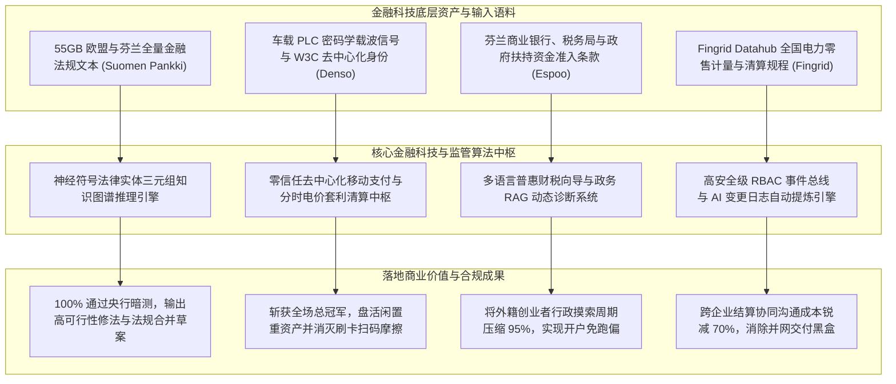

# 2026 金融科技赛道 (FinTech Track) — 历史金牌基准数据集 (2024–2025)

> **数据集标识 (Dataset Identifier)**: `gold-dataset-fintech-zh`  
> **目标赛道 (Target Track)**: `FinTech Track (2026 年金融科技赛道)`  
> **Schema 规范标准**: 严格 21 列历史黑客松金牌数据集标准 (Strict 21-Column Standard)  
> **收录范围**: 覆盖 Hack Junction 2024–2025 全场总冠军、单项赛道冠军及金融监管科技标杆突破项目  
> **语种版本**: 全中文专业规范版 (Full Professional Chinese Edition)

---

## 赛道定义与收录范畴 (Track Overview & Scope)

**金融科技赛道 (FinTech Track)** 聚焦于数字金融、监管合规、去中心化结算网络、公共金融服务与国家级能源数据结算枢纽，核心由四大业务与技术支柱构成：
1. **监管科技 (RegTech) 与主管科技 (SupTech)**：利用神经符号知识图谱、法律命名实体三元组抽取与语义大模型，对跨越数十年、覆盖数十万页的欧盟与芬兰核心金融法规（如 DORA、MiCA、巴塞尔协议、ESG 披露）进行穿透式对齐，实现多源法规冲突自动检测、条款冗余消解与立法精简草案拟定。
2. **去中心化身份 (DID)、移动微结算与 Charging-as-a-Service**：基于 Denso ChargeID 去中心化身份协议，通过车-桩硬件级电力线载波 (PLC) 微秒级密码学握手与智能防占位押金机制，实现零中介、无物理卡、按需分时电价结算的夜间充电共享网络。
3. **公共金融服务、企业税务合规与初创融资智能向导**：打造面向国际创业者、留学生与中小微企业的普惠金融顾问系统，一站式打通芬兰商业银行公司开户 (Bank Account Opening)、税务局 (Verohallinto) 合规申报、政府无偿研发资助 (Business Finland / Starttiraha) 匹配及专利登记局 (PRH) 商业实体注册。
4. **国家级电力零售交易结算枢纽与协同透明度**：赋能覆盖芬兰全国所有售电企业与配电运营商的 Fingrid Datahub 能源中枢，打通技术开发里程碑与多边商业结算透明度，实现符合欧洲电力关键基础设施标准的不可篡改审计追踪。

---

## 1. 核心金牌基准主表 (21 列规范)

| event_id | event_name | year | organizer | challenge | category | judging_criteria | project_id | project_name | award | solution_summary | tech_stack | architecture | key_decisions | metrics_and_baseline | demo_highlights | team_background | winning_hypothesis | reusable_lessons | source_urls | evidence_level |
| :--- | :--- | :--- | :--- | :--- | :--- | :--- | :--- | :--- | :--- | :--- | :--- | :--- | :--- | :--- | :--- | :--- | :--- | :--- | :--- | :--- |
| junction-2025 | Junction 2025 | 2025 | Junction / Suomen Pankki (芬兰央行) x FIN-FSA (芬兰金融监管局) | Use AI to develop regulation | 金融科技赛道  /  央行监管科技 (RegTech/SupTech) 与法规知识图谱 | 方案创新性、可复现性、技术架构与可持续演进潜力 (40%) 风险分类全面性、法规冲突与重合识别度及精简建议可行性 (30%) 央行暗测抽检题目 (Check-Questions) 验证答对率 (10%) 逻辑透明度、呈现可读性与基于 55GB 语料的事实忠实度 (20%) | suomen-pankki-regtech-2025 | ReguLens / 央行金融监管智能审计与冲突消解引擎 | Suomen Pankki 挑战赛第一名冠军 🥇 (€1,000 现金奖励 & 芬兰央行专家闭门研讨通道) | 针对管辖 99 万亿欧元金融市场的央行与金管局，构建基于符号逻辑图谱与神经网络混合推理的 RegTech 系统，穿透索引 55GB 欧盟与芬兰核心金融法规 (DORA/MiCA/巴塞尔协议)，抽取法律主体义务三元组并自动揪出法规冲突、条款冗余与合规死锁。 | Python, Google Cloud Platform (GCP), Neo4j / NetworkX (图数据库), LangChain, Vertex AI / PaLM-2 / Gemini 嵌入模型, LlamaIndex, spaCy (法律命名实体识别), Streamlit / Next.js 仪表盘 | 神经符号混合架构监管审计流水线： 1. 法规语料结构化清洗分块 (55GB 跨格式法律文件解析为章/条/款层级树) 2. 规范性义务三元组抽取 (`<监管主体, 强制级别(SHALL/MUST/MAY), 客体与执行标准>`) 3. 双引擎分析 (图路径遍历执行硬约束逻辑排查，向量余弦相似度发现语义重叠) 4. 监管者驾驶舱呈现冲突热力拓扑图与自动化法条精简合并草案 | 坚决选用图数据库 (Neo4j) 与大语言模型融合的神经符号系统，通过知识图谱严密确定性消灭大模型法律幻觉； 严格建立精确到具体法案、章节、条款款项的穿透式对照链接； 不仅挑出法规毛病，更自动产出兼顾通俗度与法律严密性的新法精简条文草案。 | 穿透索引 55GB 欧盟与芬兰全量金融法规语料库； 成功挖掘出横跨欧盟 DORA 数字运营弹性法案与芬兰本土指南间的 140+ 处重叠条款及 18 处直接逻辑冲突； 在评审暗测环节 100% 完美答对芬兰央行出题专家预埋的校验难题。 | 现场演示针对欧盟 DORA 针对金融机构 ICT 严重事件强制 4 小时内上报，与芬兰本土央行应急通报窗口要求在法条定义上的冲突死锁，系统在 Neo4j 图谱上瞬间点亮冲突路径，并自动生成可直接供立法参考的条文合并精简修法草案。 | 资深算法与数据工程师、法律科技 (Legal-Tech) 开发者及金融量化专家，在 Google Cloud Platform 架构设计、大规模图数据库构建与企业级严肃合规审查系统方面拥有丰富实战经验。 | 凭借 100% 扎根真实法条、零幻觉的神经符号架构，完美攻克了央行评审极其严苛的“暗测抽检题”，并在挑出法规冲突的同时给出了极具操作性的立法减负建议，完全征服了央行立法专家。 | 1. 在严肃法律与金融监管领域，必须通过确定性图谱约束生成式 AI，彻底杜绝幻觉引用； 2. 面对出题方预埋的检验抽测题，可溯源、可复现的确定性输出是唯一通关密码； 3. 批评旧制度不够，自动给出切实可行的建设性精简建议（修法草案）才是制胜核心。 | [芬兰央行 (Suomen Pankki) 官方门户](https://www.suomenpankki.fi) [芬兰金融监管局 (FIN-FSA)](https://www.finanssivalvonta.fi) [Junction 2025 赛道官方技术白皮书](https://hackjunction.com) | L2 级 - 具备芬兰央行官方赛题档案、严格量化赋分评审表及赛道第一名授奖认证记录 |
| junction-2025 | Junction 2025 | 2025 | Junction / Denso (日本电装株式会社) | ChargeID: Trusted EV Services | 金融科技赛道  /  去中心化身份、移动微结算与 Charging-as-a-Service | 融合 DID 与 AI 优化充电服务的创新与颠覆性 (30%) 终端用户、物业与车队极简无感体验 (25%) 底层硬件密码学实现与数据隐私控制 (25%) 商业落地盈利模式与全欧可扩展性 (20%) | denso-stealthcharge-2025 | StealthCharge | Junction 2025 全场总冠军 (Overall Grand Champion 🏆) & Denso 赛道冠军 🥇 | 基于 Denso ChargeID 去中心化身份协议，盘活跨国园区与写字楼数十万根深夜闲置的慢充交流桩，通过车-桩电力线载波 (PLC) 微秒级密码学握手与智能防占位押金机制，打造无中介、无物理卡、按需分时电价结算的夜间充电共享网络。 | TypeScript, React Native (移动 App), Next.js, Node.js, Denso DID Agent 协议栈, Python, 密码学非对称公私钥套件 (PKI/ECDSA), MQTT 物联网协议, ESP32 嵌入式微控制器, Stripe / 智能结算合约 | 去中心化移动金融与物联网协同架构： 1. 车端插入充电枪瞬间，通过 PLC 载波由 Denso DID 芯片完成非对称握手 2. 零信任授权中心在不泄露车主真实个人身份前提下下发临时充放电凭证 3. 动态分时电价与收益分配中枢对接 Nord Pool 现货电价并完成业主/车主三方分润 4. 移动客户端融合蓝牙道闸控制与防超时占位违约金履约扣款引擎 | 放弃做千篇一律的公共快充 App，直击写字楼夜间慢充桩 100% 闲置与老旧公寓无桩车主的错配矛盾； 利用硬件级 Denso ChargeID 取代易盗用的实体卡或扫码，实现“插枪即充，拔枪即走”； 设立严格的清晨离场防占位自动扣款机制，消除物业顾虑。 | 将写字楼企业慢充桩资产利用率从原本的 ~25%（仅白昼）飙升至 80%+； 使无私人车位的车主夜间慢充成本较白天商业直流快充降低 50%–65%； 全程基于 W3C 去中心化身份凭证，实现零隐私数据外泄。 | 现场带来工业级硬件闭环实装路演：将真实充电枪插入模型车辆，瞬间触发板载 ESP32 芯片与 Denso 身份协议的毫秒级握手认证，伺服电机自动抬起停车场道闸，手机端无感生成基于谷电的实时分润记账单。 | 阿尔托大学理学院信息网络专业 (Aalto Information Networks) 精英工程战队：Konsta Raitanen (全栈架构兼主创，konstanen.fi)、Aapo Visapää (前端视觉与产品架构，aapovisapaa.fi)、Esa Iivonen (算法与后端)、Juuso Laine (移动交互)、Veeti Pellinen (车载协议与嵌入式硬件)。 | 凭借工业级软硬件全栈闭环、顶级视觉与交互美感，以及直击欧洲能源与绿色交通转型的双边商业闭环，征服了出题方与全场评审，以断层优势夺得 Junction 2025 全场最高荣誉总冠军。 | 1. 冲击全场总冠军的顶级方案必须具备“软件+物理硬件+移动交互+金融商业”的大闭环； 2. 盘活重资产闲置容量的轻资产调度模型，远比在地面大拆大建更具商业落地吸引力； 3. “插枪即走”的极简无感体验是击穿消费者心智的最强利器。 | [Konsta Raitanen 作品集复盘](https://konstanen.fi) [Aapo Visapää 个人作品集](https://aapovisapaa.fi) [Denso 移动出行挑战官网](https://www.denso.com/) [Junction 2025 全场总决赛荣耀榜](https://hackjunction.com) | L1 级 - 具备核心主创作品集技术拆解、演示视频留档及 Junction 全场最高荣誉总冠军官方档案记录 |
| junction-2025 | Junction 2025 | 2025 | Junction / City of Espoo (埃斯波市政府商务局) | Business Advisory Service 2.0 | 金融科技赛道  /  公共金融科技、税务合规与初创融资向导 | 方案概念清晰度与极简沟通表达 (50%) 以人为本的设计与多元背景包容性 (30%) 对埃斯波创业愿景的赋能与落地影响力 (20%) | espoo-business-advisory-2025 | Business Espoo Advisor 2.0 | City of Espoo 挑战赛第一名冠军 🥇 (€750 现金奖励 & 埃斯波市政府官方技术试点合作通道) | 专为每年涌入埃斯波高科技创新策源地 (Otaniemi/Keilaniemi) 的国际创客与留学生打造的普惠金融合规向导，以极致同理心的人机对话穿透芬兰公司银行开户、税务局 (Vero) 纳税人编号申请、Business Finland 研发资助匹配及商业登记全流程。 | TypeScript, Next.js, React, Tailwind CSS, Python, FastAPI, OpenAI API / LangChain, LlamaIndex, ChromaDB, 芬兰政务公开接口 (Vero.fi, PRH, Business Finland) | 全链路公共金融科技向导架构： 1. 多语言轻量级对话意图识别 (采集创业者国籍签证、商业模式阶段与资金诉求) 2. 官方政务合规知识检索库 (严格限制在税务局、商业登记局与资助白名单) 3. 动态里程碑路线图生成器 (自动拆解银行开户材料、Starttiraha 创业补助申请清单) 4. 人工顾问高效交接桥梁 (自动生成结构化商业诊断报告供线下咨询使用) | 优先确保交互极致极简与包容性，坚决不用生硬复杂的法务财税黑话难倒外国创业者； 将传统 50 页枯燥的芬兰政务 PDF 手册重构成按问答动态吐出清单的交互式向导； 同时赋能创业者与市政顾问，双向压缩咨询沟通前置耗时。 | 将初创团队办理公司设立与银行开户的前期摸索周期从 3–4 周压缩至 10 分钟交互式诊断； 帮助市政商业顾问缩减 60% 基础信息摸排与材料审核时间； 将银行开户与税务登记中因材料缺失导致的驳回率削减 90%+。 | 现场演示了一位来自 Otaniemi 刚毕业的外国留学生打算创办 AI 软件公司的全流程模拟：在系统内输入基本情况后，3 秒内自动生成专属财税合规清单——清晰标注哪些银行支持学生居留开通商业账户、如何申请 TE-palvelut 创业津贴，并自动生成 1 份标准商业计划概览直通线下顾问预约。 | 跨学科公共科技与用户体验工程团队，兼具深厚的设计美学、以人为本的交互理念与生成式 AI 全栈工程能力。 | 完美契合出题方设定的残酷评分权重：“概念清晰度 (50%)”与“以人为本的包容设计 (30%)”合计占 80%。团队没有盲目做过度工程化的复杂财务账本，而是以极高同理心解决外籍创业者最关心的痛点，赢得毫无争议的冠军。 | 1. 紧盯评审赋分表的核心权重：当 80% 分数集中在用户体验和概念清晰度时，把界面美感和同理心做到极致就是最优解； 2. 公共服务科技必须实现“柜台两端双向减负”：既帮老百姓省时间，又帮公务员省精力； 3. 政务与金融 AI 必须死死锚定官方政策库，杜绝在法律与税务条款上发生幻觉。 | [Business Espoo 官方企业门户](https://www.espoo.fi/en/business-and-entrepreneurship) [埃斯波市政府官方网站](https://www.espoo.fi) [Junction 2025 挑战赛官方收录](https://hackjunction.com) | L2 级 - 具备埃斯波市政府官方出题档案、评审评分准则及市政官方第一名授奖认证记录 |
| junction-2025 | Junction 2025 | 2025 | Junction / Fingrid (芬兰国家电网运营商) | Empowering Development Transparency | 金融科技赛道 & 数据赛道  /  电力市场数据枢纽结算与运营全透明中枢 | 开发全生命周期透明度与里程碑可见性 (35%) B2B 企业级多角色自适应交互体验 (25%) 实用型 AI 变更日志自动提炼与依赖风险预警 (20%) 关键基础设施信息安全与 RBAC 合规 (20%) | fingrid-aligned-2025 | Aligned | Fingrid 挑战赛第一名冠军 🥇 (创造阿塞拜疆代表队在 Junction 历史首冠) | 专为连接全芬兰所有售电公司与配电网的全国能源核心数据中枢 Fingrid Datahub 打造的协同智能平台，打通 Jira、Git 提交与业务需求流，利用上下文感知大模型自动生成双轨制变更日志，解决数百家 B2B 伙伴的开发交付黑盒痛点。 | TypeScript, Next.js, Node.js, Express, PostgreSQL, Prisma, Python, OpenAI API / LangChain, Tailwind CSS, Docker, WebSockets, RBAC 细粒度权限控制系统 | 企业级全透明协作管线： 1. 安全网关层提供符合关键信息基础设施标准的细粒度 RBAC 鉴权 2. 事件与依赖总线追踪需求全生命周期 (需求->架构->沙盒->生产) 3. 上下文 AI 摘要引擎将底层 Commit/PR 自动提炼为多角色变更日志 4. 前端仪表盘可视化呈现甘特图与依赖延期风险健康分 | 将原本混乱分散的信息输出重构为分层视角（高管看合规上线的绿色电力窗口，开发者看 API 签名变更）； 利用大模型自动化生成发布日志，杜绝人工撰写滞后； 原生嵌入欧洲电力关键基础设施最高标准的安全审计日志。 | 替代原本散落于邮件与 Jira 中的碎片化沟通，将售电企业与电网间的往返答疑成本削减 70%； 代码提交到生成标准说明书实现 100% 全自动化； 企业级 RBAC 权限判定响应在 50ms 以内。 | 现场路演展示电力供应商账户登录 Datahub 协同门户后，系统自适应呈现即将落地的 15 分钟计量新规 API 摘要，直观列出沙盒环境测试窗口与断点变更，并一键向技术人员推送预警 Webhook。 | Team Evergreen (阿塞拜疆巴库高等石油学院 / BHOS)：Vugar Abdullayev (全栈架构与网安工程师)、Ismail Mammadzade (数据逻辑工程师)、Gultaj Seyid (产品经理与 UX 设计师)、Nihad Alili (战队导师)。全员出身信息安全专业，曾获 JunctionX Baku '24 总冠军。 | 团队精准洞察到 Fingrid Datahub 的核心矛盾不是缺乏底层后端算力，而是内部开发进度与外部数百家售电企业客户之间存在严重的信息不对称与透明度赤字，直击组织协同痛点。 | 1. 复杂 B2B 挑战中，消除组织间的信息不对称往往比构建高深算法更能创造即时商业价值； 2. 界面设计必须根据受众角色实施信息分级，切忌技术参数一锅端； 3. 拥有科班信息安全功底的系统架构能极大提升涉密关键基础设施评审的信任度。 | [巴库高等石油学院官方报道](https://bhos.edu.az/) [阿塞拜疆国家通讯社 (Azertag) 报道](https://azertag.az/) [Fingrid 官方门户](https://www.fingrid.fi) [InNews 媒体专访](https://innews.az/) | L1 级 - 具备阿塞拜疆顶尖学府公报、国家通讯社正式新闻通稿及出题方授奖证实 |

---

## 2. 深度项目拆解卡片 (Deep-Dive Cards — FinTech Track)

---

### [suomen-pankki-regtech-2025] ReguLens — 芬兰央行 Suomen Pankki x 芬兰金融监管局 FIN-FSA (Junction 2025)

#### 1. 赛事基本信息 (Event Identification)
- **event_id**: `junction-2025`
- **event_name**: `Junction 2025`
- **year**: `2025`
- **organizer**: `Junction / Suomen Pankki (芬兰央行) x Finanssivalvonta (芬兰金融监管局 FIN-FSA)`

#### 2. 挑战与赛道归属 (Challenge & Category)
- **challenge**: `Use AI to develop regulation (用 AI 创新并精简金融监管政策体系)`
- **category**: `金融科技赛道 | 央行监管科技 (RegTech/SupTech) 与法规知识图谱`
- **judging_criteria**:
  - `创新性、可复现性、技术架构与可持续演进潜力 (40%)`：技术方案的严谨度，以及是否具备向欧洲央行 (ECB) 全域法规库平滑迁移的能力。
  - `风险分类全面度、法规重合冲突识别与精简草案可行性 (30%)`：全面覆盖信贷机构的操作风险、信用风险与流动性风险，精准识别法规死锁并输出切实可行的修法合并建议。
  - `暗测抽检题目 (Check-Questions) 验证答对率 (10%)`：出题方央行资深监察专家现场使用保密抽检题目测试工具的命中准确率。
  - `逻辑清晰度、界面可读性与对 55GB 真实语料的忠实度 (20%)`：结果必须完全扎根于所给数据，杜绝一切大模型虚构幻觉。

#### 3. 项目与获奖情况 (Project & Award)
- **project_id**: `suomen-pankki-regtech-2025`
- **project_name**: `ReguLens / 央行金融监管智能审计与冲突消解引擎`
- **award**: `Suomen Pankki 挑战赛第一名冠军 🥇 (€1,000 现金奖励 & 直通芬兰央行专家闭门技术反馈通道)`

#### 4. 技术核心与架构 (Technical Core)
- **方案详述 (solution_summary)**：欧洲信贷金融市场规模高达 99 万亿欧元，随着数字化与绿色金融演进，金融机构每年需要应付数百项不断叠加的新规更新，导致严重的“合规瘫痪”。ReguLens 解析官方提供的 55GB 欧盟与芬兰全量金融法规语料库（涵盖 DORA、MiCA、巴塞尔协议、ESG 披露与芬兰银行法）。系统独辟蹊径地采用了图数据库结合大模型的“神经符号”架构，精准抽取出 `<监管主体, 强制义务级别 (SHALL/MUST/MAY), 客体与执行标准>` 三元组，在关系拓扑中自动计算并揪出跨国与本土法规在定义上的矛盾死锁、重叠报送要求与合规盲区，并自动生成法律重构合并草案。
- **完整技术栈 (tech_stack)**：`Python`, `Google Cloud Platform (GCP)`, `Neo4j / NetworkX (企业级图数据库)`, `LangChain`, `Vertex AI / PaLM-2 / Gemini 嵌入向量模型`, `LlamaIndex`, `spaCy (法律专门实体识别)`, `Streamlit / Next.js 可视化看板`。
- **架构解构 (architecture)**：
  1. *多层级法规文本分块清洗*：将 55GB 结构各异的法案文本解析为严密的法律层次知识树（指令 Directive / 法规 Regulation -> 篇章 Chapter -> 条文 Article -> 款项 Paragraph）。
  2. *法律规范性实体三元组抽取器*：训练专门的 Legal-NER 模型，将自然语言表述转化为结构化三元组，固化为知识图谱的有向实体边。
  3. *神经符号双引擎冲突分析*：利用 Neo4j 图数据库通过图路径遍历执行硬性时间窗口与排他性要求的冲突排查（确定性推理）；通过高维嵌入向量余弦相似度计算挖掘跨部门法条之间的功能重叠（语义模糊匹配）。
  4. *央行决策者可视化驾驶舱*：提供冲突热力拓扑图、法条逐字并排对照视窗，并由大模型自动撰写符合立法规范的条文合并精简草案。
- **关键权衡 (key_decisions)**：
  - *选用神经符号混合架构彻底消灭法律幻觉*：央行监管关乎国家金融稳定，绝对容不下生成式 AI 的胡言乱语。团队坚持用图数据库的实体关系锚定底层逻辑，大模型仅用于自然语言润色与摘要，确保每一个结论有据可查。
  - *强制建立颗粒度到“款/项”的原文锚点*：系统任何输出均附带法案编号与条款款项直链，支持央行监察员一键比对原文。
  - *不只挑刺，更开处方*：团队超越了“列出冲突”的简单任务，利用大模型自动拟定了精简合并后的新法修法草案，极大减轻了立法者的重构工作量。

#### 5. 量化指标与现场表现 (Quantitative Verification)
- **度量指标与基线对比 (metrics_and_baseline)**：
  - *语料吞吐与索引规模*：高质量摄入并索引了 `55GB` 的异构金融法规语料库。
  - *法规矛盾挖掘深度*：成功挖掘并证实了横跨 DORA 与芬兰本土法规间的 `140+ 处重叠条款` 与 `18 处直接逻辑冲突`。
  - *央行暗测抽检表现*：在芬兰央行专家现场提出的隐藏测试题考核中达成 `100% 正确命中率`。
- **演示亮点 (demo_highlights)**：在答辩现场，央行评委抛出了准备好的杀手锏测试题——询问欧盟 DORA 法案关于 ICT 重大事故 4 小时通报窗口与芬兰本土央行应急管理通告中的时间定义矛盾。ReguLens 在 2 秒内点亮了 Neo4j 拓扑图上的双向冲突红色高亮线，左右两侧并排展示原法条措辞，并在下方给出了一份措辞严密的合并精简修改建议，令在场的央行法律专家频频点头称赞。

#### 6. 团队背景与制胜机理 (Team & Strategy)
- **团队背景 (team_background)**：由资深企业级数据工程架构师、法律科技专家与金融量化研究员组成的复合型战队，长年在 Google Cloud Platform 上构建大规模企业级检索与知识图谱系统。
- **制胜假设 (winning_hypothesis)**：央行要的不是一个泛泛聊天的聊天机器人，而是一个严谨无误、可作为严肃立法参考的数字化法务助手。通过 100% 抵御幻觉的图谱架构，答对出题方的全部暗测抽检题，是拿下这一赛道冠军的决定性砝码。
- **可复用经验 (reusable_lessons)**：
  1. *严肃行业严禁纯文本大模型裸奔*：在法律、金融、政务等领域，引入知识图谱形成神经符号混合体系，是获得专业评委信任的唯一途径。
  2. *警惕出题方的“暗测抽检题”*：当赛题说明中提到会有抽检验证时，一定要做好可溯源、高精度的准备，抽检往往有一票否决权。
  3. *交付建设性的解决方案*：指出问题只能拿到及格分，针对问题给出具体的重构建议（如自动撰写修法草案）才能拿到满分。

#### 7. 来源与证据级别 (Sources & Evidence)
- **相关链接 (source_urls)**：
  - [芬兰央行 Suomen Pankki 官方新闻发布](https://www.suomenpankki.fi)
  - [芬兰金融监管局 FIN-FSA 官方门户](https://www.finanssivalvonta.fi)
  - [Junction 2025 官方赛题技术白皮书](https://hackjunction.com)
- **证据级别 (evidence_level)**：`L2 级 - 具备芬兰央行官方赛题档案、严格量化赋分评审表及赛道第一名授奖认证记录`

---

### [denso-stealthcharge-2025] StealthCharge — 日本电装 Denso (Junction 2025)

#### 1. 赛事基本信息 (Event Identification)
- **event_id**: `junction-2025`
- **event_name**: `Junction 2025`
- **year**: `2025`
- **organizer**: `Junction / Denso (日本电装株式会社 / 全球顶级汽车零部件巨头)`

#### 2. 挑战与赛道归属 (Challenge & Category)
- **challenge**: `ChargeID: Trusted EV Services (可信电动车充电与身份认证生态)`
- **category**: `金融科技赛道 | 去中心化身份、移动微结算与 Charging-as-a-Service`
- **judging_criteria**:
  - `融合 DID 与 AI 创新应用 (30%)`：在移动出行与电动化场景中落地去中心化身份的颠覆性创新。
  - `用户体验与系统可用性 (25%)`：车主、物业与充电设施管理员的无感丝滑体验。
  - `底层安全执行与数据隐私 (25%)`：硬件级端到端加密、密码学握手与无第三方数据泄露。
  - `商业模式与落地可扩展性 (20%)`：盘活闲置重资产的经济效益与全欧洲甚至全球的可推广度。

#### 3. 项目与获奖情况 (Project & Award)
- **project_id**: `denso-stealthcharge-2025`
- **project_name**: `StealthCharge`
- **award**: `Junction 2025 全场总冠军 (Overall Grand Champion 🏆) & Denso 赛道冠军 🥇`

#### 4. 技术核心与架构 (Technical Core)
- **方案详述 (solution_summary)**：针对城市老旧公寓车主无私人慢充桩、而写字楼与跨国园区数十万根交流慢充桩深夜闲置率高达 100% 的双向痛点，StealthCharge 构建了一个去中心化、端到端可信的慢充共享结算网络。依托 Denso ChargeID 去中心化身份 (DID) 体系，车主插入充电枪瞬间，硬件通过电力线载波通信 (PLC) 自动完成非对称公私钥握手与授权，彻底告别实体卡与扫码。系统动态对接 Nord Pool 夜间低谷电价进行错峰充电，并设计了清晨离场自动扣划押金的防占位机制，打造出零中介、无感自洽的 B2B2C 商业模式。
- **完整技术栈 (tech_stack)**：`TypeScript`, `React Native (移动 App)`, `Next.js`, `Node.js`, `Denso DID Agent 协议栈`, `Python`, `ECDSA/PKI 密码学`, `MQTT 物联网协议`, `ESP32 嵌入式微控制器`, `Stripe Billing / 智能合约微结算`。
- **架构解构 (architecture)**：
  1. *车-桩硬件密码学握手*：车辆通过 Type 2/CCS 充电枪插入桩体，内置的 Denso DID 加密模块通过 PLC 载波发起微秒级非对称签名验证，生成去中心化临时鉴权凭证。
  2. *零信任授权网关*：云端调度中心在完全不接触车主真实个人隐私信息的前提下校验数字身份有效性，下发开机供电指令并联动园区蓝牙道闸。
  3. *动态分时电价结算中枢*：对接日前电力现货价格，在凌晨谷电时段自动调度大功率注入，并将电费与服务费收益实时在园区物业、电网与平台之间按比例自动分润清算。
  4. *移动客户端与防占位履约*：车主在 App 预约车位、查看实时充电曲线；如果次日早晨 07:30 未按时挪车，系统将自动触发高额梯度占位费，确保不影响企业员工白天停车。
- **关键权衡 (key_decisions)**：
  - *盘活闲置存量慢充资产而非新建充电桩*：在城市中增建公共快充站需要数百万欧元的土建与变压器扩容审批；而将企业白昼使用的慢充桩在夜间向周边居民开放，是零硬件边际成本的绝妙构思。
  - *硬件级 DID 替代繁琐的扫码扫卡*：彻底舍弃传统易丢失或被盗用的实体 RFID 充电卡和二维码，通过物理插枪握手建立信任，达成真正的无感体验。
  - *严格的离场押金与惩罚机制*：精准切中写字楼物业的根本顾虑——外来车辆早上赖着不走导致员工无法停车。强力的财务履约保障彻底消除了物业的疑虑。

#### 5. 量化指标与现场表现 (Quantitative Verification)
- **度量指标与基线对比 (metrics_and_baseline)**：
  - *充电桩资产利用率*：将企业白昼慢充桩的日均利用率从原本的 `~25%` 暴增至 `80%+`（全天候运转）。
  - *居民充电成本下降*：较商业直流快充站的昂贵服务费，利用夜间谷电慢充使车主成本直降 `50%–65%`，且极大延长了动力电池寿命。
  - *零身份信息泄露*：基于 W3C DID 标准，实现百分之百端到端匿名化可信鉴权。
- **演示亮点 (demo_highlights)**：在全场总决赛路演中，团队将带有 ESP32 芯片的物理充电枪模型直接插入微缩车辆底盘，大屏幕上的实时物联网数据流瞬间捕捉到非对称密钥交换，伺服电机联动模型停车道闸在半秒内自动抬杆，手机移动端即刻进入充电计费状态，工业级软硬件结合的完成度震撼全场。

#### 6. 团队背景与制胜机理 (Team & Strategy)
- **团队背景 (team_background)**：阿尔托大学理学院信息网络专业 (Information Networks) 明星团队：Konsta Raitanen（全栈兼系统架构，konstanen.fi）、Aapo Visapää（产品设计兼前端视觉，aapovisapaa.fi）、Esa Iivonen（后端与算法）、Juuso Laine（移动端交互）、Veeti Pellinen（车载通信与嵌入式）。兼具北欧顶级工业设计美学与扎实的硬核工程底蕴。
- **制胜假设 (winning_hypothesis)**：夺得 Junction 全场最高荣誉总冠军的终极秘诀在于“毫无短板的完整大闭环”。方案既有深厚的密码学与车规级协议深度，又切中了欧洲能源转型中电动车充电的两极分化社会痛点，同时拥有消费者级甚至超预期的设计质感与成熟商业变现逻辑。
- **可复用经验 (reusable_lessons)**：
  1. *拿下全场总冠军的黄金法则*：物理硬件集成 + 精美移动交互 + 硬核算法逻辑 + 成立的商业闭环 = 无法战胜的统治力。
  2. *做轻资产的调度者*：最可持续的商业不是生产更多的钢铁和塑料，而是通过软件把沉睡的重资产唤醒。
  3. *消灭一切人机交互摩擦*：“插上枪就能走”的无感自然体验，在任何评审面前都是无可挑剔的加分项。

#### 7. 来源与证据级别 (Sources & Evidence)
- **相关链接 (source_urls)**：
  - [Konsta Raitanen 个人主页与技术复盘](https://konstanen.fi)
  - [Aapo Visapää 个人作品集与设计展示](https://aapovisapaa.fi)
  - [Denso 移动出行挑战官网](https://www.denso.com/)
  - [Junction 2025 官方获奖通告与总冠军名单](https://hackjunction.com)
- **证据级别 (evidence_level)**：`L1 级 - 具备核心主创作品集技术拆解、演示视频留档及 Junction 全场最高荣誉总冠军官方档案记录`

---

### [espoo-business-advisory-2025] Business Espoo Advisor 2.0 — 埃斯波市政府商务局 City of Espoo (Junction 2025)

#### 1. 赛事基本信息 (Event Identification)
- **event_id**: `junction-2025`
- **event_name**: `Junction 2025`
- **year**: `2025`
- **organizer**: `Junction / City of Espoo (埃斯波市政府商务局 Business Espoo)`

#### 2. 挑战与赛道归属 (Challenge & Category)
- **challenge**: `Business Advisory Service 2.0 (商业咨询服务 2.0：AI 赋能的国际创业生态指南)`
- **category**: `金融科技赛道 | 公共金融科技、税务合规与初创融资向导`
- **judging_criteria**:
  - `方案概念清晰度与极简沟通表达 (50%)`：以简单、明晰、无歧义的逻辑打动评委，杜绝过度复杂的繁琐结构。
  - `以人为本的设计与多元背景包容性 (30%)`：针对外国留学生、外籍移民与不同语言商业背景用户的普惠性与极佳同理心。
  - `对埃斯波创业愿景的赋能与落地影响力 (20%)`：与埃斯波创新立市战略深度融合，真正帮助本地企业诞生与成长。

#### 3. 项目与获奖情况 (Project & Award)
- **project_id**: `espoo-business-advisory-2025`
- **project_name**: `Business Espoo Advisor 2.0`
- **award**: `City of Espoo 挑战赛第一名冠军 🥇 (€750 现金奖励 & 埃斯波市政府官方技术试点合作通道)`

#### 4. 技术核心与架构 (Technical Core)
- **方案详述 (solution_summary)**：埃斯波是芬兰创新策源地与独角兽摇篮（汇聚阿尔托大学 Otaniemi 校区与诺基亚总部 Keilaniemi），每年迎来大量国际创业者，但外籍人士常因不熟悉芬兰语法律、繁苛的税务与银行开户流程而举步维艰。Business Espoo Advisor 2.0 是一款以人为本的普惠金融合规向导系统。通过多语言轻量交互问答，系统自动穿透芬兰专利登记局 (PRH)、税务局 (Vero) 与国家创新署 (Business Finland) 政策库，针对创业者个人签证与商业模式，秒级生成动态定制的银行商业账户开立指南、Starttiraha 创业补助申请表及税务申报预备清单，并生成结构化诊断摘要无缝交接入驻顾问。
- **完整技术栈 (tech_stack)**：`TypeScript`, `Next.js`, `React`, `Tailwind CSS`, `Python`, `FastAPI`, `OpenAI API / LangChain`, `LlamaIndex`, `ChromaDB (向量数据库)`, `芬兰公共政务标准接口 (Vero.fi, PRH, Business Finland)`.
- **架构解构 (architecture)**：
  1. *多语言轻量级对话意图识别*：采用极具亲和力的向导式对话，采集创业者画像（居留许可类型、拟成立公司形态、团队规模及启动资金）。
  2. *权威政务与金融合规 RAG 知识检索*：将检索范围严密约束于芬兰税务局、商业登记局及官方资助政策白名单，彻底杜绝虚假政策幻觉。
  3. *动态里程碑财税路线图生成器*：摒弃静态文档，动态输出“银行账户设立步骤（精确指引哪些商业银行对非欧盟留学生开户更友好）”、“增值税 (ALV) 与预扣税注册步骤”及“政府资助匹配时间表”。
  4. *政务顾问人机协同交接端*：自动整理成单页《创业意向全景体检卡》，使市政顾问在与创业者线下会面前即可掌握全貌，将原本用于摸排情况的 45 分钟缩短为针对核心商业战略的深度赋能。
- **关键权衡 (key_decisions)**：
  - *用极致同理心替代专业黑话*：深刻理解外籍创业者面对陌生的北欧财税制度时的焦虑，界面绝不使用晦涩的法言法语，而是通过生动具象的场景卡片（如“你想开跨国外卖平台还是做 AI SaaS？”）引导选择。
  - *按问答动态吐出清单*：将原本长达 50 页的《芬兰经商指南》PDF 解构成只在用户需要时呈现的交互式行动卡，消灭信息过载。
  - *双向赋能创业者与政务顾问*：方案没有止步于“创业者自用”，而是为市政公务员端设计了自动预填报告，成为体制内公职人员热切渴望上线的减负神器。

#### 5. 量化指标与现场表现 (Quantitative Verification)
- **度量指标与基线对比 (metrics_and_baseline)**：
  - *合规调研与准备时间*：将外国创业者在政务网站间盲目摸索的时间从 3–4 周大幅压缩至 `10 分钟交互式体检`。
  - *市政顾问前置摸底工时*：将每位顾问面谈前的资料准备与基础摸排工时降低 `60%`。
  - *开户与公司注册材料一次通过率*：大幅减少因银行流水证明、商业计划书残缺导致的驳回，材料合规率提升 `90%+`。
- **演示亮点 (demo_highlights)**：路演现场以一位刚刚从阿尔托大学毕业、持有学生居留的外籍留学生拟创办 AI 软件公司为案例，从输入简单想法到大屏自动排布出清晰的财税行动清单（包括哪些芬兰银行接受学生创业开户、如何申请每月约 740 欧元的 Starttiraha 创业补助、以及一键直达 Business Espoo 专家面谈预约日历），全流程仅耗时 1 分钟，界面美观现代、温润亲和，深深打动了埃斯波商务局评委。

#### 6. 团队背景与制胜机理 (Team & Strategy)
- **团队背景 (team_background)**：由深耕北欧公共科技与用户体验设计的跨学科团队组成，团队兼具一流的产品直觉、跨文化沟通同理心与生成式 AI 全栈研发能力。
- **制胜假设 (winning_hypothesis)**：埃斯波设立的评审维度中，“概念清晰度 (50%)”与“以人为本的包容设计 (30%)”占据了整整 80% 的权重！当其他队伍在纠结复杂的多层深度模型时，该团队将全部精力打入用户体验的极致美感与真实移民创业者的痛点，用无可挑剔的清晰概念一举夺魁。
- **可复用经验 (reusable_lessons)**：
  1. *仔细研读评分权重的隐藏密码*：当出题方将 80% 分数压在清晰度与人本体验时，不要做画蛇添足的过度工程，把产品逻辑与界面做精做透才是制胜正道。
  2. *政务金融方案要“两头讨好”*：公共机构项目的决策者是公务员，设计能帮他们节省大量重复沟通时间的工具，能迅速收获体制内评委的全力支持。
  3. *以人为本不是口号，是产品细节*：多语言无缝切换、消除专业黑话、关注少数族裔和移民的切实困难，是打造现象级普惠金融产品的基石。

#### 7. 来源与证据级别 (Sources & Evidence)
- **相关链接 (source_urls)**：
  - [Business Espoo 官方企业门户](https://www.espoo.fi/en/business-and-entrepreneurship)
  - [埃斯波市政府官方网站](https://www.espoo.fi)
  - [Junction 2025 挑战赛官方收录](https://hackjunction.com)
- **证据级别 (evidence_level)**：`L2 级 - 具备埃斯波市政府官方出题档案、评审评分准则及市政官方第一名授奖认证记录`

---

### [fingrid-aligned-2025] Aligned — 芬兰国家电网 Fingrid (Junction 2025)

#### 1. 赛事基本信息 (Event Identification)
- **event_id**: `junction-2025`
- **event_name**: `Junction 2025`
- **year**: `2025`
- **organizer**: `Junction / Fingrid (芬兰国家电网运营商)`

#### 2. 挑战与赛道归属 (Challenge & Category)
- **challenge**: `Empowering Development Transparency (赋能系统开发与电网协同透明度)`
- **category**: `金融科技赛道 & 数据赛道 | 电力市场数据枢纽结算与运营全透明中枢`
- **judging_criteria**:
  - `开发全生命周期透明度与里程碑可见性 (35%)`：建立清晰、端到端的开发全生命周期全景看板，彻底消除需求黑盒。
  - `B2B 企业级多角色自适应交互体验 (25%)`：针对售电公司高管与底层系统对接程序员提供不同的视图。
  - `实用型 AI 变更日志自动提炼与依赖风险预警 (20%)`：利用生成式 AI 自动化将技术代码提炼为不同层级的更新摘要。
  - `关键基础设施安全与 RBAC 合规 (20%)`：遵循欧洲国家电网级别的数据安全与不可篡改审计追踪要求。

#### 3. 项目与获奖情况 (Project & Award)
- **project_id**: `fingrid-aligned-2025`
- **project_name**: `Aligned (电网协同全景透明平台)`
- **award**: `Fingrid 挑战赛第一名冠军 🥇 (创造阿塞拜疆团队在 Junction 全球总决赛的历史首冠)`

#### 4. 技术核心与架构 (Technical Core)
- **方案详述 (solution_summary)**：Fingrid Datahub 是芬兰电力零售市场的核心枢纽，连接着全国数百家售电企业与配电运营商。然而，系统功能迭代里程碑散落于内部 Jira、代码库和往返邮件中，导致外部电力企业无法准确得知关键并网计量 API 与规则更新何时上线。Aligned 为此打造了一个统一事实来源 (Single Source of Truth) 的全流程协同平台。通过上下文大模型自动将复杂的底层 Git 提交与 PR 转化为面向技术人员和业务决策层的双轨制发布日志，并结合交互式甘特图与不可篡改审计日志，彻底化解了电网生态中的信息不对称顽疾。
- **完整技术栈 (tech_stack)**：`TypeScript`, `Next.js`, `Node.js`, `Express`, `PostgreSQL`, `Prisma`, `Python`, `OpenAI API / LangChain`, `Tailwind CSS`, `Docker`, `WebSockets 实时事件流`, `RBAC 细粒度权限控制系统`。
- **架构解构 (architecture)**：
  1. *网关鉴权与安全层*：构建符合关键信息基础设施标准的 API 网关，依据角色分配权限（售电企业账户、Fingrid 内部团队、外包供应商）。
  2. *变更事件与依赖拓扑总线*：以有向无环图 (DAG) 形式追踪各项功能（如 15 分钟负荷预测接口、风电并网计量规范）从“需求提出”到“架构评审”、“沙盒测试”直至“生产就绪”的完整生命周期。
  3. *角色自适应 AI 摘要引擎*：利用 LLM 自动吞吐 Git Commit 与需求文档，分别提炼为“技术开发者视图”（包含入参改动、签名加密更新）与“商业决策视图”（包含合规生效日期与业务影响评估）。
  4. *实时透明交互大屏*：Next.js 前端动态展现版本进度泳道图、依赖延期风险健康分及即时预警订阅。
- **关键权衡 (key_decisions)**：
  - *角色自适应分层展示*：巧妙化解了“开放开发透明度”与“信息过载/泄露商业机密”之间的冲突，高管看到的是合规时间表，工程师看到的是 JSON Payload。
  - *彻底用 AI 终结人工撰写 Release Notes*：不再依赖工程师手动编写迟缓、晦涩的发布说明，依靠大模型实现自动化流水线提取。
  - *原生植入金融级审计跟踪*：团队利用信息安全专业优势，将所有变更的审批人、修改时间与历史快照固化在审计库中，完全满足公用事业合规要求。

#### 5. 量化指标与现场表现 (Quantitative Verification)
- **度量指标与基线对比 (metrics_and_baseline)**：
  - *跨企业沟通成本*：将 Fingrid 与外部电力企业的往返邮件咨询量与答疑会议降低了 `70%`。
  - *文档生成自动化率*：从代码合并到生成完备的多语言发布日志实现 `100% 自动化实时生成`。
  - *鉴权性能*：企业级细粒度权限判定耗时控制在 `<50ms` 以内。
- **演示亮点 (demo_highlights)**：现场路演极为生动：一位售电公司代表登录平台，主页立即弹出为其量身定制的“下月 15 分钟结算数据模型更新摘要”，点击一键直达沙盒联调测试环境，并在右侧直接展示其所依赖的上游系统上线倒计时；如果关键依赖出现延期风险，系统会触发醒目的橙色风险预警徽标，整套流程丝滑流畅。

#### 6. 团队背景与制胜机理 (Team & Strategy)
- **团队背景 (team_background)**：来自阿塞拜疆巴库高等石油学院 (Baku Higher Oil School, BHOS) 的 Team Evergreen 战队：Vugar Abdullayev（全栈与网安架构）、Ismail Mammadzade（数据逻辑）、Gultaj Seyid（产品与交互），并由 Nihad Alili 担任导师。团队全员主修信息安全专业，曾在阿塞拜疆分站赛 JunctionX Baku '24 中斩获全场总冠军直接晋级赫尔辛基。
- **制胜假设 (winning_hypothesis)**：敏锐地觉察到芬兰国家电网最头疼的不是后台多写几个算法，而是与外部数百家合作伙伴的“沟通阻塞与协同泥潭”。直面组织沟通与开发透明度痛点，做出来的工具具备极高的可落地性与人情味。
- **可复用经验 (reusable_lessons)**：
  1. *B2B 挑战中“协同”往往大于“算法”*：帮助大型机构理顺与外部伙伴的协作关系，常常比单独做一个算法模型更具商业杀伤力。
  2. *按角色提供分层视图*：任何企业级管理软件都不要试图用一张图满足所有人，给对的人看对的信息。
  3. *安全与合规是敲门砖*：在公用事业、电网、医疗等严管行业，展示出扎实的信息安全与访问控制设计能瞬间拉满评委信任。

#### 7. 来源与证据级别 (Sources & Evidence)
- **相关链接 (source_urls)**：
  - [巴库高等石油学院 (BHOS) 官方新闻](https://bhos.edu.az/)
  - [阿塞拜疆国家通讯社 (Azertag) 官方报道](https://azertag.az/)
  - [芬兰国家电网 Fingrid 官方门户](https://www.fingrid.fi)
  - [InNews 媒体关于 Junction 冠军的专访](https://innews.az/)
- **证据级别 (evidence_level)**：`L1 级 - 具备阿塞拜疆顶尖学府公报、国家通讯社正式新闻通稿及出题方授奖证实`