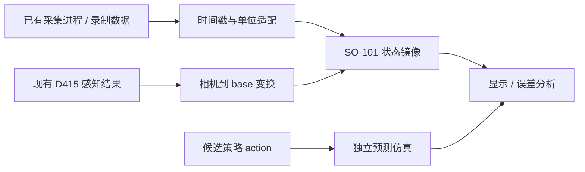

# SO-101 digital twin：实施研究与验证路线

研究日期：2026-11-14，Europe/Helsinki。本文是本项目的工程建议；未建立经实机校准的 twin，未操作相机或机械臂。比赛要求仍以 [Gold 英文分析](../2026/gold/en/intel_physical_ai_challenge.md)及其原始来源为准。

## 建议与适用范围

先用 **MuJoCo + 现成 SO-101 MJCF** 建立能回放、比较和测试的桌面场景；需要批量生成视觉示教时，再评估 **Isaac Sim / Isaac Lab + LeIsaac**。5090 留给策略训练和较重的渲染任务。应先完成真实分拣闭环，再扩大仿真范围。

按本项目验收目标，把建设过程分四级。这是本文的分阶段定义，并非引用某个统一标准：

| 阶段 | 可以解决什么 | 还不能证明什么 |
| --- | --- | --- |
| 几何模型 | FK、关节限位、桌面位置、可达范围、录制轨迹可视化 | 与实机坐标一致、真实抓取 |
| 状态镜像 | 真实关节状态/录制数据驱动虚拟模型，叠加相机检测 | 未来轨迹的动力学精度 |
| 经校准的预测 twin | 在留出轨迹上预测末端误差、滞后、碰撞和接触趋势 | 单次仿真成功就能保证实机成功 |
| 数据与策略实验平台 | 生成示教、随机化、仿真回归测试、策略对比 | 仿真数据能替代全部真实数据 |

对 hackathon，优先交付前两级和经过实测的坐标误差报告。不要为了漂亮渲染延迟相机固定、校准、示教和真实排序。

## 已核对的模型与软件来源

以下版本是研究快照，后续应有意更新，不自动跟随 main。

| 来源 | 核对内容 | 固定版本 / 入口 |
| --- | --- | --- |
| TheRobotStudio SO-ARM100 | SO101 的 URDF、MJCF、leader/follower 区别、新旧零位 | [`a758567c3978dfeefe282ede0500085a48fe8f78`](https://github.com/TheRobotStudio/SO-ARM100/tree/a758567c3978dfeefe282ede0500085a48fe8f78/Simulation/SO101) |
| MuJoCo Menagerie | 专门的 `robotstudio_so101`，已有手臂/夹爪碰撞体、执行器、腕部相机 | [`370c43965323c0944b433b202aac5058b5f907a9`](https://github.com/google-deepmind/mujoco_menagerie/tree/370c43965323c0944b433b202aac5058b5f907a9/robotstudio_so101) |
| LeIsaac | SO101 仿真、遥操作、数据转换和策略工作流 | [`24d3bcd3f1e4585740fc79921782c41617237812`](https://github.com/LightwheelAI/leisaac/tree/24d3bcd3f1e4585740fc79921782c41617237812) |
| 本仓库 Studio | 训练、导出和部署的对接版本 | `external/physical-ai-studio`，`17714488fa9c7d098a056da83f7c220cf983957d` |

Menagerie 的模型要求 MuJoCo >=3.1.3，来源于 SO101 模型，并调整了碰撞体、求解器和相机安装结构。它提供可用的起点，仍需匹配本机的安装件、夹爪和校准。模型许可证标为 Apache-2.0；引入资产时保留该目录许可证及来源。[模型说明](https://github.com/google-deepmind/mujoco_menagerie/blob/370c43965323c0944b433b202aac5058b5f907a9/robotstudio_so101/README.md)

官方模型明确区分：new calibration 把关节范围中部作为虚拟零位，old calibration 使用水平伸直姿态；官方说明也指出 LeRobot 夹爪的 0–100 表示与当前模型角度尚未统一。leader 的手柄/扳机也与 follower 夹爪不同。不得把 leader 模型当成执行端模型。[官方模型说明](https://github.com/TheRobotStudio/SO-ARM100/blob/a758567c3978dfeefe282ede0500085a48fe8f78/Simulation/SO101/README.md)

## 仿真器怎么选

| 选择 | 本项目适合的用途 | 接入代价 / 限制 |
| --- | --- | --- |
| MuJoCo + Menagerie | 首个场景、FK 对齐、轨迹回放、接触回归 | 需要自己补桌面、碗、物体、相机和策略接口；基础仿真不会自动产出 Studio 数据 |
| Isaac Sim / Isaac Lab + LeIsaac | 渲染、环境变化、批量示教和策略评估 | 独立且较重的依赖栈；先验证 GPU/渲染及版本组合，再建设自定义任务 |
| URDF + ROS 2 / Gazebo / MoveIt | 已有 ROS 通信、规划或控制栈时接入 | 当前项目没有该依赖，第一阶段额外引入的接口较多 |
| 仅浏览器 / Rerun 的模型显示 | 展示关节状态和回放 | 没有接触动力学时不能验证抓取/滑落 |

MuJoCo 原生支持 MJCF，也能读取 URDF；MJCF 更适合保留其接触和执行器设置。建议直接复用专用 MJCF，避免先做一轮格式往返转换。[MuJoCo 建模文档](https://mujoco.readthedocs.io/en/stable/modeling.html)

LeIsaac 已提供 SO101 与仿真数据工作流，并在 LeRobot EnvHub 中有集成。它不是现有 Studio 的一键 twin；策略观察/动作格式和本项目场景仍要适配。[LeIsaac](https://github.com/LightwheelAI/leisaac)、[EnvHub](https://huggingface.co/docs/lerobot/envhub_leisaac)

依赖必须隔离：LeIsaac 安装指南给出的组合包含 Python 3.11、CUDA 12.8、PyTorch 2.7、Isaac Sim 5.1.0；本仓库 Studio 使用 Python 3.13，轻量感知包使用 3.12。这里记录的是来源给出的组合，不表示已经在本机安装成功。不要把几个环境合并，也不要只升级其中一个大组件到 latest。[安装指南](https://lightwheelai.github.io/leisaac/docs/getting_started/installation/)

## 第一步：建立可信的关节、单位和工具定义

当前模型的六个执行量是：`shoulder_pan`、`shoulder_lift`、`elbow_flex`、`wrist_flex`、`wrist_roll`、`gripper`。这里包含夹爪开合；不是六个可任意控制末端空间姿态的手臂关节。规划器必须检查目标位置与姿态是否可达。[MJCF](https://github.com/google-deepmind/mujoco_menagerie/blob/370c43965323c0944b433b202aac5058b5f907a9/robotstudio_so101/so101.xml)

建立每台 follower 的映射配置，至少记录：

- 序列号、校准文件版本、关节名字与顺序、硬件和模型零位。
- 每个量究竟是 encoder tick、度、弧度、归一化位置还是夹爪百分比；状态和 action 分别记录。
- 电机正方向、硬件限位、模型限位、部署限速和 action clamp。
- TCP：以实际夹持中心定义工具坐标；有无摄像头安装件、手指延长件、软垫。

对转动关节，可从 `q_model = alpha * u + beta` 开始标定；只有已确认 `u` 是角度时，才使用相应度/弧度转换。归一化数据必须依据采集时的配置还原。夹爪单独记录开合百分比、仿真转角和实际指尖间距的对应表，不默认三者线性。

当前上游 LeRobot 的 follower 实现允许身体关节选择 degrees 或 -100…100，夹爪使用 0…100。这里是公开源码事实；实机必须再次核对实际安装版本和录制配置，不能凭字段名推断单位。[LeRobot follower 源码](https://github.com/huggingface/lerobot/blob/main/src/lerobot/robots/so_follower/so_follower.py)

从已记录的已知姿态做 FK 对比，先检查方向和零位，再拟合小偏差。不要用自动扫关节去猜校准。现有记录显示机械臂未校准且曾出现夹爪 overload；这需要现场人员处理，本文没有授权任何运动或重试。

## 第二步：把相机、桌面、机械臂放进同一个坐标系

定义 `T_A_B` 为把 B 系点变换到 A 系，统一米、弧度和单调时钟。建议 `base` 为机械臂底座，场景世界系可与它一致。

本项目 `geometry.py` 使用相机光学系：x 向右、y 向下、z 向前；`Scene` 中 `xyz_cam_m` 还不是底座坐标。桌面 RANSAC 平面只能给出平面法向和距离，不能单独确定底座原点、平面内方向和全部相机外参。

对固定 D415 / front camera：

1. 使用实际分辨率/裁剪对应的内参 K、畸变参数和对齐方式。
2. 将已知尺寸的标定板固定在桌面，测定板相对底座的 `T_base_board`。
3. 用标定板图像与内参估计 `T_camera_board`，得到 `T_base_camera = T_base_board * inverse(T_camera_board)`。
4. 用未参与拟合的标记/测量点验证，不只看用于拟合的角点。

OpenCV 提供相机模型、PnP 和 hand-eye 标定函数；ChArUco 可用于标定板角点检测。具体板尺寸、可见范围、拍摄数量和姿态覆盖需要现场设计。[标定 API](https://docs.opencv.org/4.x/d9/d0c/group__calib3d.html)、[ChArUco](https://docs.opencv.org/4.x/df/d4a/tutorial_charuco_detection.html)

对腕部相机，保存固定的 `T_tool_camera`；动态外参是 `T_base_camera(t) = T_base_tool(q(t)) * T_tool_camera`。需要独立工具标定与多姿态 hand-eye 数据，不能把腕部相机当固定相机。相机光学轴与渲染器相机轴的转换应显式测试，不能靠画面“看起来差不多”。

深度也要区分轴向 z 与沿像素射线的距离；渲染后测一个已知平面，比较中心和边缘像素。图像统一 RGB/BGR、resize、内参缩放和时间戳约定。

## 第三步：重建真正影响分拣的场景

第一版只建底座、桌面、两个碗、单个砖块、实际 TCP 和固定相机，采用简单碰撞几何。测量并记录桌面高度/边界、底座安装位置、碗的内外尺寸与位置、物体尺寸/质量、夹持面材料。碗必须有可容纳物体的凹形碰撞结构；单个凸包会把碗口封起来。

视觉与碰撞模型分开：视觉网格用于相机，简化且可解释的碰撞体用于物理。桌沿、底座夹具、腕部安装件会影响真实工作空间，不能因上游未建模就忽略。外观缺陷可以画在纹理上，但应显式区分它是否改变质量/摩擦/几何。

先放入实测场景，再随机化其测量不确定性。未知参数应标为 unknown，不填一组默认值后把它当实测值。

## 第四步：先做只读镜像与离线回放

镜像层只消费已有状态，不打开第二路相机，也不为了可视化连接一个可能触发校准/torque 配置的硬件对象。第一版完全从文件回放，后续由已授权的采集/控制进程发布状态。

记录命令、实际发出的受限 action、测得关节状态、相机时间、推理起止时间、对象状态与来源。检测中心不等于物体完整位姿：第一版可以显示它能观测到的中心/高度，无法观测的朝向明确留空。

镜像与预测实例分开：镜像可把 `qpos` 设置为测量值后运行 FK；预测实例必须从初始状态通过执行器积分推进。每一步把预测 `qpos` 强行设为目标，再报告跟踪误差为零，会使验证失效。

## 第五步：根据记录做动力学与延迟辨识

Menagerie 是参数起点，不是本机电机的测量结果。其 MJCF 明确说明位置增益不是 LeRobot servo 增益的一比一映射，并且存在尚未加到关节上的 backlash 默认定义。[执行器与模型设置](https://github.com/google-deepmind/mujoco_menagerie/blob/370c43965323c0944b433b202aac5058b5f907a9/robotstudio_so101/so101.xml)

后续现场获准采集的低速短行程记录，可用于拟合关节响应、速度/力矩饱和、摩擦、重力影响和命令延迟。夹爪抓取再拟合接触面摩擦、柔顺性和物体质量。不把保护电流值直接当作 TCP 接触力；没有力传感器或经验证的映射时，力的真值不可得。

独立留出轨迹验证参数，按关节记录 MAE、最大误差、响应时延，按 TCP 记录位置/朝向误差；测试空载和实际载荷。视觉、相机曝光、USB、推理和动作 chunk 的滞后也应单独计入。

仿真时间步与控制周期分别配置：例如 200 Hz 物理步进和 30 Hz 策略频率是候选起点，不是实测能力。使用时间累积器处理非整数频率比，模拟 zero-order hold、采样与延迟，不能简单把两者当同一循环。

## 怎样与三条训练线连接

| 路线 | twin 的价值 | 必须补齐的接口 |
| --- | --- | --- |
| ACT | 检查固定任务示教、动作顺序、轨迹是否越界 | 同一组相机/state/action feature 和归一化统计 |
| SmolVLA 动作专家微调 | 加入任务语言与场景变化，比较真实/仿真数据组合 | 语言任务、相机命名/顺序、颜色、动作时序；目标碗决策要真实地影响策略输入 |
| π0.5 LoRA | 对比更大预训练策略，做仿真回归 | 同上，另测显存和导出兼容性；不能因 LoRA 就承诺 32GB 一定能训练 |

缺陷检测和动作策略是两个数据问题。仿真纹理不能直接视作真实 Anomalib 正常/异常分布。先用实拍正常样本与独立缺陷样本建立检测基线；仿真主要补操作状态覆盖，并保留真实留出集。

LeIsaac 文档区分 LeRobot v2 与 v3 转换脚本，并对其转换环境有独立版本要求。转换成功后仍需检查最终数据的相机、六维动作/state、任务字段、单位与时间顺序。[数据转换与策略说明](https://lightwheelai.github.io/leisaac/docs/getting_started/policy_support/)

比较 real-only、sim-only、sim+real 三个实验，保持训练预算和真实留出集一致。按场景/episode 切分，避免相邻帧泄漏；单独报告真实成功率、仿真成功率和差距。随机化光照、相机小偏差、物体初始位姿与已辨识的动力学区间，不随意改关节顺序或动作含义。

CUDA 训练结束不等于 Intel 部署完成。每条策略还要检查支持的导出后端、预处理和数值一致性，再实测工作站 CPU/GPU/NPU 支持情况及完整周期时间。

### 没有实机示教，先怎样得到仿真数据

建议先做一个完整但简单的仿真任务：单砖块从桌面进入指定碗。第一版可以使用仿真关节滑块/键盘控制，或编写“接近—闭爪—抬起—移动—松爪”的状态机。状态机还需要可达性/IK、接触和成功判据，不会因为有 MJCF 就自动获得。固定的简单轨迹先用于调试记录格式，不作为已经泛化的策略。

保存每步渲染 RGB、关节测量值、目标 action、语言任务、时间戳、episode id 和 success 标志；只对满足任务结果的轨迹建立成功示教集，另外保留失败轨迹用于回归。记录 sim/real 来源、资产和参数版本，合成数据不得冒充现场采集数据。

定义结果时检查松爪之后物体是否稳定留在碗内，而非只看末端到了碗上方。先验证一条 episode 的视频/Parquet 时间对齐，再批量改变砖块初始位置、碗位置和可控外观。相机数量/命名、动作单位和任务语义必须能通过本项目训练数据契约。

LeIsaac 可作为这条路的工具基础，但现有 pick-orange 等任务不能直接替代缺陷分拣场景。需要自定义砖块/碗、成功条件、异常标签和相机布置，然后验证其输出为训练入口支持的 v3 格式。仿真数据可让训练程序先跑起来；只有随后在真实留出任务上成功，才证明对本次比赛有实际收益。

## 分阶段验收建议

下列数值为初始工程目标，不是官方比赛门槛，也不是当前性能；应按物体尺寸和真实夹持余量调整。

| Gate | 输入和检查 | 建议判据 |
| --- | --- | --- |
| G0 模型 | 加载 follower 场景、名字与映射、限位、有限值、接触结构 | 模型可载入/步进；六个执行量与名称匹配，无 NaN；已记录版本 |
| G1 几何 | 多个独立测量姿态的 TCP 和桌面点 | 候选目标：TCP 中位位置误差 <=5mm、P95 <=10mm；以抓取余量为最终判据 |
| G2 视觉 | 未参与标定的点、不同位置/高度、重投影和深度 | 同时报像素与毫米误差，不能只报告训练点重投影误差 |
| G3 动态 | 未参与拟合的命令/测量轨迹 | 报关节/TCP 误差和时延；剩余误差低于任务允许范围 |
| G4 接触 | 不同位置/载荷/抓取方向的重复试验 | 报成功/滑落/碰撞各自频率；标出仿真与实机不一致的情况 |
| G5 策略 | 同一批留出任务、种子和初始条件分层统计 | 报两域成功率及样本量，禁止以仿真单次成功代替现场验证 |

可把执行结果分为：未知/未执行、检测不确定、不可达、越限、抓取失败、放置失败、成功。实际安全门控必须继续保留硬件限位、速度限制、急停和人员监督；twin 不是安全认证控制器。

## 在数据缺失时能做什么

现在可以完成：固定模型/许可证清单、关节和坐标协议、场景几何草稿、合成状态回放、变换/时序/越界测试、训练配置检查。

仍需现场提供：已完成的 follower 校准、实际夹爪状态、相机固定位置与标定图像、底座/桌面/碗尺寸、带时间戳的命令与测量轨迹、真实物体/缺陷数据。缺少这些时不能宣布 calibrated digital twin 或 sim-to-real 验证完成。

后续建议代码边界：`twin/state.py`（记录/单位）、`twin/transforms.py`（坐标）、`twin/mujoco_backend.py`（仿真 SDK）、`twin/replay.py`（离线 CLI）；策略通过 observation/action 数据结构接入，不依赖硬件 SDK。先为映射、坐标和时间行为写确定性测试，再实现仿真 adapter。这里只规划这些模块，本次未实现。

## 本次实际验证与局限

- 已读取并核对上述官方 URDF/MJCF 说明、Menagerie XML、LeIsaac 工作流和本项目感知坐标定义；核对模型源码的六个关节/执行器名字。
- 尝试用临时隔离环境在 Windows 运行 MuJoCo 资产加载/200 步 smoke。**在 `import mujoco` 时失败：`WinError 4551`，系统 Application Control 阻止 DLL 加载。** 未修改系统策略、驱动或重试机械臂；模型未实际加载，未执行仿真步进，未生成渲染预览。
- 因此 G0 运行验收尚未通过。后续在获准的软件环境中运行，或交由用户处理本机应用策略；不能把本次源码核对写成运行成功。
- 无真实数据或硬件校准；未做抓取、碰撞准确性、策略训练、NPU 导出或 sim-to-real 成功率验证。

这条路线的首个可验收交付，应是“录制轨迹与检测点在同一 SO-101 场景内对齐，并给出独立测量误差”，然后才是生成训练数据。
